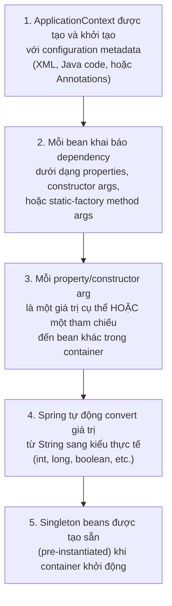
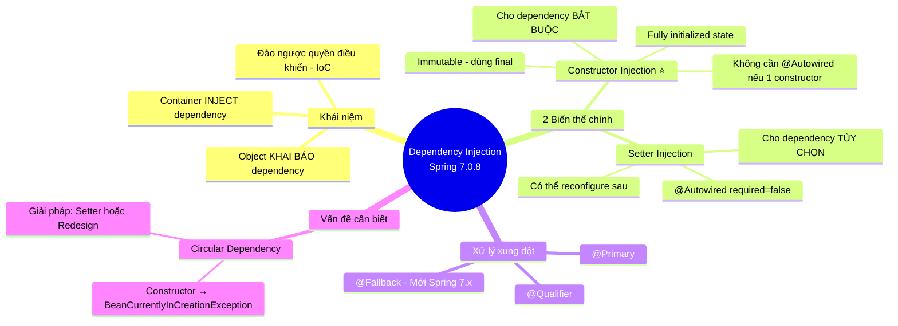

# 📘 Dependency Injection — Spring Framework 7.0.8

> **Nguồn chính thống:** [Spring Framework 7.0.8 — Dependency Injection](https://docs.spring.io/spring-framework/reference/core/beans/dependencies/factory-collaborators.html)
>
> **Thuộc roadmap:** `2. Spring Framework → Core → Dependency Injection`

---

## 1. Định nghĩa chính thức từ Spring Docs

> *"Dependency injection (DI) is a process whereby objects define their dependencies (that is, the other objects with which they work) **only through constructor arguments, arguments to a factory method, or properties that are set on the object instance** after it is constructed or returned from a factory method. The **container then injects those dependencies** when it creates the bean."*
>
> *"This process is fundamentally the inverse (hence the name, **Inversion of Control**) of the bean itself controlling the instantiation or location of its dependencies on its own by using direct construction of classes or the **Service Locator pattern**."*

### Dịch & giải thích đơn giản:

**Dependency Injection (DI)** là một quá trình trong đó các object **chỉ khai báo** những dependency (object khác mà nó cần) thông qua:
1. **Tham số của Constructor**
2. **Tham số của Factory method**
3. **Setter methods** (thuộc tính được set sau khi object được tạo)

Và **Spring IoC Container** sẽ là "nhà quản lý" chịu trách nhiệm **inject (tiêm)** các dependency đó vào khi nó tạo bean.

> [!IMPORTANT]
> Quá trình này là **đảo ngược hoàn toàn** (Inversion of Control — IoC) so với cách truyền thống, nơi mà chính bean tự mình kiểm soát việc tạo hoặc tìm kiếm các dependency bằng cách dùng `new` trực tiếp hoặc Service Locator pattern.

---

## 2. Tại sao cần DI?

Tài liệu Spring viết:

> *"Code is cleaner with the DI principle, and decoupling is more effective when objects are provided with their dependencies. The object does not look up its dependencies and does not know the location or class of the dependencies. As a result, your classes become **easier to test**, particularly when the dependencies are on **interfaces or abstract base classes**, which allow for stub or mock implementations to be used in unit tests."*

### Tóm lại, DI giúp:

| Lợi ích | Giải thích |
|---------|------------|
| **Code sạch hơn** | Object không cần biết dependency được tạo từ đâu, như thế nào |
| **Decoupling (Giảm kết dính)** | Class không phụ thuộc vào implementation cụ thể, mà phụ thuộc vào interface/abstract class |
| **Dễ test** | Khi dependency là interface, bạn có thể truyền vào mock/stub object để test |
| **Dễ bảo trì** | Thay đổi implementation mà không cần sửa class sử dụng nó |

---

## 3. Hai biến thể chính của DI (theo tài liệu Spring 7.0.8)

Tài liệu Spring nêu rõ:

> *"DI exists in two major variants: **Constructor-based dependency injection** and **Setter-based dependency injection**."*

---

### 3.1 Constructor-based Dependency Injection ⭐ (Khuyến nghị chính)

> *"Constructor-based DI is accomplished by the container invoking a constructor with a number of arguments, each representing a dependency."*

**Ví dụ từ docs chính thống (Java):**

```java
public class SimpleMovieLister {

    // SimpleMovieLister has a dependency on a MovieFinder
    private final MovieFinder movieFinder;

    // a constructor so that the Spring container can inject a MovieFinder
    public SimpleMovieLister(MovieFinder movieFinder) {
        this.movieFinder = movieFinder;
    }

    // business logic that actually uses the injected MovieFinder is omitted...
}
```

> [!NOTE]
> Spring Docs nhấn mạnh: *"Notice that there is nothing special about this class. It is a **POJO** that has no dependencies on container specific interfaces, base classes, or annotations."*
>
> → Class này hoàn toàn là Java thuần túy (POJO — Plain Old Java Object), **không phụ thuộc vào bất kỳ interface, base class, hay annotation nào của Spring Container**.

#### Constructor Argument Resolution (Giải quyết tham số Constructor)

Khi constructor có **nhiều tham số**, Spring dùng 3 cách để xác định đúng tham số:

**Cách 1: Type matching (Tự động theo kiểu dữ liệu)**
```java
public class ThingOne {
    public ThingOne(ThingTwo thingTwo, ThingThree thingThree) {
        // ...
    }
}
```
```xml
<beans>
    <bean id="beanOne" class="x.y.ThingOne">
        <constructor-arg ref="beanTwo"/>
        <constructor-arg ref="beanThree"/>
    </bean>
    <bean id="beanTwo" class="x.y.ThingTwo"/>
    <bean id="beanThree" class="x.y.ThingThree"/>
</beans>
```
→ Nếu `ThingTwo` và `ThingThree` không có quan hệ kế thừa, Spring tự match theo kiểu dữ liệu.

**Cách 2: Chỉ định `type` hoặc `index` (khi có kiểu simple như int, String)**
```java
public class ExampleBean {
    private final int years;
    private final String ultimateAnswer;

    public ExampleBean(int years, String ultimateAnswer) {
        this.years = years;
        this.ultimateAnswer = ultimateAnswer;
    }
}
```

```xml
<!-- Dùng type -->
<bean id="exampleBean" class="examples.ExampleBean">
    <constructor-arg type="int" value="7500000"/>
    <constructor-arg type="java.lang.String" value="42"/>
</bean>

<!-- Hoặc dùng index (bắt đầu từ 0) -->
<bean id="exampleBean" class="examples.ExampleBean">
    <constructor-arg index="0" value="7500000"/>
    <constructor-arg index="1" value="42"/>
</bean>

<!-- Hoặc dùng name -->
<bean id="exampleBean" class="examples.ExampleBean">
    <constructor-arg name="years" value="7500000"/>
    <constructor-arg name="ultimateAnswer" value="42"/>
</bean>
```

> [!TIP]
> Khi dùng `name`, bạn cần compile code với flag `-parameters` để Spring có thể đọc tên parameter từ constructor. Hoặc dùng annotation `@ConstructorProperties`:
> ```java
> @ConstructorProperties({"years", "ultimateAnswer"})
> public ExampleBean(int years, String ultimateAnswer) {
>     this.years = years;
>     this.ultimateAnswer = ultimateAnswer;
> }
> ```

---

### 3.2 Setter-based Dependency Injection

> *"Setter-based DI is accomplished by the container calling setter methods on your beans **after invoking a no-argument constructor** or a no-argument static factory method to instantiate your bean."*

**Ví dụ từ docs chính thống (Java):**

```java
public class SimpleMovieLister {

    // the SimpleMovieLister has a dependency on the MovieFinder
    private MovieFinder movieFinder;

    // a setter method so that the Spring container can inject a MovieFinder
    public void setMovieFinder(MovieFinder movieFinder) {
        this.movieFinder = movieFinder;
    }

    // business logic that actually uses the injected MovieFinder is omitted...
}
```

**Cấu hình XML:**
```xml
<bean id="exampleBean" class="examples.ExampleBean">
    <!-- setter injection using the nested ref element -->
    <property name="beanOne">
        <ref bean="anotherExampleBean"/>
    </property>

    <!-- setter injection using the neater ref attribute -->
    <property name="beanTwo" ref="yetAnotherBean"/>
    <property name="integerProperty" value="1"/>
</bean>

<bean id="anotherExampleBean" class="examples.AnotherBean"/>
<bean id="yetAnotherBean" class="examples.YetAnotherBean"/>
```

---

## 4. Constructor vs Setter — Khi nào dùng cái nào? (Quan điểm chính thức của Spring Team)

> [!IMPORTANT]
> Đây là phần rất quan trọng, trích nguyên văn từ tài liệu Spring 7.0.8:

> *"The Spring team **generally advocates constructor injection**, as it lets you implement application components as **immutable objects** and ensures that **required dependencies are not `null`**. Furthermore, constructor-injected components are always returned to the client (calling) code in a **fully initialized state**."*

> *"As a side note, a large number of constructor arguments is a **bad code smell**, implying that the class likely has **too many responsibilities** and should be refactored to better address proper separation of concerns."*

> *"Setter injection should primarily only be used for **optional dependencies** that can be assigned reasonable default values within the class."*

### Bảng tổng kết:

| Tiêu chí | Constructor Injection ⭐ | Setter Injection |
|----------|------------------------|------------------|
| **Khi nào dùng** | Cho dependency **bắt buộc** | Cho dependency **tùy chọn** (optional) |
| **Immutability** | ✅ Có thể dùng `final` → Object bất biến | ❌ Không thể `final`, có thể bị thay đổi |
| **Null safety** | ✅ Đảm bảo dependency luôn not-null | ❌ Cần kiểm tra null ở mọi nơi sử dụng |
| **Trạng thái khi nhận** | ✅ Object luôn **fully initialized** | ⚠️ Object có thể ở trạng thái chưa đầy đủ |
| **Reconfiguration** | ❌ Không thể thay đổi sau khi tạo | ✅ Có thể re-inject / re-configure sau |
| **JMX MBeans** | ❌ | ✅ Phù hợp cho quản lý qua JMX |

---

## 5. Quy trình giải quyết Dependency (Dependency Resolution Process)

Tài liệu Spring 7.0.8 mô tả quy trình như sau:



> [!WARNING]
> ### Circular Dependencies (Phụ thuộc vòng tròn)
>
> Nếu dùng **Constructor Injection**, có thể xảy ra tình huống:
> - Class A cần Class B qua constructor
> - Class B cần Class A qua constructor
> - → Spring sẽ throw `BeanCurrentlyInCreationException` tại runtime!
>
> **Giải pháp:** Dùng **Setter Injection** cho một trong hai class để phá vỡ vòng tròn. Tuy nhiên, docs ghi rõ đây là giải pháp *"not recommended"* — tốt nhất nên **redesign** để tránh circular dependency.

---

## 6. Cách làm thực tế với Spring Boot 4.1.0 (Annotation-based — Cách hiện đại)

Mặc dù docs giải thích cả XML, nhưng trong thực tế với **Spring Boot 4.1.0**, bạn sẽ dùng **Annotation** là chủ yếu. Dưới đây là cách áp dụng DI hiện đại:

### 6.1 Constructor Injection (Recommended — Không cần `@Autowired` nếu chỉ có 1 constructor)

```java
@Service
public class MovieService {

    private final MovieRepository movieRepository;
    private final NotificationService notificationService;

    // Spring 7.0.8: Nếu class chỉ có DUY NHẤT 1 constructor,
    // Spring TỰ ĐỘNG inject mà KHÔNG CẦN @Autowired
    public MovieService(MovieRepository movieRepository, 
                        NotificationService notificationService) {
        this.movieRepository = movieRepository;
        this.notificationService = notificationService;
    }

    public Movie findMovie(String title) {
        return movieRepository.findByTitle(title);
    }
}
```

```java
@Repository
public class MovieRepository {
    public Movie findByTitle(String title) {
        // truy vấn database...
        return new Movie(title);
    }
}
```

```java
@Service
public class NotificationService {
    public void sendNotification(String message) {
        System.out.println("Notification: " + message);
    }
}
```

> [!TIP]
> **Trong Spring Framework 7.0.8**, nếu class chỉ có **1 constructor duy nhất**, annotation `@Autowired` là **không bắt buộc**. Spring tự động nhận diện và inject. Đây là best practice hiện tại.

### 6.2 Setter Injection (Cho optional dependencies)

```java
@Service
public class MovieService {

    private final MovieRepository movieRepository;
    private MovieCacheService cacheService; // Optional dependency

    public MovieService(MovieRepository movieRepository) {
        this.movieRepository = movieRepository;
    }

    // Optional: nếu không có MovieCacheService bean, service vẫn hoạt động
    @Autowired(required = false)
    public void setCacheService(MovieCacheService cacheService) {
        this.cacheService = cacheService;
    }

    public Movie findMovie(String title) {
        if (cacheService != null) {
            Movie cached = cacheService.get(title);
            if (cached != null) return cached;
        }
        return movieRepository.findByTitle(title);
    }
}
```

### 6.3 Field Injection (⚠️ Không khuyến khích trong Spring 7.x)

```java
@Service
public class MovieService {

    @Autowired  // ⚠️ Hoạt động nhưng KHÔNG được khuyến khích
    private MovieRepository movieRepository;
}
```

> [!CAUTION]
> **Field Injection** không được Spring Team khuyến khích vì:
> - Không thể khai báo `final` → mất immutability
> - Khó viết unit test (phải dùng Reflection hoặc framework đặc biệt)
> - Che giấu dependency → khó nhìn thấy class phụ thuộc vào bao nhiêu thứ

---

## 7. Xử lý khi có nhiều Bean cùng kiểu (Disambiguation)

Khi có **nhiều bean cùng implement một interface**, Spring không biết inject cái nào. Spring 7.0.8 cung cấp các annotation để giải quyết:

### `@Primary` — Đánh dấu bean ưu tiên
```java
@Configuration
public class AppConfig {

    @Bean
    @Primary  // Bean này sẽ được ưu tiên inject
    public MovieRepository primaryRepo() {
        return new JpaMovieRepository();
    }

    @Bean
    public MovieRepository secondaryRepo() {
        return new InMemoryMovieRepository();
    }
}
```

### `@Qualifier` — Chỉ định chính xác bean nào
```java
@Service
public class MovieService {

    private final MovieRepository movieRepository;

    public MovieService(@Qualifier("secondaryRepo") MovieRepository movieRepository) {
        this.movieRepository = movieRepository;
    }
}
```

### `@Fallback` (Mới trong Spring 7.0.x) — Bean dự phòng
```java
@Bean
@Fallback  // Chỉ được dùng khi không có bean nào khác
public MovieRepository fallbackRepo() {
    return new InMemoryMovieRepository();
}
```

---

## 8. Tóm tắt kiến thức cốt lõi



---

## 9. Tổng hợp các chủ đề Dependency Injection (Bản đồ tra cứu)

Để làm chủ hoàn toàn DI trong Spring, dưới đây là danh sách các kỹ thuật từ cơ bản đến nâng cao. Hãy dùng nó làm kim chỉ nam khi tra cứu:

### 🌟 9.1. Những kỹ thuật ƯU TIÊN PHẢI BIẾT TRƯỚC (Bắt buộc khi đi làm)
1. **Lombok `@RequiredArgsConstructor` + `final`:** Kỹ thuật cực kỳ phổ biến ở 99% các công ty để viết Constructor Injection siêu ngắn gọn mà không cần tự gõ code hàm Constructor.
2. **`@Value` (Property Injection):** Tiêm các giá trị cấu hình (ví dụ URL database, secret key) từ file `application.yml` vào các biến trong class.
3. **`@Qualifier` / `@Primary`:** Giải quyết xung đột khi có nhiều Bean cùng loại (như đã học ở trên).

### 🟡 9.2. Nhóm kỹ thuật Trung cấp (Tùy biến hành vi DI)
1. **Bean Scopes:** Hiểu rõ các phạm vi tồn tại của Bean (`Singleton`, `Prototype`, `Request`, `Session`) và cách chúng bị ảnh hưởng khi được inject vào nhau.
2. **Lazy Injection (`@Lazy`, `ObjectProvider`):** Kỹ thuật trì hoãn việc khởi tạo và tiêm Bean cho đến tận lúc Bean đó thực sự được gọi hàm (rất hữu ích để giảm tải lúc khởi động hoặc phá vỡ lỗi vòng tròn Circular Dependency).
3. **Method Injection (Lookup Method):** Kỹ thuật tiêm một Bean có scope `Prototype` (mỗi lần gọi là 1 object mới) vào trong một Bean `Singleton` (một bài toán phỏng vấn cực kỳ hay gặp).

### 🔴 9.3. Nhóm kỹ thuật Nâng cao (Kiến trúc chuẩn hóa)
1. **Custom Qualifier Annotations:** Tự định nghĩa ra các Annotation phân loại của riêng bạn thay vì dùng `@Qualifier("chuoi-string")` để tránh lỗi gõ sai chữ (Type-safe DI).
2. **JSR-330 Standard Annotations (`@Inject`, `@Named`):** Dùng các Annotation chuẩn của Java EE thay vì annotation `@Autowired` của Spring để code của bạn "sạch" hơn và không bị trói buộc vĩnh viễn vào framework Spring.

## 📚 Tài liệu tham khảo chính thống

| Tài liệu | Link |
|-----------|------|
| Spring 7.0.8 — Introduction to IoC Container and Beans | [docs.spring.io](https://docs.spring.io/spring-framework/reference/core/beans/introduction.html) |
| Spring 7.0.8 — Dependency Injection | [docs.spring.io](https://docs.spring.io/spring-framework/reference/core/beans/dependencies/factory-collaborators.html) |
| Spring 7.0.8 — Using @Autowired | [docs.spring.io](https://docs.spring.io/spring-framework/reference/core/beans/annotation-config/autowired.html) |
| Spring 7.0.8 — @Primary and @Fallback | [docs.spring.io](https://docs.spring.io/spring-framework/reference/core/beans/annotation-config/autowired-primary.html) |
| Spring 7.0.8 — @Qualifier | [docs.spring.io](https://docs.spring.io/spring-framework/reference/core/beans/annotation-config/autowired-qualifiers.html) |

---

> **Tiếp theo trong roadmap:** `Inversion of Control` (chúng ta đã chạm vào khái niệm này rồi, bước tiếp theo sẽ đi sâu hơn vào IoC Container — `BeanFactory` & `ApplicationContext`)

> **Lưu ý khi dùng scope:**
    - @RequestScope dùng để chia sẻ dữ liệu xuyên suốt các tầng trong cùng 1 request.
    - @SessionScope dùng để chia sẻ dữ liệu xuyên suốt trong 1 session.
    - Prototype dùng để tạo ra các công cụ tính toán tách biệt hoàn toàn, không muốn dùng chung với bất kỳ ai (dù là cùng request).