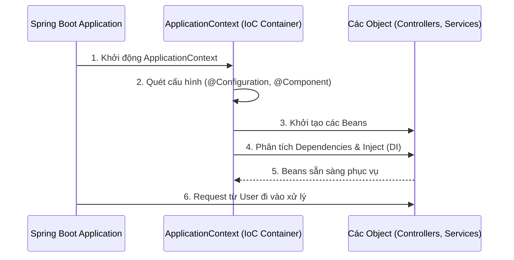

# 🔄 Inversion of Control (IoC) & IoC Container — Spring Framework 7.0.8

> **Nguồn chính thống:** [Spring Framework 7.0.8 — The IoC Container](https://docs.spring.io/spring-framework/reference/core/beans/introduction.html)
>
> **Thuộc roadmap:** `2. Spring Framework → Core → Inversion of Control` & `Bean Factory & Application Context`

---

## 1. Định nghĩa chính thức từ Spring Docs

> *"This chapter covers the Spring Framework implementation of the Inversion of Control (IoC) principle. IoC is also known as dependency injection (DI). It is a process whereby objects define their dependencies... The container then injects those dependencies when it creates the bean. This process is fundamentally the inverse (hence the name, Inversion of Control) of the bean itself controlling the instantiation or location of its dependencies..."*

### Dịch & giải thích đơn giản:
**Inversion of Control (IoC - Đảo ngược quyền điều khiển)** là một nguyên lý thiết kế phần mềm. 
Bình thường, trong lập trình truyền thống, code của bạn (class A) sẽ tự đi khởi tạo class B (ví dụ `B b = new B()`). Bạn hoàn toàn **kiểm soát** việc tạo ra các object.
Với IoC, quyền kiểm soát này bị **đảo ngược**. Bạn giao phó toàn bộ việc khởi tạo, quản lý vòng đời, và hủy bỏ object cho một hệ thống bên ngoài gọi là **IoC Container** (trong Spring). 

---

## 2. Spring IoC Container là gì?

> *"The `org.springframework.context.ApplicationContext` interface represents the Spring IoC container and is responsible for instantiating, configuring, and assembling the beans."*

**IoC Container** giống như một "nhà máy" hoặc một "người quản lý" khổng lồ. 
Nhiệm vụ của nó là:
1. Đọc các file cấu hình (Annotations, Java Config, XML).
2. Khởi tạo các object (trong Spring gọi là **Beans**).
3. Lắp ráp chúng lại với nhau (thực hiện Dependency Injection).
4. Quản lý toàn bộ vòng đời của chúng từ khi sinh ra đến khi chết đi.

---

## 3. BeanFactory vs ApplicationContext

Trong Spring 7.0.8, có hai interface chính đại diện cho IoC Container. Vậy sự khác biệt là gì?

### `BeanFactory`
- Là interface cơ sở, cung cấp cơ chế cấu hình và quản lý bean cơ bản nhất.
- Hỗ trợ **Lazy Initialization** (khi nào gọi `getBean()` thì mới khởi tạo).
- Tiết kiệm bộ nhớ, nhưng thiếu nhiều tính năng cao cấp. Ít được sử dụng trực tiếp trong các ứng dụng thực tế hiện nay.

### `ApplicationContext`
- Là một interface kế thừa (sub-interface) từ `BeanFactory`.
- Tự động khởi tạo tất cả Singleton Beans ngay khi ứng dụng khởi động (**Eager Initialization**).
- **Tích hợp thêm vô vàn tính năng doanh nghiệp:**
  - Xử lý Message resource (i18n, đa ngôn ngữ).
  - Tích hợp Event publication (Pub/Sub cơ bản).
  - Tích hợp AOP (Aspect-Oriented Programming).
  - Các ngữ cảnh chuyên biệt (ví dụ `WebApplicationContext` cho Web).

> [!IMPORTANT]
> **Khuyến nghị từ Spring 7.x:** Luôn luôn sử dụng `ApplicationContext` trừ khi bạn đang viết ứng dụng cho thiết bị cực kỳ hạn chế bộ nhớ (như IoT siêu nhỏ). Trong Spring Boot 4.1.0, container mặc định luôn là một implementation của `ApplicationContext`.

---

## 🔥 Ứng dụng thực tế (Thực tế dùng để làm gì? Giải quyết vấn đề gì?)

*Mục này giải thích giá trị thực tế của IoC Container trong môi trường dự án.*

### Vấn đề khi không có IoC Container
Giả sử bạn có ứng dụng thương mại điện tử: `OrderController` gọi `OrderService`, `OrderService` gọi `PaymentService` và `InventoryRepository`.

```java
// Lập trình truyền thống (KHÔNG CÓ IoC)
public class OrderService {
    // Tự khởi tạo thủ công (Tight Coupling)
    private PaymentService paymentService = new MomoPaymentService();
    private InventoryRepository inventoryRepo = new MySQLInventoryRepository();
    
    // ... logic xử lý ...
}
```
**Nỗi đau thực tế:**
1. **Khó bảo trì & Thay đổi:** Nếu sếp yêu cầu đổi từ MoMo sang VNPay, bạn phải chui vào code của `OrderService` tìm và sửa `new MomoPaymentService()` thành `new VNPayService()`. Dẫn đến rủi ro sinh ra lỗi mới (regression bug) ở những chỗ không liên quan.
2. **Khó viết Unit Test:** Không thể dễ dàng thay thế `MySQLInventoryRepository` bằng một Database giả (Mock Object) để test riêng rẻ `OrderService`.
3. **Quản lý tài nguyên kém:** Mỗi lần cần gọi service là một lần `new`, tốn bộ nhớ vô ích. Việc tự quản lý object dùng chung (Singleton) bằng tay rất phức tạp.

### Giải quyết vấn đề bằng Spring IoC Container
Bây giờ, bạn vứt bỏ hoàn toàn từ khóa `new`. Bạn chỉ cần "khai báo" những gì bạn muốn:

```java
@Service
public class OrderService {
    
    private final PaymentService paymentService;
    private final InventoryRepository inventoryRepo;

    // Chỉ cần khai báo Constructor, IoC Container sẽ tự nhét dependency vào!
    public OrderService(PaymentService paymentService, InventoryRepository inventoryRepo) {
        this.paymentService = paymentService;
        this.inventoryRepo = inventoryRepo;
    }
}
```

**Thực tế IoC Container đang làm gì ngầm bên dưới ở Spring Boot 4.1.0?**
Khi bạn chạy `SpringApplication.run()`, IoC Container (đại diện là `ApplicationContext`) thức dậy và làm những việc sau:
1. **Quét (Scan):** Chạy khắp project tìm các class có gắn biển `@Service`, `@Repository`, `@Controller`...
2. **Khởi tạo & Lưu trữ:** Container thấy `PaymentService` (có thể là MomoPaymentService) và `MySQLInventoryRepository`, nó sẽ đại diện bạn dùng từ khóa `new` tạo ra các object này ở hậu trường và ném vào một cái "Kho" (đó chính là Container).
3. **Tiêm (Inject - Lắp ráp):** Container thấy `OrderService` cần `PaymentService`. Nó tự động vào "Kho", lôi object MomoPayment ra và truyền (inject) vào constructor của `OrderService`.

**Thành quả thực tế mang lại:**
- **Loose Coupling (Kết dính lỏng lẻo):** Khi đổi sang VNPay, bạn chỉ cần tạo class `VNPayService` và gắn annotation. Bạn có thể xóa MoMo đi hoặc đánh dấu VNPay bằng `@Primary`. `OrderService` **không hề biết và không phải sửa 1 dòng code nào**.
- **Hiệu năng cao:** Các object mặc định được Spring tạo một lần duy nhất (Singleton) ở lúc khởi động và dùng chung cho hàng triệu request, tối ưu bộ nhớ tuyệt đối.

---

## 4. Tóm tắt luồng hoạt động của IoC


---

## 5. Tổng hợp các chủ đề IoC Container (Bản đồ tra cứu)

Inversion of Control là trái tim của Spring. Dưới đây là bức tranh toàn cảnh để bạn tra cứu khi muốn đào sâu hơn:

### 🌟 5.1. Những khái niệm ƯU TIÊN PHẢI BIẾT TRƯỚC (Bắt buộc khi đi làm)
1. **Phân biệt rạch ròi 4 chữ:** Cùng là đánh dấu một class thành Bean, nhưng bạn phải biết chính xác khi nào dùng `@Component` (Component chung chung), `@Service` (Tầng Logic nghiệp vụ), `@Repository` (Tầng tương tác Database), `@Controller` (Tầng tiếp nhận API).
2. **Cơ chế `@ComponentScan`:** Hiểu cách Spring chạy lùng sục các thư mục để tìm Bean. Giúp bạn tránh được lỗi kinh điển nhất của newbie: *"Viết class đúng hết rồi nhưng tạo sai vị trí thư mục nên Spring quét không thấy"*.

### 🟡 5.2. Nhóm kiến trúc Trung cấp (Cấu hình linh hoạt)
1. **`@Configuration` & `@Bean`:** Khai báo Bean bằng Java code thay vì dùng Annotation gắn trực tiếp trên class (rất hay dùng khi cần khởi tạo các class thuộc thư viện bên ngoài mà bạn không thể sửa code để gắn `@Service` vào được).
2. **Conditional Beans (`@Conditional`, `@ConditionalOnProperty`):** Dạy cho IoC Container thông minh hơn: *"Chỉ khởi tạo Bean này nếu người dùng có bật một cấu hình tương ứng trong file properties"*. Đây chính là nền tảng cốt lõi làm nên phép màu tự động cấu hình (Auto-configuration) của Spring Boot.

### 🔴 5.3. Nhóm kiến trúc Nâng cao (Can thiệp vào lõi Spring)
1. **`BeanPostProcessor` & `BeanFactoryPostProcessor`:** Hai interface quyền lực nhất cho phép bạn "độ" lại hệ thống. Bạn có thể nhảy vào giữa quá trình Spring đang tạo Bean, lấy cái Bean đó ra, chỉnh sửa nó (ví dụ bọc nó bằng một Proxy để theo dõi) rồi mới trả lại cho Container.
2. **`ApplicationEventPublisher` (Event/Listener Pattern):** Thay vì các class gọi hàm trực tiếp của nhau, bạn bắt IoC Container làm "Bưu điện". Class A bắn ra một sự kiện (Event), Class B, C ngồi nghe (Listener) và tự động phản ứng. Giúp kiến trúc cực kỳ lỏng lẻo (Decoupled).

## 📚 Tài liệu tham khảo chính thống

| Tài liệu | Link |
|-----------|------|
| Spring 7.0.8 — The IoC Container | [docs.spring.io](https://docs.spring.io/spring-framework/reference/core/beans/introduction.html) |
| Spring 7.0.8 — BeanFactory API | [docs.spring.io](https://docs.spring.io/spring-framework/reference/core/beans/beanfactory.html) |
| Spring Boot 4.1.0 — Application Startup | [docs.spring.io](https://docs.spring.io/spring-boot/reference/core/spring-application.html) |

---

> **Tiếp theo trong roadmap:** `Bean Life Cycle` (Chúng ta sẽ tìm hiểu xem từ lúc Bean được IoC Container sinh ra đến lúc chết đi, nó trải qua những sự kiện gì và làm sao để can thiệp vào các sự kiện đó).
