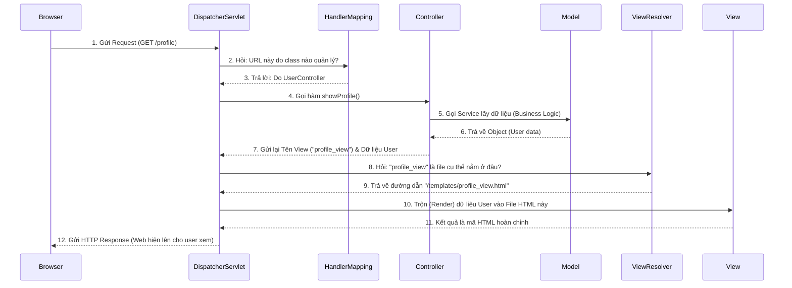

# 🏗️ Cấu trúc Spring MVC (Model - View - Controller)

> **Nguồn chính thống:** [Spring Framework 7.0.8 — Spring Web MVC](https://docs.spring.io/spring-framework/reference/web/webmvc.html)
>
> **Thuộc roadmap:** `2. Spring Framework → Web → MVC Structure`

---

## 1. MVC là gì?
**MVC** (Model - View - Controller) là một mẫu kiến trúc phần mềm được sử dụng rất phổ biến trong việc thiết kế giao diện người dùng và các ứng dụng Web. Mục đích cốt lõi của MVC là **phân tách mối quan tâm (Separation of Concerns)**:
- **M (Model):** Đại diện cho dữ liệu của ứng dụng và các quy tắc nghiệp vụ (Business Logic). Nó chịu trách nhiệm lấy dữ liệu từ Database, tính toán, và đóng gói lại.
- **V (View):** Chịu trách nhiệm hiển thị giao diện người dùng. Nó nhận dữ liệu từ Model và render (vẽ) ra HTML/JSON/XML để trả về cho người dùng xem.
- **C (Controller):** Là "bộ não" điều phối. Nó tiếp nhận các Request từ người dùng (click nút, submit form, gõ URL), gọi Model để lấy/xử lý dữ liệu, sau đó chọn View thích hợp để hiển thị dữ liệu đó ra.

---

## 2. Spring MVC hoạt động như thế nào? (Bí mật của DispatcherServlet)

Trong Spring 7.0.8, Spring MVC được thiết kế xung quanh một khái niệm cốt lõi gọi là **Front Controller Pattern**, được hiện thực hóa bởi một class tên là `DispatcherServlet`.

> *"Spring MVC, like many other web frameworks, is designed around the front controller pattern where a central Servlet, the `DispatcherServlet`, provides a shared algorithm for request processing..."*

Thay vì mỗi một URL của bạn đều trỏ tới một điểm xử lý (Servlet) riêng lẻ, tất cả mọi HTTP Request bay vào server của bạn đều phải đi qua "Cửa khẩu chính" là `DispatcherServlet`. Sau đó, `DispatcherServlet` mới xem xét và "chia bài" (dispatch) cho các Controller cụ thể của bạn.

---

## 3. Ba thành phần M-V-C trong thế giới Spring Boot 4.1.0 hiện đại

Thời xưa, Spring MVC chủ yếu dùng để render ra các trang HTML (dùng JSP, Thymeleaf). Ngày nay, với sự lên ngôi của React/Vue/Mobile App, mô hình này thường biến thể thành **RESTful Web Services**. 

Dưới đây là cách ánh xạ kiến trúc MVC vào cấu trúc thư mục code thực tế của dự án:

### Ⓜ️ Model
Không chỉ là một Class (như `User`, `Product`), mà nó bao gồm toàn bộ tầng xử lý nghiệp vụ ở phía dưới:
- **Entity / DTO:** Các object thuần chứa dữ liệu.
- **Service (`@Service`):** Chứa business logic (ví dụ: tính toán giảm giá, kiểm tra mật khẩu, validate).
- **Repository (`@Repository`):** Tầng giao tiếp với Database (ví dụ: Spring Data JPA).

### 🇻 View
- **Trường hợp MVC truyền thống (Server-side rendering):** View là các file giao diện (Thymeleaf `.html`, JSP). Dữ liệu từ Server sẽ được nhúng thẳng vào file HTML trước khi trả về trình duyệt.
- **Trường hợp REST API (Phổ biến nhất):** Khái niệm View truyền thống (HTML) biến mất. Thay vào đó, Spring dùng các thư viện (như Jackson) để tự động chuyển đổi Model thành một chuỗi **JSON**. Tầng Frontend (React/Vue) ở một server khác sẽ tự nhận JSON đó và vẽ giao diện.

### ©️ Controller
- Các class được đánh dấu `@Controller` (dành cho view HTML) hoặc `@RestController` (dành cho API trả về JSON).
- Là nơi định nghĩa các đường dẫn URL (Endpoints) qua các annotation như `@GetMapping`, `@PostMapping`.

---

## 🔥 Ứng dụng thực tế (Thực tế dùng để làm gì? Giải quyết vấn đề gì?)

*Tại sao chúng ta phải chia code ra thành 3 cục M, V, và C lằng nhằng như vậy? Sao không nhét tất cả vào một file chạy cho lẹ?*

### Nỗi đau nếu KHÔNG dùng MVC:
Giả sử bạn cần làm tính năng "Lấy thông tin User và hiển thị lên Web". 
Nếu code gộp chung (Spaghetti code) giống như thời viết PHP/Servlet cổ điển:
- Trong cùng một class: Bạn vừa kết nối SQL (`SELECT * FROM users`), vừa viết vòng lặp `for`, vừa `print` ra các thẻ HTML `<table>`, `<tr>`, `<td>`.
- **Hậu quả:** 
  1. **Bảo trì là ác mộng:** Code backend trộn lẫn thẻ HTML, nhìn cực kỳ rối mắt. Sửa giao diện có khi làm chết logic.
  2. **Làm việc nhóm khó khăn:** Frontend Developer không thể thiết kế giao diện vì HTML bị giấu cứng trong file Java.
  3. **Rất khó mở rộng:** Nếu sếp nói: *"Giờ làm thêm cái App Mobile đi, hệ thống chỉ trả về JSON thôi, không trả HTML nữa"*. Bạn sẽ phải **đập bỏ viết lại toàn bộ** vì logic lấy dữ liệu (SQL) dính chặt với thẻ in HTML rồi!

### Giải pháp tuyệt vời từ Spring MVC:

Kiến trúc MVC giải quyết bài toán trên bằng triết lý **Chia để trị (Separation of Concerns)**:

```java
// 1. MODEL (Chỉ tập trung xử lý Dữ liệu)
@Service
public class UserService {
    public User getUserInfo() {
        return database.findUser(); // Code SQL/JPA nằm yên ở đây, ko dính 1 chữ HTML nào
    }
}
```

```java
// 2. CONTROLLER (Chỉ lo điều phối luồng)
@Controller
public class UserController {
    
    private final UserService userService; // Được IoC Inject tự động

    @GetMapping("/profile")
    public String showProfile(org.springframework.ui.Model model) {
        // Controller đi xin dữ liệu từ Model
        User u = userService.getUserInfo();
        
        // Gói dữ liệu vào một cái hộp để gửi sang View
        model.addAttribute("userData", u);
        
        // Lệnh: "Hãy gọi file giao diện 'profile_view.html' ra để render nhé!"
        return "profile_view"; 
    }
}
```

```html
<!-- 3. VIEW (file profile_view.html) -->
<!-- Developer HTML/CSS cứ thoải mái làm đẹp giao diện ở đây -->
<h1> Xin chào: <span th:text="${userData.name}"></span> </h1>
```

**Giá trị thực tiễn mang lại:**
1. **Phân chia nhân sự rõ ràng:** Team Java Backend chỉ lo viết logic (Model, Controller), team Frontend (UI/UX) chỉ lo code giao diện (View). Không ai dẫm chân ai.
2. **Siêu tái sử dụng:** Hàm `UserService.getUserInfo()` (Model) giờ là độc lập.
   - Trả cho Web truyền thống: Dùng `@Controller` gọi nó và đẩy ra `profile_view.html`.
   - Trả cho App Mobile: Viết thêm 1 class `@RestController` gọi đúng `UserService` đó, và nó sẽ tự trả về JSON `{"name": "Alice"}` mà không phải viết lại lệnh SQL.

---

## 4. Sơ đồ luồng đi của một Request (Bản chất DispatcherServlet)

Để hiểu sâu Spring MVC, bạn phải biết đường đi của Request khi user truy cập `http://localhost:8080/profile`:



> [!NOTE]
> Nếu bạn xây dựng **REST API** (dùng `@RestController`), thì quá trình từ **bước 7 đến 11 sẽ không xảy ra**. Khi đó, Spring sẽ lấy ngay Object ở bước 6, dùng một công cụ (như Jackson `HttpMessageConverter`) để ép kiểu nó thành chuỗi JSON, rồi gửi thẳng về bước 12 luôn.

---

## 5. Tổng hợp các chủ đề Kiến trúc MVC (Bản đồ tra cứu)

Mặc dù 3 chữ M-V-C nghe rất đơn giản, nhưng khi áp dụng vào một dự án thực tế, nó phình to ra với rất nhiều khái niệm bổ trợ. Dưới đây là các mảnh ghép bạn cần lấp đầy:

### 🌟 5.1. Những khái niệm ƯU TIÊN PHẢI BIẾT TRƯỚC (Bắt buộc khi đi làm)
1. **DTO Pattern (Data Transfer Object):** Tuyệt đối KHÔNG BAO GIỜ trả thẳng đối tượng Entity (bản sao cấu trúc Database) ra ngoài View hoặc API. Bạn bắt buộc phải tạo một class DTO trung gian để bọc dữ liệu lại. Đây là nguyên tắc sống còn về bảo mật.
2. **Object Mapping Libraries (MapStruct / ModelMapper):** Vì quy tắc DTO ở trên, bạn sẽ phải copy dữ liệu từ Entity sang DTO rất mỏi tay. Hãy học cách dùng 1 trong 2 thư viện này để Spring tự động copy data sang DTO cho bạn trong 1 nốt nhạc.

### 🟡 5.2. Nhóm kiến trúc Trung cấp (Xử lý các tình huống đặc biệt)
1. **`MultipartResolver`:** Thành phần chuyên xử lý các Request có đính kèm file (Upload hình ảnh, tài liệu).
2. **`LocaleResolver` & `ThemeResolver`:** Dùng để chuyển đổi đa ngôn ngữ (Tiếng Anh/Tiếng Việt) hoặc giao diện (Dark Mode/Light Mode) ngay lập tức dựa trên thông tin Request gửi lên.
3. **`Flash Attributes`:** Kỹ thuật giấu dữ liệu tạm thời khi bạn thực hiện Redirect (chuyển hướng trang) sau khi submit form thành công (để tránh lỗi user bấm F5 thì form bị submit lại 2 lần).

### 🔴 5.3. Nhóm kiến trúc Nâng cao (Tối ưu & Tùy biến sâu)
1. **Servlet FilterChain:** Hiểu cách Spring Boot nhúng `DispatcherServlet` vào bên trong một chuỗi các Filter bảo mật khổng lồ (Spring Security Filter Chain) trước khi Request thực sự chạm được tới Controller.
2. **Tùy chỉnh `ViewResolver`:** Không chỉ trả về HTML, bạn có thể dạy cho ViewResolver cách lấy dữ liệu Model và xuất thẳng ra một file **PDF** hoặc **Excel** để trình duyệt tải về.
3. **Async Request Processing:** Thiết kế Controller trả về `Callable` hoặc `DeferredResult` để không giữ kết nối đồng bộ, giúp Server chịu được lượng tải khổng lồ khi một API bị kẹt xử lý quá lâu.

## 📚 Tài liệu tham khảo chính thống

| Tài liệu | Link |
|-----------|------|
| Spring 7.0.8 — DispatcherServlet | [docs.spring.io](https://docs.spring.io/spring-framework/reference/web/webmvc/mvc-servlet.html) |
| Spring 7.0.8 — Annotated Controllers | [docs.spring.io](https://docs.spring.io/spring-framework/reference/web/webmvc/mvc-controller.html) |

---

> **Tiếp theo trong roadmap:** `Configurations` (Cách cấu hình một dự án Spring MVC / Spring Boot để các thành phần này hoạt động trơn tru với nhau).
