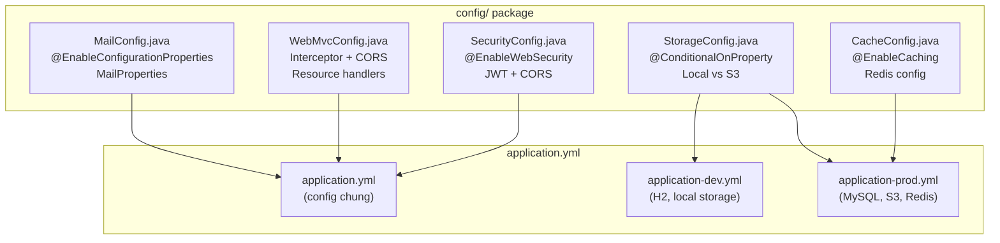
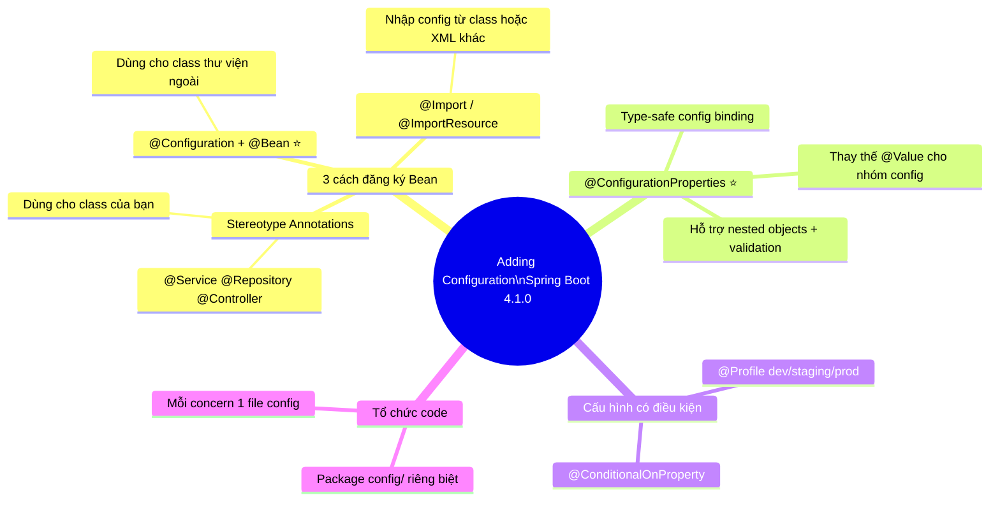

# 🛠️ Adding Configuration — Spring Boot 4.1.0

> **Nguồn chính thống:** [Spring Boot 4.1.0 — Configuration Classes](https://docs.spring.io/spring-boot/reference/using/configuration-classes.html)
>
> **Thuộc roadmap:** `3. Spring Boot → Adding Configuration`

---

## 1. Định nghĩa chính thức từ Spring Boot Docs

> *"Spring Boot **favors Java-based configuration**. Although it is possible to use `SpringApplication` with XML sources, we generally recommend that your primary source be a **single `@Configuration` class**. Usually the class that defines the `main` method is a good candidate as the primary `@Configuration`."*
>
> — **Spring Boot 4.1.0 Reference — Configuration Classes**

### Dịch & giải thích đơn giản:

Trong Spring Boot, **"Adding Configuration"** (Thêm cấu hình) là quá trình bạn **tuỳ chỉnh hoặc bổ sung** hành vi của ứng dụng ngoài những gì Auto-configuration đã cung cấp sẵn.

Spring Boot ưu tiên sử dụng **Java-based configuration** (cấu hình bằng code Java) thay vì XML. Điều này mang lại:
- **Type-safe**: IDE báo lỗi ngay khi viết sai
- **Refactor-friendly**: Đổi tên class/method → tự động cập nhật
- **Dễ debug**: Đặt breakpoint, bước qua từng dòng config

> [!IMPORTANT]
> Spring Boot **KHÔNG bắt buộc** bạn phải thêm cấu hình thủ công cho mọi thứ. Auto-configuration đã lo phần lớn. Bạn chỉ cần thêm configuration khi muốn **tuỳ chỉnh hành vi mặc định** hoặc **đăng ký bean mà Auto-configuration không biết**.

---

## 2. Ba cách thêm Configuration trong Spring Boot

### 2.1 `@Configuration` + `@Bean` — Đăng ký Bean thủ công

Đây là cách phổ biến nhất khi bạn cần tạo Bean từ **class thuộc thư viện bên ngoài** (không thể gắn `@Service` hay `@Component` lên code của họ):

```java
@Configuration
public class AppConfig {

    // Đăng ký RestClient cho gọi API bên ngoài
    @Bean
    public RestClient restClient() {
        return RestClient.builder()
                .baseUrl("https://api.example.com")
                .defaultHeader("Accept", "application/json")
                .requestFactory(new HttpComponentsClientHttpRequestFactory())
                .build();
    }

    // Đăng ký PasswordEncoder cho Spring Security
    @Bean
    public PasswordEncoder passwordEncoder() {
        return new BCryptPasswordEncoder(12);
    }

    // Đăng ký ObjectMapper tuỳ chỉnh cho JSON
    @Bean
    public ObjectMapper objectMapper() {
        ObjectMapper mapper = new ObjectMapper();
        mapper.setSerializationInclusion(JsonInclude.Include.NON_NULL);
        mapper.registerModule(new JavaTimeModule());
        mapper.disable(SerializationFeature.WRITE_DATES_AS_TIMESTAMPS);
        return mapper;
    }
}
```

> [!NOTE]
> **Khi nào dùng `@Bean`?** Khi class bạn muốn đăng ký là **class của thư viện bên ngoài** (bạn không thể sửa source code của nó để gắn `@Component`). Ví dụ: `RestClient`, `ObjectMapper`, `PasswordEncoder`, `DataSource` tuỳ chỉnh, v.v.

### 2.2 Stereotype Annotations — Đăng ký Bean tự động

Khi class là **code của bạn**, dùng stereotype annotations trực tiếp:

```java
@Service       // Đánh dấu class nghiệp vụ → Spring tự tạo Bean
public class OrderService {
    // ...
}

@Repository    // Đánh dấu class truy vấn DB → Spring tự tạo Bean
public class OrderRepository {
    // ...
}

@Controller    // Đánh dấu class xử lý HTTP request → Spring tự tạo Bean
public class OrderController {
    // ...
}

@Component     // Đánh dấu chung cho các class không thuộc 3 loại trên
public class EmailHelper {
    // ...
}
```

| Annotation | Dùng cho | Tính năng đặc biệt |
|-----------|---------|---------------------|
| `@Component` | Class chung | Không có thêm tính năng |
| `@Service` | Tầng nghiệp vụ (Business Logic) | Ngữ nghĩa rõ ràng, dễ đọc |
| `@Repository` | Tầng truy vấn DB | Tự động translate SQL exception → Spring `DataAccessException` |
| `@Controller` | Tầng Web (MVC) | Kết hợp với `@RequestMapping` để xử lý HTTP request |
| `@RestController` | Tầng REST API | `@Controller` + `@ResponseBody` (tự serialize JSON) |

### 2.3 `@Import` — Nhập Configuration class từ nơi khác

Khi bạn muốn tách cấu hình thành nhiều file cho gọn, hoặc nhập config từ một module/thư viện khác:

```java
@Configuration
@Import({SecurityConfig.class, CacheConfig.class, AsyncConfig.class})
public class AppConfig {
    // Class này import thêm 3 file cấu hình khác
}
```

Hoặc khi cần load **cấu hình XML legacy** (chỉ dùng khi bắt buộc):

```java
@Configuration
@ImportResource("classpath:legacy-beans.xml")
public class LegacyConfig {
    // Import file XML cũ vào hệ thống Spring Boot mới
}
```

> [!TIP]
> Tài liệu Spring Boot viết rõ: *"If you absolutely must use XML based configuration, we recommend that you still start with a `@Configuration` class. You can then use `@ImportResource` annotation to load XML configuration files."* — Luôn bắt đầu bằng Java Config, chỉ import XML khi cần tương thích với hệ thống cũ.

---

## 3. Tổ chức Configuration classes trong dự án thực tế

### 3.1 Cấu trúc thư mục khuyến nghị

```
com.example.myapp/
├── MyApplication.java              ← @SpringBootApplication (root package)
├── config/                          ← Thư mục chứa TẤT CẢ configuration
│   ├── SecurityConfig.java          ← Cấu hình Spring Security
│   ├── WebMvcConfig.java            ← Cấu hình CORS, Interceptor, v.v.
│   ├── CacheConfig.java             ← Cấu hình Redis/Cache
│   ├── AsyncConfig.java             ← Cấu hình xử lý bất đồng bộ
│   └── SwaggerConfig.java           ← Cấu hình Swagger/OpenAPI
├── controller/
├── service/
├── repository/
└── entity/
```

### 3.2 Ví dụ: SecurityConfig.java hoàn chỉnh

```java
@Configuration
@EnableWebSecurity
public class SecurityConfig {

    @Bean
    public SecurityFilterChain filterChain(HttpSecurity http) throws Exception {
        return http
            .csrf(csrf -> csrf.disable())
            .authorizeHttpRequests(auth -> auth
                .requestMatchers("/api/public/**").permitAll()
                .requestMatchers("/api/admin/**").hasRole("ADMIN")
                .anyRequest().authenticated()
            )
            .sessionManagement(session -> session
                .sessionCreationPolicy(SessionCreationPolicy.STATELESS)
            )
            .build();
    }

    @Bean
    public PasswordEncoder passwordEncoder() {
        return new BCryptPasswordEncoder();
    }
}
```

### 3.3 Ví dụ: WebMvcConfig.java hoàn chỉnh

```java
@Configuration
public class WebMvcConfig implements WebMvcConfigurer {

    // Cấu hình CORS — cho phép Frontend gọi API
    @Override
    public void addCorsMappings(CorsRegistry registry) {
        registry.addMapping("/api/**")
                .allowedOrigins("http://localhost:3000", "https://myapp.com")
                .allowedMethods("GET", "POST", "PUT", "DELETE")
                .allowedHeaders("*")
                .allowCredentials(true)
                .maxAge(3600);
    }

    // Cấu hình Interceptor — ghi log mọi request
    @Override
    public void addInterceptors(InterceptorRegistry registry) {
        registry.addInterceptor(new RequestLoggingInterceptor())
                .addPathPatterns("/api/**")
                .excludePathPatterns("/api/health");
    }
}
```

### 3.4 Ví dụ: AsyncConfig.java

```java
@Configuration
@EnableAsync
public class AsyncConfig {

    @Bean(name = "taskExecutor")
    public Executor taskExecutor() {
        ThreadPoolTaskExecutor executor = new ThreadPoolTaskExecutor();
        executor.setCorePoolSize(5);
        executor.setMaxPoolSize(10);
        executor.setQueueCapacity(25);
        executor.setThreadNamePrefix("Async-");
        executor.initialize();
        return executor;
    }
}
```

---

## 4. `@ConfigurationProperties` — Type-safe Configuration (⭐ Rất quan trọng)

Đây là cách **hiện đại nhất** để đọc cấu hình từ `application.yml` vào một Java object, thay vì dùng `@Value` từng property một.

### Cách truyền thống (dùng `@Value` — dễ nhưng dễ sai):

```java
@Service
public class EmailService {

    @Value("${mail.host}")        // Gõ sai chuỗi → lỗi runtime, không báo lúc compile
    private String host;

    @Value("${mail.port}")
    private int port;

    @Value("${mail.username}")
    private String username;

    @Value("${mail.password}")
    private String password;
}
```

### Cách hiện đại (dùng `@ConfigurationProperties` — Type-safe):

**Bước 1: Tạo class properties**
```java
@ConfigurationProperties(prefix = "mail")
public class MailProperties {

    private String host;
    private int port;
    private String username;
    private String password;
    private Ssl ssl = new Ssl();    // Nested object!

    // Getters & Setters

    public static class Ssl {
        private boolean enabled;
        private String protocol;
        // Getters & Setters
    }
}
```

**Bước 2: Khai báo trong application.yml**
```yaml
mail:
  host: smtp.gmail.com
  port: 587
  username: myapp@gmail.com
  password: secret
  ssl:
    enabled: true
    protocol: TLSv1.3
```

**Bước 3: Kích hoạt và sử dụng**
```java
@Configuration
@EnableConfigurationProperties(MailProperties.class)
public class MailConfig {

    @Bean
    public JavaMailSender mailSender(MailProperties props) {
        JavaMailSenderImpl sender = new JavaMailSenderImpl();
        sender.setHost(props.getHost());
        sender.setPort(props.getPort());
        sender.setUsername(props.getUsername());
        sender.setPassword(props.getPassword());
        return sender;
    }
}
```

### So sánh `@Value` vs `@ConfigurationProperties`:

| Tiêu chí | `@Value` | `@ConfigurationProperties` |
|----------|---------|---------------------------|
| **Type-safe** | ❌ Chuỗi string, lỗi lúc runtime | ✅ Java object, lỗi lúc compile |
| **IDE support** | ❌ Không autocomplete | ✅ Autocomplete trong application.yml |
| **Nested objects** | ❌ Khó xử lý | ✅ Hỗ trợ tự nhiên |
| **Validation** | ❌ Phải tự validate | ✅ Hỗ trợ `@Validated` + `@NotBlank`, `@Min`, v.v. |
| **Khi nào dùng** | Đọc 1-2 giá trị đơn lẻ | Đọc nhóm config liên quan (database, mail, v.v.) |

> [!TIP]
> **Best practice:** Dùng `@Value` chỉ khi đọc 1-2 property đơn lẻ. Khi có **nhóm properties liên quan** (ví dụ: tất cả config liên quan đến mail, hoặc tất cả config liên quan đến JWT), luôn dùng `@ConfigurationProperties`.

---

## 5. `@Conditional` — Cấu hình có điều kiện

Đôi khi bạn muốn một Bean **chỉ được tạo khi thỏa mãn điều kiện nhất định**:

```java
@Configuration
public class StorageConfig {

    // Bean này CHỈ ĐƯỢC TẠO khi property storage.type=local
    @Bean
    @ConditionalOnProperty(name = "storage.type", havingValue = "local")
    public StorageService localStorage() {
        return new LocalStorageService();
    }

    // Bean này CHỈ ĐƯỢC TẠO khi property storage.type=s3
    @Bean
    @ConditionalOnProperty(name = "storage.type", havingValue = "s3")
    public StorageService s3Storage() {
        return new S3StorageService();
    }
}
```

```yaml
# application.yml — Chỉ cần đổi giá trị này là đổi cả implementation!
storage:
  type: local    # Đổi thành "s3" khi deploy lên production
```

---

## 6. `@Profile` — Cấu hình theo môi trường

```java
@Configuration
@Profile("dev")    // CHỈ kích hoạt khi chạy với profile "dev"
public class DevConfig {

    @Bean
    public DataSource dataSource() {
        // H2 in-memory database cho lúc dev
        return new EmbeddedDatabaseBuilder()
                .setType(EmbeddedDatabaseType.H2)
                .build();
    }
}

@Configuration
@Profile("prod")   // CHỈ kích hoạt khi chạy với profile "prod"
public class ProdConfig {

    @Bean
    public DataSource dataSource() {
        // MySQL cho production
        HikariDataSource ds = new HikariDataSource();
        ds.setJdbcUrl("jdbc:mysql://prod-server:3306/mydb");
        ds.setMaximumPoolSize(50);
        return ds;
    }
}
```

**Kích hoạt profile:**
```bash
# Cách 1: Command line
java -jar myapp.jar --spring.profiles.active=prod

# Cách 2: application.yml
spring:
  profiles:
    active: dev
```

---

## 🔥 Ứng dụng thực tế (Thực tế dùng để làm gì? Giải quyết vấn đề gì?)

### Bài toán thực tế: Dự án E-commerce cần các cấu hình sau

```
1. Security: JWT Authentication + CORS cho React frontend
2. Database: Dev dùng H2, Production dùng MySQL
3. Email: Gửi email xác nhận đơn hàng qua Gmail SMTP
4. Cache: Redis cho caching sản phẩm hot
5. File Upload: Dev lưu local, Production lưu S3
```

**Kiến trúc Configuration:**



**Lợi ích thực tế:**
- **Tách biệt rõ ràng**: Mỗi concern (Security, Cache, Mail...) nằm trong 1 file config riêng
- **Dễ bảo trì**: Khi cần sửa cấu hình Security, chỉ mở `SecurityConfig.java`
- **Linh hoạt theo môi trường**: Cùng 1 code, chạy `--spring.profiles.active=dev` sẽ dùng H2 + Local Storage, đổi sang `prod` sẽ tự động chuyển sang MySQL + S3

---

## 7. Tóm tắt kiến thức cốt lõi



---

## 8. Tổng hợp các chủ đề Adding Configuration (Bản đồ tra cứu)

### 🌟 8.1. Những kỹ thuật ƯU TIÊN PHẢI BIẾT TRƯỚC (Bắt buộc khi đi làm)
1. **`@Configuration` + `@Bean`:** Kỹ thuật nền tảng để đăng ký Bean thủ công. Dùng khi cần khởi tạo object từ thư viện bên ngoài (RestClient, ObjectMapper, PasswordEncoder, v.v.).
2. **`@ConfigurationProperties`:** Cách hiện đại và type-safe để đọc nhóm cấu hình từ `application.yml` vào Java object. Phải biết khi đi làm vì 100% dự án đều dùng.
3. **`@Profile`:** Quản lý cấu hình theo môi trường (dev/staging/prod). Không biết cái này thì không thể deploy đúng cách.

### 🟡 8.2. Nhóm kỹ thuật Trung cấp (Tuỳ biến nâng cao)
1. **`@ConditionalOnProperty` và các `@Conditional` khác:** Tạo Bean có điều kiện — bật/tắt tính năng dựa trên config mà không cần sửa code.
2. **`WebMvcConfigurer`:** Interface để tuỳ chỉnh sâu Spring MVC — CORS, Interceptor, Formatter, Resource handlers. Rất hay gặp trong dự án thực tế.
3. **`@EnableConfigurationProperties` + Validation:** Kết hợp `@ConfigurationProperties` với `@Validated` để validate config ngay lúc khởi động (ví dụ: bắt buộc phải có `mail.host`).

### 🔴 8.3. Nhóm kỹ thuật Nâng cao (Kiến trúc mở rộng)
1. **`@Import` + `@ImportSelector`:** Kỹ thuật nâng cao để load configuration class có điều kiện phức tạp. Đây chính là cơ chế Spring Boot dùng bên trong `@EnableAutoConfiguration`.
2. **`BeanDefinitionRegistryPostProcessor`:** Can thiệp vào quá trình đăng ký Bean trước khi chúng được khởi tạo — dùng khi xây dựng framework nội bộ.
3. **`EnvironmentPostProcessor`:** Thêm/sửa property sources tùy chỉnh trước khi ApplicationContext được tạo (ví dụ: đọc config từ Vault hoặc AWS Secrets Manager).

## 📚 Tài liệu tham khảo chính thống

| Tài liệu | Link |
|-----------|------|
| Spring Boot 4.1.0 — Configuration Classes | [docs.spring.io](https://docs.spring.io/spring-boot/reference/using/configuration-classes.html) |
| Spring Boot 4.1.0 — @ConfigurationProperties | [docs.spring.io](https://docs.spring.io/spring-boot/reference/features/external-config.html#features.external-config.typesafe-configuration-properties) |
| Spring Framework 7.0.8 — @Configuration | [docs.spring.io](https://docs.spring.io/spring-framework/reference/core/beans/java/configuration-annotation.html) |
| Spring Framework 7.0.8 — @Bean | [docs.spring.io](https://docs.spring.io/spring-framework/reference/core/beans/java/bean-annotation.html) |
| Spring Boot 4.1.0 — Profiles | [docs.spring.io](https://docs.spring.io/spring-boot/reference/features/profiles.html) |

---

> **Tiếp theo trong roadmap:** `Properties/YAML` (Đi sâu vào file cấu hình `application.properties` và `application.yml` — cú pháp, thứ tự ưu tiên, profile-specific config, và tất cả các property quan trọng).
