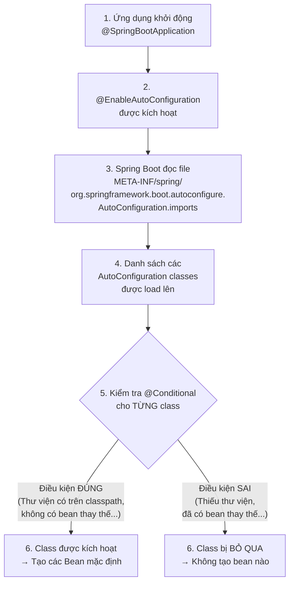
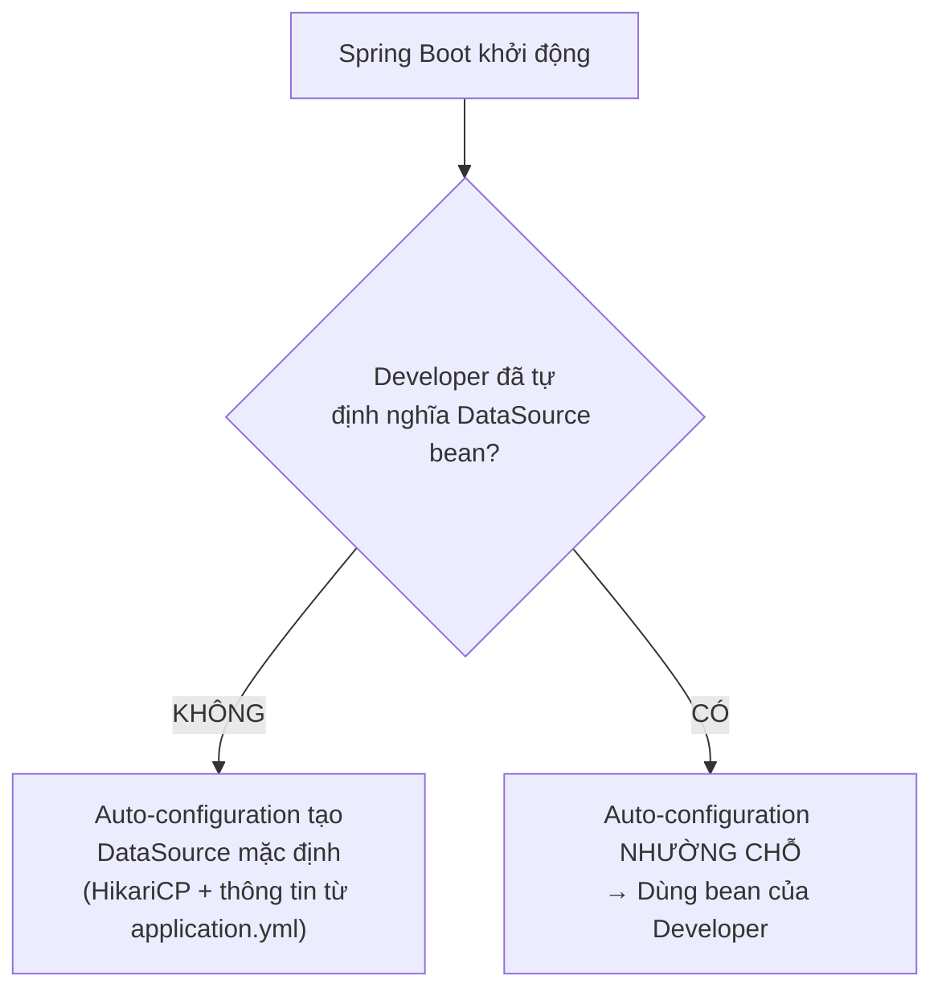
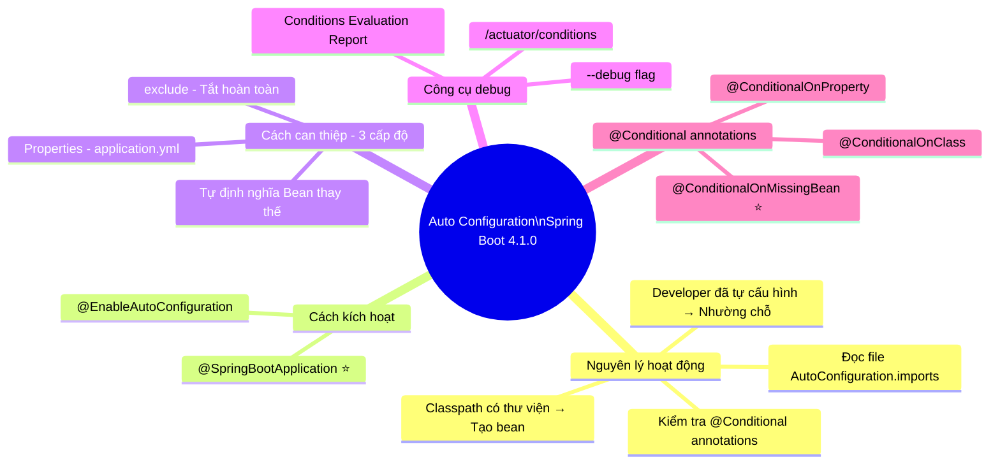

# ⚙️ Auto Configuration — Spring Boot 4.1.0

> **Nguồn chính thống:** [Spring Boot 4.1.0 — Auto-configuration](https://docs.spring.io/spring-boot/reference/using/auto-configuration.html)
>
> **Thuộc roadmap:** `3. Spring Boot → Auto Configuration`

---

## 1. Định nghĩa chính thức từ Spring Boot Docs

> *"Spring Boot auto-configuration attempts to **automatically configure your Spring application** based on the **jar dependencies** that you have added. For example, if `HSQLDB` is on your classpath, and you have not manually configured any database connection beans, then Spring Boot auto-configures an **in-memory database**."*
>
> — **Spring Boot 4.1.0 Reference — Auto-configuration**

### Dịch & giải thích đơn giản:

**Auto-configuration (Tự động cấu hình)** là cơ chế cốt lõi nhất của Spring Boot. Nó hoạt động theo nguyên tắc:

> **"Nếu thấy thư viện X nằm trong classpath → tự động cấu hình các Bean cần thiết cho thư viện đó."**

Ví dụ đơn giản:
- Thêm `spring-boot-starter-web` vào `pom.xml` → Spring Boot tự động cấu hình **DispatcherServlet**, **Embedded Tomcat**, **Jackson MessageConverter**, v.v.
- Thêm `spring-boot-starter-data-jpa` + driver MySQL → Spring Boot tự động cấu hình **DataSource**, **EntityManagerFactory**, **TransactionManager**.

Bạn **không cần viết một dòng cấu hình nào** — mọi thứ "just works"!

> [!IMPORTANT]
> Auto-configuration chính là lý do vì sao bạn có thể tạo một ứng dụng Spring Boot hoàn chỉnh chỉ với vài dòng code. Nó là "phép thuật" đứng sau sự đơn giản của Spring Boot.

---

## 2. Cách kích hoạt Auto-configuration

Theo tài liệu chính thống:

> *"You need to opt-in to auto-configuration by adding the `@EnableAutoConfiguration` or `@SpringBootApplication` annotations to one of your `@Configuration` classes."*

**Cách 1: Sử dụng `@SpringBootApplication` (Khuyến nghị — cách phổ biến nhất)**

```java
@SpringBootApplication  // Bao gồm @EnableAutoConfiguration bên trong
public class MyApplication {
    public static void main(String[] args) {
        SpringApplication.run(MyApplication.class, args);
    }
}
```

**Cách 2: Sử dụng `@EnableAutoConfiguration` trực tiếp (Hiếm khi dùng)**

```java
@Configuration
@EnableAutoConfiguration
@ComponentScan
public class MyApplication {
    public static void main(String[] args) {
        SpringApplication.run(MyApplication.class, args);
    }
}
```

> [!TIP]
> Tài liệu Spring Boot khuyến nghị: *"You should only ever add **one** `@SpringBootApplication` or `@EnableAutoConfiguration` annotation. We generally recommend that you add one or the other to your primary `@Configuration` class only."* — Chỉ cần đặt 1 lần duy nhất trên class chính.

---

## 3. Auto-configuration hoạt động như thế nào? (Cơ chế bên trong)

Đây là phần quan trọng nhất — hiểu cách auto-configuration "ra quyết định":

### 3.1 Luồng hoạt động tổng quát



### 3.2 Ví dụ cụ thể: DataSource Auto-configuration

Khi bạn thêm `spring-boot-starter-data-jpa` + MySQL driver, đây là những gì xảy ra bên trong:

```java
// Đây là class Auto-configuration của Spring Boot (đã được đơn giản hóa)
// Nguồn: spring-boot-autoconfigure module

@AutoConfiguration
@ConditionalOnClass({ DataSource.class, EmbeddedDatabaseType.class })
// ↑ Chỉ kích hoạt NẾU class DataSource tồn tại trên classpath

@EnableConfigurationProperties(DataSourceProperties.class)
// ↑ Tự động đọc các properties spring.datasource.* từ application.yml

public class DataSourceAutoConfiguration {

    @Configuration
    @ConditionalOnMissingBean(DataSource.class)
    // ↑ Chỉ tạo DataSource NẾU developer CHƯA TỰ ĐỊNH NGHĨA DataSource bean
    static class PooledDataSourceConfiguration {

        @Bean
        DataSource dataSource(DataSourceProperties properties) {
            // Tạo HikariCP DataSource với các thuộc tính từ application.yml
            return properties.initializeDataSourceBuilder()
                .type(HikariDataSource.class)
                .build();
        }
    }
}
```

> [!NOTE]
> Chú ý annotation `@ConditionalOnMissingBean(DataSource.class)` — đây là chìa khóa: Auto-configuration **chỉ tạo bean mặc định** khi bạn chưa tự định nghĩa bean đó. Nếu bạn đã tự tạo `DataSource` bean, Spring Boot sẽ **lịch sự nhường chỗ** và dùng bean của bạn.

### 3.3 Các `@Conditional` Annotation quan trọng

Spring Boot sử dụng hệ thống `@Conditional` annotations để "ra quyết định" có nên kích hoạt auto-configuration hay không:

| Annotation | Ý nghĩa | Ví dụ |
|-----------|---------|-------|
| `@ConditionalOnClass` | Chỉ kích hoạt nếu class X **có** trên classpath | `@ConditionalOnClass(DataSource.class)` |
| `@ConditionalOnMissingClass` | Chỉ kích hoạt nếu class X **không có** trên classpath | `@ConditionalOnMissingClass("com.example.Foo")` |
| `@ConditionalOnBean` | Chỉ kích hoạt nếu bean Y **đã được đăng ký** | `@ConditionalOnBean(DataSource.class)` |
| `@ConditionalOnMissingBean` | Chỉ kích hoạt nếu bean Y **chưa được đăng ký** | `@ConditionalOnMissingBean(DataSource.class)` |
| `@ConditionalOnProperty` | Chỉ kích hoạt nếu property Z **có giá trị cụ thể** | `@ConditionalOnProperty("spring.jpa.enabled", havingValue = "true")` |
| `@ConditionalOnWebApplication` | Chỉ kích hoạt trong ứng dụng **Web** | `@ConditionalOnWebApplication(type = SERVLET)` |
| `@ConditionalOnNotWebApplication` | Chỉ kích hoạt nếu **KHÔNG phải** Web app | — |

---

## 4. Tính chất "Non-invasive" (Không xâm lấn) của Auto-configuration

Tài liệu Spring Boot nhấn mạnh:

> *"Auto-configuration is **non-invasive**. At any point, you can start to define your own configuration to **replace specific parts** of the auto-configuration. For example, if you add your own `DataSource` bean, the default embedded database support **backs away**."*

### Nguyên tắc vàng: "Your Bean Wins" (Bean của bạn luôn thắng)

```java
// application.yml tự động cấu hình DataSource mặc định
// NHƯNG nếu bạn tự định nghĩa:

@Configuration
public class MyDataSourceConfig {

    @Bean
    public DataSource dataSource() {
        // Bean TỰ ĐỊNH NGHĨA của bạn → Spring Boot sẽ dùng cái này
        // và BỎ QUA hoàn toàn auto-configuration DataSource
        HikariDataSource ds = new HikariDataSource();
        ds.setJdbcUrl("jdbc:mysql://production-db:3306/mydb");
        ds.setMaximumPoolSize(50); // Tuỳ chỉnh theo nhu cầu
        return ds;
    }
}
```

**Hình dung bằng sơ đồ:**



---

## 5. Ghi đè (Override) Auto-configuration từng phần

Bạn không cần phải "tắt hoàn toàn" auto-configuration để tuỳ chỉnh. Có 3 cấp độ can thiệp:

### 5.1 Cấp 1: Thay đổi qua Properties (Đơn giản nhất)

```yaml
# application.yml — Thay đổi hành vi auto-configuration qua properties
server:
  port: 9090                    # Đổi port mặc định từ 8080 → 9090
  servlet:
    context-path: /api          # Thêm prefix cho tất cả URL

spring:
  datasource:
    url: jdbc:mysql://localhost:3306/mydb
    hikari:
      maximum-pool-size: 30     # Tuỳ chỉnh connection pool
      minimum-idle: 5

  jackson:
    serialization:
      indent-output: true       # JSON trả về được format đẹp
    date-format: "yyyy-MM-dd HH:mm:ss"  # Format ngày tháng
```

### 5.2 Cấp 2: Định nghĩa Bean thay thế (Trung bình)

```java
@Configuration
public class JacksonConfig {

    // Tự định nghĩa ObjectMapper → Spring Boot sẽ dùng cái này
    // thay vì ObjectMapper auto-configured mặc định
    @Bean
    public ObjectMapper objectMapper() {
        ObjectMapper mapper = new ObjectMapper();
        mapper.setSerializationInclusion(JsonInclude.Include.NON_NULL);
        mapper.configure(DeserializationFeature.FAIL_ON_UNKNOWN_PROPERTIES, false);
        mapper.registerModule(new JavaTimeModule());
        return mapper;
    }
}
```

### 5.3 Cấp 3: Tắt hoàn toàn Auto-configuration cụ thể (Mạnh nhất)

```java
// Cách 1: Dùng attribute exclude trong @SpringBootApplication
@SpringBootApplication(exclude = { DataSourceAutoConfiguration.class })
public class MyApplication {
    public static void main(String[] args) {
        SpringApplication.run(MyApplication.class, args);
    }
}
```

```yaml
# Cách 2: Dùng property trong application.yml
spring:
  autoconfigure:
    exclude:
      - org.springframework.boot.jdbc.autoconfigure.DataSourceAutoConfiguration
      - org.springframework.boot.security.autoconfigure.SecurityAutoConfiguration
```

> [!WARNING]
> Chỉ tắt auto-configuration khi bạn **thực sự hiểu** mình đang làm gì. Ví dụ: nếu tắt `DataSourceAutoConfiguration` mà quên tự cấu hình DataSource, ứng dụng sẽ crash khi cố truy vấn database.

---

## 6. Debug Auto-configuration — Xem Spring Boot đang tự cấu hình gì

Tài liệu chính thức:

> *"If you need to find out what auto-configuration is **currently being applied**, and why, start your application with the `--debug` switch. Doing so enables debug logs for a selection of core loggers and logs a **conditions report** to the console."*

### Cách 1: Thêm `--debug` khi chạy

```bash
java -jar myapp.jar --debug
```

### Cách 2: Thêm property

```yaml
# application.yml
debug: true
```

### Kết quả: Conditions Evaluation Report

Khi bật debug, Spring Boot in ra một báo cáo chi tiết:

```
============================
CONDITIONS EVALUATION REPORT
============================

Positive matches:    ← Các auto-configuration ĐÃ ĐƯỢC kích hoạt
-----------------
   DataSourceAutoConfiguration matched:
      - @ConditionalOnClass found required classes 'javax.sql.DataSource',
        'org.springframework.jdbc.datasource.embedded.EmbeddedDatabaseType'
        (OnClassCondition)

   DataSourceAutoConfiguration.PooledDataSourceConfiguration matched:
      - @ConditionalOnMissingBean (types: javax.sql.DataSource) did not find
        any beans (OnBeanCondition)

Negative matches:    ← Các auto-configuration ĐÃ BỊ bỏ qua (và lý do)
-----------------
   ActiveMQAutoConfiguration:
      Did not match:
         - @ConditionalOnClass did not find required class
           'jakarta.jms.ConnectionFactory' (OnClassCondition)

   CassandraAutoConfiguration:
      Did not match:
         - @ConditionalOnClass did not find required class
           'com.datastax.oss.driver.api.core.CqlSession' (OnClassCondition)
```

> [!TIP]
> **Conditions Evaluation Report** là công cụ debug cực kỳ hữu ích khi bạn gặp vấn đề. Ví dụ: ứng dụng không kết nối được database → xem report để biết `DataSourceAutoConfiguration` có được kích hoạt không, nếu không thì lý do là gì.

### Cách 3: Dùng Actuator endpoint

```bash
# Xem conditions report qua HTTP (cần spring-boot-starter-actuator)
GET http://localhost:8080/actuator/conditions
```

---

## 7. Auto-configuration Packages

> *"Auto-configuration packages are the packages that various auto-configured features look in by default when scanning for things such as entities and Spring Data repositories. The `@EnableAutoConfiguration` annotation (either directly or through its presence on `@SpringBootApplication`) determines the default auto-configuration package."*

Khi Spring Boot auto-configure JPA, nó cần biết scan package nào để tìm `@Entity` classes. Mặc định, nó scan package chứa class `@SpringBootApplication`.

```
com.example.myapp/
├── MyApplication.java         ← @SpringBootApplication ở đây
├── controller/
│   └── UserController.java
├── service/
│   └── UserService.java
├── repository/
│   └── UserRepository.java
└── entity/
    └── User.java              ← @Entity được auto-scan thành công!
```

> [!CAUTION]
> Nếu `@Entity` nằm ở package **ngoài** package gốc của `@SpringBootApplication`:
> ```
> com.example.myapp/
> │   └── MyApplication.java    ← @SpringBootApplication
> com.example.common/
> │   └── BaseEntity.java       ← ❌ KHÔNG ĐƯỢC SCAN!
> ```
> Giải pháp: Dùng `@EntityScan("com.example.common")` hoặc `@AutoConfigurationPackage` để thêm package.

---

## 🔥 Ứng dụng thực tế (Thực tế dùng để làm gì? Giải quyết vấn đề gì?)

### Ví dụ thực tế 1: Xây dựng REST API kết nối Database

**Yêu cầu:** Tạo API CRUD quản lý sản phẩm (Product) với MySQL.

**Bước 1: Thêm dependencies (pom.xml)**
```xml
<dependencies>
    <dependency>
        <groupId>org.springframework.boot</groupId>
        <artifactId>spring-boot-starter-web</artifactId>
    </dependency>
    <dependency>
        <groupId>org.springframework.boot</groupId>
        <artifactId>spring-boot-starter-data-jpa</artifactId>
    </dependency>
    <dependency>
        <groupId>com.mysql</groupId>
        <artifactId>mysql-connector-j</artifactId>
        <scope>runtime</scope>
    </dependency>
</dependencies>
```

**Bước 2: Cấu hình (application.yml)**
```yaml
spring:
  datasource:
    url: jdbc:mysql://localhost:3306/shop
    username: root
    password: secret
  jpa:
    hibernate:
      ddl-auto: update
```

**Bước 3: Viết code nghiệp vụ (KHÔNG CẦN viết bất kỳ cấu hình nào)**
```java
@Entity
public class Product {
    @Id @GeneratedValue(strategy = GenerationType.IDENTITY)
    private Long id;
    private String name;
    private BigDecimal price;
    // getters, setters...
}

@Repository
public interface ProductRepository extends JpaRepository<Product, Long> {
    List<Product> findByNameContaining(String keyword);
}

@RestController
@RequestMapping("/api/products")
public class ProductController {

    private final ProductRepository repository;

    public ProductController(ProductRepository repository) {
        this.repository = repository;
    }

    @GetMapping
    public List<Product> findAll() {
        return repository.findAll();
    }

    @PostMapping
    public Product create(@RequestBody Product product) {
        return repository.save(product);
    }
}
```

**Auto-configuration đã làm gì ngầm cho bạn?**

| Bạn KHÔNG phải viết | Auto-configuration đã tự tạo |
|---------------------|------------------------------|
| Cấu hình DataSource | `DataSourceAutoConfiguration` → Tạo `HikariDataSource` từ properties |
| Cấu hình JPA/Hibernate | `HibernateJpaAutoConfiguration` → Tạo `EntityManagerFactory` + `TransactionManager` |
| Cấu hình Spring Data JPA | `JpaRepositoriesAutoConfiguration` → Scan và tạo implementation cho `ProductRepository` |
| Cấu hình DispatcherServlet | `DispatcherServletAutoConfiguration` → Đăng ký DispatcherServlet |
| Cấu hình Jackson | `JacksonAutoConfiguration` → Tạo `ObjectMapper` cho JSON serialization |
| Cấu hình Tomcat | `EmbeddedWebServerFactoryCustomizerAutoConfiguration` → Khởi động Tomcat trên port 8080 |

### Ví dụ thực tế 2: Tùy chỉnh khi cần "vượt ra ngoài" mặc định

Giả sử sếp yêu cầu: *"Dùng 2 database — MySQL cho dữ liệu chính, PostgreSQL cho analytics".*

Lúc này auto-configuration **mặc định** không đủ (vì nó chỉ tạo 1 DataSource). Bạn cần **ghi đè**:

```java
@Configuration
public class MultiDataSourceConfig {

    @Primary  // DataSource chính
    @Bean("primaryDataSource")
    @ConfigurationProperties("spring.datasource.primary")
    public DataSource primaryDataSource() {
        return DataSourceBuilder.create().build();
    }

    @Bean("analyticsDataSource")
    @ConfigurationProperties("spring.datasource.analytics")
    public DataSource analyticsDataSource() {
        return DataSourceBuilder.create().build();
    }
}
```

```yaml
spring:
  datasource:
    primary:
      url: jdbc:mysql://localhost:3306/main_db
      username: root
      password: secret
    analytics:
      url: jdbc:postgresql://localhost:5432/analytics_db
      username: analyst
      password: secret
```

→ Spring Boot sẽ thấy bạn đã tự định nghĩa `DataSource` bean → nó **tự động nhường chỗ** và bỏ qua `DataSourceAutoConfiguration`.

---

## 8. Tóm tắt kiến thức cốt lõi



---

## 9. Tổng hợp các chủ đề Auto-configuration (Bản đồ tra cứu)

### 🌟 9.1. Những kỹ thuật ƯU TIÊN PHẢI BIẾT TRƯỚC (Bắt buộc khi đi làm)
1. **Nguyên tắc "Your Bean Wins":** Khi bạn tự định nghĩa một Bean, auto-configuration sẽ tự động nhường chỗ. Đây là nguyên tắc quan trọng nhất để hiểu hành vi của Spring Boot.
2. **Debug với `--debug` flag:** Khi ứng dụng không hoạt động như mong đợi, bật `--debug` để xem Conditions Evaluation Report — biết chính xác auto-configuration nào đang active và tại sao.
3. **Override qua Properties:** 90% nhu cầu tuỳ chỉnh đều có thể giải quyết bằng cách thêm properties vào `application.yml` mà không cần viết Java code.

### 🟡 9.2. Nhóm kỹ thuật Trung cấp (Kiểm soát auto-configuration)
1. **Exclude cụ thể auto-configuration class:** Tắt auto-configuration không cần thiết bằng `@SpringBootApplication(exclude = ...)` để tối ưu thời gian khởi động hoặc tránh xung đột.
2. **`@ConditionalOnProperty`:** Kiểm soát việc kích hoạt bean dựa trên giá trị property — rất hữu ích khi bạn muốn bật/tắt tính năng theo môi trường (dev bật feature X, production tắt).
3. **`@AutoConfigureBefore` / `@AutoConfigureAfter`:** Kiểm soát thứ tự khởi tạo giữa các auto-configuration class khi bạn viết auto-configuration tùy chỉnh.

### 🔴 9.3. Nhóm kỹ thuật Nâng cao (Tự tạo auto-configuration)
1. **Viết Auto-configuration class của riêng bạn:** Tạo `@AutoConfiguration` class với các `@Conditional` annotation, đăng ký trong file `META-INF/spring/org.springframework.boot.autoconfigure.AutoConfiguration.imports`.
2. **Custom Starter = auto-configuration module + starter module:** Đóng gói thành starter để chia sẻ cho team/công ty sử dụng (ví dụ: `company-email-spring-boot-starter`).
3. **`@ImportAutoConfiguration` cho Testing:** Kiểm soát chính xác auto-configuration nào được load trong test context, giúp test chạy nhanh hơn.

## 📚 Tài liệu tham khảo chính thống

| Tài liệu | Link |
|-----------|------|
| Spring Boot 4.1.0 — Auto-configuration | [docs.spring.io](https://docs.spring.io/spring-boot/reference/using/auto-configuration.html) |
| Spring Boot 4.1.0 — Creating Your Own Auto-configuration | [docs.spring.io](https://docs.spring.io/spring-boot/reference/features/developing-auto-configuration.html) |
| Spring Boot 4.1.0 — @SpringBootApplication | [docs.spring.io](https://docs.spring.io/spring-boot/reference/using/using-the-springbootapplication-annotation.html) |
| Spring Boot 4.1.0 — Condition Annotations | [docs.spring.io](https://docs.spring.io/spring-boot/reference/features/developing-auto-configuration.html#features.developing-auto-configuration.condition-annotations) |
| Spring Boot 4.1.0 — Auto-configuration Classes (Appendix) | [docs.spring.io](https://docs.spring.io/spring-boot/reference/appendix/auto-configuration-classes/index.html) |

---

> **Tiếp theo trong roadmap:** `Adding Configuration` (Cách thêm cấu hình tùy chỉnh vào ứng dụng Spring Boot — `@Configuration`, `@Bean`, và cách kết hợp với auto-configuration).
