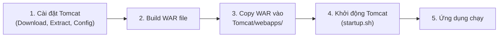
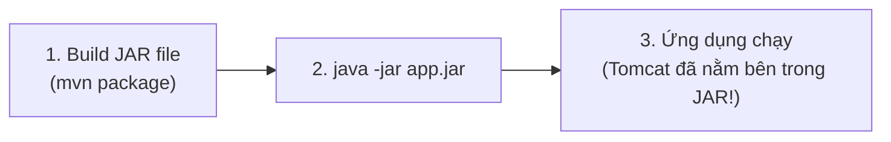
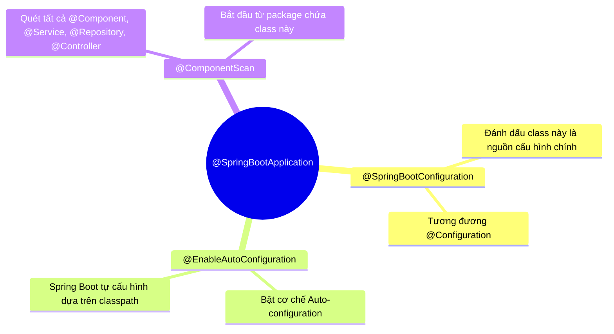
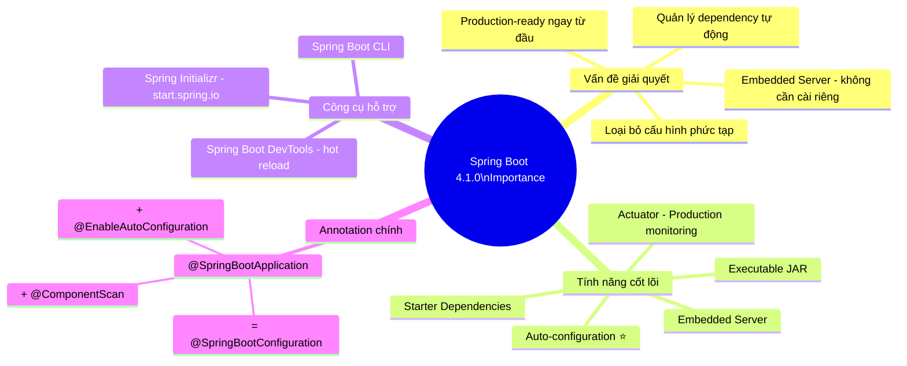

# 🚀 Importance of Spring Boot — Spring Boot 4.1.0

> **Nguồn chính thống:** [Spring Boot 4.1.0 — Overview](https://docs.spring.io/spring-boot/reference/)
>
> **Thuộc roadmap:** `3. Spring Boot → Importance of Spring Boot`

---

## 1. Spring Boot là gì? (Định nghĩa chính thức)

> *"Spring Boot helps you to create Spring-powered, production-grade applications and services with absolute minimum fuss. It takes an **opinionated view** of the Spring platform so that new and existing users can quickly get to the bits they need."*
>
> — **spring.io/projects/spring-boot**

### Dịch & giải thích đơn giản:

**Spring Boot** là một framework được xây dựng **bên trên** Spring Framework, với mục tiêu duy nhất: **giảm tối đa sự phức tạp** khi tạo và chạy một ứng dụng Spring ở mức production-grade (sẵn sàng đưa lên production).

Nó áp dụng cách tiếp cận **"opinionated"** (có chính kiến/có quan điểm mặc định) — tức là Spring Boot đã chọn sẵn cho bạn những cấu hình hợp lý nhất, để bạn có thể bắt đầu code **ngay lập tức** mà không phải ngồi cấu hình hàng trăm dòng XML hay Java Config.

> [!IMPORTANT]
> Spring Boot **KHÔNG PHẢI** là một framework mới thay thế Spring Framework. Nó là một **"lớp tiện ích"** được xây dựng bên trên Spring Framework, giúp bạn sử dụng Spring Framework dễ dàng hơn rất nhiều.

---

## 2. Vấn đề mà Spring Boot giải quyết (Tại sao cần Spring Boot?)

### 2.1 Nỗi đau khi dùng Spring Framework thuần (Không có Spring Boot)

Trước khi có Spring Boot, để tạo một ứng dụng Spring Web đơn giản, bạn phải:

```
1. Cài đặt và cấu hình Web Server (Tomcat/Jetty) riêng biệt
2. Tạo file web.xml để đăng ký DispatcherServlet
3. Viết file applicationContext.xml hoặc Java Config để:
   - Khai báo ComponentScan
   - Cấu hình ViewResolver
   - Cấu hình DataSource
   - Cấu hình TransactionManager
   - Cấu hình MessageConverter
   - ... và hàng chục bean khác
4. Tự quản lý dependency versions (tránh xung đột giữa các thư viện)
5. Đóng gói thành file WAR và deploy lên server
```

**Ví dụ thực tế — Cấu hình Spring MVC truyền thống (KHÔNG CÓ Spring Boot):**

```java
// File: WebConfig.java — Cấu hình Spring MVC thủ công
@Configuration
@EnableWebMvc
@ComponentScan(basePackages = "com.example")
public class WebConfig implements WebMvcConfigurer {

    // Cấu hình ViewResolver thủ công
    @Bean
    public InternalResourceViewResolver viewResolver() {
        InternalResourceViewResolver resolver = new InternalResourceViewResolver();
        resolver.setPrefix("/WEB-INF/views/");
        resolver.setSuffix(".jsp");
        return resolver;
    }

    // Cấu hình MessageConverter thủ công
    @Override
    public void configureMessageConverters(List<HttpMessageConverter<?>> converters) {
        converters.add(new MappingJackson2HttpMessageConverter());
    }
}
```

```java
// File: AppInitializer.java — Thay thế web.xml
public class AppInitializer extends AbstractAnnotationConfigDispatcherServletInitializer {

    @Override
    protected Class<?>[] getRootConfigClasses() {
        return new Class<?>[] { RootConfig.class };
    }

    @Override
    protected Class<?>[] getServletConfigClasses() {
        return new Class<?>[] { WebConfig.class };
    }

    @Override
    protected String[] getServletMappings() {
        return new String[] { "/" };
    }
}
```

```java
// File: DataSourceConfig.java — Cấu hình Database thủ công
@Configuration
public class DataSourceConfig {

    @Bean
    public DataSource dataSource() {
        DriverManagerDataSource ds = new DriverManagerDataSource();
        ds.setDriverClassName("com.mysql.cj.jdbc.Driver");
        ds.setUrl("jdbc:mysql://localhost:3306/mydb");
        ds.setUsername("root");
        ds.setPassword("password");
        return ds;
    }

    @Bean
    public LocalContainerEntityManagerFactoryBean entityManagerFactory() {
        LocalContainerEntityManagerFactoryBean em = new LocalContainerEntityManagerFactoryBean();
        em.setDataSource(dataSource());
        em.setPackagesToScan("com.example.entity");
        // ... còn nhiều cấu hình nữa
        return em;
    }

    @Bean
    public PlatformTransactionManager transactionManager() {
        return new JpaTransactionManager(entityManagerFactory().getObject());
    }
}
```

> [!WARNING]
> Chỉ để chạy một API đơn giản trả về JSON, bạn đã phải viết **3-4 file cấu hình**, quản lý hàng chục dependency, và cài đặt server riêng. Đây là lý do mà nhiều developer mới cảm thấy Spring "quá nặng nề" và chuyển sang framework khác.

### 2.2 Giải pháp: Spring Boot xuất hiện

**Cùng một ứng dụng web đó, với Spring Boot 4.1.0:**

```java
// File: MyApplication.java — CHỈ CẦN DUY NHẤT 1 FILE NÀY!
@SpringBootApplication
public class MyApplication {
    public static void main(String[] args) {
        SpringApplication.run(MyApplication.class, args);
    }
}
```

```java
// File: HelloController.java — Code nghiệp vụ
@RestController
public class HelloController {

    @GetMapping("/hello")
    public String hello() {
        return "Hello World!";
    }
}
```

```yaml
# File: application.yml — Cấu hình database (chỉ cần 4 dòng!)
spring:
  datasource:
    url: jdbc:mysql://localhost:3306/mydb
    username: root
    password: password
```

**Chạy:** `mvn spring-boot:run` hoặc `java -jar myapp.jar` → **XONG!** 🎉

Không cần cài Tomcat riêng, không cần web.xml, không cần hàng chục file cấu hình.

---

## 3. Các tính năng cốt lõi của Spring Boot (Core Features)

Tài liệu chính thống của Spring Boot liệt kê các tính năng chính sau:

| Tính năng | Mô tả | Lợi ích thực tế |
|-----------|--------|-----------------|
| **Auto-configuration** | Tự động cấu hình ứng dụng dựa trên các thư viện có trong classpath | Không cần viết hàng trăm dòng config thủ công |
| **Starter Dependencies** | Các "gói dependency" được đóng gói sẵn (ví dụ: `spring-boot-starter-web`) | Thêm 1 dependency = có đầy đủ thư viện cần thiết, không lo xung đột phiên bản |
| **Embedded Server** | Tích hợp sẵn Web Server (Tomcat, Jetty, Undertow) bên trong ứng dụng | Không cần cài đặt và quản lý server riêng biệt |
| **Production-ready Features** | Actuator cung cấp health check, metrics, monitoring sẵn có | Sẵn sàng lên production mà không cần tích hợp thêm công cụ giám sát |
| **Opinionated Defaults** | Cung cấp các cấu hình mặc định hợp lý | Bắt đầu code ngay, không cần quyết định 100 thứ trước khi viết dòng code đầu tiên |
| **Executable JAR/WAR** | Đóng gói thành file JAR tự chạy được | Deploy đơn giản: `java -jar app.jar` — không cần WAR + Server |

---

## 4. Starter Dependencies — Giải quyết "Dependency Hell"

### Vấn đề: Dependency Hell (Địa ngục phụ thuộc)

Khi dùng Spring Framework thuần, bạn phải tự chọn version cho **từng thư viện một**:

```xml
<!-- KHÔNG CÓ Spring Boot: Tự quản lý TẤT CẢ versions -->
<dependencies>
    <dependency>
        <groupId>org.springframework</groupId>
        <artifactId>spring-webmvc</artifactId>
        <version>7.0.8</version>  <!-- Version nào? -->
    </dependency>
    <dependency>
        <groupId>org.springframework</groupId>
        <artifactId>spring-orm</artifactId>
        <version>7.0.8</version>  <!-- Phải khớp với webmvc! -->
    </dependency>
    <dependency>
        <groupId>com.fasterxml.jackson.core</groupId>
        <artifactId>jackson-databind</artifactId>
        <version>2.18.3</version>  <!-- Version nào tương thích? -->
    </dependency>
    <dependency>
        <groupId>org.hibernate.orm</groupId>
        <artifactId>hibernate-core</artifactId>
        <version>7.0.2</version>  <!-- Có xung đột không? -->
    </dependency>
    <!-- ... còn 20+ dependency nữa ... -->
</dependencies>
```

### Giải pháp: Spring Boot Starter

```xml
<!-- CÓ Spring Boot: Chỉ cần 2 starter! -->
<parent>
    <groupId>org.springframework.boot</groupId>
    <artifactId>spring-boot-starter-parent</artifactId>
    <version>4.1.0</version>
</parent>

<dependencies>
    <!-- Starter này tự kéo về: Spring MVC, Jackson, Tomcat, Validation... -->
    <dependency>
        <groupId>org.springframework.boot</groupId>
        <artifactId>spring-boot-starter-web</artifactId>
    </dependency>

    <!-- Starter này tự kéo về: Hibernate, Spring Data JPA, HikariCP... -->
    <dependency>
        <groupId>org.springframework.boot</groupId>
        <artifactId>spring-boot-starter-data-jpa</artifactId>
    </dependency>
</dependencies>
```

> [!TIP]
> **Không cần khai báo version** cho các starter — `spring-boot-starter-parent` đã quản lý tất cả versions tương thích cho bạn thông qua cơ chế **BOM (Bill of Materials)**. Đây là lý do bạn không thấy thẻ `<version>` trong các dependency.

### Bảng các Starter phổ biến nhất:

| Starter | Mô tả |
|---------|--------|
| `spring-boot-starter-web` | Web app với Spring MVC + Embedded Tomcat |
| `spring-boot-starter-data-jpa` | JPA + Hibernate + Spring Data JPA |
| `spring-boot-starter-security` | Spring Security |
| `spring-boot-starter-test` | JUnit 5 + Mockito + AssertJ + Spring Test |
| `spring-boot-starter-validation` | Bean Validation (Hibernate Validator) |
| `spring-boot-starter-actuator` | Production monitoring & health checks |
| `spring-boot-starter-data-redis` | Redis (Cache, Pub/Sub, v.v.) |
| `spring-boot-starter-mail` | Gửi email |

---

## 5. Embedded Server — Không cần cài Tomcat riêng

### Cách truyền thống (Không có Spring Boot):



### Cách Spring Boot 4.1.0:



> [!NOTE]
> Spring Boot 4.1.0 mặc định sử dụng **Tomcat** làm embedded server. Bạn có thể đổi sang **Jetty** hoặc **Undertow** chỉ bằng cách thay đổi dependency trong `pom.xml`, không cần sửa bất kỳ dòng code nào.

**Đổi sang Jetty (ví dụ):**
```xml
<dependency>
    <groupId>org.springframework.boot</groupId>
    <artifactId>spring-boot-starter-web</artifactId>
    <exclusions>
        <exclusion>
            <groupId>org.springframework.boot</groupId>
            <artifactId>spring-boot-starter-tomcat</artifactId>
        </exclusion>
    </exclusions>
</dependency>
<dependency>
    <groupId>org.springframework.boot</groupId>
    <artifactId>spring-boot-starter-jetty</artifactId>
</dependency>
```

---

## 6. Spring Boot Actuator — Sẵn sàng cho Production

Chỉ cần thêm 1 dependency:

```xml
<dependency>
    <groupId>org.springframework.boot</groupId>
    <artifactId>spring-boot-starter-actuator</artifactId>
</dependency>
```

Bạn lập tức có các endpoint giám sát:

| Endpoint | Chức năng |
|----------|-----------|
| `/actuator/health` | Kiểm tra ứng dụng có đang "sống" không (cho Load Balancer, Kubernetes) |
| `/actuator/metrics` | Xem các số liệu: memory, CPU, HTTP requests, v.v. |
| `/actuator/info` | Thông tin về ứng dụng (version, build time) |
| `/actuator/env` | Xem các biến môi trường & cấu hình đang chạy |
| `/actuator/loggers` | Thay đổi log level **tại runtime** mà không cần restart |
| `/actuator/beans` | Liệt kê tất cả beans đang được quản lý bởi IoC Container |

---

## 🔥 Ứng dụng thực tế (Thực tế dùng để làm gì? Giải quyết vấn đề gì?)

### Bối cảnh thực tế trong doanh nghiệp

Spring Boot không chỉ là "tiện" mà nó **thay đổi hoàn toàn cách các công ty phát triển phần mềm Java**:

**1. Startup & MVP (Minimum Viable Product):**
Một startup muốn ra mắt sản phẩm trong 2 tuần. Với Spring Boot, một developer có thể tạo REST API + Database + Authentication trong vài giờ thay vì vài ngày cấu hình.

**2. Microservices Architecture:**
Khi công ty cần tách monolith thành 20 microservices, Spring Boot giúp mỗi service là một ứng dụng JAR độc lập, tự chứa server, dễ dàng container hóa (Docker) và deploy lên Kubernetes.

**3. DevOps & CI/CD:**
- Build: `mvn package` → file JAR duy nhất
- Deploy: `java -jar app.jar` hoặc `docker run myapp`
- Monitor: Actuator endpoints tích hợp sẵn với Prometheus/Grafana
- Health check: `/actuator/health` cho Kubernetes liveness/readiness probe

### So sánh tổng thể:

| Tiêu chí | Spring Framework thuần | Spring Boot 4.1.0 |
|----------|----------------------|-------------------|
| **Thời gian setup** | Hàng giờ đến vài ngày | Vài phút (start.spring.io) |
| **Số file cấu hình** | 5-10+ files | 1 file (application.yml) |
| **Quản lý dependency** | Tự quản lý versions | Tự động qua BOM |
| **Web Server** | Cài đặt riêng (Tomcat/JBoss) | Tích hợp sẵn bên trong |
| **Đóng gói** | WAR → Deploy lên server | JAR tự chạy được |
| **Monitoring** | Tự tích hợp (rất phức tạp) | Actuator có sẵn |
| **Testing** | Tự cấu hình test context | `@SpringBootTest` là đủ |
| **Learning curve** | Dốc đứng cho người mới | Bắt đầu nhanh, đào sâu dần |

---

## 7. Annotation `@SpringBootApplication` — Trái tim của mọi ứng dụng Spring Boot

```java
@SpringBootApplication  // ← Annotation "3 trong 1"
public class MyApplication {
    public static void main(String[] args) {
        SpringApplication.run(MyApplication.class, args);
    }
}
```

`@SpringBootApplication` thực chất là sự kết hợp của **3 annotation**:



> [!TIP]
> **Best practice:** Luôn đặt class chứa `@SpringBootApplication` ở **root package** (ví dụ: `com.example.myapp`). Vì `@ComponentScan` sẽ quét từ package đó trở xuống, nên nếu bạn đặt sai vị trí, các Bean ở package khác sẽ không được phát hiện — đây là lỗi kinh điển nhất của người mới.

---

## 8. Spring Initializr — Công cụ khởi tạo project

**[start.spring.io](https://start.spring.io)** là công cụ chính thức để tạo project Spring Boot:

1. Chọn **Build tool**: Maven hoặc Gradle
2. Chọn **Language**: Java, Kotlin, hoặc Groovy
3. Chọn **Spring Boot version**: 4.1.0
4. Nhập **Group** & **Artifact** (tên project)
5. Thêm **Dependencies** (starter): Web, JPA, Security, v.v.
6. Click **Generate** → Download file ZIP → Import vào IDE → Code!

> [!NOTE]
> Spring Initializr cũng được tích hợp sẵn trong **IntelliJ IDEA Ultimate** (File → New → Spring Initializr) và **VS Code** (extension Spring Boot Tools). Bạn không cần phải vào website.

---

## 9. Tóm tắt kiến thức cốt lõi



---

## 10. Tổng hợp các chủ đề Spring Boot (Bản đồ tra cứu)

### 🌟 10.1. Những khái niệm ƯU TIÊN PHẢI BIẾT TRƯỚC (Bắt buộc khi đi làm)
1. **`@SpringBootApplication` và cấu trúc project:** Hiểu annotation "3 trong 1" này hoạt động như thế nào, và tại sao class chính phải đặt ở root package.
2. **Starter Dependencies:** Biết cách chọn đúng starter cho nhu cầu (`spring-boot-starter-web`, `spring-boot-starter-data-jpa`, v.v.) và hiểu rằng version được quản lý tự động bởi parent POM.
3. **`application.properties` / `application.yml`:** File cấu hình duy nhất cho toàn bộ ứng dụng — cách khai báo database URL, server port, logging level, v.v.
4. **DevTools (Hot Reload):** Công cụ giúp ứng dụng tự động restart khi bạn thay đổi code, tăng tốc quá trình phát triển đáng kể.

### 🟡 10.2. Nhóm kiến thức Trung cấp (Tùy biến và vận hành)
1. **Auto-configuration (Bài tiếp theo):** Hiểu sâu cách Spring Boot tự động cấu hình, cách ghi đè (override), và cách tắt auto-configuration cụ thể.
2. **Profiles (`@Profile`, `application-{profile}.yml`):** Quản lý nhiều môi trường (dev, staging, production) với các cấu hình khác nhau.
3. **Actuator Endpoints:** Giám sát sức khỏe ứng dụng, xem metrics, thay đổi log level tại runtime.
4. **Externalized Configuration:** Thứ tự ưu tiên của các nguồn cấu hình (command line > env variables > application.yml > default).

### 🔴 10.3. Nhóm kiến thức Nâng cao (Kiến trúc và mở rộng)
1. **Tự viết Auto-configuration:** Tạo thư viện/module của riêng bạn với cơ chế auto-configuration tương tự Spring Boot, sử dụng `@Conditional` annotations.
2. **Custom Starter:** Đóng gói một bộ dependency + auto-configuration thành một starter để team khác sử dụng (ví dụ: `company-logging-starter`).
3. **GraalVM Native Image:** Compile ứng dụng Spring Boot thành native executable, khởi động trong vài milliseconds thay vì vài giây (xu hướng mới với Spring Boot 4.x).

## 📚 Tài liệu tham khảo chính thống

| Tài liệu | Link |
|-----------|------|
| Spring Boot 4.1.0 — Reference Documentation | [docs.spring.io](https://docs.spring.io/spring-boot/reference/) |
| Spring Boot 4.1.0 — Getting Started | [docs.spring.io](https://docs.spring.io/spring-boot/reference/using/index.html) |
| Spring Boot 4.1.0 — Starters | [docs.spring.io](https://docs.spring.io/spring-boot/reference/using/build-systems.html#using.build-systems.starters) |
| Spring Boot 4.1.0 — Actuator | [docs.spring.io](https://docs.spring.io/spring-boot/reference/actuator/index.html) |
| Spring Initializr | [start.spring.io](https://start.spring.io) |

---

> **Tiếp theo trong roadmap:** `Auto Configuration` (Chúng ta sẽ đi sâu vào cơ chế "phép thuật" đằng sau Spring Boot — làm sao nó biết cần cấu hình gì, khi nào cấu hình, và cách bạn can thiệp vào quá trình này).
