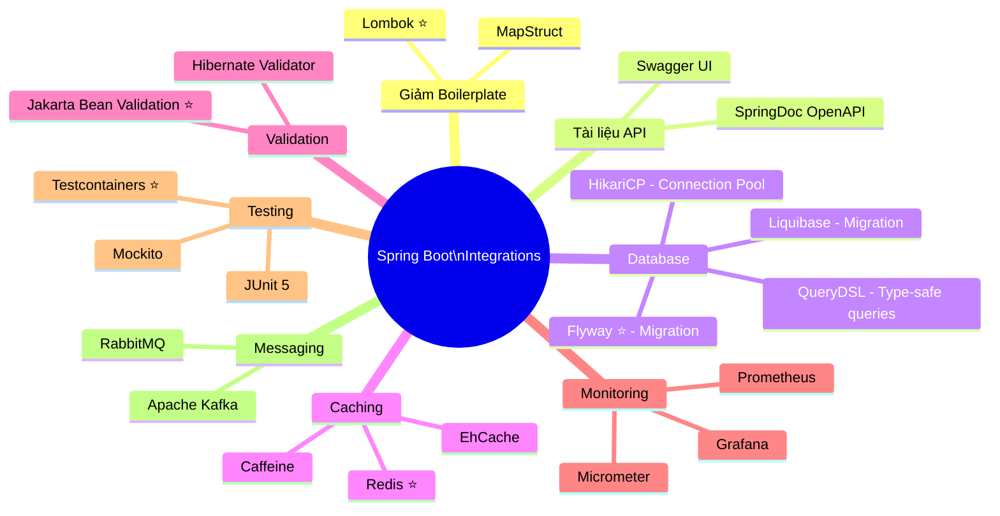

# 🔗 Integrations with other Libraries/Frameworks — Spring Boot 4.1.0

> **Nguồn chính thống:** [Spring Boot 4.1.0 — Reference Documentation](https://docs.spring.io/spring-boot/reference/)
>
> **Thuộc roadmap:** `3. Spring Boot → Integrations with other Libraries/Frameworks`

---

## 1. Tổng quan: Spring Boot và khả năng tích hợp

> *"Spring Boot makes it easy to create stand-alone, production-grade Spring based Applications. We take an **opinionated view** of the Spring platform and **third-party libraries** so you can get started with minimum fuss."*
>
> — **spring.io/projects/spring-boot**

### Dịch & giải thích đơn giản:

Một trong những sức mạnh lớn nhất của Spring Boot là khả năng **tích hợp dễ dàng** với hàng trăm thư viện và framework bên ngoài. Cơ chế **Auto-configuration** + **Starter Dependencies** cho phép bạn thêm một thư viện mới vào dự án chỉ trong **vài phút**:

1. Thêm dependency vào `pom.xml` / `build.gradle`
2. (Tuỳ chọn) Thêm vài dòng config vào `application.yml`
3. Bắt đầu sử dụng — Spring Boot tự cấu hình phần còn lại!

> [!IMPORTANT]
> Bài này tập trung vào các **thư viện/framework ngoài hệ sinh thái Spring** mà developer Java sử dụng hàng ngày. Các thư viện thuộc Spring ecosystem (Spring Security, Spring Data, Spring Cloud...) sẽ được đề cập trong các bài riêng của roadmap.

---

## 2. Lombok — Giảm boilerplate code (⭐ Bắt buộc phải biết)

### Vấn đề: Java quá nhiều boilerplate

```java
// KHÔNG CÓ Lombok — Phải viết TẤT CẢ thủ công
public class Product {
    private Long id;
    private String name;
    private BigDecimal price;
    private String description;
    private LocalDateTime createdAt;

    // Constructor
    public Product() {}

    public Product(Long id, String name, BigDecimal price, String description, LocalDateTime createdAt) {
        this.id = id;
        this.name = name;
        this.price = price;
        this.description = description;
        this.createdAt = createdAt;
    }

    // Getters (5 cái)
    public Long getId() { return id; }
    public String getName() { return name; }
    public BigDecimal getPrice() { return price; }
    public String getDescription() { return description; }
    public LocalDateTime getCreatedAt() { return createdAt; }

    // Setters (5 cái)
    public void setId(Long id) { this.id = id; }
    public void setName(String name) { this.name = name; }
    public void setPrice(BigDecimal price) { this.price = price; }
    public void setDescription(String description) { this.description = description; }
    public void setCreatedAt(LocalDateTime createdAt) { this.createdAt = createdAt; }

    // toString, equals, hashCode... (thêm ~30 dòng nữa)
}
// Tổng cộng: ~70 dòng code cho 5 fields!
```

### Giải pháp: Lombok

**Dependency:**
```xml
<dependency>
    <groupId>org.projectlombok</groupId>
    <artifactId>lombok</artifactId>
    <optional>true</optional>
</dependency>
```

**Code với Lombok:**
```java
@Data                    // = @Getter + @Setter + @ToString + @EqualsAndHashCode
@NoArgsConstructor       // Constructor không tham số
@AllArgsConstructor      // Constructor đầy đủ tham số
@Builder                 // Builder pattern
public class Product {
    private Long id;
    private String name;
    private BigDecimal price;
    private String description;
    private LocalDateTime createdAt;
}
// Tổng cộng: 10 dòng! Lombok tự sinh ra 70+ dòng code lúc compile
```

### Các Lombok annotations phổ biến nhất:

| Annotation | Chức năng | Hay dùng ở đâu |
|-----------|----------|-----------------|
| `@Data` | Getter + Setter + toString + equals + hashCode | Entity, DTO |
| `@Getter` / `@Setter` | Chỉ sinh getter/setter | Khi cần kiểm soát chi tiết |
| `@NoArgsConstructor` | Constructor không tham số | Entity (JPA yêu cầu) |
| `@AllArgsConstructor` | Constructor đầy đủ tham số | DTO, Value Object |
| `@Builder` | Builder pattern | Tạo object phức tạp |
| `@RequiredArgsConstructor` | Constructor cho các field `final` | ⭐ **Service, Controller** (thay thế `@Autowired`) |
| `@Slf4j` | Tạo biến `log` (Logger) tự động | Mọi class cần logging |
| `@Value` (Lombok) | Immutable class (all fields final + private) | DTO response |

### Kết hợp kinh điển: `@RequiredArgsConstructor` + DI

```java
@Service
@RequiredArgsConstructor  // Tự sinh constructor cho các field "final"
@Slf4j                    // Tự tạo biến "log"
public class OrderService {

    private final OrderRepository orderRepository;      // final → bắt buộc inject
    private final PaymentService paymentService;         // final → bắt buộc inject
    private final NotificationService notificationService; // final → bắt buộc inject

    public Order createOrder(OrderRequest request) {
        log.info("Creating order for user: {}", request.getUserId());
        // ... logic nghiệp vụ
    }
}
// Lombok tự sinh constructor:
// public OrderService(OrderRepository orderRepository, PaymentService paymentService,
//                     NotificationService notificationService) { ... }
// Spring tự inject vì chỉ có 1 constructor!
```

> [!TIP]
> Đây là pattern **phổ biến nhất** trong thực tế. 99% các class Service/Controller trong dự án Spring Boot đều dùng `@RequiredArgsConstructor` + `final` fields thay vì viết constructor thủ công hay dùng `@Autowired`.

---

## 3. MapStruct — Chuyển đổi Object (Entity ↔ DTO)

### Vấn đề: Copy dữ liệu giữa Entity và DTO

Trong kiến trúc sạch, bạn **KHÔNG** trả Entity trực tiếp cho client. Bạn cần chuyển đổi Entity → DTO (và ngược lại).

```java
// Làm thủ công — Rất mệt khi có 20+ fields!
public ProductResponse toResponse(Product product) {
    ProductResponse response = new ProductResponse();
    response.setId(product.getId());
    response.setName(product.getName());
    response.setPrice(product.getPrice());
    response.setDescription(product.getDescription());
    // ... copy từng field một ...
    return response;
}
```

### Giải pháp: MapStruct

**Dependency:**
```xml
<dependency>
    <groupId>org.mapstruct</groupId>
    <artifactId>mapstruct</artifactId>
    <version>1.6.3</version>
</dependency>
<dependency>
    <groupId>org.mapstruct</groupId>
    <artifactId>mapstruct-processor</artifactId>
    <version>1.6.3</version>
    <scope>provided</scope>
</dependency>
```

**Tạo Mapper interface:**
```java
@Mapper(componentModel = "spring")  // Tích hợp với Spring IoC Container
public interface ProductMapper {

    ProductResponse toResponse(Product product);

    Product toEntity(ProductCreateRequest request);

    // MapStruct tự động map các field cùng tên!
    // Nếu tên khác, chỉ cần thêm @Mapping:
    @Mapping(source = "categoryName", target = "category")
    @Mapping(source = "createdAt", target = "date", dateFormat = "yyyy-MM-dd")
    ProductResponse toCustomResponse(Product product);
}
```

**Sử dụng:**
```java
@RestController
@RequiredArgsConstructor
public class ProductController {

    private final ProductService productService;
    private final ProductMapper productMapper;   // Inject như một Bean bình thường!

    @GetMapping("/api/products/{id}")
    public ProductResponse getProduct(@PathVariable Long id) {
        Product product = productService.findById(id);
        return productMapper.toResponse(product);  // 1 dòng thay vì 20 dòng copy!
    }
}
```

> [!NOTE]
> MapStruct sinh code **lúc compile** (không dùng reflection lúc runtime), nên hiệu năng **ngang bằng với code viết tay** — nhanh hơn rất nhiều so với các thư viện mapping dùng reflection (ModelMapper, Dozer).

---

## 4. Swagger / SpringDoc OpenAPI — Tài liệu API tự động

### Vấn đề: Viết tài liệu API bằng tay rất mệt và dễ lỗi thời

### Giải pháp: SpringDoc OpenAPI (thay thế Springfox Swagger cho Spring Boot 3.x/4.x)

**Dependency:**
```xml
<dependency>
    <groupId>org.springdoc</groupId>
    <artifactId>springdoc-openapi-starter-webmvc-ui</artifactId>
    <version>2.8.8</version>
</dependency>
```

**Chỉ cần thêm dependency → tự động có:**
- Swagger UI tại: `http://localhost:8080/swagger-ui.html`
- OpenAPI JSON tại: `http://localhost:8080/v3/api-docs`

**Tuỳ chỉnh (tuỳ chọn):**
```java
@Configuration
public class SwaggerConfig {

    @Bean
    public OpenAPI customOpenAPI() {
        return new OpenAPI()
            .info(new Info()
                .title("E-Commerce API")
                .version("2.0.0")
                .description("API documentation for E-Commerce platform")
                .contact(new Contact()
                    .name("Dev Team")
                    .email("dev@example.com")))
            .addSecurityItem(new SecurityRequirement().addList("Bearer"))
            .components(new Components()
                .addSecuritySchemes("Bearer",
                    new SecurityScheme()
                        .type(SecurityScheme.Type.HTTP)
                        .scheme("bearer")
                        .bearerFormat("JWT")));
    }
}
```

**Annotations trên Controller:**
```java
@RestController
@RequestMapping("/api/products")
@Tag(name = "Products", description = "Product management APIs")
public class ProductController {

    @Operation(summary = "Get all products", description = "Returns a paginated list of products")
    @ApiResponse(responseCode = "200", description = "Successfully retrieved products")
    @GetMapping
    public Page<ProductResponse> getAll(Pageable pageable) {
        // ...
    }

    @Operation(summary = "Create new product")
    @ApiResponse(responseCode = "201", description = "Product created successfully")
    @ApiResponse(responseCode = "400", description = "Invalid input data")
    @PostMapping
    public ProductResponse create(@Valid @RequestBody ProductCreateRequest request) {
        // ...
    }
}
```

---

## 5. Flyway / Liquibase — Database Migration

### Vấn đề: Quản lý thay đổi database schema

Khi nhiều developer cùng làm việc, database schema thay đổi liên tục. Không có hệ thống migration → **chaos**:
- Developer A thêm column mà Developer B không biết
- Staging database khác Production database
- Rollback thay đổi database rất khó

### Giải pháp: Flyway (phổ biến nhất)

**Dependency:**
```xml
<dependency>
    <groupId>org.flywaydb</groupId>
    <artifactId>flyway-core</artifactId>
</dependency>
<dependency>
    <groupId>org.flywaydb</groupId>
    <artifactId>flyway-mysql</artifactId>  <!-- Cho MySQL -->
</dependency>
```

**Tạo migration files:**
```
src/main/resources/db/migration/
├── V1__create_users_table.sql
├── V2__create_products_table.sql
├── V3__add_email_column_to_users.sql
└── V4__create_orders_table.sql
```

**Ví dụ file migration:**
```sql
-- V1__create_users_table.sql
CREATE TABLE users (
    id BIGINT PRIMARY KEY AUTO_INCREMENT,
    username VARCHAR(50) NOT NULL UNIQUE,
    password VARCHAR(255) NOT NULL,
    created_at TIMESTAMP DEFAULT CURRENT_TIMESTAMP
);

-- V3__add_email_column_to_users.sql
ALTER TABLE users ADD COLUMN email VARCHAR(100);
CREATE INDEX idx_users_email ON users(email);
```

**Configuration:**
```yaml
spring:
  flyway:
    enabled: true
    locations: classpath:db/migration
    baseline-on-migrate: true    # Bắt đầu từ database có sẵn
```

> [!IMPORTANT]
> Khi dùng Flyway, bạn nên đặt `spring.jpa.hibernate.ddl-auto=validate` (không phải `update`). Flyway quản lý schema, Hibernate chỉ validate xem Entity có khớp với schema không.

---

## 6. Redis (Spring Data Redis) — Caching & Session

**Dependency:**
```xml
<dependency>
    <groupId>org.springframework.boot</groupId>
    <artifactId>spring-boot-starter-data-redis</artifactId>
</dependency>
```

**Configuration:**
```yaml
spring:
  data:
    redis:
      host: localhost
      port: 6379
      password: ${REDIS_PASSWORD:}
      timeout: 2000ms

  cache:
    type: redis
    redis:
      time-to-live: 3600000    # 1 giờ
```

**Sử dụng Cache:**
```java
@Service
@RequiredArgsConstructor
public class ProductService {

    private final ProductRepository productRepository;

    @Cacheable(value = "products", key = "#id")    // Cache kết quả
    public Product findById(Long id) {
        log.info("Fetching product from DB: {}", id);  // Chỉ log lần đầu!
        return productRepository.findById(id)
                .orElseThrow(() -> new ProductNotFoundException(id));
    }

    @CacheEvict(value = "products", key = "#id")   // Xoá cache khi update
    public Product update(Long id, ProductUpdateRequest request) {
        // ... update logic
    }

    @CacheEvict(value = "products", allEntries = true)  // Xoá toàn bộ cache
    public void clearCache() {
        log.info("Product cache cleared");
    }
}
```

**Kích hoạt caching:**
```java
@SpringBootApplication
@EnableCaching    // Bật cơ chế caching
public class MyApplication {
    public static void main(String[] args) {
        SpringApplication.run(MyApplication.class, args);
    }
}
```

---

## 7. Validation (Jakarta Bean Validation) — Kiểm tra dữ liệu đầu vào

**Dependency:**
```xml
<dependency>
    <groupId>org.springframework.boot</groupId>
    <artifactId>spring-boot-starter-validation</artifactId>
</dependency>
```

**Sử dụng trên DTO:**
```java
@Data
public class ProductCreateRequest {

    @NotBlank(message = "Tên sản phẩm không được để trống")
    @Size(min = 2, max = 100, message = "Tên sản phẩm phải từ 2 đến 100 ký tự")
    private String name;

    @NotNull(message = "Giá không được để trống")
    @DecimalMin(value = "0.01", message = "Giá phải lớn hơn 0")
    private BigDecimal price;

    @Size(max = 500, message = "Mô tả tối đa 500 ký tự")
    private String description;

    @NotBlank(message = "Danh mục không được để trống")
    private String category;

    @Email(message = "Email nhà cung cấp không hợp lệ")
    private String supplierEmail;
}
```

**Kích hoạt trên Controller:**
```java
@PostMapping("/api/products")
public ProductResponse create(@Valid @RequestBody ProductCreateRequest request) {
    // Nếu validation fail → Spring tự động trả về 400 Bad Request
    // Nếu pass → code bên trong được thực thi
    return productService.create(request);
}
```

### Bảng các Validation annotations phổ biến:

| Annotation | Mô tả |
|-----------|--------|
| `@NotNull` | Không được null |
| `@NotBlank` | Không được null, rỗng, hoặc chỉ có khoảng trắng |
| `@NotEmpty` | Không được null hoặc rỗng (cho Collection, String) |
| `@Size(min, max)` | Giới hạn độ dài String hoặc Collection |
| `@Min` / `@Max` | Giá trị số tối thiểu/tối đa |
| `@Email` | Phải đúng định dạng email |
| `@Pattern(regexp)` | Phải khớp với regex |
| `@Positive` / `@PositiveOrZero` | Số dương / số dương hoặc 0 |
| `@Past` / `@Future` | Ngày trong quá khứ / tương lai |

---

## 8. Tổng quan các tích hợp phổ biến



---

## 🔥 Ứng dụng thực tế (Thực tế dùng để làm gì? Giải quyết vấn đề gì?)

### Bộ tích hợp chuẩn cho dự án Spring Boot thực tế

Khi bắt đầu một dự án mới, đây là bộ thư viện mà hầu hết các team đều tích hợp ngay từ đầu:

| Thứ tự | Thư viện | Lý do |
|--------|---------|-------|
| 1 | **Lombok** | Giảm 60-70% boilerplate code |
| 2 | **Spring Validation** | Validate input — tránh dữ liệu rác vào DB |
| 3 | **Flyway** | Quản lý database schema — track mọi thay đổi |
| 4 | **SpringDoc OpenAPI** | Tự động sinh API docs — Frontend dev và QA cần |
| 5 | **MapStruct** | Chuyển đổi Entity ↔ DTO — code sạch, hiệu năng cao |
| 6 | **Redis** | Caching — giảm tải database cho sản phẩm hot |
| 7 | **Testcontainers** | Integration test với Docker — test gần giống production |

### Ví dụ pom.xml hoàn chỉnh cho dự án E-commerce:

```xml
<dependencies>
    <!-- Spring Boot Starters -->
    <dependency>
        <groupId>org.springframework.boot</groupId>
        <artifactId>spring-boot-starter-web</artifactId>
    </dependency>
    <dependency>
        <groupId>org.springframework.boot</groupId>
        <artifactId>spring-boot-starter-data-jpa</artifactId>
    </dependency>
    <dependency>
        <groupId>org.springframework.boot</groupId>
        <artifactId>spring-boot-starter-validation</artifactId>
    </dependency>
    <dependency>
        <groupId>org.springframework.boot</groupId>
        <artifactId>spring-boot-starter-data-redis</artifactId>
    </dependency>
    <dependency>
        <groupId>org.springframework.boot</groupId>
        <artifactId>spring-boot-starter-security</artifactId>
    </dependency>
    <dependency>
        <groupId>org.springframework.boot</groupId>
        <artifactId>spring-boot-starter-actuator</artifactId>
    </dependency>

    <!-- Database -->
    <dependency>
        <groupId>com.mysql</groupId>
        <artifactId>mysql-connector-j</artifactId>
        <scope>runtime</scope>
    </dependency>
    <dependency>
        <groupId>org.flywaydb</groupId>
        <artifactId>flyway-core</artifactId>
    </dependency>
    <dependency>
        <groupId>org.flywaydb</groupId>
        <artifactId>flyway-mysql</artifactId>
    </dependency>

    <!-- Developer Productivity -->
    <dependency>
        <groupId>org.projectlombok</groupId>
        <artifactId>lombok</artifactId>
        <optional>true</optional>
    </dependency>
    <dependency>
        <groupId>org.mapstruct</groupId>
        <artifactId>mapstruct</artifactId>
        <version>1.6.3</version>
    </dependency>

    <!-- API Documentation -->
    <dependency>
        <groupId>org.springdoc</groupId>
        <artifactId>springdoc-openapi-starter-webmvc-ui</artifactId>
        <version>2.8.8</version>
    </dependency>

    <!-- Testing -->
    <dependency>
        <groupId>org.springframework.boot</groupId>
        <artifactId>spring-boot-starter-test</artifactId>
        <scope>test</scope>
    </dependency>
</dependencies>
```

---

## 9. Tổng hợp các chủ đề Integration (Bản đồ tra cứu)

### 🌟 9.1. Những thư viện ƯU TIÊN PHẢI BIẾT TRƯỚC (Bắt buộc khi đi làm)
1. **Lombok (`@Data`, `@RequiredArgsConstructor`, `@Slf4j`, `@Builder`):** 100% dự án Spring Boot đều dùng. Không biết Lombok = viết code Java gấp 3 lần người khác.
2. **Jakarta Bean Validation (`@NotBlank`, `@Valid`):** Validate input ngay tại Controller — tuyến phòng thủ đầu tiên chống dữ liệu rác.
3. **Flyway hoặc Liquibase:** Quản lý database schema thay đổi theo thời gian. Không có migration tool = không dám thay đổi database structure.
4. **SpringDoc OpenAPI (Swagger UI):** Tự động sinh tài liệu API. Frontend developer và QA cần cái này để biết gọi API nào, truyền gì, trả về gì.

### 🟡 9.2. Nhóm thư viện Trung cấp (Tối ưu và chất lượng)
1. **MapStruct:** Chuyển đổi Entity ↔ DTO tự động, compile-time, hiệu năng cao. Thay thế code copy field thủ công.
2. **Spring Data Redis + `@Cacheable`:** Caching kết quả query giúp giảm tải database từ hàng ngàn xuống vài chục query/giây.
3. **Testcontainers:** Chạy database/Redis/Kafka thật trong Docker container khi test — test chính xác hơn mock.
4. **Spring Boot DevTools:** Hot reload khi thay đổi code — tăng tốc phát triển.

### 🔴 9.3. Nhóm thư viện Nâng cao (Hệ thống phân tán)
1. **Apache Kafka / RabbitMQ (Spring Boot Starter):** Messaging system cho kiến trúc Event-Driven và Microservices.
2. **Micrometer + Prometheus + Grafana:** Observability stack — thu thập metrics, trực quan hóa dashboard, cảnh báo khi hệ thống gặp vấn đề.
3. **Spring Cloud (Config, Gateway, Circuit Breaker):** Bộ công cụ cho kiến trúc Microservices.

## 📚 Tài liệu tham khảo chính thống

| Tài liệu | Link |
|-----------|------|
| Project Lombok | [projectlombok.org](https://projectlombok.org/) |
| MapStruct Reference Guide | [mapstruct.org](https://mapstruct.org/documentation/stable/reference/html/) |
| SpringDoc OpenAPI | [springdoc.org](https://springdoc.org/) |
| Flyway Documentation | [documentation.red-gate.com](https://documentation.red-gate.com/flyway) |
| Spring Boot 4.1.0 — Caching | [docs.spring.io](https://docs.spring.io/spring-boot/reference/io/caching.html) |
| Spring Boot 4.1.0 — Validation | [docs.spring.io](https://docs.spring.io/spring-boot/reference/io/validation.html) |
| Jakarta Bean Validation | [beanvalidation.org](https://beanvalidation.org/) |

---

> **Tiếp theo trong roadmap:** `4. REST API` (Chúng ta sẽ đi vào xây dựng REST API chuyên nghiệp — HTTP Methods, Status Codes, Best Practices, Exception Handling, Pagination, v.v.).
