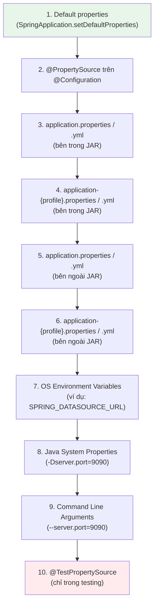
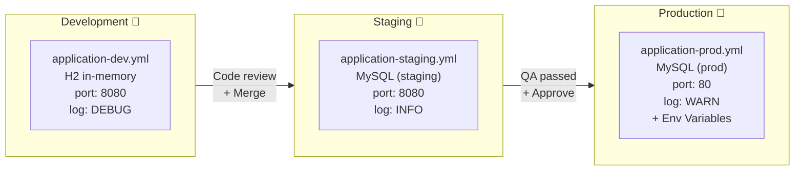
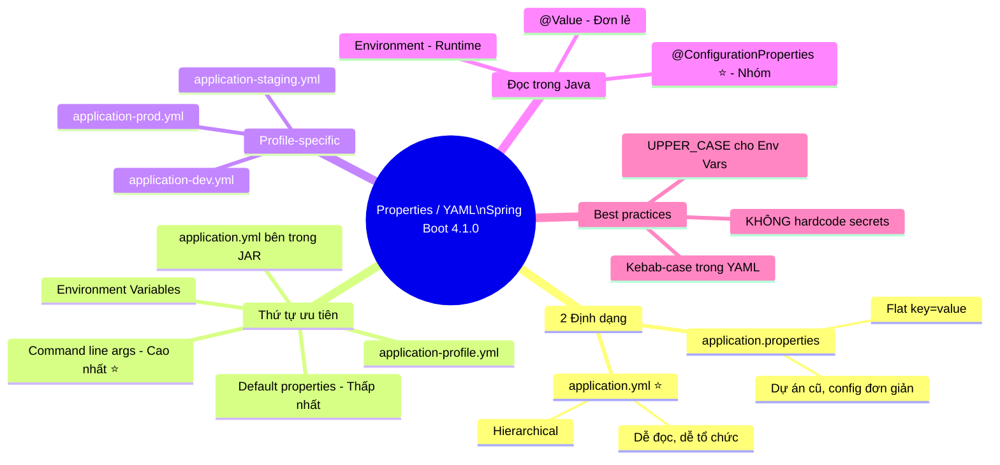

# 📋 Properties / YAML — Spring Boot 4.1.0

> **Nguồn chính thống:** [Spring Boot 4.1.0 — Externalized Configuration](https://docs.spring.io/spring-boot/reference/features/external-config.html)
>
> **Thuộc roadmap:** `3. Spring Boot → Properties/YAML`

---

## 1. Định nghĩa chính thức từ Spring Boot Docs

> *"Spring Boot lets you **externalize your configuration** so that you can work with the **same application code in different environments**. You can use a variety of external configuration sources including **Java properties files, YAML files, environment variables, and command-line arguments**."*
>
> — **Spring Boot 4.1.0 Reference — Externalized Configuration**

### Dịch & giải thích đơn giản:

**Externalized Configuration** (Cấu hình ngoại vi) là triết lý cốt lõi của Spring Boot: **tách cấu hình ra khỏi code**. Thay vì hardcode database URL, API key, hay server port vào trong Java code, bạn đặt chúng vào file cấu hình bên ngoài.

Lợi ích: **Cùng một bộ code**, chạy ở môi trường dev thì kết nối H2 database, chạy ở production thì kết nối MySQL — chỉ cần thay đổi file cấu hình, **không cần build lại code**.

Spring Boot hỗ trợ 2 định dạng file cấu hình chính:
- **`application.properties`** — Định dạng key=value truyền thống
- **`application.yml`** (hoặc `.yaml`) — Định dạng phân cấp (hierarchical), dễ đọc hơn

> [!IMPORTANT]
> Spring Boot khuyến nghị: *"It is recommended to stick with **one format** for your entire application."* — Chọn 1 định dạng và dùng xuyên suốt. Nếu cùng tồn tại cả `.properties` và `.yml` ở cùng vị trí, **`.properties` được ưu tiên hơn**.

---

## 2. Properties vs YAML — So sánh chi tiết

### 2.1 Cú pháp `application.properties`

```properties
# Cấu hình server
server.port=8080
server.servlet.context-path=/api

# Cấu hình datasource
spring.datasource.url=jdbc:mysql://localhost:3306/mydb
spring.datasource.username=root
spring.datasource.password=secret
spring.datasource.driver-class-name=com.mysql.cj.jdbc.Driver

# Cấu hình JPA
spring.jpa.hibernate.ddl-auto=update
spring.jpa.show-sql=true
spring.jpa.properties.hibernate.format_sql=true

# Cấu hình custom
app.name=My Awesome App
app.version=1.0.0
app.jwt.secret=mySecretKey123
app.jwt.expiration=86400000
```

### 2.2 Cú pháp `application.yml` (cùng nội dung)

```yaml
# Cấu hình server
server:
  port: 8080
  servlet:
    context-path: /api

# Cấu hình datasource
spring:
  datasource:
    url: jdbc:mysql://localhost:3306/mydb
    username: root
    password: secret
    driver-class-name: com.mysql.cj.jdbc.Driver

  # Cấu hình JPA
  jpa:
    hibernate:
      ddl-auto: update
    show-sql: true
    properties:
      hibernate:
        format_sql: true

# Cấu hình custom
app:
  name: My Awesome App
  version: 1.0.0
  jwt:
    secret: mySecretKey123
    expiration: 86400000
```

### 2.3 Bảng so sánh:

| Tiêu chí | `.properties` | `.yml` / `.yaml` |
|----------|--------------|-------------------|
| **Cú pháp** | `key=value` (flat) | Thụt lề phân cấp (hierarchical) |
| **Đọc hiểu** | Khó đọc khi nhiều config cùng prefix | ✅ Rõ ràng, trực quan, gom nhóm tự nhiên |
| **Lặp prefix** | ❌ Phải lặp lại prefix (ví dụ: `spring.datasource.` 4 lần) | ✅ Viết 1 lần, các con nằm bên dưới |
| **List / Array** | `list[0]=a`, `list[1]=b` | ✅ Dùng dấu `-` |
| **Multi-document** | ❌ Không hỗ trợ (trước Spring Boot 2.4) | ✅ Dùng `---` để tách nhiều document |
| **Comment** | `# comment` | `# comment` |
| **Sensitivity** | Không nhạy với khoảng trắng | ⚠️ Rất nhạy với thụt lề (indent) |
| **Spring Boot hỗ trợ** | ✅ Mặc định | ✅ Cần `snakeyaml` trên classpath (starter-web đã có sẵn) |

> [!TIP]
> **Khuyến nghị thực tế:** Hầu hết các dự án hiện đại sử dụng **YAML** vì dễ đọc và tổ chức tốt hơn. Properties vẫn phổ biến trong các dự án cũ hoặc khi cần config đơn giản.

---

## 3. Thứ tự ưu tiên của Property Sources (⭐ Cực kỳ quan trọng)

Spring Boot đọc cấu hình từ **nhiều nguồn** và áp dụng theo thứ tự ưu tiên **từ thấp đến cao** (nguồn sau ghi đè nguồn trước):



> [!WARNING]
> **Nguyên tắc quan trọng nhất:** Command line arguments (`--key=value`) luôn ghi đè mọi file cấu hình. Điều này có nghĩa là khi deploy, đội DevOps có thể override bất kỳ config nào mà không cần sửa file.

### Ví dụ thực tế về thứ tự ưu tiên:

```yaml
# File: application.yml (bên trong JAR)
server:
  port: 8080
```

```bash
# Chạy với command line argument → GHI ĐÈ file config
java -jar myapp.jar --server.port=9090

# Kết quả: Ứng dụng chạy trên port 9090 (KHÔNG phải 8080)
```

```bash
# Hoặc dùng Environment Variable
export SERVER_PORT=9090
java -jar myapp.jar

# Kết quả: Ứng dụng chạy trên port 9090
```

---

## 4. Profile-specific Configuration — Cấu hình theo môi trường

### 4.1 Tạo file profile-specific

```
src/main/resources/
├── application.yml                  ← Config chung (tất cả môi trường)
├── application-dev.yml              ← Config riêng cho Development
├── application-staging.yml          ← Config riêng cho Staging
└── application-prod.yml             ← Config riêng cho Production
```

**`application.yml` (config chung):**
```yaml
spring:
  application:
    name: my-ecommerce-app

app:
  name: My E-Commerce
  version: 2.0.0

logging:
  level:
    root: INFO
```

**`application-dev.yml` (Development):**
```yaml
server:
  port: 8080

spring:
  datasource:
    url: jdbc:h2:mem:devdb
    driver-class-name: org.h2.Driver
  h2:
    console:
      enabled: true       # Bật H2 Console để xem DB trên trình duyệt
  jpa:
    show-sql: true         # In câu SQL ra console để debug

logging:
  level:
    com.example: DEBUG     # Log chi tiết hơn khi dev
```

**`application-prod.yml` (Production):**
```yaml
server:
  port: 80

spring:
  datasource:
    url: jdbc:mysql://prod-db-server:3306/ecommerce
    username: ${DB_USERNAME}       # Đọc từ Environment Variable
    password: ${DB_PASSWORD}       # KHÔNG hardcode password!
    hikari:
      maximum-pool-size: 50
      minimum-idle: 10
  jpa:
    show-sql: false                # TẮT log SQL ở production

logging:
  level:
    com.example: WARN              # Chỉ log cảnh báo trở lên
```

### 4.2 Kích hoạt profile

```bash
# Cách 1: Command line argument
java -jar myapp.jar --spring.profiles.active=prod

# Cách 2: Environment variable
export SPRING_PROFILES_ACTIVE=prod
java -jar myapp.jar

# Cách 3: Trong application.yml (không khuyến nghị cho prod)
spring:
  profiles:
    active: dev

# Cách 4: Khi dùng nhiều profile cùng lúc
java -jar myapp.jar --spring.profiles.active=prod,redis,kafka
```

> [!CAUTION]
> **KHÔNG BAO GIỜ** hardcode password, API key, hay secret vào file `application-prod.yml` rồi commit lên Git! Luôn dùng **Environment Variables** hoặc **Secret Manager** (AWS Secrets Manager, HashiCorp Vault). Dùng cú pháp `${ENV_VAR_NAME}` để tham chiếu.

---

## 5. Cú pháp YAML nâng cao

### 5.1 Danh sách (List)

```yaml
# Cách 1: Block style (thường dùng)
app:
  allowed-origins:
    - http://localhost:3000
    - http://localhost:5173
    - https://myapp.com

# Cách 2: Inline style
app:
  allowed-origins: [http://localhost:3000, http://localhost:5173, https://myapp.com]
```

### 5.2 Map

```yaml
app:
  cache-ttl:
    products: 3600        # 1 giờ
    categories: 86400     # 1 ngày
    users: 1800           # 30 phút
```

```java
// Đọc bằng @ConfigurationProperties
@ConfigurationProperties(prefix = "app")
public class AppProperties {
    private Map<String, Long> cacheTtl = new HashMap<>();
    // Getter & Setter
}
```

### 5.3 Multi-document (nhiều profile trong 1 file)

```yaml
# Document 1: Config chung
spring:
  application:
    name: my-app

---
# Document 2: Profile dev
spring:
  config:
    activate:
      on-profile: dev
  datasource:
    url: jdbc:h2:mem:devdb

---
# Document 3: Profile prod
spring:
  config:
    activate:
      on-profile: prod
  datasource:
    url: jdbc:mysql://prod-server:3306/mydb
```

> [!NOTE]
> Dùng `---` (3 dấu gạch ngang) để tách các document trong cùng 1 file YAML. Mỗi document có thể gắn với một profile khác nhau qua `spring.config.activate.on-profile`.

### 5.4 Tham chiếu biến (Property Placeholders)

```yaml
app:
  name: My E-Commerce
  description: "${app.name} is the best shopping platform"  # → "My E-Commerce is the best..."

server:
  port: ${PORT:8080}  # Đọc env var PORT, nếu không có thì mặc định 8080
```

### 5.5 Random Values

```yaml
app:
  instance-id: ${random.uuid}           # UUID ngẫu nhiên
  secret: ${random.value}               # Giá trị ngẫu nhiên
  server-port: ${random.int(8000,9000)} # Số ngẫu nhiên từ 8000-9000
```

---

## 6. Đọc Properties trong Java Code

### 6.1 `@Value` — Đọc từng property đơn lẻ

```java
@Service
public class NotificationService {

    @Value("${app.name}")
    private String appName;

    @Value("${app.notification.enabled:true}")  // Giá trị mặc định nếu property không tồn tại
    private boolean notificationEnabled;

    @Value("${app.allowed-origins}")
    private List<String> allowedOrigins;         // Tự động convert sang List!

    public void sendWelcome(String user) {
        if (notificationEnabled) {
            System.out.println("Welcome to " + appName + ", " + user + "!");
        }
    }
}
```

### 6.2 `@ConfigurationProperties` — Đọc nhóm properties (⭐ Khuyến nghị)

```java
@ConfigurationProperties(prefix = "app.jwt")
@Validated    // Bật validation cho config
public class JwtProperties {

    @NotBlank(message = "JWT secret không được để trống!")
    private String secret;

    @Min(value = 60000, message = "JWT expiration phải >= 60 giây")
    private long expiration;

    private String issuer = "my-app";  // Giá trị mặc định

    // Getters & Setters
}
```

```yaml
app:
  jwt:
    secret: mySecretKeyThatIsLongEnoughForHS256Algorithm
    expiration: 86400000    # 24 giờ
    issuer: my-ecommerce    # Ghi đè giá trị mặc định
```

### 6.3 `Environment` — Đọc bằng code tại runtime

```java
@Service
public class DynamicConfigService {

    private final Environment environment;

    public DynamicConfigService(Environment environment) {
        this.environment = environment;
    }

    public String getDatabaseUrl() {
        return environment.getProperty("spring.datasource.url");
    }

    public boolean isDevMode() {
        return Arrays.asList(environment.getActiveProfiles()).contains("dev");
    }
}
```

---

## 7. Relaxed Binding — Quy tắc linh hoạt khi đặt tên

Spring Boot rất linh hoạt trong cách bạn đặt tên property. Tất cả các cách viết sau đều **tương đương nhau**:

| Dạng viết | Ví dụ | Thường dùng trong |
|----------|-------|-------------------|
| **Kebab-case** | `spring.main.allow-bean-definition-overriding` | ✅ `application.yml` (khuyến nghị) |
| **Camel-case** | `spring.main.allowBeanDefinitionOverriding` | Java code |
| **Underscore** | `spring.main.allow_bean_definition_overriding` | `.properties` |
| **UPPER_CASE** | `SPRING_MAIN_ALLOWBEANDEFINITIONOVERRIDING` | ✅ Environment variables (khuyến nghị) |

> [!TIP]
> **Best practice:** Trong file `application.yml`, luôn dùng **kebab-case** (chữ thường, phân cách bằng dấu gạch ngang). Trong Environment Variables, luôn dùng **UPPER_CASE** (chữ in hoa, phân cách bằng underscore). Spring tự động map giữa 2 kiểu.

---

## 8. Các Properties phổ biến nhất (Phải nhớ khi đi làm)

### 8.1 Server Configuration

```yaml
server:
  port: 8080                          # Port chạy ứng dụng
  servlet:
    context-path: /api                # Prefix cho tất cả URL
  error:
    include-message: always           # Hiển thị error message trong response
    include-stacktrace: never         # KHÔNG hiển thị stacktrace (security!)
  compression:
    enabled: true                     # Bật nén GZIP cho response
```

### 8.2 Database Configuration

```yaml
spring:
  datasource:
    url: jdbc:mysql://localhost:3306/mydb?useSSL=false&serverTimezone=UTC
    username: root
    password: ${DB_PASSWORD}
    hikari:                           # HikariCP connection pool
      maximum-pool-size: 20
      minimum-idle: 5
      idle-timeout: 30000             # 30 giây
      max-lifetime: 1800000           # 30 phút
      connection-timeout: 20000       # 20 giây

  jpa:
    hibernate:
      ddl-auto: validate              # Production: dùng validate hoặc none
    show-sql: false
    open-in-view: false               # ⭐ Tắt OSIV — best practice
```

### 8.3 Logging Configuration

```yaml
logging:
  level:
    root: INFO
    com.example.myapp: DEBUG          # Log chi tiết cho package của bạn
    org.springframework.web: WARN     # Giảm noise từ Spring
    org.hibernate.SQL: DEBUG          # Xem câu SQL (chỉ bật khi dev)
  file:
    name: logs/myapp.log              # Ghi log ra file
  logback:
    rollingpolicy:
      max-file-size: 10MB             # Mỗi file log tối đa 10MB
      max-history: 30                 # Giữ tối đa 30 file
```

### 8.4 Jackson (JSON) Configuration

```yaml
spring:
  jackson:
    serialization:
      write-dates-as-timestamps: false     # Ngày tháng dạng ISO string
      indent-output: true                   # Pretty print (chỉ bật khi dev)
    deserialization:
      fail-on-unknown-properties: false     # Không crash khi nhận field lạ
    default-property-inclusion: non_null    # Bỏ qua field null trong JSON
    date-format: "yyyy-MM-dd HH:mm:ss"     # Format ngày tháng
    time-zone: "Asia/Ho_Chi_Minh"           # Múi giờ Việt Nam
```

---

## 🔥 Ứng dụng thực tế (Thực tế dùng để làm gì? Giải quyết vấn đề gì?)

### Bài toán: Deploy ứng dụng qua 3 môi trường



**Thực tế trong doanh nghiệp:**

| Tình huống | Giải pháp bằng Properties/YAML |
|-----------|-------------------------------|
| Dev cần database nhanh, không cần cài MySQL | `application-dev.yml` dùng H2 in-memory |
| Production cần bảo mật database password | `${DB_PASSWORD}` → đọc từ Environment Variable |
| DevOps muốn đổi port mà không build lại | `java -jar app.jar --server.port=9090` |
| Cần log chi tiết khi debug bug trên staging | Đổi `logging.level.com.example=DEBUG` trong file config |
| Kubernetes health check cần endpoint | `management.endpoints.web.exposure.include=health` |
| Frontend gọi API bị CORS | Thêm `app.cors.allowed-origins` vào YAML + đọc trong `WebMvcConfig` |

---

## 9. Tóm tắt kiến thức cốt lõi



---

## 10. Tổng hợp các chủ đề Properties/YAML (Bản đồ tra cứu)

### 🌟 10.1. Những kỹ thuật ƯU TIÊN PHẢI BIẾT TRƯỚC (Bắt buộc khi đi làm)
1. **Cú pháp YAML cơ bản:** Phải thành thạo viết YAML (thụt lề 2 spaces, list dùng `-`, string không cần quote trừ ký tự đặc biệt). Sai thụt lề = ứng dụng crash.
2. **Profile-specific config:** Biết tách config theo môi trường (`application-dev.yml`, `application-prod.yml`) và cách kích hoạt profile (`--spring.profiles.active`).
3. **Properties phổ biến:** Thuộc lòng các property hay dùng: `server.port`, `spring.datasource.*`, `spring.jpa.*`, `logging.level.*`.
4. **Environment Variable substitution:** Cú pháp `${ENV_VAR:default}` để đọc biến môi trường — bắt buộc cho production deployment.

### 🟡 10.2. Nhóm kỹ thuật Trung cấp (Quản lý config chuyên nghiệp)
1. **`@ConfigurationProperties` + `@Validated`:** Đọc nhóm config vào Java object và validate ngay lúc khởi động (ví dụ: bắt buộc phải có `jwt.secret`).
2. **Relaxed Binding:** Hiểu quy tắc Spring tự động map giữa `kebab-case` ↔ `camelCase` ↔ `UPPER_CASE` để tránh bối rối khi debug.
3. **Multi-document YAML (`---`):** Gom nhiều profile vào 1 file YAML thay vì tạo nhiều file riêng.
4. **Config file locations:** Biết Spring Boot tìm file config ở đâu (`classpath:/`, `classpath:/config/`, `file:./`, `file:./config/`) và thứ tự ưu tiên.

### 🔴 10.3. Nhóm kỹ thuật Nâng cao (Kiến trúc config phân tán)
1. **Spring Cloud Config Server:** Quản lý config tập trung cho hàng chục microservices, thay đổi config tại runtime mà không cần restart.
2. **Config Import (`spring.config.import`):** Import config từ nhiều nguồn: file khác, Config Server, Vault, Consul, v.v.
3. **`EnvironmentPostProcessor`:** Tự thêm property source tuỳ chỉnh (ví dụ: đọc secret từ AWS Secrets Manager) trước khi ApplicationContext khởi tạo.

## 📚 Tài liệu tham khảo chính thống

| Tài liệu | Link |
|-----------|------|
| Spring Boot 4.1.0 — Externalized Configuration | [docs.spring.io](https://docs.spring.io/spring-boot/reference/features/external-config.html) |
| Spring Boot 4.1.0 — Application Properties (Appendix) | [docs.spring.io](https://docs.spring.io/spring-boot/reference/appendix/application-properties/index.html) |
| Spring Boot 4.1.0 — Profiles | [docs.spring.io](https://docs.spring.io/spring-boot/reference/features/profiles.html) |
| Spring Boot 4.1.0 — @ConfigurationProperties | [docs.spring.io](https://docs.spring.io/spring-boot/reference/features/external-config.html#features.external-config.typesafe-configuration-properties) |
| YAML Specification | [yaml.org](https://yaml.org/spec/1.2.2/) |

---

> **Tiếp theo trong roadmap:** `Integrations with other Libraries/Frameworks` (Cách Spring Boot tích hợp với các thư viện và framework phổ biến — Lombok, MapStruct, Swagger, Flyway, v.v.).
