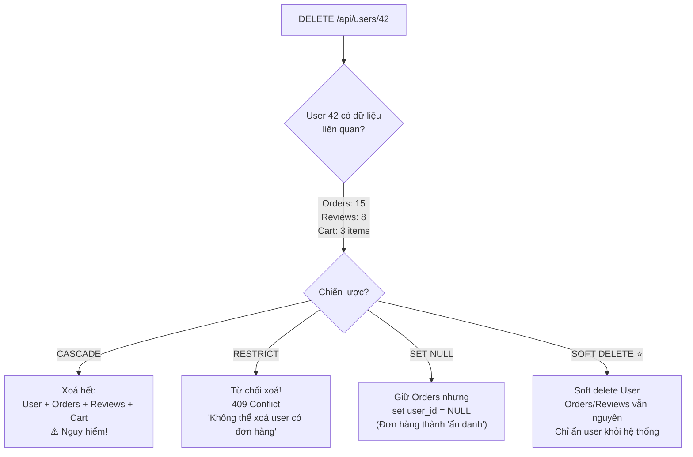
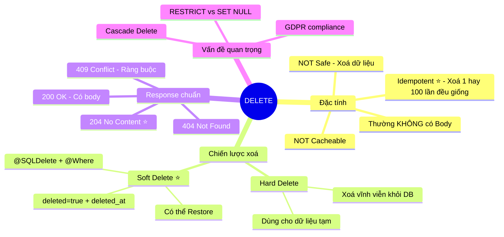

# 🗑️ HTTP Method: DELETE — REST API

> **Nguồn chính thống:** [RFC 9110 — HTTP Semantics: DELETE](https://www.rfc-editor.org/rfc/rfc9110.html#name-delete) | [MDN Web Docs — DELETE](https://developer.mozilla.org/en-US/docs/Web/HTTP/Methods/DELETE)
>
> **Thuộc roadmap:** `4. REST API → HTTP Methods → DELETE`

---

## 1. Định nghĩa chính thức từ RFC 9110

> *"The **DELETE** method requests that the origin server **remove the association** between the target resource and its current functionality. In effect, this method is similar to the **rm command** in UNIX."*
>
> — **RFC 9110, Section 9.3.5**

### Dịch & giải thích đơn giản:

**DELETE** là phương thức HTTP dùng để **xoá** một tài nguyên (resource) trên server. RFC ví nó giống lệnh `rm` trong UNIX — xoá sạch, dứt khoát.

Đặc tính quan trọng:
- **NOT Safe:** DELETE **thay đổi** dữ liệu trên server (xoá bản ghi).
- **Idempotent (Luỹ đẳng) ⭐:** Gọi DELETE 1 lần → resource bị xoá. Gọi DELETE lần 2, 3 → resource vẫn đã bị xoá → **kết quả cuối cùng giống nhau**.
- **NOT Cacheable:** Kết quả DELETE không được cache.
- **Không cần Request Body:** Thường không gửi body (chỉ cần URL chứa ID resource cần xoá).

> [!IMPORTANT]
> **Idempotent KHÔNG có nghĩa là response giống nhau!** DELETE lần 1 → `204 No Content`. DELETE lần 2 → có thể trả `404 Not Found`. Nhưng **trạng thái cuối cùng trên server** là giống nhau: resource không tồn tại. Đó là ý nghĩa của idempotent.

---

## 2. Soft Delete vs Hard Delete — Quyết định thiết kế quan trọng nhất

### 2.1 Hard Delete — Xoá vĩnh viễn khỏi Database

```sql
-- SQL thực thi
DELETE FROM products WHERE id = 42;
-- → Bản ghi biến mất hoàn toàn, KHÔNG THỂ khôi phục!
```

**Ưu điểm:** Đơn giản, database sạch sẽ, không tốn dung lượng.
**Nhược điểm:** KHÔNG thể khôi phục, mất dữ liệu lịch sử.

### 2.2 Soft Delete — Đánh dấu "đã xoá" (⭐ Phổ biến hơn trong thực tế)

```sql
-- SQL thực thi
UPDATE products SET deleted = true, deleted_at = NOW() WHERE id = 42;
-- → Bản ghi vẫn còn trong DB, chỉ bị ẩn!
```

**Ưu điểm:** Có thể khôi phục, giữ lịch sử, phục vụ audit/compliance.
**Nhược điểm:** Database phình to, mọi query cần thêm `WHERE deleted = false`.

### So sánh:

| Tiêu chí | Hard Delete | Soft Delete |
|----------|------------|-------------|
| **Dữ liệu** | Xoá vĩnh viễn | Đánh dấu `deleted=true` |
| **Khôi phục** | ❌ Không thể | ✅ Có thể (undelete) |
| **Hiệu năng DB** | ✅ DB nhẹ | ⚠️ DB phình to theo thời gian |
| **Compliance** | ❌ Mất audit trail | ✅ Giữ lịch sử đầy đủ |
| **Query** | Đơn giản | Phải thêm `WHERE deleted = false` |
| **Khi nào dùng** | Dữ liệu tạm, cache, session | User data, orders, products, tài liệu |

> [!TIP]
> **Thực tế trong doanh nghiệp:** Hầu hết các hệ thống enterprise đều dùng **Soft Delete** cho dữ liệu nghiệp vụ quan trọng (đơn hàng, người dùng, sản phẩm). Nhiều quy định pháp luật (GDPR, ngân hàng, y tế) yêu cầu phải lưu giữ dữ liệu trong một khoảng thời gian nhất định, không được xoá ngay.

---

## 3. Implementation trong Spring Boot 4.1.0

### 3.1 Controller Layer

```java
@RestController
@RequestMapping("/api/products")
@RequiredArgsConstructor
public class ProductController {

    private final ProductService productService;

    // DELETE /api/products/42
    @DeleteMapping("/{id}")
    public ResponseEntity<Void> delete(@PathVariable Long id) {
        productService.delete(id);
        return ResponseEntity.noContent().build();    // 204 No Content
    }

    // DELETE /api/products/batch?ids=1,2,3,4,5
    @DeleteMapping("/batch")
    public ResponseEntity<BatchDeleteResponse> deleteBatch(
            @RequestParam List<Long> ids) {
        BatchDeleteResponse result = productService.deleteBatch(ids);
        return ResponseEntity.ok(result);             // 200 OK với thống kê
    }
}
```

### 3.2 Service Layer — Soft Delete

```java
@Service
@RequiredArgsConstructor
@Slf4j
public class ProductService {

    private final ProductRepository productRepository;

    @Transactional
    public void delete(Long id) {
        Product product = productRepository.findById(id)
                .orElseThrow(() -> new ResourceNotFoundException("Product", "id", id));

        // Soft Delete — đánh dấu thay vì xoá thật
        product.setDeleted(true);
        product.setDeletedAt(LocalDateTime.now());
        productRepository.save(product);

        log.info("Soft deleted product: id={}, name={}", id, product.getName());
    }

    @Transactional
    public BatchDeleteResponse deleteBatch(List<Long> ids) {
        int deleted = 0;
        List<Long> notFound = new ArrayList<>();

        for (Long id : ids) {
            try {
                delete(id);
                deleted++;
            } catch (ResourceNotFoundException e) {
                notFound.add(id);
            }
        }

        return new BatchDeleteResponse(deleted, notFound);
    }
}
```

### 3.3 Entity với Soft Delete

```java
@Entity
@Table(name = "products")
@Where(clause = "deleted = false")    // Hibernate tự thêm WHERE deleted=false cho MỌI query
@SQLDelete(sql = "UPDATE products SET deleted = true, deleted_at = NOW() WHERE id = ?")
// ↑ Khi gọi repository.delete(), Hibernate chạy UPDATE thay vì DELETE
@Data
public class Product {

    @Id
    @GeneratedValue(strategy = GenerationType.IDENTITY)
    private Long id;

    private String name;
    private BigDecimal price;

    private boolean deleted = false;

    @Column(name = "deleted_at")
    private LocalDateTime deletedAt;

    // ... other fields
}
```

> [!NOTE]
> Với `@SQLDelete` + `@Where` (Hibernate), bạn gọi `productRepository.delete(product)` hay `productRepository.deleteById(id)` → Hibernate tự động chạy **UPDATE** (soft delete) thay vì **DELETE** (hard delete). Toàn bộ query `findAll()`, `findById()` cũng tự động thêm `WHERE deleted = false`. Code service **không cần thay đổi gì!**

### 3.4 Khôi phục resource đã xoá (Undelete)

```java
// Endpoint đặc biệt cho admin — khôi phục sản phẩm đã soft delete
@PatchMapping("/{id}/restore")
public ResponseEntity<ProductResponse> restore(@PathVariable Long id) {
    ProductResponse restored = productService.restore(id);
    return ResponseEntity.ok(restored);
}
```

```java
@Transactional
public ProductResponse restore(Long id) {
    // Bypass @Where filter bằng native query
    Product product = productRepository.findDeletedById(id)
            .orElseThrow(() -> new ResourceNotFoundException("Deleted Product", "id", id));

    product.setDeleted(false);
    product.setDeletedAt(null);
    productRepository.save(product);

    log.info("Restored product: id={}", id);
    return productMapper.toResponse(product);
}
```

```java
// Repository — Query bỏ qua @Where filter
@Repository
public interface ProductRepository extends JpaRepository<Product, Long> {

    @Query(value = "SELECT * FROM products WHERE id = :id AND deleted = true",
           nativeQuery = true)
    Optional<Product> findDeletedById(@Param("id") Long id);
}
```

---

## 4. Response Status Codes cho DELETE

| Status Code | Khi nào dùng | Ví dụ |
|------------|-------------|-------|
| **204 No Content** ⭐ | Xoá thành công, không trả body | DELETE /api/products/42 → xoá thành công |
| **200 OK** | Xoá thành công, trả về thông tin | Trả về object vừa xoá hoặc batch result |
| **202 Accepted** | Đã nhận yêu cầu xoá, đang xử lý (async) | Xoá file lớn, xoá cascade phức tạp |
| **400 Bad Request** | Request sai | DELETE body invalid |
| **401 Unauthorized** | Chưa đăng nhập | Thiếu JWT token |
| **403 Forbidden** | Không có quyền xoá | User thường xoá admin resource |
| **404 Not Found** | Resource không tồn tại | DELETE /api/products/999 |
| **409 Conflict** | Không thể xoá do ràng buộc | Xoá category đang có products |

---

## 5. Cascade Delete — Xoá dây chuyền

### Vấn đề: Xoá User → Đơn hàng, Review, Giỏ hàng của user đó sẽ như thế nào?



```java
// Kiểm tra trước khi xoá — Chiến lược RESTRICT
@Transactional
public void delete(Long userId) {
    User user = userRepository.findById(userId)
            .orElseThrow(() -> new ResourceNotFoundException("User", "id", userId));

    // Kiểm tra ràng buộc nghiệp vụ
    long orderCount = orderRepository.countByUserId(userId);
    if (orderCount > 0) {
        throw new BusinessException(
            "Không thể xoá user có " + orderCount + " đơn hàng. " +
            "Vui lòng chuyển đơn hàng hoặc dùng chức năng vô hiệu hoá tài khoản."
        );
    }

    userRepository.delete(user);
}
```

---

## 🔥 Ứng dụng thực tế (Thực tế dùng để làm gì? Giải quyết vấn đề gì?)

### DELETE trong ứng dụng E-commerce:

| Hành động | Request | Loại Delete | Lý do |
|----------|---------|------------|-------|
| Xoá sản phẩm | `DELETE /api/products/42` | **Soft Delete** | Đơn hàng cũ tham chiếu sản phẩm này |
| Xoá item khỏi giỏ hàng | `DELETE /api/cart/items/3` | **Hard Delete** | Dữ liệu tạm, không cần lưu |
| Xoá tài khoản user | `DELETE /api/users/42` | **Soft Delete** | GDPR cho phép khôi phục trong 30 ngày |
| Xoá review | `DELETE /api/reviews/88` | **Soft Delete** | Audit: admin cần biết ai đã xoá review gì |
| Xoá session/token | `DELETE /api/auth/logout` | **Hard Delete** | Token hết giá trị, xoá sạch |
| Admin xoá hàng loạt | `DELETE /api/products/batch?ids=1,2,3` | **Soft Delete** | Batch operation |

---

## 6. Tóm tắt DELETE



---

## 📚 Tài liệu tham khảo chính thống

| Tài liệu | Link |
|-----------|------|
| RFC 9110 — DELETE | [rfc-editor.org](https://www.rfc-editor.org/rfc/rfc9110.html#name-delete) |
| MDN — DELETE | [developer.mozilla.org](https://developer.mozilla.org/en-US/docs/Web/HTTP/Methods/DELETE) |
| Hibernate — @SQLDelete & @Where | [docs.jboss.org](https://docs.jboss.org/hibernate/orm/current/userguide/html_single/Hibernate_User_Guide.html) |

---

> **Tiếp theo trong roadmap:** `OPTIONS` (Phương thức khám phá khả năng của server — vai trò quan trọng trong CORS preflight request).
