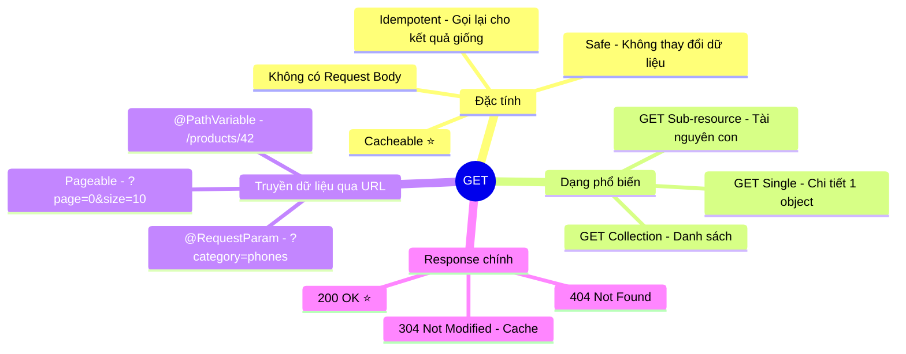

# 📥 HTTP Method: GET — REST API

> **Nguồn chính thống:** [RFC 9110 — HTTP Semantics: GET](https://www.rfc-editor.org/rfc/rfc9110.html#name-get) | [MDN Web Docs — GET](https://developer.mozilla.org/en-US/docs/Web/HTTP/Methods/GET)
>
> **Thuộc roadmap:** `4. REST API → HTTP Methods → GET`

---

## 1. Định nghĩa chính thức từ RFC 9110

> *"The **GET** method requests transfer of a **current selected representation** for the target resource. GET is the primary mechanism of information retrieval and the focus of almost all performance optimizations."*
>
> — **RFC 9110, Section 9.3.1**

### Dịch & giải thích đơn giản:

**GET** là phương thức HTTP dùng để **lấy dữ liệu** (đọc) từ server. Đây là phương thức **phổ biến nhất** — mỗi lần bạn mở trình duyệt gõ URL, trình duyệt gửi request GET.

Đặc tính quan trọng:
- **Safe (An toàn):** GET **KHÔNG** thay đổi dữ liệu trên server. Gọi 1 lần hay 100 lần, dữ liệu vẫn nguyên vẹn.
- **Idempotent (Luỹ đẳng):** Gọi lặp lại nhiều lần → kết quả giống nhau.
- **Cacheable (Có thể cache):** Kết quả GET có thể được trình duyệt/CDN lưu lại để tăng tốc.
- **Không có Request Body:** Dữ liệu truyền qua **URL parameters** (query string), không qua body.

> [!IMPORTANT]
> **KHÔNG BAO GIỜ** dùng GET để thay đổi dữ liệu (tạo, sửa, xoá). Ví dụ: `GET /api/users/delete/5` là **SAI HOÀN TOÀN** về mặt thiết kế REST. Nếu search engine crawl URL này, nó sẽ xoá user!

---

## 2. Các dạng GET phổ biến trong REST API

### 2.1 GET Collection — Lấy danh sách

```
GET /api/products
GET /api/products?page=0&size=10&sort=price,desc
GET /api/products?category=electronics&minPrice=100
```

### 2.2 GET Single Resource — Lấy chi tiết 1 object

```
GET /api/products/42
GET /api/users/john-doe
```

### 2.3 GET Sub-resource — Lấy tài nguyên con

```
GET /api/users/42/orders            ← Tất cả đơn hàng của user 42
GET /api/users/42/orders/101        ← Đơn hàng 101 của user 42
GET /api/products/42/reviews        ← Đánh giá của sản phẩm 42
```

---

## 3. Implementation trong Spring Boot 4.1.0

### 3.1 GET Collection với Pagination, Sorting & Filtering

```java
@RestController
@RequestMapping("/api/products")
@RequiredArgsConstructor
public class ProductController {

    private final ProductService productService;

    // GET /api/products?page=0&size=10&sort=price,desc
    @GetMapping
    public ResponseEntity<Page<ProductResponse>> getAll(
            @RequestParam(required = false) String category,
            @RequestParam(required = false) BigDecimal minPrice,
            @RequestParam(required = false) BigDecimal maxPrice,
            @RequestParam(required = false) String keyword,
            Pageable pageable) {

        Page<ProductResponse> products = productService
                .findAll(category, minPrice, maxPrice, keyword, pageable);

        return ResponseEntity.ok(products);
    }
}
```

**Response (200 OK):**
```json
{
  "content": [
    {
      "id": 1,
      "name": "iPhone 16 Pro",
      "price": 29990000,
      "category": "electronics"
    },
    {
      "id": 2,
      "name": "MacBook Pro M4",
      "price": 42990000,
      "category": "electronics"
    }
  ],
  "pageable": {
    "pageNumber": 0,
    "pageSize": 10,
    "sort": { "sorted": true, "orders": [{"property": "price", "direction": "DESC"}] }
  },
  "totalElements": 156,
  "totalPages": 16,
  "last": false
}
```

### 3.2 GET Single Resource

```java
@GetMapping("/{id}")
public ResponseEntity<ProductResponse> getById(@PathVariable Long id) {
    ProductResponse product = productService.findById(id);
    return ResponseEntity.ok(product);
}

// GET /api/products/search?keyword=iphone
@GetMapping("/search")
public ResponseEntity<List<ProductResponse>> search(
        @RequestParam String keyword) {
    List<ProductResponse> results = productService.search(keyword);
    return ResponseEntity.ok(results);
}
```

### 3.3 Service Layer

```java
@Service
@RequiredArgsConstructor
public class ProductService {

    private final ProductRepository productRepository;
    private final ProductMapper productMapper;

    public ProductResponse findById(Long id) {
        Product product = productRepository.findById(id)
                .orElseThrow(() -> new ResourceNotFoundException("Product", "id", id));
        return productMapper.toResponse(product);
    }

    public Page<ProductResponse> findAll(String category, BigDecimal minPrice,
            BigDecimal maxPrice, String keyword, Pageable pageable) {

        // Dùng Specification hoặc @Query để filter
        Page<Product> products = productRepository
                .findByFilters(category, minPrice, maxPrice, keyword, pageable);

        return products.map(productMapper::toResponse);
    }
}
```

---

## 4. Query Parameters — Cách truyền dữ liệu cho GET

Vì GET không có body, dữ liệu được truyền qua **URL**:

| Kỹ thuật | Ví dụ URL | Annotation |
|----------|----------|------------|
| **Path Variable** | `GET /api/products/42` | `@PathVariable Long id` |
| **Query Parameter** | `GET /api/products?category=electronics` | `@RequestParam String category` |
| **Query Param (Optional)** | `GET /api/products?minPrice=100` | `@RequestParam(required = false) BigDecimal minPrice` |
| **Pagination** | `GET /api/products?page=0&size=10` | `Pageable pageable` (Spring Data tự parse) |
| **Sorting** | `GET /api/products?sort=price,desc` | Nằm trong `Pageable` |

> [!WARNING]
> **Giới hạn URL:** Hầu hết trình duyệt giới hạn URL khoảng **2048 ký tự**. Nếu cần truyền filter phức tạp (ví dụ: 50 category IDs), hãy cân nhắc dùng **POST** với body thay vì GET với query string quá dài.

---

## 5. Response Status Codes cho GET

| Status Code | Khi nào dùng | Ví dụ |
|------------|-------------|-------|
| **200 OK** | Tìm thấy tài nguyên, trả về thành công | GET /api/products → danh sách products |
| **204 No Content** | Thành công nhưng không có dữ liệu trả về | GET /api/products → danh sách rỗng (ít dùng, thường trả 200 với array rỗng) |
| **301/302** | Tài nguyên đã chuyển vĩnh viễn/tạm thời | URL cũ redirect sang URL mới |
| **304 Not Modified** | Tài nguyên chưa thay đổi (cache) | Browser gửi `If-None-Match` header |
| **400 Bad Request** | Query parameters sai định dạng | `GET /api/products?price=abc` |
| **401 Unauthorized** | Chưa đăng nhập | Thiếu JWT token |
| **403 Forbidden** | Đã đăng nhập nhưng không có quyền | User thường xem admin API |
| **404 Not Found** | Tài nguyên không tồn tại | `GET /api/products/999` (ID 999 không tồn tại) |

---

## 6. Caching cho GET Requests

GET là phương thức **duy nhất** thường được cache:

```java
@GetMapping("/{id}")
public ResponseEntity<ProductResponse> getById(@PathVariable Long id) {
    ProductResponse product = productService.findById(id);

    return ResponseEntity.ok()
            .cacheControl(CacheControl.maxAge(1, TimeUnit.HOURS))  // Cache 1 giờ
            .eTag(String.valueOf(product.hashCode()))               // ETag cho validation
            .body(product);
}
```

```java
// Hoặc dùng @Cacheable (Redis/Caffeine)
@Cacheable(value = "products", key = "#id")
public ProductResponse findById(Long id) {
    return productRepository.findById(id)
            .map(productMapper::toResponse)
            .orElseThrow(() -> new ResourceNotFoundException("Product", "id", id));
}
```

---

## 🔥 Ứng dụng thực tế (Thực tế dùng để làm gì? Giải quyết vấn đề gì?)

### GET trong ứng dụng E-commerce thực tế:

| Trang | GET Request | Mô tả |
|-------|------------|-------|
| Trang chủ | `GET /api/products?featured=true&size=8` | Lấy 8 sản phẩm nổi bật |
| Danh mục | `GET /api/products?category=phones&page=0&size=20&sort=price,asc` | Danh sách điện thoại, sắp theo giá tăng dần |
| Chi tiết SP | `GET /api/products/42` | Thông tin chi tiết sản phẩm |
| Đánh giá | `GET /api/products/42/reviews?page=0&size=5` | 5 review mới nhất |
| Tìm kiếm | `GET /api/products/search?keyword=iphone&minPrice=10000000` | Tìm iPhone giá trên 10 triệu |
| Giỏ hàng | `GET /api/cart` | Lấy giỏ hàng hiện tại |
| Đơn hàng | `GET /api/orders?status=DELIVERED` | Đơn hàng đã giao |

---

## 7. Tóm tắt GET



---

## 📚 Tài liệu tham khảo chính thống

| Tài liệu | Link |
|-----------|------|
| RFC 9110 — GET | [rfc-editor.org](https://www.rfc-editor.org/rfc/rfc9110.html#name-get) |
| MDN — GET | [developer.mozilla.org](https://developer.mozilla.org/en-US/docs/Web/HTTP/Methods/GET) |
| Spring MVC — @GetMapping | [docs.spring.io](https://docs.spring.io/spring-framework/reference/web/webmvc/mvc-controller/ann-requestmapping.html) |

---

> **Tiếp theo trong roadmap:** `POST` (Phương thức tạo mới tài nguyên — cách gửi body, validation, và trả về 201 Created).
