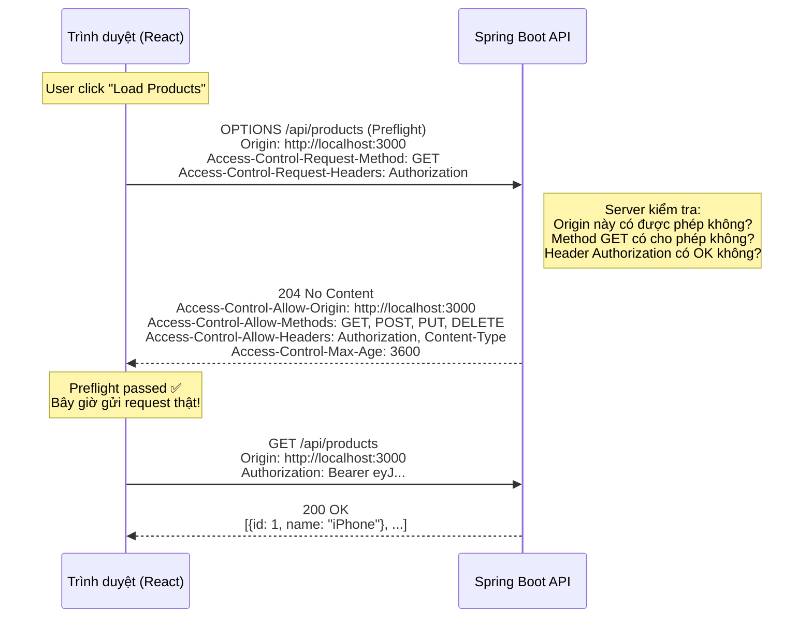
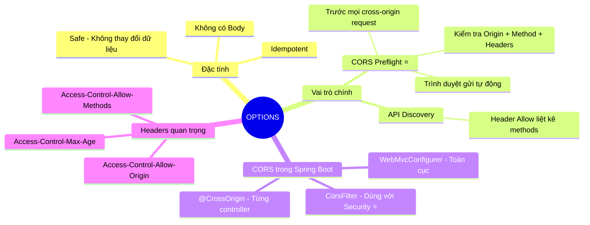

# 🔍 HTTP Method: OPTIONS — REST API

> **Nguồn chính thống:** [RFC 9110 — HTTP Semantics: OPTIONS](https://www.rfc-editor.org/rfc/rfc9110.html#name-options) | [MDN Web Docs — OPTIONS](https://developer.mozilla.org/en-US/docs/Web/HTTP/Methods/OPTIONS)
>
> **Thuộc roadmap:** `4. REST API → HTTP Methods → OPTIONS`

---

## 1. Định nghĩa chính thức từ RFC 9110

> *"The **OPTIONS** method requests information about the **communication options available** for the target resource, at either the origin server or an intervening intermediary."*
>
> — **RFC 9110, Section 9.3.7**

### Dịch & giải thích đơn giản:

**OPTIONS** là phương thức HTTP dùng để **hỏi server**: *"Tài nguyên này hỗ trợ những phương thức nào? Có cho phép tôi gọi không?"*

Nói đơn giản: OPTIONS giống như việc bạn **gọi điện hỏi trước** nhà hàng: *"Anh ơi, quán mở cửa không? Có nhận đặt bàn online không? Có menu chay không?"* — trước khi thực sự đến ăn.

Đặc tính quan trọng:
- **Safe:** OPTIONS **KHÔNG** thay đổi dữ liệu trên server.
- **Idempotent:** Gọi lặp lại bao nhiêu lần cũng cho kết quả giống nhau.
- **Không có Request Body** (thường).
- **Response chứa metadata** về server/resource, không chứa data thật.

> [!IMPORTANT]
> Trong thực tế, bạn **hiếm khi gọi OPTIONS trực tiếp**. Trình duyệt **tự động** gửi OPTIONS request trước mỗi cross-origin request (CORS preflight). Đây là vai trò quan trọng nhất của OPTIONS trong web development hiện đại.

---

## 2. CORS Preflight — Vai trò quan trọng nhất của OPTIONS

### 2.1 Vấn đề: Cross-Origin Request bị chặn

Khi frontend (React, Vue) ở `http://localhost:3000` gọi API ở `http://localhost:8080`:

```
Frontend: http://localhost:3000  →  API: http://localhost:8080/api/products
         ↑ Origin khác nhau!                    ↑
         Trình duyệt CHẶN request vì lý do bảo mật (Same-Origin Policy)
```

### 2.2 Giải pháp: CORS Preflight với OPTIONS

Trước khi gửi request thật, trình duyệt **tự động** gửi một request OPTIONS "dò đường":



### 2.3 Khi nào trình duyệt gửi Preflight?

Trình duyệt gửi OPTIONS preflight khi request thuộc loại **"not simple"**:

| Điều kiện | Simple Request (Không preflight) | Preflight Required |
|----------|--------------------------------|-------------------|
| **Method** | GET, HEAD, POST | PUT, DELETE, PATCH |
| **Content-Type** | `text/plain`, `multipart/form-data`, `application/x-www-form-urlencoded` | `application/json` ⚠️ |
| **Custom Headers** | Không có | `Authorization`, `X-Custom-Header` |

> [!WARNING]
> **Gần như mọi REST API call đều trigger preflight!** Vì REST API dùng `Content-Type: application/json` + `Authorization` header → đều là "not simple" → trình duyệt **luôn** gửi OPTIONS trước. Nếu server không trả đúng CORS headers → request thật sẽ bị chặn.

---

## 3. Cấu hình CORS trong Spring Boot 4.1.0

### 3.1 Cách 1: `WebMvcConfigurer` (Toàn cục — Khuyến nghị)

```java
@Configuration
public class WebMvcConfig implements WebMvcConfigurer {

    @Override
    public void addCorsMappings(CorsRegistry registry) {
        registry.addMapping("/api/**")                        // Áp dụng cho mọi /api/*
                .allowedOrigins(
                    "http://localhost:3000",                   // React dev
                    "http://localhost:5173",                   // Vite dev
                    "https://myapp.com"                        // Production
                )
                .allowedMethods("GET", "POST", "PUT", "PATCH", "DELETE", "OPTIONS")
                .allowedHeaders("*")                           // Cho phép mọi header
                .allowCredentials(true)                        // Cho phép gửi cookie/token
                .maxAge(3600);                                 // Cache preflight 1 giờ
    }
}
```

### 3.2 Cách 2: `@CrossOrigin` (Trên từng Controller)

```java
@RestController
@RequestMapping("/api/products")
@CrossOrigin(origins = "http://localhost:3000", maxAge = 3600)
public class ProductController {
    // Chỉ controller này cho phép CORS từ localhost:3000
}
```

### 3.3 Cách 3: `CorsFilter` Bean (Linh hoạt nhất — dùng với Spring Security)

```java
@Configuration
public class CorsConfig {

    @Bean
    public CorsFilter corsFilter() {
        CorsConfiguration config = new CorsConfiguration();
        config.setAllowedOrigins(List.of(
            "http://localhost:3000",
            "https://myapp.com"
        ));
        config.setAllowedMethods(List.of("GET", "POST", "PUT", "PATCH", "DELETE", "OPTIONS"));
        config.setAllowedHeaders(List.of("*"));
        config.setAllowCredentials(true);
        config.setMaxAge(3600L);

        UrlBasedCorsConfigurationSource source = new UrlBasedCorsConfigurationSource();
        source.registerCorsConfiguration("/api/**", config);

        return new CorsFilter(source);
    }
}
```

> [!CAUTION]
> Khi dùng **Spring Security**, cấu hình CORS trong `WebMvcConfigurer` **có thể bị bỏ qua** vì Security filter chain chạy trước. Bạn cần cấu hình CORS **trong Security config** nữa:
> ```java
> @Bean
> public SecurityFilterChain filterChain(HttpSecurity http) throws Exception {
>     return http
>         .cors(cors -> cors.configurationSource(corsConfigurationSource()))
>         .csrf(csrf -> csrf.disable())
>         // ... other config
>         .build();
> }
> ```

---

## 4. OPTIONS ngoài CORS — Khám phá API

Ngoài CORS preflight, OPTIONS cũng có thể dùng để **khám phá** những methods mà một endpoint hỗ trợ:

**Request:**
```http
OPTIONS /api/products HTTP/1.1
Host: api.example.com
```

**Response:**
```http
HTTP/1.1 204 No Content
Allow: GET, POST, PUT, DELETE, OPTIONS
```

Header `Allow` liệt kê tất cả methods mà endpoint `/api/products` chấp nhận.

> [!NOTE]
> Trong Spring MVC, khi bạn định nghĩa `@GetMapping` và `@PostMapping` cho `/api/products`, Spring tự động xử lý OPTIONS và trả về header `Allow: GET, POST, OPTIONS`. Bạn **không cần viết code** để handle OPTIONS request.

---

## 5. CORS Headers quan trọng

| Header | Mô tả | Ví dụ |
|--------|--------|-------|
| `Access-Control-Allow-Origin` | Origin nào được phép | `http://localhost:3000` hoặc `*` |
| `Access-Control-Allow-Methods` | Methods nào được phép | `GET, POST, PUT, DELETE` |
| `Access-Control-Allow-Headers` | Custom headers nào được phép | `Authorization, Content-Type` |
| `Access-Control-Allow-Credentials` | Có cho gửi cookie/token không | `true` |
| `Access-Control-Max-Age` | Cache preflight bao lâu (giây) | `3600` (1 giờ) |
| `Access-Control-Expose-Headers` | Headers nào client được đọc từ response | `X-Total-Count, Location` |

---

## 🔥 Ứng dụng thực tế (Thực tế dùng để làm gì? Giải quyết vấn đề gì?)

### Lỗi CORS — Nỗi đau #1 của mọi Full-stack Developer

Nếu bạn thấy lỗi này trong Console trình duyệt:

```
Access to fetch at 'http://localhost:8080/api/products' from origin 
'http://localhost:3000' has been blocked by CORS policy: 
No 'Access-Control-Allow-Origin' header is present on the requested resource.
```

**Nguyên nhân:** Server Spring Boot chưa cấu hình CORS → OPTIONS preflight thất bại → trình duyệt chặn request thật.

**Giải pháp:** Thêm CORS config như phần 3 ở trên.

### Debug CORS nhanh:

```bash
# Gửi OPTIONS request thủ công bằng curl
curl -X OPTIONS http://localhost:8080/api/products \
  -H "Origin: http://localhost:3000" \
  -H "Access-Control-Request-Method: GET" \
  -H "Access-Control-Request-Headers: Authorization" \
  -v

# Nếu response có Access-Control-Allow-Origin → CORS OK ✅
# Nếu không có → CORS chưa cấu hình ❌
```

---

## 6. Tóm tắt OPTIONS



---

## 📚 Tài liệu tham khảo chính thống

| Tài liệu | Link |
|-----------|------|
| RFC 9110 — OPTIONS | [rfc-editor.org](https://www.rfc-editor.org/rfc/rfc9110.html#name-options) |
| MDN — OPTIONS | [developer.mozilla.org](https://developer.mozilla.org/en-US/docs/Web/HTTP/Methods/OPTIONS) |
| MDN — CORS | [developer.mozilla.org](https://developer.mozilla.org/en-US/docs/Web/HTTP/CORS) |
| Spring MVC — CORS | [docs.spring.io](https://docs.spring.io/spring-framework/reference/web/webmvc-cors.html) |

---

> **Tiếp theo trong roadmap:** `TRACE` (Phương thức debug mạng — Echo request, bảo mật, và tại sao nên tắt trong production).
