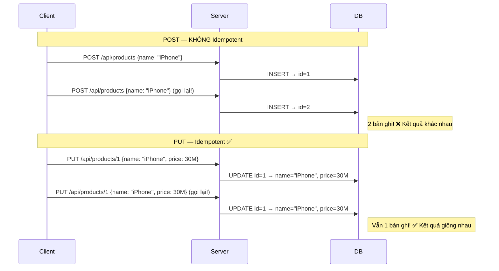
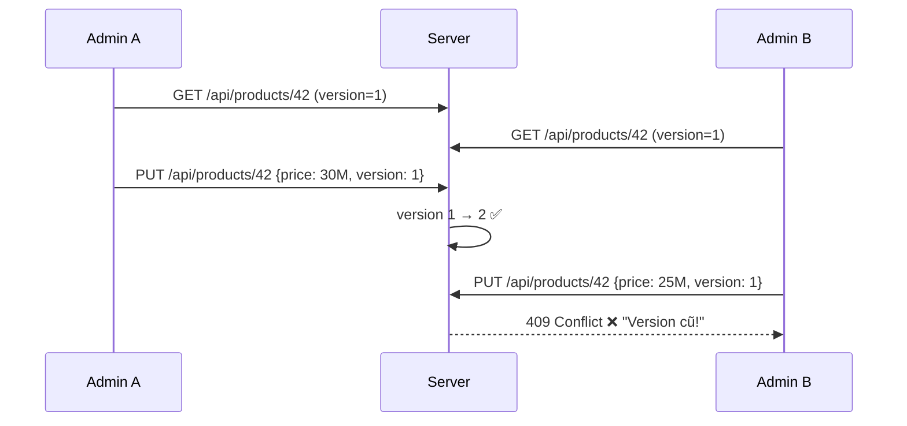
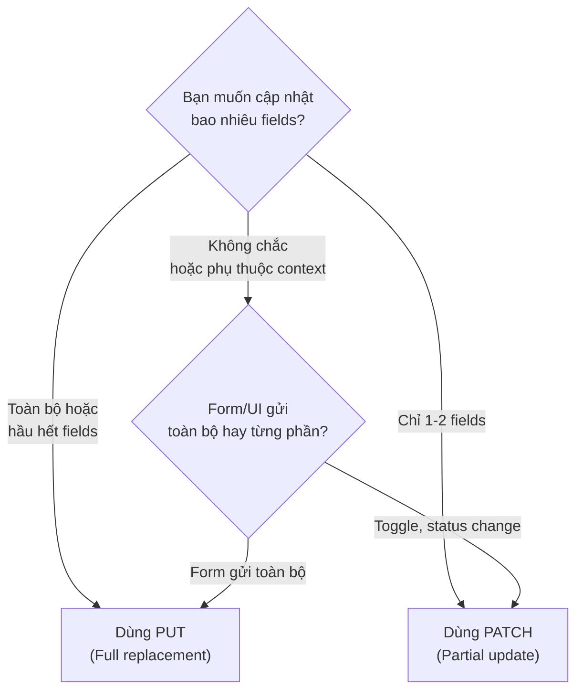
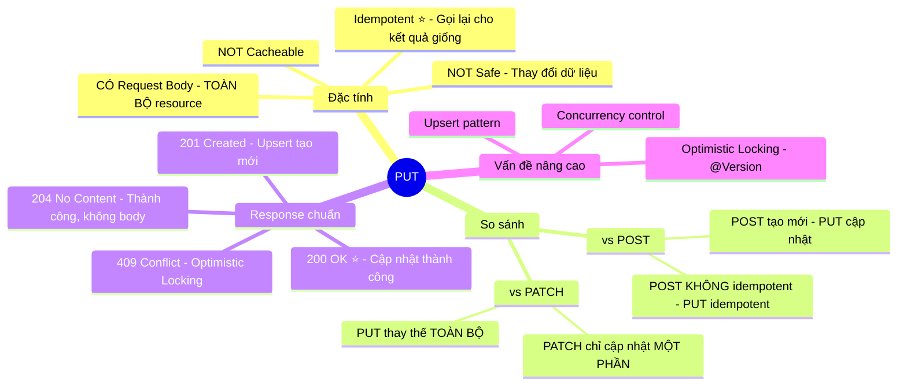

# ✏️ HTTP Method: PUT — REST API

> **Nguồn chính thống:** [RFC 9110 — HTTP Semantics: PUT](https://www.rfc-editor.org/rfc/rfc9110.html#name-put) | [MDN Web Docs — PUT](https://developer.mozilla.org/en-US/docs/Web/HTTP/Methods/PUT)
>
> **Thuộc roadmap:** `4. REST API → HTTP Methods → PUT`

---

## 1. Định nghĩa chính thức từ RFC 9110

> *"The **PUT** method requests that the state of the target resource be **created or replaced** with the state defined by the representation enclosed in the request message content."*
>
> — **RFC 9110, Section 9.3.4**

> *"A successful PUT of a given representation would suggest that a subsequent GET on that same target resource will result in an **equivalent representation** being sent in a 200 (OK) response."*

### Dịch & giải thích đơn giản:

**PUT** là phương thức HTTP dùng để **thay thế toàn bộ** một tài nguyên (resource) trên server. Nếu resource chưa tồn tại, PUT có thể **tạo mới** nó.

Hãy tưởng tượng PUT như việc **viết đè hoàn toàn** (overwrite) một file. Khi bạn PUT, bạn gửi lên **toàn bộ nội dung mới** — và server sẽ **thay thế hoàn toàn** nội dung cũ bằng nội dung mới.

Đặc tính quan trọng:
- **NOT Safe:** PUT **thay đổi** dữ liệu trên server.
- **Idempotent (Luỹ đẳng) ⭐:** Gọi PUT 1 lần hay 100 lần với **cùng nội dung** → kết quả **giống nhau**. Đây là **điểm khác biệt cốt lõi** so với POST.
- **NOT Cacheable:** Kết quả PUT thường không được cache.
- **Có Request Body:** Gửi **toàn bộ** trạng thái mới của resource.

> [!IMPORTANT]
> **PUT thay thế TOÀN BỘ resource!** Nếu bạn PUT một Product mà chỉ gửi `{name: "New Name"}` (thiếu `price`, `description`...), các field còn lại sẽ bị **set về null/default**. Nếu chỉ muốn cập nhật một phần, hãy dùng **PATCH** (xem phần so sánh bên dưới).

---

## 2. PUT vs POST — Idempotent là gì?

**Idempotent** (Luỹ đẳng) nghĩa là: *"Thực hiện một thao tác nhiều lần cho ra kết quả giống hệt như thực hiện 1 lần."*



### Tại sao Idempotent quan trọng?

Trong thực tế, **mạng không ổn định**. Client có thể:
- Mạng timeout → gửi lại request
- User click nút "Lưu" nhiều lần
- Load balancer retry request

Với PUT (idempotent): Dù server nhận 5 lần cùng 1 request → kết quả **luôn giống nhau** → **an toàn** để retry.

Với POST (not idempotent): Retry = có thể tạo ra bản ghi trùng lặp → **nguy hiểm**.

---

## 3. PUT vs PATCH — Khi nào dùng cái nào?

| Tiêu chí | PUT | PATCH |
|----------|-----|-------|
| **Ngữ nghĩa** | **Thay thế toàn bộ** resource | **Cập nhật một phần** resource |
| **Body chứa** | **Toàn bộ** trạng thái mới | **Chỉ những field** cần thay đổi |
| **Idempotent** | ✅ Có | ⚠️ Có thể có hoặc không (tuỳ implementation) |
| **Field thiếu** | Bị set về null/default | Giữ nguyên giá trị cũ |
| **Khi nào dùng** | Thay đổi nhiều/toàn bộ fields | Thay đổi 1-2 fields |

### Ví dụ cụ thể:

**Resource hiện tại trên server:**
```json
{
  "id": 42,
  "name": "iPhone 16 Pro",
  "price": 29990000,
  "description": "Smartphone cao cấp Apple",
  "stock": 100
}
```

**PUT — Phải gửi TOÀN BỘ:**
```http
PUT /api/products/42
Content-Type: application/json

{
  "name": "iPhone 16 Pro Max",
  "price": 34990000,
  "description": "Smartphone cao cấp Apple",
  "stock": 100
}
```
→ Nếu **thiếu `stock`** trong body → `stock` sẽ bị **set về 0 hoặc null**!

**PATCH — Chỉ gửi field cần sửa:**
```http
PATCH /api/products/42
Content-Type: application/json

{
  "name": "iPhone 16 Pro Max",
  "price": 34990000
}
```
→ Chỉ `name` và `price` được cập nhật. `description` và `stock` **giữ nguyên**.

> [!TIP]
> **Thực tế:** Nhiều API trong thực tế dùng PUT nhưng xử lý **giống PATCH** (chỉ cập nhật field có trong body, bỏ qua field null). Tuy nhiên, đây là cách làm **sai chuẩn REST**. Để code sạch, nên phân biệt rõ PUT (full update) và PATCH (partial update).

---

## 4. Implementation trong Spring Boot 4.1.0

### 4.1 Controller Layer — PUT (Full Update)

```java
@RestController
@RequestMapping("/api/products")
@RequiredArgsConstructor
public class ProductController {

    private final ProductService productService;

    // PUT /api/products/42 — Cập nhật toàn bộ
    @PutMapping("/{id}")
    public ResponseEntity<ProductResponse> update(
            @PathVariable Long id,
            @Valid @RequestBody ProductUpdateRequest request) {

        ProductResponse updated = productService.fullUpdate(id, request);
        return ResponseEntity.ok(updated);
    }

    // PATCH /api/products/42 — Cập nhật một phần
    @PatchMapping("/{id}")
    public ResponseEntity<ProductResponse> partialUpdate(
            @PathVariable Long id,
            @RequestBody ProductPatchRequest request) {

        ProductResponse updated = productService.partialUpdate(id, request);
        return ResponseEntity.ok(updated);
    }
}
```

### 4.2 Request DTO cho PUT

```java
// PUT DTO — TẤT CẢ fields đều bắt buộc (vì PUT thay thế toàn bộ)
@Data
public class ProductUpdateRequest {

    @NotBlank(message = "Tên sản phẩm không được để trống")
    @Size(min = 2, max = 200)
    private String name;

    @NotNull(message = "Giá không được để trống")
    @DecimalMin("0.01")
    private BigDecimal price;

    @NotBlank(message = "Danh mục không được để trống")
    private String category;

    @Size(max = 1000)
    private String description;     // Có thể rỗng nhưng phải gửi

    @Min(0)
    private int stock;              // Phải gửi, nếu không → mặc định 0
}
```

```java
// PATCH DTO — TẤT CẢ fields đều optional (chỉ update field có giá trị)
@Data
public class ProductPatchRequest {
    private String name;            // null = không thay đổi
    private BigDecimal price;       // null = không thay đổi
    private String category;        // null = không thay đổi
    private String description;     // null = không thay đổi
    private Integer stock;          // null = không thay đổi (dùng Integer, không dùng int)
}
```

### 4.3 Service Layer

```java
@Service
@RequiredArgsConstructor
@Slf4j
public class ProductService {

    private final ProductRepository productRepository;
    private final ProductMapper productMapper;

    // PUT — Full Update (thay thế toàn bộ)
    @Transactional
    public ProductResponse fullUpdate(Long id, ProductUpdateRequest request) {
        Product product = productRepository.findById(id)
                .orElseThrow(() -> new ResourceNotFoundException("Product", "id", id));

        // Ghi đè TOÀN BỘ fields (PUT semantics)
        product.setName(request.getName());
        product.setPrice(request.getPrice());
        product.setCategory(request.getCategory());
        product.setDescription(request.getDescription());
        product.setStock(request.getStock());
        product.setUpdatedAt(LocalDateTime.now());

        Product saved = productRepository.save(product);
        log.info("Full updated product: id={}", saved.getId());

        return productMapper.toResponse(saved);
    }

    // PATCH — Partial Update (chỉ cập nhật field không null)
    @Transactional
    public ProductResponse partialUpdate(Long id, ProductPatchRequest request) {
        Product product = productRepository.findById(id)
                .orElseThrow(() -> new ResourceNotFoundException("Product", "id", id));

        // Chỉ cập nhật field CÓ GIÁ TRỊ (không null)
        if (request.getName() != null) {
            product.setName(request.getName());
        }
        if (request.getPrice() != null) {
            product.setPrice(request.getPrice());
        }
        if (request.getCategory() != null) {
            product.setCategory(request.getCategory());
        }
        if (request.getDescription() != null) {
            product.setDescription(request.getDescription());
        }
        if (request.getStock() != null) {
            product.setStock(request.getStock());
        }
        product.setUpdatedAt(LocalDateTime.now());

        Product saved = productRepository.save(product);
        log.info("Partial updated product: id={}", saved.getId());

        return productMapper.toResponse(saved);
    }
}
```

---

## 5. PUT tạo mới resource (Upsert)

Theo RFC, nếu resource **chưa tồn tại**, PUT có thể **tạo mới**:

```java
@PutMapping("/{id}")
public ResponseEntity<ProductResponse> upsert(
        @PathVariable Long id,
        @Valid @RequestBody ProductUpdateRequest request) {

    Optional<Product> existing = productRepository.findById(id);

    if (existing.isPresent()) {
        // Đã tồn tại → Update
        ProductResponse updated = productService.fullUpdate(id, request);
        return ResponseEntity.ok(updated);              // 200 OK
    } else {
        // Chưa tồn tại → Create
        ProductResponse created = productService.createWithId(id, request);
        URI location = ServletUriComponentsBuilder
                .fromCurrentRequest().build().toUri();
        return ResponseEntity.created(location)          // 201 Created
                .body(created);
    }
}
```

> [!NOTE]
> **Upsert** (Update + Insert) không phải lúc nào cũng phù hợp. Nếu dùng auto-increment ID (thường gặp), bạn không thể biết trước ID → PUT để tạo mới không hợp lý. Upsert phổ biến hơn khi dùng **natural key** hoặc **UUID** làm ID.

---

## 6. Response Status Codes cho PUT

| Status Code | Khi nào dùng | Ví dụ |
|------------|-------------|-------|
| **200 OK** ⭐ | Cập nhật thành công, trả về resource mới | PUT /api/products/42 → product đã cập nhật |
| **201 Created** | Resource chưa tồn tại, PUT tạo mới (Upsert) | PUT /api/products/42 lần đầu tiên |
| **204 No Content** | Cập nhật thành công, không trả body | Khi client không cần response body |
| **400 Bad Request** | Dữ liệu đầu vào sai | Thiếu field bắt buộc |
| **404 Not Found** | Resource không tồn tại (khi không hỗ trợ Upsert) | PUT /api/products/999 |
| **409 Conflict** | Xung đột dữ liệu | Optimistic Locking — version cũ |
| **422 Unprocessable Entity** | Dữ liệu đúng format nhưng sai logic | Cập nhật giá thành số âm |

---

## 7. Optimistic Locking — Xử lý xung đột cập nhật đồng thời

### Vấn đề: 2 người cập nhật cùng 1 sản phẩm cùng lúc



### Implementation:

```java
@Entity
public class Product {
    @Id @GeneratedValue(strategy = GenerationType.IDENTITY)
    private Long id;

    private String name;
    private BigDecimal price;

    @Version    // JPA Optimistic Locking
    private Long version;
}
```

```java
@PutMapping("/{id}")
public ResponseEntity<?> update(
        @PathVariable Long id,
        @Valid @RequestBody ProductUpdateRequest request) {
    try {
        ProductResponse updated = productService.fullUpdate(id, request);
        return ResponseEntity.ok(updated);
    } catch (OptimisticLockingFailureException ex) {
        return ResponseEntity.status(HttpStatus.CONFLICT)
                .body(Map.of(
                    "error", "Dữ liệu đã bị thay đổi bởi người khác",
                    "message", "Vui lòng tải lại và thử lại"
                ));
    }
}
```

---

## 🔥 Ứng dụng thực tế (Thực tế dùng để làm gì? Giải quyết vấn đề gì?)

### PUT trong ứng dụng E-commerce thực tế:

| Hành động | Request | Ghi chú |
|----------|---------|---------|
| Admin sửa sản phẩm | `PUT /api/products/42` | Full update — gửi toàn bộ thông tin mới |
| User cập nhật profile | `PUT /api/users/profile` | Gửi toàn bộ profile mới |
| Cập nhật địa chỉ giao hàng | `PUT /api/addresses/5` | Thay thế hoàn toàn địa chỉ cũ |
| Sửa nội dung review | `PUT /api/reviews/88` | Ghi đè toàn bộ review cũ |
| Thay đổi số lượng giỏ hàng | `PATCH /api/cart/items/3` | PATCH vì chỉ đổi quantity |
| Đổi trạng thái đơn hàng | `PATCH /api/orders/101` | PATCH vì chỉ đổi status |

### Quy tắc chọn PUT vs PATCH trong thực tế:



---

## 8. Tóm tắt PUT



---

## 9. Tổng hợp các chủ đề HTTP Methods (Bản đồ tra cứu)

### 🌟 9.1. Những kiến thức ƯU TIÊN PHẢI BIẾT TRƯỚC (Bắt buộc khi đi làm)
1. **GET vs POST vs PUT vs DELETE:** Phân biệt rõ ràng khi nào dùng method nào. Đây là nền tảng của REST API — sai method = sai thiết kế hoàn toàn.
2. **Idempotent:** Hiểu tại sao GET/PUT/DELETE là idempotent còn POST thì không. Ảnh hưởng trực tiếp đến cách xử lý retry và error handling.
3. **Response Status Codes đúng:** `201 Created` cho POST, `200 OK` cho PUT/GET, `204 No Content` cho DELETE. Dùng sai status code = gây khó hiểu cho frontend developer.
4. **Request Body + Validation:** POST/PUT gửi body, GET dùng query params. Phải validate input bằng `@Valid` + `@NotBlank`, `@Min`, v.v.

### 🟡 9.2. Nhóm kỹ thuật Trung cấp (API chất lượng cao)
1. **PUT vs PATCH:** Phân biệt full update vs partial update. Biết khi nào nên dùng cái nào dựa trên use case.
2. **Idempotency Key (cho POST):** Xử lý vấn đề duplicate request — đặc biệt quan trọng cho payment, order APIs.
3. **Pagination + Sorting + Filtering (cho GET):** Sử dụng `Pageable`, `@RequestParam`, Specification để xây dựng API linh hoạt.
4. **Error Response chuẩn:** Tạo `GlobalExceptionHandler` + `ErrorResponse` DTO để trả về lỗi nhất quán.

### 🔴 9.3. Nhóm kỹ thuật Nâng cao (API Enterprise-grade)
1. **Optimistic Locking (`@Version`):** Xử lý xung đột khi nhiều người cập nhật cùng 1 resource đồng thời.
2. **HATEOAS (Hypermedia):** Trả về link navigable trong response — API tự mô tả.
3. **ETag + Conditional Requests:** Cache validation cho GET, Precondition cho PUT — tối ưu bandwidth và tránh xung đột.
4. **API Versioning (URL/Header/Content-Type):** Quản lý nhiều phiên bản API cùng lúc khi hệ thống phát triển.

## 📚 Tài liệu tham khảo chính thống

| Tài liệu | Link |
|-----------|------|
| RFC 9110 — HTTP Semantics (GET, POST, PUT, DELETE...) | [rfc-editor.org](https://www.rfc-editor.org/rfc/rfc9110.html#name-methods) |
| MDN — HTTP Methods | [developer.mozilla.org](https://developer.mozilla.org/en-US/docs/Web/HTTP/Methods) |
| Spring MVC — Request Mapping | [docs.spring.io](https://docs.spring.io/spring-framework/reference/web/webmvc/mvc-controller/ann-requestmapping.html) |
| RESTful API Design Best Practices | [restfulapi.net](https://restfulapi.net/) |

---

> **Tiếp theo trong roadmap:** `DELETE` (Phương thức xoá tài nguyên — Soft Delete vs Hard Delete, idempotent, và 204 No Content).
