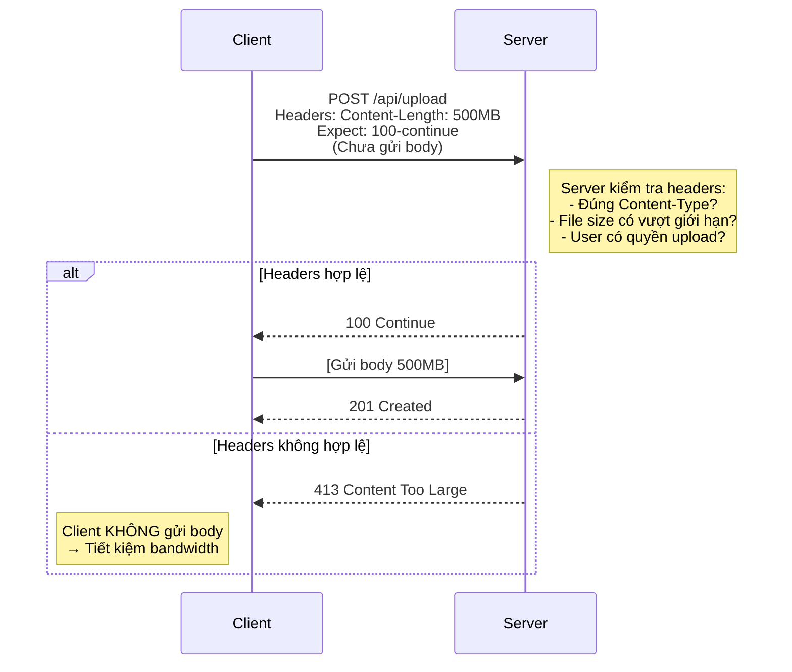
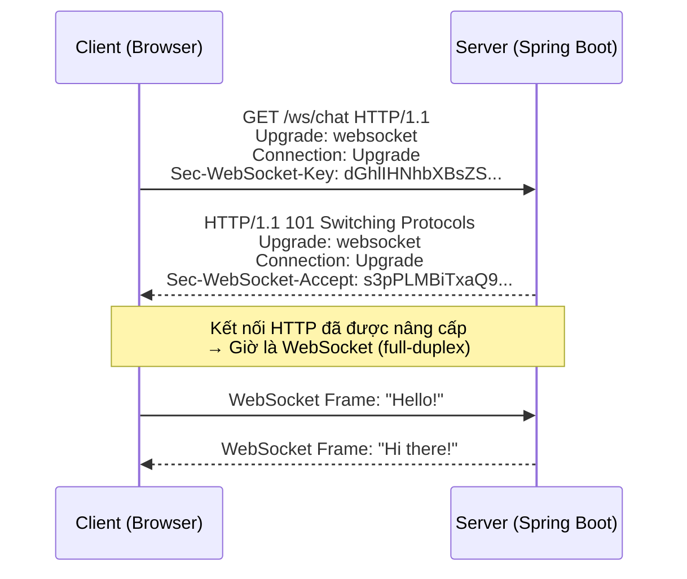
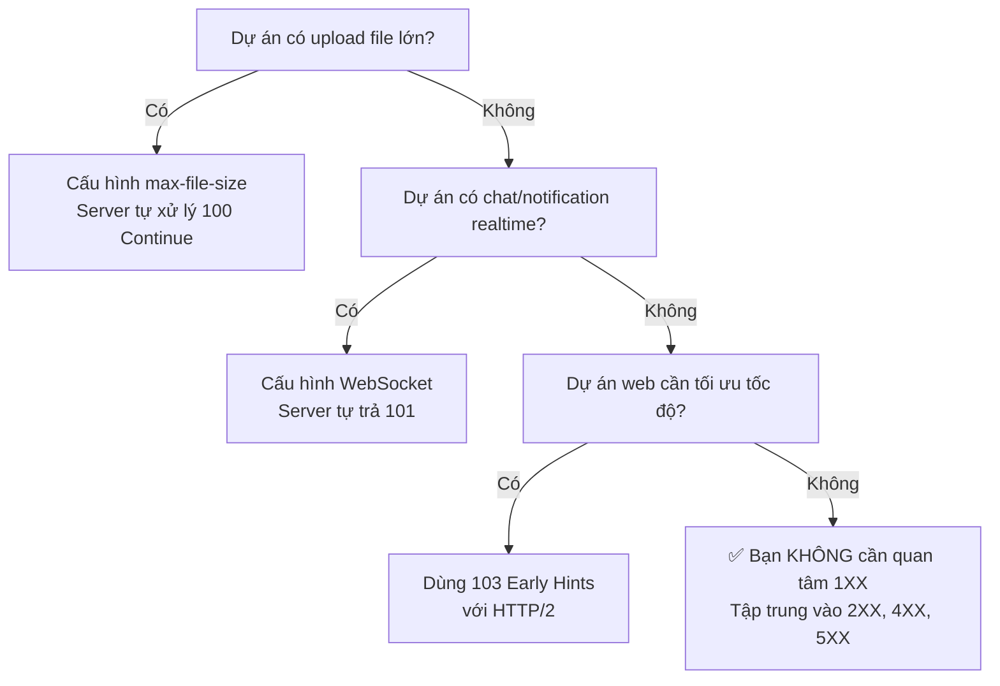

# ℹ️ HTTP Status Codes: 1XX — Informational (Phản hồi thông tin)

> **Nguồn chính thống:** [RFC 9110 — HTTP Semantics: Status Codes](https://www.rfc-editor.org/rfc/rfc9110.html#name-informational-1xx) | [MDN Web Docs — HTTP Status Codes](https://developer.mozilla.org/en-US/docs/Web/HTTP/Status#informational_responses)
>
> **Thuộc roadmap:** `4. REST API → HTTP Status Codes → 1.X.X`

---

## 1. Định nghĩa chính thức từ RFC 9110

> *"The **1xx (Informational)** class of status code indicates an **interim response** for communicating connection status or request progress prior to completing the requested action and sending a final response."*
>
> — **RFC 9110, Section 15.2**

### Dịch & giải thích đơn giản:

**Nhóm 1XX** là các mã trạng thái **tạm thời (interim)**. Server gửi 1XX để thông báo cho client rằng: *"Tôi đã nhận request của bạn, đang xử lý, hãy tiếp tục chờ hoặc tiếp tục gửi."*

Đặc tính quan trọng:
- **Tạm thời:** Không phải phản hồi cuối cùng — server SẼ gửi thêm response chính thức (2XX, 3XX, 4XX, 5XX) sau đó.
- **Không có body:** Response 1XX thường không chứa nội dung body.
- **Client phải xử lý được:** Client phải sẵn sàng nhận 1 hoặc nhiều response 1XX trước response cuối cùng.
- **Ít gặp trong thực tế REST API:** Bạn hiếm khi phải tự trả 1XX trong Spring Boot — phần lớn do web server tự xử lý.

> [!NOTE]
> Trong thực tế phát triển REST API hàng ngày, bạn **hầu như không cần trả 1XX thủ công**. Tuy nhiên, hiểu chúng giúp bạn debug network issues và xử lý các tình huống upload lớn, WebSocket, HTTP/2.

---

## 2. Bảng tổng hợp tất cả mã 1XX

| Status Code | Tên | Ý nghĩa | RFC |
|:-----------:|------|---------|:---:|
| **100** | Continue | Server đã nhận headers, client hãy tiếp tục gửi body | [RFC 9110 §15.2.1](https://www.rfc-editor.org/rfc/rfc9110.html#name-100-continue) |
| **101** | Switching Protocols | Server đồng ý chuyển đổi giao thức theo yêu cầu client | [RFC 9110 §15.2.2](https://www.rfc-editor.org/rfc/rfc9110.html#name-101-switching-protocols) |
| **102** | Processing | Server đã nhận request, đang xử lý (chưa xong) | [RFC 2518](https://www.rfc-editor.org/rfc/rfc2518#section-10.1) *(WebDAV)* |
| **103** | Early Hints | Server gửi trước một số headers (preload) trước response chính | [RFC 8297](https://www.rfc-editor.org/rfc/rfc8297) |

---

## 3. Chi tiết từng Status Code

### 3.1 `100 Continue` — Phổ biến nhất trong nhóm 1XX

**Kịch bản:** Client muốn gửi request body rất lớn (ví dụ: upload file 500MB). Trước khi gửi toàn bộ body, client hỏi server: *"Tôi muốn gửi body lớn, bạn có chấp nhận không?"*

**Quy trình hoạt động:**



**Ví dụ thực tế với cURL:**

```bash
# Client gửi header "Expect: 100-continue"
curl -v -X POST http://localhost:8080/api/upload \
  -H "Expect: 100-continue" \
  -H "Content-Type: multipart/form-data" \
  -F "file=@large-video.mp4"
```

**Cấu hình trong Spring Boot 4.1.0 (Tomcat):**

```yaml
# application.yml
server:
  tomcat:
    max-swallow-size: 100MB        # Giới hạn body server chấp nhận đọc
    max-http-form-post-size: 100MB # Giới hạn form POST
spring:
  servlet:
    multipart:
      max-file-size: 100MB         # Giới hạn 1 file upload
      max-request-size: 200MB      # Giới hạn toàn bộ request
```

```java
@RestController
@RequestMapping("/api/upload")
public class UploadController {

    // Tomcat tự động trả 100 Continue khi nhận header "Expect: 100-continue"
    // Nếu file vượt giới hạn → tự trả 413 TRƯỚC KHI client gửi body
    @PostMapping
    public ResponseEntity<String> upload(@RequestParam("file") MultipartFile file) {
        // Xử lý file...
        return ResponseEntity.status(HttpStatus.CREATED)
                .body("Uploaded: " + file.getOriginalFilename());
    }
}
```

> [!IMPORTANT]
> **Bạn KHÔNG cần tự code trả 100 Continue.** Web server (Tomcat, Netty) tự xử lý mechanism này. Việc bạn cần làm là **cấu hình đúng giới hạn file size** để server từ chối sớm các file quá lớn.

---

### 3.2 `101 Switching Protocols` — Chuyển đổi giao thức

**Kịch bản:** Client yêu cầu server chuyển từ HTTP sang giao thức khác (phổ biến nhất: **WebSocket**).

**Quy trình WebSocket Handshake:**



**Cấu hình WebSocket trong Spring Boot 4.1.0:**

```java
@Configuration
@EnableWebSocketMessageBroker
public class WebSocketConfig implements WebSocketMessageBrokerConfigurer {

    @Override
    public void registerStompEndpoints(StompEndpointRegistry registry) {
        // Client kết nối tới /ws → Server trả 101 Switching Protocols
        registry.addEndpoint("/ws")
                .setAllowedOrigins("*")
                .withSockJS();
    }

    @Override
    public void configureMessageBroker(MessageBrokerRegistry registry) {
        registry.enableSimpleBroker("/topic", "/queue");
        registry.setApplicationDestinationPrefixes("/app");
    }
}
```

> [!TIP]
> Khi dùng Chrome DevTools (F12 → Network → WS), bạn sẽ thấy request đầu tiên trả về **101 Switching Protocols** — đó chính là lúc HTTP "nhường chỗ" cho WebSocket.

---

### 3.3 `102 Processing` — Đang xử lý (WebDAV)

**Kịch bản:** Server nhận request nhưng cần **thời gian dài** để xử lý. Để client không bị timeout, server gửi 102 để nói: *"Tôi vẫn đang làm, đừng ngắt kết nối!"*

```
Client → Server: COPY /large-folder/ (WebDAV — copy thư mục lớn)
Server → Client: 102 Processing       (Đang copy...)
Server → Client: 102 Processing       (Vẫn đang copy...)
Server → Client: 201 Created          (Xong!)
```

> [!WARNING]
> **102 Processing** chỉ thuộc **WebDAV** (RFC 2518), không thuộc HTTP chuẩn. Trong REST API thông thường, bạn **KHÔNG NÊN** dùng mã này. Thay vào đó, hãy dùng **asynchronous pattern** (trả 202 Accepted + polling).

---

### 3.4 `103 Early Hints` — Gửi gợi ý sớm (HTTP/2+)

**Kịch bản:** Server biết trước client sẽ cần tải thêm CSS, JS, font... Server gửi 103 kèm `Link` header để trình duyệt **bắt đầu tải trước** (preload) trong khi server vẫn đang chuẩn bị response chính.

```
Server → Client: 103 Early Hints
                  Link: </css/style.css>; rel=preload; as=style
                  Link: </js/app.js>; rel=preload; as=script

[Server đang render HTML...]

Server → Client: 200 OK
                  <html>...</html>
```

**Lợi ích:** Trình duyệt bắt đầu tải CSS/JS **sớm hơn** → trang web hiển thị nhanh hơn.

**Cấu hình trong Spring Boot 4.1.0:**

```java
@GetMapping("/")
public String homePage(HttpServletResponse response) {
    // Gửi Early Hints headers
    // (Yêu cầu web server hỗ trợ HTTP/2 hoặc HTTP/3)
    response.setHeader("Link", "</css/main.css>; rel=preload; as=style");
    return "index";
}
```

> [!NOTE]
> **103 Early Hints** yêu cầu **HTTP/2+** và sự hỗ trợ từ cả server lẫn client. Hiện tại Chrome, Firefox, Edge đều đã hỗ trợ.

---

## 4. So sánh nhanh các mã 1XX

| Đặc điểm | 100 | 101 | 102 | 103 |
|-----------|:---:|:---:|:---:|:---:|
| **Tần suất gặp** | Trung bình | Cao (WebSocket) | Hiếm | Đang tăng |
| **Ai xử lý?** | Web server | Web server | Server code | Web server |
| **Bạn cần code?** | ❌ Không | Cấu hình WebSocket | ❌ Không dùng | Cấu hình preload |
| **HTTP version** | HTTP/1.1+ | HTTP/1.1+ | WebDAV | HTTP/2+ |
| **Use case chính** | Upload lớn | WebSocket, HTTP/2 | Copy file lớn (WebDAV) | Preload CSS/JS |

---

## 🔥 Ứng dụng thực tế (Thực tế dùng để làm gì? Giải quyết vấn đề gì?)

### 1XX trong các tình huống thực tế:

| Tình huống | Status Code | Giải thích |
|-----------|:-----------:|-----------|
| Upload video 2GB lên YouTube | **100 Continue** | Client hỏi trước khi gửi → server từ chối sớm nếu file quá lớn → **tiết kiệm bandwidth** |
| Chat realtime (Zalo, Slack) | **101 Switching Protocols** | Nâng cấp HTTP → WebSocket để nhắn tin 2 chiều realtime |
| Truy cập website có nhiều assets | **103 Early Hints** | Browser tải CSS/JS trước khi server xong → **trang hiển thị nhanh hơn 200-500ms** |
| Sync file OneDrive/Google Drive | **102 Processing** | Server báo đang xử lý sync thư mục lớn (WebDAV) |

### Khi nào bạn cần quan tâm 1XX trong dự án Spring Boot?



---

## 5. Tổng hợp các chủ đề (Bản đồ tra cứu)

### 🟢 Ưu tiên phải biết trước (Bắt buộc)
- Nhóm 1XX là **phản hồi tạm thời**, không phải kết quả cuối cùng
- **100 Continue** — cơ chế "hỏi trước khi gửi" cho request body lớn
- **101 Switching Protocols** — cần biết khi làm WebSocket
- Hầu hết 1XX do **web server tự xử lý**, developer không cần code thủ công

### 🟡 Nhóm trung cấp
- Cấu hình file upload size limits trong Spring Boot (`spring.servlet.multipart.*`)
- WebSocket handshake flow và cấu hình `@EnableWebSocketMessageBroker`
- **103 Early Hints** và cách dùng với HTTP/2 để tối ưu performance

### 🔴 Nhóm nâng cao
- **102 Processing** và giao thức WebDAV
- Sự khác biệt giữa `100 Continue` trong HTTP/1.1 vs HTTP/2
- Custom `Expect` header handling trong Spring Boot
- Tối ưu hóa preload strategy với 103 Early Hints cho SPA (Single Page Application)

---

## 📚 Tài liệu tham khảo chính thống

| Tài liệu | Link |
|-----------|------|
| RFC 9110 — 1XX Status Codes | [rfc-editor.org](https://www.rfc-editor.org/rfc/rfc9110.html#name-informational-1xx) |
| MDN — 100 Continue | [developer.mozilla.org](https://developer.mozilla.org/en-US/docs/Web/HTTP/Status/100) |
| MDN — 101 Switching Protocols | [developer.mozilla.org](https://developer.mozilla.org/en-US/docs/Web/HTTP/Status/101) |
| MDN — 103 Early Hints | [developer.mozilla.org](https://developer.mozilla.org/en-US/docs/Web/HTTP/Status/103) |
| Spring WebSocket Docs | [docs.spring.io](https://docs.spring.io/spring-framework/reference/web/websocket.html) |
| Spring Boot File Upload | [docs.spring.io](https://docs.spring.io/spring-boot/reference/web/servlet.html#web.servlet.spring-mvc.multipart) |

---

> **Tiếp theo trong roadmap:** `2XX — Success` (Nhóm phản hồi thành công — mã quan trọng nhất mà bạn sẽ dùng hàng ngày).
