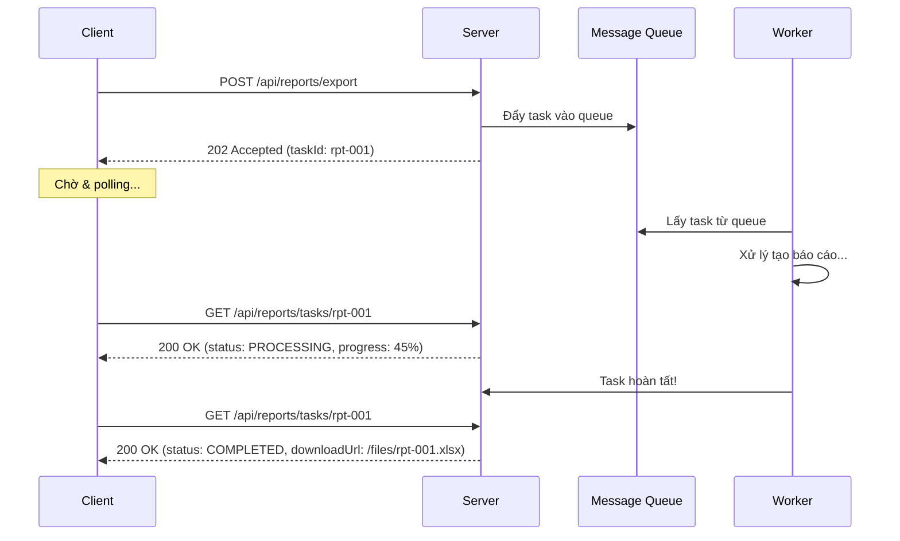
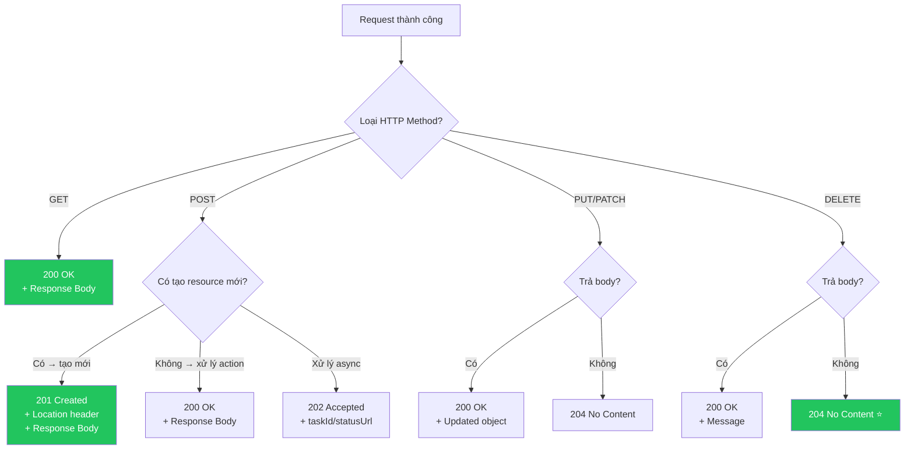

# ✅ HTTP Status Codes: 2XX — Success (Phản hồi thành công)

> **Nguồn chính thống:** [RFC 9110 — HTTP Semantics: Successful 2xx](https://www.rfc-editor.org/rfc/rfc9110.html#name-successful-2xx) | [MDN Web Docs — HTTP Status Codes](https://developer.mozilla.org/en-US/docs/Web/HTTP/Status#successful_responses)
>
> **Thuộc roadmap:** `4. REST API → HTTP Status Codes → 2.X.X`

---

## 1. Định nghĩa chính thức từ RFC 9110

> *"The **2xx (Successful)** class of status code indicates that the client's request was **successfully received, understood, and accepted**."*
>
> — **RFC 9110, Section 15.3**

### Dịch & giải thích đơn giản:

**Nhóm 2XX** là các mã trạng thái thông báo rằng request đã được **xử lý thành công**. Đây là nhóm mã trạng thái mà bạn sẽ **sử dụng nhiều nhất** khi xây dựng REST API.

Đặc tính quan trọng:
- **Thành công:** Request đã được server nhận, hiểu, và xử lý đúng.
- **Response cuối cùng:** Khác với 1XX, đây là phản hồi **chính thức và cuối cùng**.
- **Mỗi mã mang ý nghĩa riêng:** Không phải cứ thành công là trả 200 — chọn đúng mã giúp API rõ ràng và chuyên nghiệp.
- **Quan trọng nhất trong REST API:** 90% response thành công sẽ nằm trong nhóm này.

> [!IMPORTANT]
> **Đừng lười trả 200 cho mọi thứ!** REST API chuyên nghiệp phải phân biệt rõ: `200 OK` (đọc/sửa thành công), `201 Created` (tạo mới thành công), `204 No Content` (xoá thành công). Việc chọn đúng mã giúp frontend biết chính xác phải xử lý response như thế nào.

---

## 2. Bảng tổng hợp tất cả mã 2XX

| Status Code | Tên | Ý nghĩa | Có Body? | RFC |
|:-----------:|------|---------|:--------:|:---:|
| **200** | OK | Thành công — có dữ liệu trả về | ✅ Có | [§15.3.1](https://www.rfc-editor.org/rfc/rfc9110.html#name-200-ok) |
| **201** | Created | Đã tạo mới tài nguyên thành công | ✅ Có | [§15.3.2](https://www.rfc-editor.org/rfc/rfc9110.html#name-201-created) |
| **202** | Accepted | Request đã nhận, đang xử lý bất đồng bộ | ✅/❌ Tuỳ | [§15.3.3](https://www.rfc-editor.org/rfc/rfc9110.html#name-202-accepted) |
| **203** | Non-Authoritative Information | Dữ liệu trả về đã bị proxy/cache sửa đổi | ✅ Có | [§15.3.4](https://www.rfc-editor.org/rfc/rfc9110.html#name-203-non-authoritative-infor) |
| **204** | No Content | Thành công, không có dữ liệu trả về | ❌ Không | [§15.3.5](https://www.rfc-editor.org/rfc/rfc9110.html#name-204-no-content) |
| **205** | Reset Content | Thành công, client hãy reset form/view | ❌ Không | [§15.3.6](https://www.rfc-editor.org/rfc/rfc9110.html#name-205-reset-content) |
| **206** | Partial Content | Trả về một phần tài nguyên (range request) | ✅ Có | [§15.3.7](https://www.rfc-editor.org/rfc/rfc9110.html#name-206-partial-content) |
| **207** | Multi-Status | Nhiều kết quả cho nhiều sub-operations | ✅ Có | [RFC 4918](https://www.rfc-editor.org/rfc/rfc4918#section-13) *(WebDAV)* |
| **208** | Already Reported | Tài nguyên đã được liệt kê trước đó | ✅ Có | [RFC 5842](https://www.rfc-editor.org/rfc/rfc5842#section-7.1) *(WebDAV)* |
| **226** | IM Used | Delta encoding đã áp dụng | ✅ Có | [RFC 3229](https://www.rfc-editor.org/rfc/rfc3229#section-10.4.1) |

---

## 3. Chi tiết các Status Code quan trọng

### 3.1 `200 OK` — ⭐ Phổ biến nhất

**Khi nào dùng:** Request thành công **VÀ** có dữ liệu trả về trong body.

**Dùng cho:**
- `GET` — Lấy dữ liệu thành công
- `PUT` — Cập nhật thành công (trả về object đã cập nhật)
- `PATCH` — Cập nhật một phần thành công
- `POST` — Xử lý thành công (khi KHÔNG tạo mới resource)

```java
@RestController
@RequestMapping("/api/products")
@RequiredArgsConstructor
public class ProductController {

    private final ProductService productService;

    // GET — Lấy danh sách → 200 OK
    @GetMapping
    public ResponseEntity<Page<ProductResponse>> getAll(Pageable pageable) {
        Page<ProductResponse> products = productService.findAll(pageable);
        return ResponseEntity.ok(products);  // 200 OK
    }

    // GET — Lấy chi tiết → 200 OK
    @GetMapping("/{id}")
    public ResponseEntity<ProductResponse> getById(@PathVariable Long id) {
        ProductResponse product = productService.findById(id);
        return ResponseEntity.ok(product);  // 200 OK
    }

    // PUT — Cập nhật → 200 OK (trả về object đã cập nhật)
    @PutMapping("/{id}")
    public ResponseEntity<ProductResponse> update(
            @PathVariable Long id,
            @Valid @RequestBody ProductUpdateRequest request) {
        ProductResponse updated = productService.update(id, request);
        return ResponseEntity.ok(updated);  // 200 OK
    }
}
```

**Response mẫu:**

```json
// GET /api/products/42 → 200 OK
{
  "id": 42,
  "name": "iPhone 16 Pro",
  "price": 29990000,
  "category": "electronics",
  "inStock": true,
  "createdAt": "2026-09-20T10:30:00Z"
}
```

---

### 3.2 `201 Created` — ⭐ Tạo mới thành công

**Khi nào dùng:** Request tạo mới tài nguyên thành công. **BẮT BUỘC** kèm header `Location` chứa URL của tài nguyên vừa tạo.

**Dùng cho:** `POST` (tạo mới)

```java
@PostMapping
public ResponseEntity<ProductResponse> create(
        @Valid @RequestBody ProductCreateRequest request) {

    ProductResponse created = productService.create(request);

    URI location = ServletUriComponentsBuilder
            .fromCurrentRequest()
            .path("/{id}")
            .buildAndExpand(created.getId())
            .toUri();

    return ResponseEntity
            .created(location)  // 201 Created + Location header
            .body(created);
}
```

**Response mẫu:**

```
HTTP/1.1 201 Created
Location: http://localhost:8080/api/products/43
Content-Type: application/json

{
  "id": 43,
  "name": "Samsung Galaxy S26",
  "price": 24990000,
  "category": "electronics",
  "createdAt": "2026-09-24T14:30:00Z"
}
```

> [!IMPORTANT]
> **Header `Location` là BẮT BUỘC** theo RFC 9110 khi trả 201. Nó cho phép client biết URL chính xác để truy cập tài nguyên vừa tạo. `ResponseEntity.created(uri)` trong Spring tự động thêm header này.

---

### 3.3 `202 Accepted` — Đã nhận, đang xử lý bất đồng bộ

**Khi nào dùng:** Server đã nhận request nhưng **chưa xử lý xong**. Kết quả sẽ có sau — client cần polling hoặc nhận thông báo.

**Use case:** Xuất báo cáo lớn, gửi email hàng loạt, import dữ liệu CSV, xử lý video...

```java
@PostMapping("/reports/export")
public ResponseEntity<TaskResponse> exportReport(
        @Valid @RequestBody ReportExportRequest request) {

    // Tạo task bất đồng bộ
    String taskId = reportService.scheduleExport(request);

    TaskResponse response = TaskResponse.builder()
            .taskId(taskId)
            .status("PROCESSING")
            .message("Báo cáo đang được tạo. Kiểm tra trạng thái tại URL bên dưới.")
            .checkStatusUrl("/api/reports/tasks/" + taskId)
            .build();

    return ResponseEntity
            .accepted()  // 202 Accepted
            .body(response);
}

// Client polling trạng thái
@GetMapping("/reports/tasks/{taskId}")
public ResponseEntity<TaskResponse> checkStatus(@PathVariable String taskId) {
    TaskResponse status = reportService.getTaskStatus(taskId);
    return ResponseEntity.ok(status);  // 200 OK
}
```

**Response mẫu:**

```json
// POST /api/reports/export → 202 Accepted
{
  "taskId": "rpt-2026-0924-001",
  "status": "PROCESSING",
  "message": "Báo cáo đang được tạo. Kiểm tra trạng thái tại URL bên dưới.",
  "checkStatusUrl": "/api/reports/tasks/rpt-2026-0924-001"
}
```

**Flow bất đồng bộ:**



---

### 3.4 `204 No Content` — ⭐ Thành công, không trả body

**Khi nào dùng:** Request thành công nhưng **không có gì để trả về** trong body.

**Dùng cho:**
- `DELETE` — Xoá thành công
- `PUT/PATCH` — Cập nhật thành công (khi không cần trả lại object)

```java
// DELETE — Xoá sản phẩm → 204 No Content
@DeleteMapping("/{id}")
public ResponseEntity<Void> delete(@PathVariable Long id) {
    productService.delete(id);
    return ResponseEntity.noContent().build();  // 204 No Content
}

// PUT — Cập nhật nhưng không trả body → 204 No Content
@PutMapping("/{id}/status")
public ResponseEntity<Void> updateStatus(
        @PathVariable Long id,
        @RequestBody StatusUpdateRequest request) {
    productService.updateStatus(id, request.getStatus());
    return ResponseEntity.noContent().build();  // 204 No Content
}
```

> [!TIP]
> **200 vs 204 cho DELETE:** Cả hai đều đúng! Dùng `204` khi không cần trả gì. Dùng `200` khi muốn trả thêm thông tin (ví dụ: `{"message": "Deleted product #42"}`). Hầu hết REST API chọn `204` cho DELETE.

---

### 3.5 `206 Partial Content` — Trả về một phần (Range Request)

**Khi nào dùng:** Client yêu cầu chỉ **một phần** của tài nguyên (thường là download file lớn, streaming video).

**Use case:** Video player (YouTube, Netflix) yêu cầu từng đoạn video, hoặc download manager tải file từng phần để hỗ trợ resume.

```
// Client yêu cầu bytes từ 0 đến 1048575 (1MB đầu tiên)
GET /api/files/video.mp4 HTTP/1.1
Range: bytes=0-1048575

// Server trả 206 với phần dữ liệu được yêu cầu
HTTP/1.1 206 Partial Content
Content-Range: bytes 0-1048575/52428800
Content-Length: 1048576
Content-Type: video/mp4

[binary data — 1MB đầu tiên]
```

**Implementation trong Spring Boot 4.1.0:**

```java
@GetMapping("/files/{filename}")
public ResponseEntity<Resource> downloadFile(
        @PathVariable String filename,
        @RequestHeader(value = "Range", required = false) String rangeHeader) {

    Resource resource = fileService.loadFile(filename);

    // Spring Boot ResourceHttpRequestHandler tự xử lý Range requests
    // khi trả về Resource — bạn KHÔNG cần code thủ công
    return ResponseEntity.ok()
            .contentType(MediaType.APPLICATION_OCTET_STREAM)
            .header(HttpHeaders.CONTENT_DISPOSITION,
                    "attachment; filename=\"" + filename + "\"")
            .body(resource);
}
```

> [!NOTE]
> Spring Boot tự xử lý Range request khi bạn trả về `Resource` (ClassPathResource, FileSystemResource...). Framework sẽ tự trả 206 với đúng Content-Range header.

---

## 4. Quy tắc chọn Status Code 2XX trong REST API



### Bảng tóm tắt nhanh:

| HTTP Method | Hành động | Status Code khuyên dùng | Body? |
|:-----------:|-----------|:-----------------------:|:-----:|
| `GET` | Lấy dữ liệu | **200 OK** | ✅ |
| `POST` | Tạo mới resource | **201 Created** | ✅ + Location |
| `POST` | Trigger action (không tạo resource) | **200 OK** | ✅ |
| `POST` | Tác vụ bất đồng bộ | **202 Accepted** | ✅ taskId |
| `PUT` | Cập nhật toàn bộ | **200 OK** hoặc **204** | Tuỳ |
| `PATCH` | Cập nhật một phần | **200 OK** | ✅ |
| `DELETE` | Xoá | **204 No Content** | ❌ |

---

## 5. Anti-patterns — Những sai lầm phổ biến

### ❌ SAI: Luôn trả 200 cho mọi thứ (kể cả lỗi)

```java
// ❌ SAI — Trả 200 khi có lỗi
@GetMapping("/{id}")
public ResponseEntity<Map<String, Object>> getById(@PathVariable Long id) {
    try {
        Product product = productService.findById(id);
        return ResponseEntity.ok(Map.of("success", true, "data", product));
    } catch (Exception e) {
        // ❌ VẪN TRẢ 200 nhưng kèm "success: false" → ANTI-PATTERN!
        return ResponseEntity.ok(Map.of("success", false, "error", e.getMessage()));
    }
}
```

### ✅ ĐÚNG: Trả đúng status code

```java
// ✅ ĐÚNG — Trả đúng status code tương ứng
@GetMapping("/{id}")
public ResponseEntity<ProductResponse> getById(@PathVariable Long id) {
    ProductResponse product = productService.findById(id);
    return ResponseEntity.ok(product);  // 200 OK
}

// Exception handler trả đúng 404
@ExceptionHandler(ResourceNotFoundException.class)
public ResponseEntity<ErrorResponse> handleNotFound(ResourceNotFoundException ex) {
    return ResponseEntity.status(HttpStatus.NOT_FOUND)  // 404
            .body(new ErrorResponse("NOT_FOUND", ex.getMessage()));
}
```

### ❌ SAI: POST tạo mới nhưng trả 200 thay vì 201

```java
// ❌ SAI
@PostMapping
public ResponseEntity<ProductResponse> create(@RequestBody ProductCreateRequest req) {
    ProductResponse product = productService.create(req);
    return ResponseEntity.ok(product);  // ❌ 200 thay vì 201
}
```

### ✅ ĐÚNG: POST tạo mới trả 201 + Location

```java
// ✅ ĐÚNG
@PostMapping
public ResponseEntity<ProductResponse> create(@RequestBody ProductCreateRequest req) {
    ProductResponse product = productService.create(req);
    URI location = URI.create("/api/products/" + product.getId());
    return ResponseEntity.created(location).body(product);  // ✅ 201 Created
}
```

---

## 🔥 Ứng dụng thực tế (Thực tế dùng để làm gì? Giải quyết vấn đề gì?)

### 2XX trong ứng dụng E-commerce thực tế:

| Hành động | API Endpoint | Method | Status Code | Giải thích |
|-----------|-------------|:------:|:-----------:|-----------|
| Xem sản phẩm | `/api/products` | GET | **200** | Trả danh sách sản phẩm |
| Xem chi tiết SP | `/api/products/42` | GET | **200** | Trả chi tiết 1 sản phẩm |
| Thêm vào giỏ hàng | `/api/cart/items` | POST | **201** | Tạo mới cart item |
| Đặt hàng | `/api/orders` | POST | **201** | Tạo mới đơn hàng |
| Thanh toán async | `/api/payments` | POST | **202** | Đã nhận, đang xử lý qua payment gateway |
| Sửa thông tin user | `/api/users/me` | PUT | **200** | Trả về user đã cập nhật |
| Đổi mật khẩu | `/api/users/me/password` | PATCH | **204** | Thành công, không trả gì |
| Xoá item khỏi giỏ | `/api/cart/items/5` | DELETE | **204** | Xoá thành công |
| Xuất báo cáo doanh thu | `/api/reports/revenue` | POST | **202** | Async — polling qua taskId |
| Streaming video SP | `/api/products/42/video` | GET | **206** | Trả từng phần video |

---

## 6. Tổng hợp các chủ đề (Bản đồ tra cứu)

### 🟢 Ưu tiên phải biết trước (Bắt buộc)
- **200 OK** — Thành công, có body trả về (GET, PUT, PATCH)
- **201 Created** — Tạo mới thành công + Location header (POST)
- **204 No Content** — Thành công, không body (DELETE, PUT khi không cần trả body)
- Quy tắc chọn đúng status code theo HTTP method
- Anti-pattern: Trả 200 cho mọi thứ (kể cả lỗi)

### 🟡 Nhóm trung cấp
- **202 Accepted** — Xử lý bất đồng bộ + polling pattern
- **206 Partial Content** — Range request cho download/streaming
- `ResponseEntity.created(uri)` vs `ResponseEntity.ok()` vs `ResponseEntity.noContent()`
- `ServletUriComponentsBuilder` để tạo Location header

### 🔴 Nhóm nâng cao
- **207 Multi-Status** — Batch operations trả nhiều kết quả
- **203 Non-Authoritative Information** — Proxy/CDN sửa đổi response
- Content negotiation và vai trò của Accept header
- ETag/Last-Modified kết hợp với 200 OK cho caching

---

## 📚 Tài liệu tham khảo chính thống

| Tài liệu | Link |
|-----------|------|
| RFC 9110 — 2XX Status Codes | [rfc-editor.org](https://www.rfc-editor.org/rfc/rfc9110.html#name-successful-2xx) |
| MDN — 200 OK | [developer.mozilla.org](https://developer.mozilla.org/en-US/docs/Web/HTTP/Status/200) |
| MDN — 201 Created | [developer.mozilla.org](https://developer.mozilla.org/en-US/docs/Web/HTTP/Status/201) |
| MDN — 204 No Content | [developer.mozilla.org](https://developer.mozilla.org/en-US/docs/Web/HTTP/Status/204) |
| Spring — ResponseEntity | [docs.spring.io](https://docs.spring.io/spring-framework/reference/web/webmvc/mvc-controller/ann-methods/responseentity.html) |
| REST API Design Best Practices | [restfulapi.net](https://restfulapi.net/http-status-codes/) |

---

> **Tiếp theo trong roadmap:** `3XX — Redirection` (Nhóm chuyển hướng — khi nào trả 301 vs 302 vs 308 và cách xử lý redirect trong Spring Boot).
