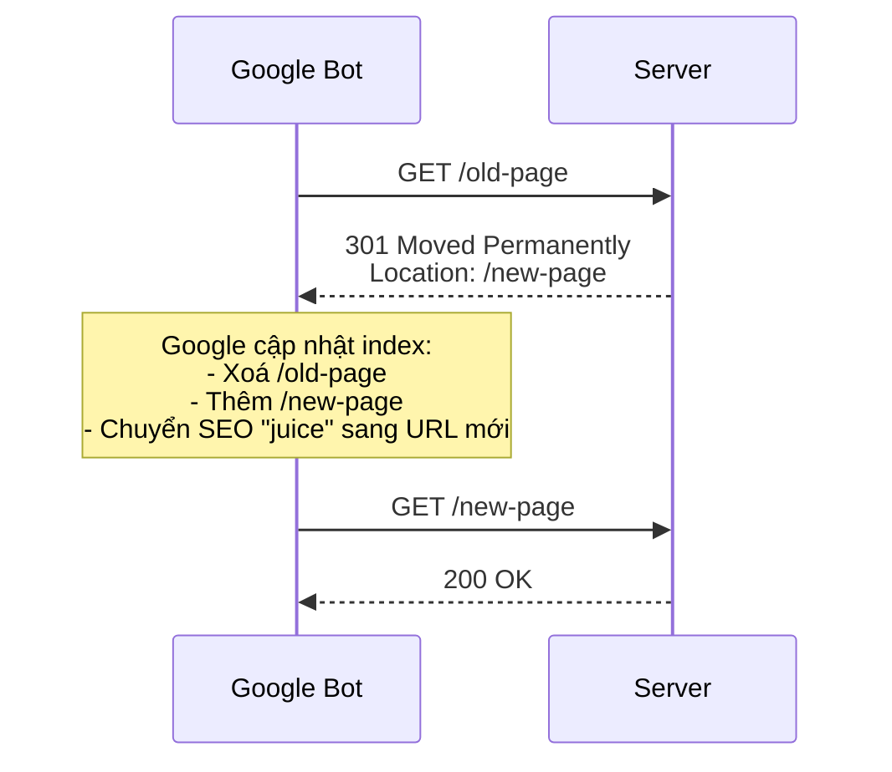
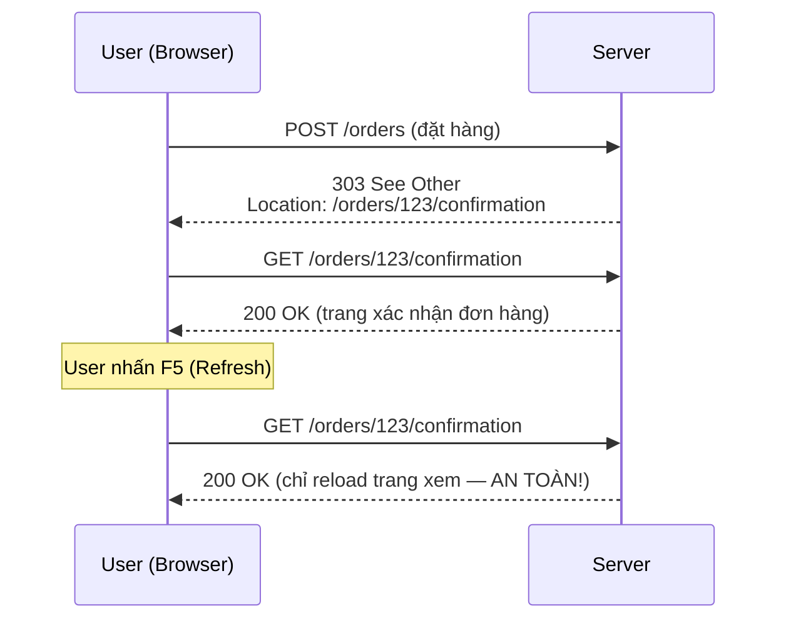
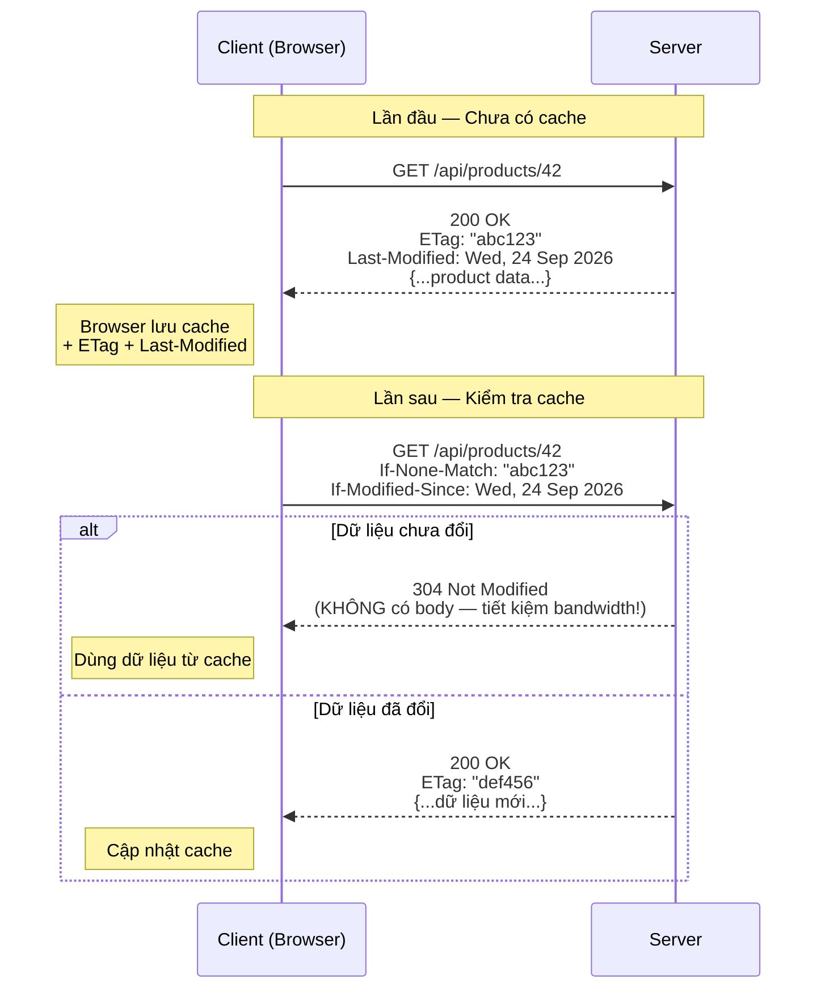
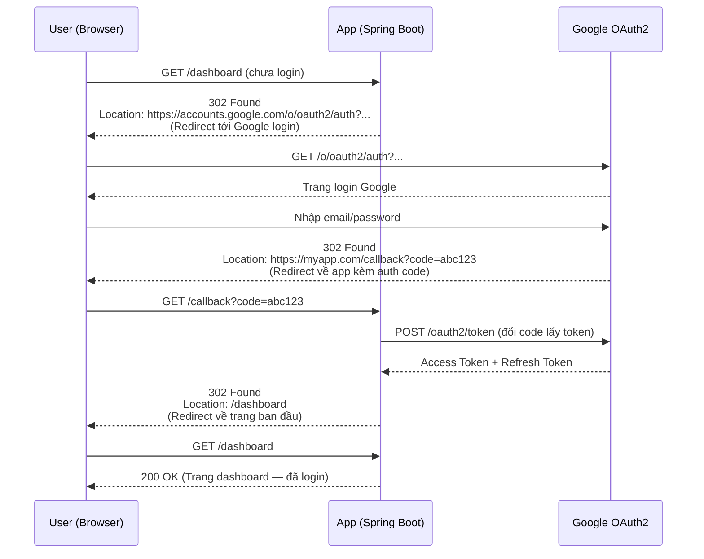

# 🔀 HTTP Status Codes: 3XX — Redirection (Chuyển hướng)

> **Nguồn chính thống:** [RFC 9110 — HTTP Semantics: Redirection 3xx](https://www.rfc-editor.org/rfc/rfc9110.html#name-redirection-3xx) | [MDN Web Docs — HTTP Status Codes](https://developer.mozilla.org/en-US/docs/Web/HTTP/Status#redirection_messages)
>
> **Thuộc roadmap:** `4. REST API → HTTP Status Codes → 3.X.X`

---

## 1. Định nghĩa chính thức từ RFC 9110

> *"The **3xx (Redirection)** class of status code indicates that **further action needs to be taken** by the user agent in order to fulfill the request."*
>
> — **RFC 9110, Section 15.4**

### Dịch & giải thích đơn giản:

**Nhóm 3XX** thông báo rằng client cần **thực hiện thêm hành động** để hoàn tất request — thường là **truy cập một URL khác**. Server nói: *"Thứ bạn cần không ở đây, hãy đi đến URL tôi chỉ."*

Đặc tính quan trọng:
- **Chuyển hướng:** Server gửi header `Location` chứa URL mới cho client.
- **Tự động hoặc cần xác nhận:** Tuỳ mã, client có thể tự redirect hoặc cần hỏi user trước.
- **Vĩnh viễn vs Tạm thời:** Quan trọng cho SEO — search engine xử lý khác nhau.
- **Ảnh hưởng HTTP method:** Một số redirect giữ nguyên method (POST → POST), một số đổi sang GET.

> [!NOTE]
> Trong REST API thuần (backend API cho mobile/SPA), bạn **ít dùng 3XX** hơn so với web truyền thống. Tuy nhiên, 3XX rất quan trọng khi xây dựng website (MVC), URL migration, hoặc tích hợp OAuth2.

---

## 2. Bảng tổng hợp tất cả mã 3XX

| Status Code | Tên | Vĩnh viễn? | Giữ Method? | Ý nghĩa | RFC |
|:-----------:|------|:----------:|:-----------:|---------|:---:|
| **300** | Multiple Choices | — | — | Nhiều lựa chọn, client tự chọn | [§15.4.1](https://www.rfc-editor.org/rfc/rfc9110.html#name-300-multiple-choices) |
| **301** | Moved Permanently | ✅ Vĩnh viễn | ❌ → GET | URL cũ đã chuyển vĩnh viễn | [§15.4.2](https://www.rfc-editor.org/rfc/rfc9110.html#name-301-moved-permanently) |
| **302** | Found | ❌ Tạm thời | ❌ → GET | URL tạm thời ở chỗ khác | [§15.4.3](https://www.rfc-editor.org/rfc/rfc9110.html#name-302-found) |
| **303** | See Other | ❌ Tạm thời | ❌ → GET | Xem kết quả ở URL khác (sau POST) | [§15.4.4](https://www.rfc-editor.org/rfc/rfc9110.html#name-303-see-other) |
| **304** | Not Modified | — | — | Tài nguyên chưa thay đổi (cache) | [§15.4.5](https://www.rfc-editor.org/rfc/rfc9110.html#name-304-not-modified) |
| **307** | Temporary Redirect | ❌ Tạm thời | ✅ Giữ nguyên | Redirect tạm + giữ nguyên method | [§15.4.8](https://www.rfc-editor.org/rfc/rfc9110.html#name-307-temporary-redirect) |
| **308** | Permanent Redirect | ✅ Vĩnh viễn | ✅ Giữ nguyên | Redirect vĩnh viễn + giữ nguyên method | [§15.4.9](https://www.rfc-editor.org/rfc/rfc9110.html#name-308-permanent-redirect) |

---

## 3. Ma trận so sánh quan trọng: 301 vs 302 vs 307 vs 308

Đây là phần **dễ nhầm lẫn nhất** — hãy nhớ theo ma trận 2×2:

```
                    Tạm thời              Vĩnh viễn
                 ┌─────────────────┬─────────────────┐
  Đổi sang GET   │   302 Found     │  301 Moved      │
  (không giữ     │   (Tạm thời,    │  Permanently    │
   method)       │    đổi sang GET) │  (Vĩnh viễn,   │
                 │                 │   đổi sang GET)  │
                 ├─────────────────┼─────────────────┤
  Giữ nguyên     │  307 Temporary  │  308 Permanent  │
  method         │  Redirect       │  Redirect       │
  (POST→POST)    │  (Tạm thời,    │  (Vĩnh viễn,   │
                 │   giữ method)   │   giữ method)   │
                 └─────────────────┴─────────────────┘
```

> [!IMPORTANT]
> **Quy tắc vàng:**
> - Cần giữ nguyên HTTP method (POST → POST)? → Dùng **307** hoặc **308**
> - Chấp nhận đổi sang GET? → Dùng **301** hoặc **302**
> - SEO / URL migration vĩnh viễn? → Dùng **301** hoặc **308**
> - Redirect tạm thời (maintenance, A/B testing)? → Dùng **302** hoặc **307**

---

## 4. Chi tiết từng Status Code quan trọng

### 4.1 `301 Moved Permanently` — ⭐ Chuyển URL vĩnh viễn

**Khi nào dùng:** URL cũ đã được thay thế **vĩnh viễn** bằng URL mới. Search engine sẽ cập nhật index sang URL mới.

**Use case:**
- Đổi domain: `http://old-site.com` → `https://new-site.com`
- Đổi cấu trúc URL: `/products/42` → `/shop/items/42`
- HTTP → HTTPS migration

```java
@RestController
public class RedirectController {

    // URL cũ → redirect 301 sang URL mới
    @GetMapping("/old-products/{id}")
    public ResponseEntity<Void> oldProductUrl(@PathVariable Long id) {
        URI newLocation = URI.create("/api/v2/products/" + id);
        return ResponseEntity
                .status(HttpStatus.MOVED_PERMANENTLY)  // 301
                .location(newLocation)
                .build();
    }
}
```

**Cấu hình redirect HTTP → HTTPS trong Spring Boot 4.1.0:**

```java
@Configuration
public class HttpsRedirectConfig {

    @Bean
    public TomcatServletWebServerFactory servletContainer() {
        TomcatServletWebServerFactory factory = new TomcatServletWebServerFactory() {
            @Override
            protected void postProcessContext(Context context) {
                SecurityConstraint constraint = new SecurityConstraint();
                constraint.setUserConstraint("CONFIDENTIAL");
                SecurityCollection collection = new SecurityCollection();
                collection.addPattern("/*");
                constraint.addCollection(collection);
                context.addConstraint(constraint);
            }
        };

        factory.addAdditionalTomcatConnectors(createHttpConnector());
        return factory;
    }

    private Connector createHttpConnector() {
        Connector connector = new Connector(TomcatServletWebServerFactory.DEFAULT_PROTOCOL);
        connector.setScheme("http");
        connector.setPort(8080);
        connector.setSecure(false);
        connector.setRedirectPort(8443);  // Redirect sang HTTPS port
        return connector;
    }
}
```

**Ảnh hưởng SEO:**



---

### 4.2 `302 Found` — Redirect tạm thời (đổi sang GET)

**Khi nào dùng:** Tài nguyên **tạm thời** ở URL khác. Client nên tiếp tục dùng URL gốc cho các request tương lai.

**Use case:**
- A/B testing — redirect một phần users sang trang khác
- Maintenance mode — tạm chuyển sang trang thông báo
- Login redirect — sau khi login, redirect về trang trước đó

```java
// Sau khi login thành công → redirect về trang trước đó
@PostMapping("/login")
public ResponseEntity<Void> login(
        @RequestBody LoginRequest request,
        @RequestParam(defaultValue = "/") String redirectTo) {

    authService.authenticate(request);

    return ResponseEntity
            .status(HttpStatus.FOUND)  // 302
            .location(URI.create(redirectTo))
            .build();
}
```

> [!WARNING]
> **302 sẽ đổi method sang GET.** Nếu client gửi `POST /submit-form` và server trả 302, browser sẽ request URL mới bằng **GET** (không phải POST). Nếu cần giữ POST → dùng **307**.

---

### 4.3 `303 See Other` — Xem kết quả ở URL khác

**Khi nào dùng:** Sau khi xử lý POST (tạo/sửa/xoá), redirect client sang trang xem kết quả bằng GET. Đây là pattern **Post/Redirect/Get (PRG)**.

**Mục đích:** Tránh user nhấn F5 (refresh) gửi lại POST → tạo duplicate order, double payment...

```java
// Pattern Post/Redirect/Get (PRG) trong Spring MVC
@Controller
public class OrderController {

    @PostMapping("/orders")
    public ResponseEntity<Void> placeOrder(@Valid @ModelAttribute OrderForm form) {
        Order order = orderService.create(form);

        // Sau khi tạo order → redirect sang trang xem order (GET)
        URI orderPage = URI.create("/orders/" + order.getId() + "/confirmation");
        return ResponseEntity
                .status(HttpStatus.SEE_OTHER)  // 303
                .location(orderPage)
                .build();
        // User nhấn F5 → chỉ reload trang confirmation (GET)
        // KHÔNG gửi lại POST → KHÔNG tạo duplicate order
    }
}
```

**Flow Post/Redirect/Get:**



---

### 4.4 `304 Not Modified` — ⭐ Cache validation

**Khi nào dùng:** Tài nguyên **chưa thay đổi** so với bản client đã cache. Server không gửi body → **tiết kiệm bandwidth**.

**Đây KHÔNG phải redirect** — 304 nằm trong nhóm 3XX nhưng có mục đích khác hoàn toàn (caching).



**Implementation trong Spring Boot 4.1.0:**

```java
@GetMapping("/{id}")
public ResponseEntity<ProductResponse> getById(@PathVariable Long id) {
    ProductResponse product = productService.findById(id);

    // Tạo ETag từ hash của product
    String etag = "\"" + Integer.toHexString(product.hashCode()) + "\"";

    return ResponseEntity.ok()
            .eTag(etag)
            .lastModified(product.getUpdatedAt().toInstant())
            .cacheControl(CacheControl.maxAge(1, TimeUnit.HOURS))
            .body(product);
    // Spring tự kiểm tra If-None-Match header
    // Nếu ETag trùng → tự trả 304 Not Modified (không gửi body)
}
```

**Cách dùng nâng cao — ShallowEtagHeaderFilter:**

```java
@Configuration
public class WebConfig {

    @Bean
    public FilterRegistrationBean<ShallowEtagHeaderFilter> etagFilter() {
        FilterRegistrationBean<ShallowEtagHeaderFilter> registration =
                new FilterRegistrationBean<>();
        registration.setFilter(new ShallowEtagHeaderFilter());
        registration.addUrlPatterns("/api/*");
        return registration;
    }
}
// Spring tự động tính ETag cho MỌI response trong /api/*
// và tự trả 304 khi ETag trùng
```

> [!TIP]
> **ShallowEtagHeaderFilter** rất dễ dùng nhưng vẫn xử lý full request rồi mới so ETag. Để tối ưu thực sự (không query DB khi cache hit), hãy dùng `@Cacheable` kết hợp với ETag thủ công.

---

### 4.5 `307 Temporary Redirect` — Redirect tạm + GIỮ method

**Khi nào dùng:** Giống 302 nhưng **bắt buộc giữ nguyên HTTP method**. POST → POST, PUT → PUT...

```java
// API maintenance — redirect tạm sang server khác
@PostMapping("/api/v1/payments")
public ResponseEntity<Void> processPayment() {
    // Server chính đang maintenance, chuyển sang backup
    return ResponseEntity
            .status(HttpStatus.TEMPORARY_REDIRECT)  // 307
            .location(URI.create("https://backup.api.com/api/v1/payments"))
            .build();
    // Client sẽ gửi lại POST (không phải GET) tới backup server
}
```

---

### 4.6 `308 Permanent Redirect` — Redirect vĩnh viễn + GIỮ method

**Khi nào dùng:** Giống 301 nhưng **bắt buộc giữ nguyên HTTP method**.

```java
// API versioning — v1 đã deprecated, redirect sang v2
@PostMapping("/api/v1/orders")
public ResponseEntity<Void> createOrderV1() {
    return ResponseEntity
            .status(HttpStatus.PERMANENT_REDIRECT)  // 308
            .location(URI.create("/api/v2/orders"))
            .build();
    // Client gửi POST → redirect vẫn là POST sang v2
    // Search engine/client biết v1 đã deprecated vĩnh viễn
}
```

---

## 5. 3XX trong OAuth2/OpenID Connect

Trong flow OAuth2, **redirect là cốt lõi của cơ chế xác thực:**



**Cấu hình OAuth2 trong Spring Boot 4.1.0:**

```yaml
# application.yml
spring:
  security:
    oauth2:
      client:
        registration:
          google:
            client-id: ${GOOGLE_CLIENT_ID}
            client-secret: ${GOOGLE_CLIENT_SECRET}
            scope: openid, profile, email
            redirect-uri: "{baseUrl}/login/oauth2/code/{registrationId}"
```

```java
@Configuration
@EnableWebSecurity
public class SecurityConfig {

    @Bean
    public SecurityFilterChain filterChain(HttpSecurity http) throws Exception {
        http
            .authorizeHttpRequests(auth -> auth
                .requestMatchers("/", "/public/**").permitAll()
                .anyRequest().authenticated()
            )
            .oauth2Login(oauth2 -> oauth2
                .defaultSuccessUrl("/dashboard", true)  // Redirect sau login thành công
                .failureUrl("/login?error=true")         // Redirect nếu login thất bại
            );
        return http.build();
    }
}
```

---

## 🔥 Ứng dụng thực tế (Thực tế dùng để làm gì? Giải quyết vấn đề gì?)

### 3XX trong các tình huống thực tế:

| Tình huống | Status Code | Giải thích |
|-----------|:-----------:|-----------|
| Đổi domain website | **301** | `old-domain.com` → `new-domain.com` — SEO juice chuyển sang domain mới |
| HTTP → HTTPS | **301** | `http://` → `https://` — bắt buộc truy cập HTTPS |
| URL rút gọn (bit.ly) | **301** hoặc **302** | Click link ngắn → redirect tới URL gốc |
| Login bằng Google/Facebook | **302** | Redirect đến trang OAuth2 → callback → redirect về app |
| Post/Redirect/Get (form) | **303** | Sau khi submit form → redirect sang trang kết quả (tránh F5 duplicate) |
| API versioning (v1 → v2) | **308** | Redirect API cũ sang mới, giữ nguyên POST/PUT |
| CDN cache validation | **304** | Trả "chưa thay đổi" → client dùng bản cache → tiết kiệm bandwidth |
| Maintenance mode | **307** | Redirect tạm sang server backup, giữ nguyên method |
| A/B testing | **302** | Redirect 50% users sang variant B |

---

## 6. Tổng hợp các chủ đề (Bản đồ tra cứu)

### 🟢 Ưu tiên phải biết trước (Bắt buộc)
- **301 Moved Permanently** — URL cũ đã chuyển vĩnh viễn (SEO)
- **302 Found** — Redirect tạm thời (login, OAuth2)
- **304 Not Modified** — Cache validation (ETag, Last-Modified)
- Ma trận 2×2: Vĩnh viễn/Tạm thời × Giữ method/Đổi sang GET
- Sự khác biệt giữa 301 vs 308 và 302 vs 307

### 🟡 Nhóm trung cấp
- **303 See Other** — Post/Redirect/Get pattern (tránh duplicate submit)
- **307 Temporary Redirect** — Redirect tạm + giữ method (API maintenance)
- **308 Permanent Redirect** — API versioning migration
- OAuth2 redirect flow trong Spring Security
- `ShallowEtagHeaderFilter` và ETag tự động

### 🔴 Nhóm nâng cao
- **300 Multiple Choices** — Content negotiation nâng cao
- Redirect chain detection và tối ưu (tránh redirect loop)
- `CacheControl` API trong Spring Framework
- HSTS (HTTP Strict Transport Security) và vai trò với redirect

---

## 📚 Tài liệu tham khảo chính thống

| Tài liệu | Link |
|-----------|------|
| RFC 9110 — 3XX Status Codes | [rfc-editor.org](https://www.rfc-editor.org/rfc/rfc9110.html#name-redirection-3xx) |
| MDN — 301 Moved Permanently | [developer.mozilla.org](https://developer.mozilla.org/en-US/docs/Web/HTTP/Status/301) |
| MDN — 302 Found | [developer.mozilla.org](https://developer.mozilla.org/en-US/docs/Web/HTTP/Status/302) |
| MDN — 304 Not Modified | [developer.mozilla.org](https://developer.mozilla.org/en-US/docs/Web/HTTP/Status/304) |
| Spring — OAuth2 Client | [docs.spring.io](https://docs.spring.io/spring-security/reference/servlet/oauth2/client/index.html) |
| Google SEO — Redirects | [developers.google.com](https://developers.google.com/search/docs/crawling-indexing/301-redirects) |

---

> **Tiếp theo trong roadmap:** `4XX — Client Error` (Nhóm lỗi phía client — cách phân biệt 400, 401, 403, 404, 409, 422 và thiết kế error response chuẩn).
