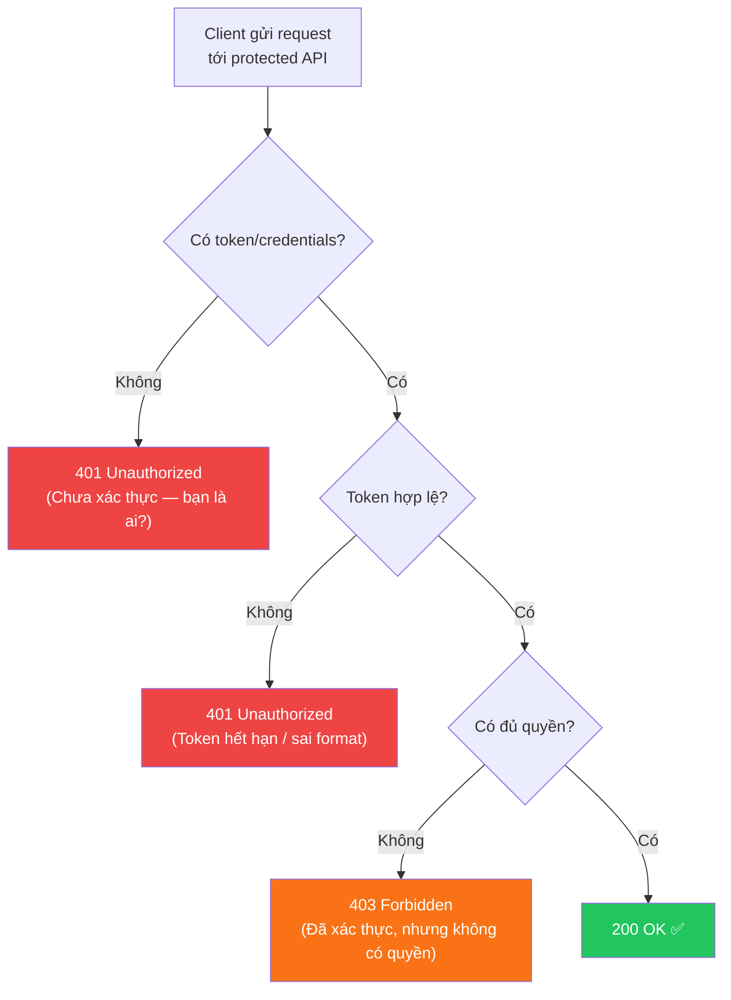
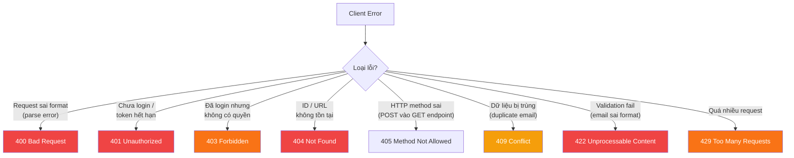

# ❌ HTTP Status Codes: 4XX — Client Error (Lỗi phía Client)

> **Nguồn chính thống:** [RFC 9110 — HTTP Semantics: Client Error 4xx](https://www.rfc-editor.org/rfc/rfc9110.html#name-client-error-4xx) | [MDN Web Docs — HTTP Status Codes](https://developer.mozilla.org/en-US/docs/Web/HTTP/Status#client_error_responses)
>
> **Thuộc roadmap:** `4. REST API → HTTP Status Codes → 4.X.X`

---

## 1. Định nghĩa chính thức từ RFC 9110

> *"The **4xx (Client Error)** class of status code indicates that the client **seems to have erred**. Except when responding to a HEAD request, the server SHOULD send a representation containing an explanation of the error situation."*
>
> — **RFC 9110, Section 15.5**

### Dịch & giải thích đơn giản:

**Nhóm 4XX** thông báo rằng lỗi xuất phát từ **phía client** — request sai format, thiếu quyền, tài nguyên không tồn tại... Server nói: *"Tôi không thể xử lý request này vì LỖI CỦA BẠN."*

Đặc tính quan trọng:
- **Lỗi từ client:** Vấn đề nằm ở request, không phải server.
- **Có thể sửa được:** Client sửa request rồi gửi lại có thể thành công.
- **PHẢI kèm error message:** Server nên giải thích rõ lỗi gì, ở đâu, để client sửa.
- **Nhóm quan trọng nhất cho developer:** Bạn sẽ xử lý 4XX hàng ngày khi xây REST API.

> [!IMPORTANT]
> **4XX là nhóm status code bạn cần thành thạo nhất** khi xây REST API. Chọn sai mã (ví dụ: trả 400 cho mọi lỗi thay vì phân biệt 401, 403, 404, 409, 422) sẽ khiến frontend khó xử lý và API khó debug.

---

## 2. Bảng tổng hợp các mã 4XX quan trọng

| Status Code | Tên | Ý nghĩa ngắn gọn | Tần suất dùng | RFC |
|:-----------:|------|-------------------|:-------------:|:---:|
| **400** | Bad Request | Request sai format, dữ liệu không hợp lệ | ⭐⭐⭐⭐⭐ | [§15.5.1](https://www.rfc-editor.org/rfc/rfc9110.html#name-400-bad-request) |
| **401** | Unauthorized | Chưa xác thực (chưa login / token hết hạn) | ⭐⭐⭐⭐⭐ | [§15.5.2](https://www.rfc-editor.org/rfc/rfc9110.html#name-401-unauthorized) |
| **403** | Forbidden | Đã xác thực nhưng không có quyền | ⭐⭐⭐⭐⭐ | [§15.5.4](https://www.rfc-editor.org/rfc/rfc9110.html#name-403-forbidden) |
| **404** | Not Found | Tài nguyên không tồn tại | ⭐⭐⭐⭐⭐ | [§15.5.5](https://www.rfc-editor.org/rfc/rfc9110.html#name-404-not-found) |
| **405** | Method Not Allowed | HTTP method không được hỗ trợ cho URL này | ⭐⭐⭐ | [§15.5.6](https://www.rfc-editor.org/rfc/rfc9110.html#name-405-method-not-allowed) |
| **406** | Not Acceptable | Server không thể trả format client yêu cầu | ⭐⭐ | [§15.5.7](https://www.rfc-editor.org/rfc/rfc9110.html#name-406-not-acceptable) |
| **408** | Request Timeout | Client gửi request quá chậm | ⭐⭐ | [§15.5.9](https://www.rfc-editor.org/rfc/rfc9110.html#name-408-request-timeout) |
| **409** | Conflict | Xung đột dữ liệu (duplicate, concurrent update) | ⭐⭐⭐⭐ | [§15.5.10](https://www.rfc-editor.org/rfc/rfc9110.html#name-409-conflict) |
| **410** | Gone | Tài nguyên đã bị xoá vĩnh viễn | ⭐⭐ | [§15.5.11](https://www.rfc-editor.org/rfc/rfc9110.html#name-410-gone) |
| **413** | Content Too Large | Body request quá lớn (upload file quá giới hạn) | ⭐⭐⭐ | [§15.5.14](https://www.rfc-editor.org/rfc/rfc9110.html#name-413-content-too-large) |
| **415** | Unsupported Media Type | Content-Type không được hỗ trợ | ⭐⭐⭐ | [§15.5.16](https://www.rfc-editor.org/rfc/rfc9110.html#name-415-unsupported-media-type) |
| **422** | Unprocessable Content | Syntax đúng nhưng logic sai (validation) | ⭐⭐⭐⭐ | [§15.5.21](https://www.rfc-editor.org/rfc/rfc9110.html#name-422-unprocessable-content) |
| **429** | Too Many Requests | Client gửi quá nhiều request (rate limiting) | ⭐⭐⭐⭐ | [RFC 6585](https://www.rfc-editor.org/rfc/rfc6585#section-4) |

---

## 3. Chi tiết các Status Code quan trọng

### 3.1 `400 Bad Request` — ⭐ Request sai format

**Khi nào dùng:** Request có **lỗi cú pháp** mà server không thể parse — JSON sai format, thiếu required field, kiểu dữ liệu sai...

```java
// Spring Boot tự trả 400 khi:
// 1. JSON parse error (thiếu dấu phẩy, sai format)
// 2. Type mismatch (gửi String cho field Integer)
// 3. Missing required @RequestParam

@RestControllerAdvice
public class GlobalExceptionHandler {

    // JSON parse error → 400
    @ExceptionHandler(HttpMessageNotReadableException.class)
    public ResponseEntity<ErrorResponse> handleJsonParseError(
            HttpMessageNotReadableException ex) {
        ErrorResponse error = ErrorResponse.builder()
                .status(400)
                .error("BAD_REQUEST")
                .message("Request body không đúng format JSON.")
                .timestamp(LocalDateTime.now())
                .build();
        return ResponseEntity.badRequest().body(error);
    }

    // Type mismatch (path variable / request param) → 400
    @ExceptionHandler(MethodArgumentTypeMismatchException.class)
    public ResponseEntity<ErrorResponse> handleTypeMismatch(
            MethodArgumentTypeMismatchException ex) {
        String message = String.format(
                "Tham số '%s' phải là kiểu %s, nhưng nhận được '%s'",
                ex.getName(),
                ex.getRequiredType().getSimpleName(),
                ex.getValue());
        ErrorResponse error = ErrorResponse.builder()
                .status(400)
                .error("BAD_REQUEST")
                .message(message)
                .timestamp(LocalDateTime.now())
                .build();
        return ResponseEntity.badRequest().body(error);
    }
}
```

**Ví dụ client gửi sai:**

```json
// ❌ JSON sai format (thiếu dấu ngoặc kép)
POST /api/products
{
  name: iPhone 16,     // ❌ thiếu ""
  "price": "abc"       // ❌ price phải là số
}

// Response: 400 Bad Request
{
  "status": 400,
  "error": "BAD_REQUEST",
  "message": "Request body không đúng format JSON.",
  "timestamp": "2026-09-24T14:30:00"
}
```

---

### 3.2 `401 Unauthorized` — ⭐ Chưa xác thực

**Khi nào dùng:** Client **chưa đăng nhập** hoặc token đã **hết hạn/không hợp lệ**. Server nói: *"Bạn là AI? Tôi không biết bạn."*

> [!WARNING]
> Tên `Unauthorized` gây nhầm lẫn — thực chất ý nghĩa là **Unauthenticated** (chưa xác thực danh tính), KHÔNG phải "không có quyền" (đó là 403).

```java
@Configuration
@EnableWebSecurity
public class SecurityConfig {

    @Bean
    public SecurityFilterChain filterChain(HttpSecurity http) throws Exception {
        http
            .authorizeHttpRequests(auth -> auth
                .requestMatchers("/api/public/**").permitAll()
                .anyRequest().authenticated()  // Yêu cầu login
            )
            .oauth2ResourceServer(oauth2 -> oauth2
                .jwt(Customizer.withDefaults())
            )
            // Custom 401 response khi chưa xác thực
            .exceptionHandling(ex -> ex
                .authenticationEntryPoint((request, response, authException) -> {
                    response.setStatus(HttpServletResponse.SC_UNAUTHORIZED);
                    response.setContentType("application/json");
                    response.setCharacterEncoding("UTF-8");
                    response.getWriter().write("""
                        {
                          "status": 401,
                          "error": "UNAUTHORIZED",
                          "message": "Bạn cần đăng nhập để truy cập tài nguyên này.",
                          "timestamp": "%s"
                        }
                        """.formatted(LocalDateTime.now()));
                })
            );
        return http.build();
    }
}
```

**Các tình huống trả 401:**

| Tình huống | Giải thích |
|-----------|-----------|
| Không gửi token | Request thiếu header `Authorization` |
| Token hết hạn | JWT expired → cần refresh token |
| Token sai format | `Bearer abc123` nhưng abc123 không phải JWT hợp lệ |
| Token bị tampered | Signature không khớp → token đã bị sửa đổi |

**Phân biệt 401 vs 403:**



---

### 3.3 `403 Forbidden` — ⭐ Không có quyền

**Khi nào dùng:** Client đã đăng nhập thành công nhưng **không đủ quyền** để truy cập tài nguyên. Server nói: *"Tôi biết bạn là ai, nhưng bạn KHÔNG ĐƯỢC PHÉP."*

```java
@Configuration
@EnableWebSecurity
@EnableMethodSecurity  // Bật @PreAuthorize
public class SecurityConfig {

    @Bean
    public SecurityFilterChain filterChain(HttpSecurity http) throws Exception {
        http
            .authorizeHttpRequests(auth -> auth
                .requestMatchers("/api/admin/**").hasRole("ADMIN")
                .requestMatchers("/api/manager/**").hasAnyRole("ADMIN", "MANAGER")
                .anyRequest().authenticated()
            )
            // Custom 403 response
            .exceptionHandling(ex -> ex
                .accessDeniedHandler((request, response, accessDeniedException) -> {
                    response.setStatus(HttpServletResponse.SC_FORBIDDEN);
                    response.setContentType("application/json");
                    response.setCharacterEncoding("UTF-8");
                    response.getWriter().write("""
                        {
                          "status": 403,
                          "error": "FORBIDDEN",
                          "message": "Bạn không có quyền truy cập tài nguyên này.",
                          "timestamp": "%s"
                        }
                        """.formatted(LocalDateTime.now()));
                })
            );
        return http.build();
    }
}
```

```java
@RestController
@RequestMapping("/api/admin")
public class AdminController {

    // Chỉ ADMIN mới truy cập được
    @PreAuthorize("hasRole('ADMIN')")
    @DeleteMapping("/users/{id}")
    public ResponseEntity<Void> deleteUser(@PathVariable Long id) {
        userService.delete(id);
        return ResponseEntity.noContent().build();
    }

    // ADMIN hoặc MANAGER
    @PreAuthorize("hasAnyRole('ADMIN', 'MANAGER')")
    @GetMapping("/reports/revenue")
    public ResponseEntity<RevenueReport> getRevenue() {
        return ResponseEntity.ok(reportService.getRevenue());
    }
}
```

---

### 3.4 `404 Not Found` — ⭐ Tài nguyên không tồn tại

**Khi nào dùng:** Tài nguyên với ID/URL được yêu cầu **không tồn tại** trong hệ thống.

```java
// Custom Exception
public class ResourceNotFoundException extends RuntimeException {

    private final String resourceName;
    private final String fieldName;
    private final Object fieldValue;

    public ResourceNotFoundException(String resourceName,
                                      String fieldName,
                                      Object fieldValue) {
        super(String.format("%s không tìm thấy với %s: '%s'",
                resourceName, fieldName, fieldValue));
        this.resourceName = resourceName;
        this.fieldName = fieldName;
        this.fieldValue = fieldValue;
    }
}

// Service layer — throw exception khi không tìm thấy
@Service
@RequiredArgsConstructor
public class ProductService {

    private final ProductRepository productRepository;

    public ProductResponse findById(Long id) {
        Product product = productRepository.findById(id)
                .orElseThrow(() -> new ResourceNotFoundException(
                        "Product", "id", id));
        return productMapper.toResponse(product);
    }
}

// Global Exception Handler — bắt và trả 404
@RestControllerAdvice
public class GlobalExceptionHandler {

    @ExceptionHandler(ResourceNotFoundException.class)
    public ResponseEntity<ErrorResponse> handleNotFound(
            ResourceNotFoundException ex,
            HttpServletRequest request) {
        ErrorResponse error = ErrorResponse.builder()
                .status(404)
                .error("NOT_FOUND")
                .message(ex.getMessage())
                .path(request.getRequestURI())
                .timestamp(LocalDateTime.now())
                .build();
        return ResponseEntity.status(HttpStatus.NOT_FOUND).body(error);
    }
}
```

**Response mẫu:**

```json
// GET /api/products/999 → 404 Not Found
{
  "status": 404,
  "error": "NOT_FOUND",
  "message": "Product không tìm thấy với id: '999'",
  "path": "/api/products/999",
  "timestamp": "2026-09-24T14:30:00"
}
```

---

### 3.5 `409 Conflict` — Xung đột dữ liệu

**Khi nào dùng:** Request hợp lệ nhưng **xung đột** với trạng thái hiện tại của tài nguyên.

**Use case:**
- Email/username đã tồn tại khi đăng ký
- Concurrent update (2 người sửa cùng 1 record)
- Trạng thái không hợp lệ (huỷ đơn hàng đã giao)

```java
// Đăng ký — email trùng → 409
@PostMapping("/register")
public ResponseEntity<UserResponse> register(
        @Valid @RequestBody RegisterRequest request) {

    if (userRepository.existsByEmail(request.getEmail())) {
        throw new ConflictException(
                "Email '" + request.getEmail() + "' đã được sử dụng.");
    }

    UserResponse user = userService.register(request);
    return ResponseEntity.status(HttpStatus.CREATED).body(user);
}

// Cập nhật với Optimistic Locking — version conflict → 409
@PutMapping("/{id}")
public ResponseEntity<ProductResponse> update(
        @PathVariable Long id,
        @Valid @RequestBody ProductUpdateRequest request) {
    try {
        ProductResponse updated = productService.update(id, request);
        return ResponseEntity.ok(updated);
    } catch (OptimisticLockException ex) {
        throw new ConflictException(
                "Dữ liệu đã bị người khác cập nhật. Vui lòng tải lại và thử lại.");
    }
}

// Exception Handler
@ExceptionHandler(ConflictException.class)
public ResponseEntity<ErrorResponse> handleConflict(ConflictException ex) {
    ErrorResponse error = ErrorResponse.builder()
            .status(409)
            .error("CONFLICT")
            .message(ex.getMessage())
            .timestamp(LocalDateTime.now())
            .build();
    return ResponseEntity.status(HttpStatus.CONFLICT).body(error);
}
```

---

### 3.6 `422 Unprocessable Content` — ⭐ Validation lỗi

**Khi nào dùng:** JSON format đúng, nhưng **dữ liệu không hợp lệ về mặt logic** (validation fail).

> [!IMPORTANT]
> **400 vs 422:**
> - `400` = Request body **sai cú pháp** (JSON parse error, type mismatch)
> - `422` = Request body **đúng cú pháp** nhưng **sai logic** (email không đúng format, tuổi âm, mật khẩu quá ngắn...)
>
> Nhiều API dùng 400 cho cả hai, nhưng phân biệt rõ sẽ giúp frontend xử lý tốt hơn.

```java
// DTO với Bean Validation
public record ProductCreateRequest(
    @NotBlank(message = "Tên sản phẩm không được để trống")
    @Size(min = 2, max = 200, message = "Tên sản phẩm từ 2 đến 200 ký tự")
    String name,

    @NotNull(message = "Giá không được để trống")
    @Positive(message = "Giá phải lớn hơn 0")
    BigDecimal price,

    @NotBlank(message = "Danh mục không được để trống")
    String category
) {}

// Controller — @Valid trigger validation
@PostMapping
public ResponseEntity<ProductResponse> create(
        @Valid @RequestBody ProductCreateRequest request) {
    ProductResponse product = productService.create(request);
    return ResponseEntity.status(HttpStatus.CREATED).body(product);
}

// Exception Handler — Validation errors → 422
@ExceptionHandler(MethodArgumentNotValidException.class)
public ResponseEntity<ValidationErrorResponse> handleValidation(
        MethodArgumentNotValidException ex) {

    Map<String, String> fieldErrors = new LinkedHashMap<>();
    ex.getBindingResult().getFieldErrors().forEach(error ->
            fieldErrors.put(error.getField(), error.getDefaultMessage()));

    ValidationErrorResponse response = ValidationErrorResponse.builder()
            .status(422)
            .error("VALIDATION_FAILED")
            .message("Dữ liệu đầu vào không hợp lệ.")
            .fieldErrors(fieldErrors)
            .timestamp(LocalDateTime.now())
            .build();

    return ResponseEntity
            .status(HttpStatus.UNPROCESSABLE_ENTITY)
            .body(response);
}
```

**Response mẫu:**

```json
// POST /api/products → 422 Unprocessable Content
{
  "status": 422,
  "error": "VALIDATION_FAILED",
  "message": "Dữ liệu đầu vào không hợp lệ.",
  "fieldErrors": {
    "name": "Tên sản phẩm không được để trống",
    "price": "Giá phải lớn hơn 0",
    "category": "Danh mục không được để trống"
  },
  "timestamp": "2026-09-24T14:30:00"
}
```

---

### 3.7 `429 Too Many Requests` — Rate Limiting

**Khi nào dùng:** Client gửi **quá nhiều request** trong khoảng thời gian ngắn.

```java
// Rate limiting với Bucket4j + Spring Boot
@Configuration
public class RateLimitConfig {

    @Bean
    public FilterRegistrationBean<RateLimitFilter> rateLimitFilter() {
        FilterRegistrationBean<RateLimitFilter> registration =
                new FilterRegistrationBean<>();
        registration.setFilter(new RateLimitFilter());
        registration.addUrlPatterns("/api/*");
        return registration;
    }
}

public class RateLimitFilter extends OncePerRequestFilter {

    private final Map<String, Bucket> buckets = new ConcurrentHashMap<>();

    @Override
    protected void doFilterInternal(HttpServletRequest request,
                                     HttpServletResponse response,
                                     FilterChain chain) throws ServletException, IOException {

        String clientIp = request.getRemoteAddr();
        Bucket bucket = buckets.computeIfAbsent(clientIp, this::createBucket);

        if (bucket.tryConsume(1)) {
            chain.doFilter(request, response);
        } else {
            response.setStatus(429);
            response.setContentType("application/json");
            response.setCharacterEncoding("UTF-8");
            response.setHeader("Retry-After", "60");  // Thử lại sau 60 giây
            response.getWriter().write("""
                {
                  "status": 429,
                  "error": "TOO_MANY_REQUESTS",
                  "message": "Bạn đã gửi quá nhiều request. Vui lòng thử lại sau 60 giây.",
                  "retryAfter": 60
                }
                """);
        }
    }

    private Bucket createBucket(String key) {
        // 100 requests/phút
        return Bucket.builder()
                .addLimit(Bandwidth.classic(100,
                        Refill.intervally(100, Duration.ofMinutes(1))))
                .build();
    }
}
```

> [!TIP]
> Luôn kèm header `Retry-After` khi trả 429 — nó cho client biết cần chờ bao lâu trước khi gửi lại request.

---

## 4. Thiết kế Error Response chuẩn (RFC 9457 — Problem Details)

RFC 9457 định nghĩa format chuẩn cho error response trong API:

```java
// Error Response theo RFC 9457 Problem Details
@Data
@Builder
public class ErrorResponse {
    private int status;          // HTTP status code
    private String error;        // Error code (machine-readable)
    private String message;      // Mô tả cho người dùng (human-readable)
    private String path;         // URL gây lỗi
    private LocalDateTime timestamp;
}

// Validation Error Response (mở rộng)
@Data
@Builder
public class ValidationErrorResponse {
    private int status;
    private String error;
    private String message;
    private Map<String, String> fieldErrors;  // Field → Error message
    private LocalDateTime timestamp;
}
```

**Bảng mapping Exception → Status Code:**

| Exception | Status Code | Error Code |
|-----------|:-----------:|-----------|
| `HttpMessageNotReadableException` | 400 | BAD_REQUEST |
| `MethodArgumentTypeMismatchException` | 400 | BAD_REQUEST |
| `AuthenticationException` | 401 | UNAUTHORIZED |
| `AccessDeniedException` | 403 | FORBIDDEN |
| `ResourceNotFoundException` | 404 | NOT_FOUND |
| `HttpRequestMethodNotSupportedException` | 405 | METHOD_NOT_ALLOWED |
| `ConflictException` | 409 | CONFLICT |
| `MaxUploadSizeExceededException` | 413 | CONTENT_TOO_LARGE |
| `HttpMediaTypeNotSupportedException` | 415 | UNSUPPORTED_MEDIA_TYPE |
| `MethodArgumentNotValidException` | 422 | VALIDATION_FAILED |
| `RateLimitExceededException` | 429 | TOO_MANY_REQUESTS |

---

## 5. So sánh nhanh các mã 4XX dễ nhầm



---

## 🔥 Ứng dụng thực tế (Thực tế dùng để làm gì? Giải quyết vấn đề gì?)

### 4XX trong ứng dụng E-commerce thực tế:

| Hành động | API | Tình huống lỗi | Status Code |
|-----------|-----|---------------|:-----------:|
| Đăng ký tài khoản | `POST /api/register` | Email đã tồn tại | **409** |
| Đăng ký tài khoản | `POST /api/register` | Password quá ngắn, email sai format | **422** |
| Xem sản phẩm | `GET /api/products/999` | ID 999 không tồn tại | **404** |
| Thêm vào giỏ hàng | `POST /api/cart/items` | Chưa đăng nhập | **401** |
| Xoá user khác | `DELETE /api/users/5` | Không phải admin | **403** |
| Upload ảnh sản phẩm | `POST /api/products/1/images` | File > 10MB | **413** |
| Đặt hàng | `POST /api/orders` | Body gửi XML thay vì JSON | **415** |
| API crawling | `GET /api/products` | Gửi 1000 request/phút | **429** |
| Huỷ đơn hàng | `PATCH /api/orders/5/cancel` | Đơn đã giao xong | **409** |

---

## 6. Tổng hợp các chủ đề (Bản đồ tra cứu)

### 🟢 Ưu tiên phải biết trước (Bắt buộc)
- **400 Bad Request** — Request sai format/parse error
- **401 Unauthorized** — Chưa xác thực (chưa login)
- **403 Forbidden** — Không có quyền (đã login)
- **404 Not Found** — Tài nguyên không tồn tại
- **422 Unprocessable Content** — Validation error
- Phân biệt 400 vs 422, 401 vs 403
- `@RestControllerAdvice` và `@ExceptionHandler` trong Spring Boot
- Thiết kế Error Response chuẩn (status, error, message, timestamp)

### 🟡 Nhóm trung cấp
- **409 Conflict** — Duplicate data, optimistic locking
- **429 Too Many Requests** — Rate limiting
- **405 Method Not Allowed** — HTTP method không hỗ trợ
- **413 Content Too Large** — Upload file vượt giới hạn
- `ResourceNotFoundException` custom exception pattern
- Bean Validation + `MethodArgumentNotValidException`

### 🔴 Nhóm nâng cao
- **406 Not Acceptable** — Content negotiation nâng cao
- **408 Request Timeout** — Client timeout handling
- **410 Gone** — Soft delete vs hard delete
- **415 Unsupported Media Type** — Multi-format API
- RFC 9457 — Problem Details for HTTP APIs
- Rate limiting với Bucket4j, Redis, hoặc API Gateway
- Spring Security `AuthenticationEntryPoint` & `AccessDeniedHandler` customization

---

## 📚 Tài liệu tham khảo chính thống

| Tài liệu | Link |
|-----------|------|
| RFC 9110 — 4XX Status Codes | [rfc-editor.org](https://www.rfc-editor.org/rfc/rfc9110.html#name-client-error-4xx) |
| RFC 9457 — Problem Details for HTTP APIs | [rfc-editor.org](https://www.rfc-editor.org/rfc/rfc9457) |
| MDN — 400 Bad Request | [developer.mozilla.org](https://developer.mozilla.org/en-US/docs/Web/HTTP/Status/400) |
| MDN — 401 Unauthorized | [developer.mozilla.org](https://developer.mozilla.org/en-US/docs/Web/HTTP/Status/401) |
| MDN — 403 Forbidden | [developer.mozilla.org](https://developer.mozilla.org/en-US/docs/Web/HTTP/Status/403) |
| MDN — 404 Not Found | [developer.mozilla.org](https://developer.mozilla.org/en-US/docs/Web/HTTP/Status/404) |
| Spring — Error Handling | [docs.spring.io](https://docs.spring.io/spring-framework/reference/web/webmvc/mvc-ann-rest-exceptions.html) |
| Spring — Bean Validation | [docs.spring.io](https://docs.spring.io/spring-framework/reference/core/validation/beanvalidation.html) |
| Spring Security — Exception Handling | [docs.spring.io](https://docs.spring.io/spring-security/reference/servlet/architecture.html#servlet-exceptiontranslationfilter) |

---

> **Tiếp theo trong roadmap:** `5XX — Server Error` (Nhóm lỗi phía server — khi nào trả 500 vs 502 vs 503 vs 504 và cách xử lý graceful error handling).
