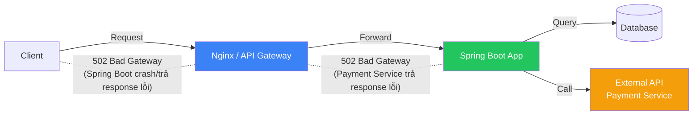
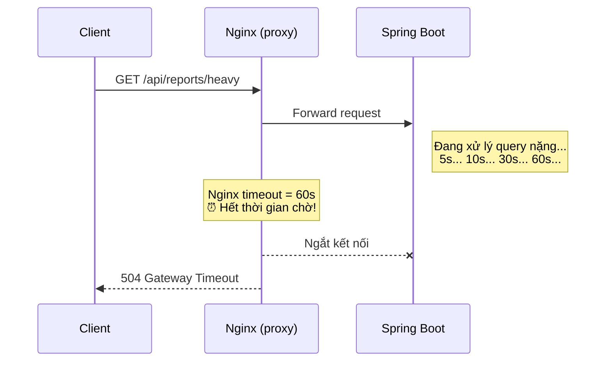
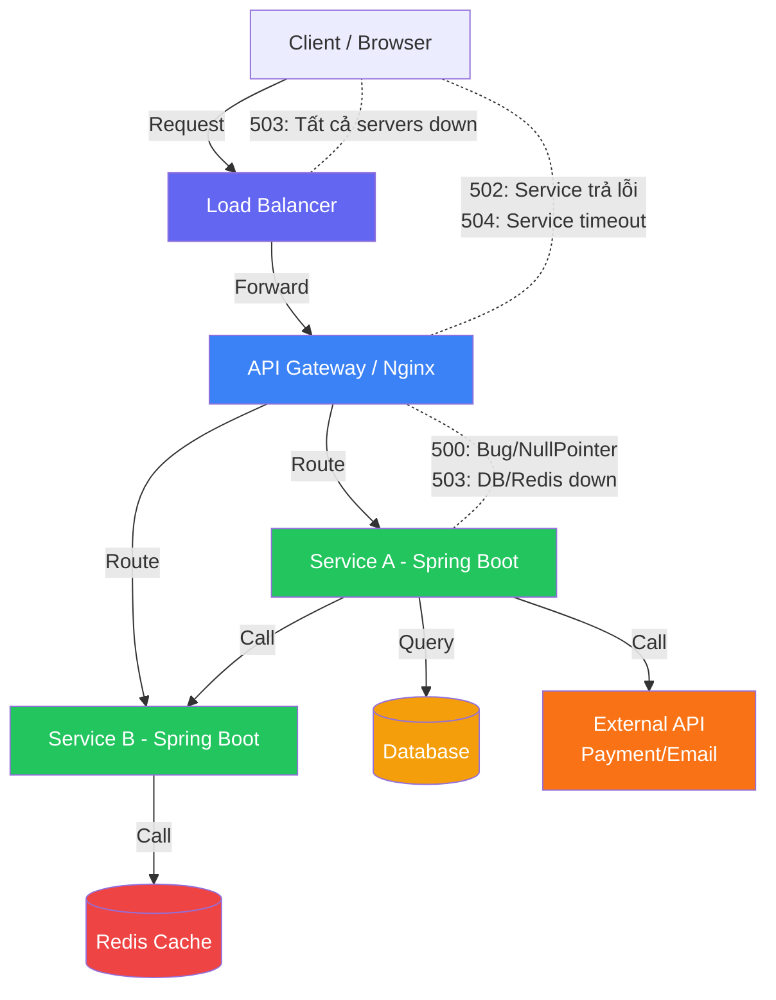
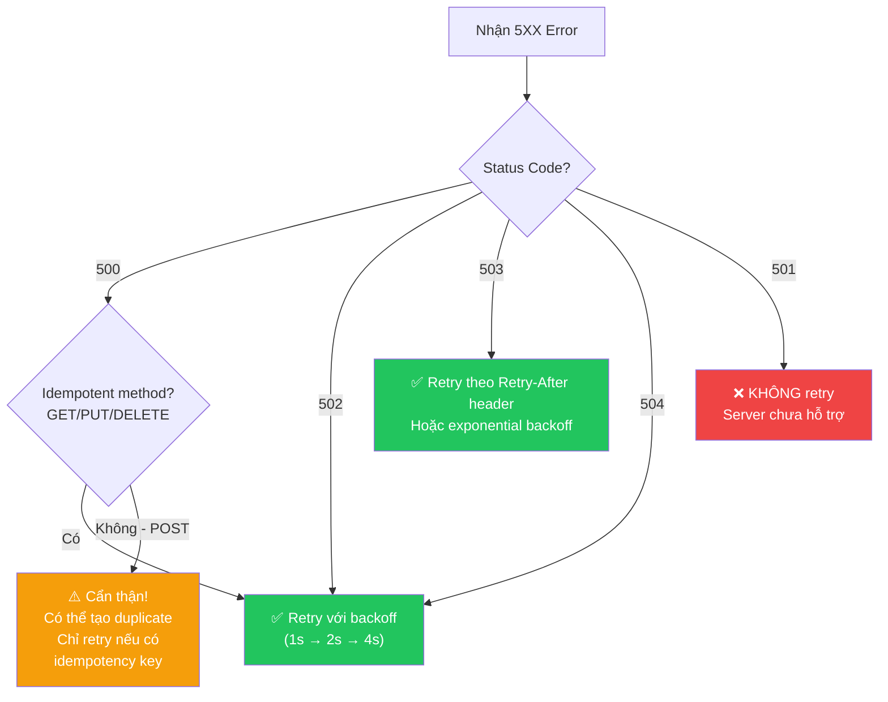
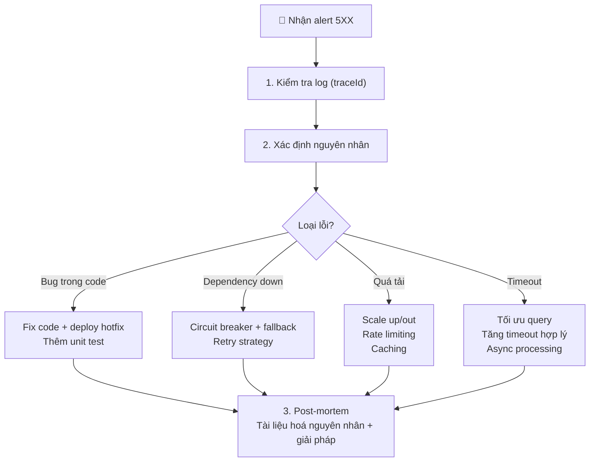

# 💥 HTTP Status Codes: 5XX — Server Error (Lỗi phía Server)

> **Nguồn chính thống:** [RFC 9110 — HTTP Semantics: Server Error 5xx](https://www.rfc-editor.org/rfc/rfc9110.html#name-server-error-5xx) | [MDN Web Docs — HTTP Status Codes](https://developer.mozilla.org/en-US/docs/Web/HTTP/Status#server_error_responses)
>
> **Thuộc roadmap:** `4. REST API → HTTP Status Codes → 5.X.X`

---

## 1. Định nghĩa chính thức từ RFC 9110

> *"The **5xx (Server Error)** class of status code indicates that the server is **aware that it has erred or is incapable** of performing the requested method."*
>
> — **RFC 9110, Section 15.6**

### Dịch & giải thích đơn giản:

**Nhóm 5XX** thông báo rằng lỗi xuất phát từ **phía server** — server biết mình đã sai hoặc không thể xử lý request. Server nói: *"LỖI CỦA TÔI, không phải lỗi của bạn."*

Đặc tính quan trọng:
- **Lỗi từ server:** Client gửi request đúng, nhưng server không thể xử lý.
- **Client không sửa được:** Gửi lại cùng request có thể vẫn lỗi — cần chờ server fix.
- **Retry có thể hữu ích:** Một số lỗi 5XX là tạm thời (server quá tải, dependency down) — retry sau vài giây có thể thành công.
- **PHẢI log chi tiết:** 5XX là lỗi nghiêm trọng — phải log đủ thông tin để debug, nhưng **KHÔNG bao giờ expose stack trace cho client**.

> [!CAUTION]
> **TUYỆT ĐỐI không trả stack trace, SQL query, hay thông tin nhạy cảm nội bộ cho client** khi trả 5XX. Hacker có thể khai thác thông tin này. Chỉ trả message chung chung, log chi tiết vào hệ thống logging nội bộ.

---

## 2. Bảng tổng hợp các mã 5XX

| Status Code | Tên | Ý nghĩa | Tần suất gặp | RFC |
|:-----------:|------|---------|:-------------:|:---:|
| **500** | Internal Server Error | Lỗi chung phía server (bug, NullPointer, DB error...) | ⭐⭐⭐⭐⭐ | [§15.6.1](https://www.rfc-editor.org/rfc/rfc9110.html#name-500-internal-server-error) |
| **501** | Not Implemented | Server chưa hỗ trợ chức năng được yêu cầu | ⭐ | [§15.6.2](https://www.rfc-editor.org/rfc/rfc9110.html#name-501-not-implemented) |
| **502** | Bad Gateway | Proxy/gateway nhận response lỗi từ upstream server | ⭐⭐⭐⭐ | [§15.6.3](https://www.rfc-editor.org/rfc/rfc9110.html#name-502-bad-gateway) |
| **503** | Service Unavailable | Server tạm thời không khả dụng (quá tải, maintenance) | ⭐⭐⭐⭐ | [§15.6.4](https://www.rfc-editor.org/rfc/rfc9110.html#name-503-service-unavailable) |
| **504** | Gateway Timeout | Proxy/gateway không nhận được response kịp thời | ⭐⭐⭐⭐ | [§15.6.5](https://www.rfc-editor.org/rfc/rfc9110.html#name-504-gateway-timeout) |
| **505** | HTTP Version Not Supported | Server không hỗ trợ phiên bản HTTP của request | ⭐ | [§15.6.6](https://www.rfc-editor.org/rfc/rfc9110.html#name-505-http-version-not-suppor) |
| **507** | Insufficient Storage | Server không đủ bộ nhớ để hoàn tất request | ⭐ | [RFC 4918](https://www.rfc-editor.org/rfc/rfc4918#section-11.5) *(WebDAV)* |
| **508** | Loop Detected | Server phát hiện vòng lặp vô hạn | ⭐ | [RFC 5842](https://www.rfc-editor.org/rfc/rfc5842#section-7.2) *(WebDAV)* |
| **511** | Network Authentication Required | Cần xác thực mạng (Wi-Fi captive portal) | ⭐ | [RFC 6585](https://www.rfc-editor.org/rfc/rfc6585#section-6) |

---

## 3. Chi tiết các Status Code quan trọng

### 3.1 `500 Internal Server Error` — ⭐ Lỗi chung phía server

**Khi nào xảy ra:** Bất kỳ lỗi không lường trước nào trên server — bug trong code, NullPointerException, database connection fail, OutOfMemoryError...

**Đây là "catch-all"** — nếu server không biết trả mã gì khác, nó trả 500.

```java
@RestControllerAdvice
public class GlobalExceptionHandler {

    private static final Logger log = LoggerFactory.getLogger(GlobalExceptionHandler.class);

    // ===== Catch-all: Mọi exception không handle được → 500 =====
    @ExceptionHandler(Exception.class)
    public ResponseEntity<ErrorResponse> handleAllUncaughtExceptions(
            Exception ex, HttpServletRequest request) {

        // ⚠️ LOG CHI TIẾT (stack trace) vào file log nội bộ
        log.error("Unhandled exception at {} {}: {}",
                request.getMethod(),
                request.getRequestURI(),
                ex.getMessage(),
                ex);  // log stack trace đầy đủ

        // ✅ TRẢ CHO CLIENT thông tin chung chung (KHÔNG lộ stack trace)
        ErrorResponse error = ErrorResponse.builder()
                .status(500)
                .error("INTERNAL_SERVER_ERROR")
                .message("Đã xảy ra lỗi hệ thống. Vui lòng thử lại sau.")
                .path(request.getRequestURI())
                .timestamp(LocalDateTime.now())
                .traceId(MDC.get("traceId"))  // Trả traceId để support team tra cứu
                .build();

        return ResponseEntity
                .status(HttpStatus.INTERNAL_SERVER_ERROR)
                .body(error);
    }

    // Database connection error → 500
    @ExceptionHandler(DataAccessException.class)
    public ResponseEntity<ErrorResponse> handleDatabaseError(
            DataAccessException ex, HttpServletRequest request) {

        log.error("Database error at {}: {}", request.getRequestURI(), ex.getMessage(), ex);

        ErrorResponse error = ErrorResponse.builder()
                .status(500)
                .error("DATABASE_ERROR")
                .message("Lỗi kết nối cơ sở dữ liệu. Vui lòng thử lại sau.")
                .path(request.getRequestURI())
                .timestamp(LocalDateTime.now())
                .build();

        return ResponseEntity.status(HttpStatus.INTERNAL_SERVER_ERROR).body(error);
    }
}
```

**Response mẫu — ĐÚNG (cho client):**

```json
// ✅ ĐÚNG — Thông tin chung chung, có traceId để tra cứu
{
  "status": 500,
  "error": "INTERNAL_SERVER_ERROR",
  "message": "Đã xảy ra lỗi hệ thống. Vui lòng thử lại sau.",
  "path": "/api/products/42",
  "timestamp": "2026-09-24T14:30:00",
  "traceId": "abc-123-def-456"
}
```

**Response mẫu — SAI (TUYỆT ĐỐI không làm):**

```json
// ❌ SAI — Lộ stack trace, lộ thông tin nội bộ
{
  "status": 500,
  "error": "Internal Server Error",
  "message": "java.lang.NullPointerException: Cannot invoke method on null object",
  "trace": "at com.myapp.service.ProductService.findById(ProductService.java:42)\n
            at com.myapp.controller.ProductController.getById(ProductController.java:28)\n
            ...(stack trace đầy đủ)...",
  "sql": "SELECT * FROM products WHERE id = 42"
}
```

> [!CAUTION]
> Cấu hình Spring Boot **KHÔNG** expose error details trong production:
> ```yaml
> # application-prod.yml
> server:
>   error:
>     include-message: never          # ❌ Không trả exception message
>     include-stacktrace: never       # ❌ Không trả stack trace
>     include-binding-errors: never   # ❌ Không trả binding errors
>     include-exception: false        # ❌ Không trả exception class name
> ```

---

### 3.2 `502 Bad Gateway` — Lỗi từ upstream server

**Khi nào xảy ra:** Server của bạn đóng vai trò **proxy/gateway** và nhận được response **không hợp lệ** từ server phía sau (upstream).

**Kiến trúc điển hình:**



**Use case:**
- Nginx forward request đến Spring Boot, nhưng Spring Boot đã crash
- API Gateway forward request đến microservice, nhưng microservice trả response sai format
- Spring Boot gọi external API (payment, email), nhận response lỗi

```java
// Spring Boot gọi external payment service bị lỗi
@Service
@RequiredArgsConstructor
public class PaymentService {

    private final RestClient restClient;

    public PaymentResult processPayment(PaymentRequest request) {
        try {
            return restClient.post()
                    .uri("https://payment-gateway.com/api/charge")
                    .body(request)
                    .retrieve()
                    .body(PaymentResult.class);
        } catch (RestClientResponseException ex) {
            // External service trả lỗi → log và wrap thành exception phù hợp
            log.error("Payment gateway error: status={}, body={}",
                    ex.getStatusCode(), ex.getResponseBodyAsString());
            throw new ExternalServiceException(
                    "Payment gateway không phản hồi đúng. Vui lòng thử lại.");
        }
    }
}

// Nếu bạn là API Gateway → trả 502
@ExceptionHandler(ExternalServiceException.class)
public ResponseEntity<ErrorResponse> handleExternalServiceError(
        ExternalServiceException ex) {
    ErrorResponse error = ErrorResponse.builder()
            .status(502)
            .error("BAD_GATEWAY")
            .message(ex.getMessage())
            .timestamp(LocalDateTime.now())
            .build();
    return ResponseEntity.status(HttpStatus.BAD_GATEWAY).body(error);
}
```

---

### 3.3 `503 Service Unavailable` — ⭐ Server tạm thời không khả dụng

**Khi nào dùng:** Server **tạm thời** không thể xử lý request — đang quá tải, đang maintenance, dependency service down...

**Quan trọng:** 503 là **TẠM THỜI** — client nên **retry sau một khoảng thời gian**.

```java
// Health check endpoint — khi server quá tải
@RestController
public class HealthController {

    private final ThreadPoolTaskExecutor executor;

    @GetMapping("/health")
    public ResponseEntity<Map<String, Object>> health() {
        int activeCount = executor.getActiveCount();
        int maxPoolSize = executor.getMaxPoolSize();

        if (activeCount >= maxPoolSize * 0.9) {
            // Server quá tải (>90% thread pool sử dụng)
            return ResponseEntity
                    .status(HttpStatus.SERVICE_UNAVAILABLE)
                    .header("Retry-After", "30")  // Thử lại sau 30 giây
                    .body(Map.of(
                            "status", "SERVICE_UNAVAILABLE",
                            "message", "Server đang quá tải. Thử lại sau 30 giây."
                    ));
        }

        return ResponseEntity.ok(Map.of("status", "UP"));
    }
}
```

**Maintenance mode:**

```java
@Component
public class MaintenanceModeFilter extends OncePerRequestFilter {

    @Value("${app.maintenance-mode:false}")
    private boolean maintenanceMode;

    @Override
    protected void doFilterInternal(HttpServletRequest request,
                                     HttpServletResponse response,
                                     FilterChain chain) throws ServletException, IOException {

        // Cho phép health check endpoint luôn hoạt động
        if (request.getRequestURI().equals("/health")) {
            chain.doFilter(request, response);
            return;
        }

        if (maintenanceMode) {
            response.setStatus(HttpServletResponse.SC_SERVICE_UNAVAILABLE);
            response.setContentType("application/json");
            response.setCharacterEncoding("UTF-8");
            response.setHeader("Retry-After", "3600");  // 1 giờ
            response.getWriter().write("""
                {
                  "status": 503,
                  "error": "SERVICE_UNAVAILABLE",
                  "message": "Hệ thống đang bảo trì. Dự kiến hoàn tất lúc 15:00 (UTC+7).",
                  "retryAfter": 3600
                }
                """);
            return;
        }

        chain.doFilter(request, response);
    }
}
```

**Circuit Breaker pattern (Resilience4j):**

```java
@Service
@RequiredArgsConstructor
public class OrderService {

    private final InventoryClient inventoryClient;

    // Circuit Breaker: nếu Inventory Service liên tục fail
    // → "mở circuit" → trả 503 thay vì gọi tiếp
    @CircuitBreaker(name = "inventoryService", fallbackMethod = "inventoryFallback")
    public StockResponse checkStock(Long productId) {
        return inventoryClient.getStock(productId);
    }

    // Fallback khi circuit mở
    private StockResponse inventoryFallback(Long productId, Throwable t) {
        log.warn("Inventory service unavailable, circuit open: {}", t.getMessage());
        throw new ServiceUnavailableException(
                "Dịch vụ kiểm tra tồn kho tạm thời không khả dụng. Vui lòng thử lại sau.");
    }
}

// Exception handler
@ExceptionHandler(ServiceUnavailableException.class)
public ResponseEntity<ErrorResponse> handleServiceUnavailable(
        ServiceUnavailableException ex) {
    ErrorResponse error = ErrorResponse.builder()
            .status(503)
            .error("SERVICE_UNAVAILABLE")
            .message(ex.getMessage())
            .timestamp(LocalDateTime.now())
            .build();
    return ResponseEntity
            .status(HttpStatus.SERVICE_UNAVAILABLE)
            .header("Retry-After", "30")
            .body(error);
}
```

> [!TIP]
> **Luôn kèm header `Retry-After`** khi trả 503. Nó có thể là số giây (`Retry-After: 30`) hoặc ngày giờ cụ thể (`Retry-After: Wed, 24 Sep 2026 15:00:00 GMT`).

---

### 3.4 `504 Gateway Timeout` — Upstream server không phản hồi kịp

**Khi nào xảy ra:** Proxy/gateway **chờ quá lâu** response từ upstream server. Khác với 502 (nhận response lỗi), 504 là **không nhận được response gì cả** (timeout).



**Cấu hình timeout trong Nginx:**

```nginx
# nginx.conf
location /api/ {
    proxy_pass http://spring-boot-app:8080;
    proxy_connect_timeout 10s;   # Timeout kết nối tới upstream
    proxy_read_timeout 60s;      # Timeout đọc response từ upstream
    proxy_send_timeout 30s;      # Timeout gửi request tới upstream
}
```

**Cấu hình timeout trong Spring Boot (RestClient):**

```java
@Configuration
public class RestClientConfig {

    @Bean
    public RestClient restClient(RestClient.Builder builder) {
        return builder
                .baseUrl("https://external-service.com")
                .requestFactory(clientHttpRequestFactory())
                .build();
    }

    private ClientHttpRequestFactory clientHttpRequestFactory() {
        JdkClientHttpRequestFactory factory = new JdkClientHttpRequestFactory();
        factory.setReadTimeout(Duration.ofSeconds(10));  // Timeout đọc response
        return factory;
    }
}
```

**Xử lý timeout khi gọi external service:**

```java
@Service
public class ReportService {

    @Timeout(name = "reportGeneration", fallbackMethod = "reportTimeoutFallback")
    @Retry(name = "reportGeneration", fallbackMethod = "reportRetryFallback")
    public ReportResult generateHeavyReport(ReportRequest request) {
        // Query nặng có thể mất nhiều thời gian
        return reportRepository.generateReport(request);
    }

    // Fallback khi timeout
    private ReportResult reportTimeoutFallback(ReportRequest request, Throwable t) {
        log.warn("Report generation timed out: {}", t.getMessage());
        throw new GatewayTimeoutException(
                "Báo cáo mất quá nhiều thời gian xử lý. " +
                "Vui lòng dùng chức năng xuất báo cáo bất đồng bộ (POST /api/reports/export).");
    }
}
```

---

### 3.5 `501 Not Implemented` — Chưa triển khai

**Khi nào dùng:** Server nhận diện được request nhưng **chưa hỗ trợ chức năng** này.

```java
// API endpoint chưa triển khai
@PatchMapping("/{id}")
public ResponseEntity<Void> partialUpdate(
        @PathVariable Long id,
        @RequestBody Map<String, Object> updates) {

    // Tính năng PATCH chưa implement
    throw new NotImplementedException(
            "Tính năng cập nhật một phần (PATCH) đang được phát triển. " +
            "Vui lòng dùng PUT để cập nhật toàn bộ.");
}

// Exception handler
@ExceptionHandler(NotImplementedException.class)
public ResponseEntity<ErrorResponse> handleNotImplemented(
        NotImplementedException ex) {
    ErrorResponse error = ErrorResponse.builder()
            .status(501)
            .error("NOT_IMPLEMENTED")
            .message(ex.getMessage())
            .timestamp(LocalDateTime.now())
            .build();
    return ResponseEntity.status(HttpStatus.NOT_IMPLEMENTED).body(error);
}
```

---

## 4. Kiến trúc tổng quan — 5XX ở đâu trong hệ thống?



| Vị trí lỗi | Status Code | Ví dụ |
|-----------|:-----------:|-------|
| **Bug trong code** | 500 | NullPointerException, StackOverflow |
| **Database down** | 500 hoặc 503 | Connection pool exhausted |
| **Upstream service trả lỗi** | 502 | Payment service trả HTML thay vì JSON |
| **Upstream service timeout** | 504 | Report service xử lý quá lâu |
| **Server quá tải** | 503 | Thread pool full, memory full |
| **Planned maintenance** | 503 | Deploy version mới, DB migration |
| **Tất cả instances down** | 503 | Load balancer không tìm thấy healthy server |

---

## 5. Retry Strategy — Khi nào nên retry?



**Retry với Resilience4j trong Spring Boot 4.1.0:**

```java
// application.yml
resilience4j:
  retry:
    instances:
      externalService:
        max-attempts: 3                    # Tối đa 3 lần thử
        wait-duration: 1s                  # Chờ 1s giữa các lần
        exponential-backoff-multiplier: 2  # 1s → 2s → 4s
        retry-exceptions:                 # Chỉ retry với các exception này
          - java.net.SocketTimeoutException
          - org.springframework.web.client.HttpServerErrorException
        ignore-exceptions:                # KHÔNG retry với các exception này
          - com.myapp.exception.BusinessException

  circuitbreaker:
    instances:
      externalService:
        sliding-window-size: 10           # Đánh giá 10 request gần nhất
        failure-rate-threshold: 50        # Mở circuit khi 50% fail
        wait-duration-in-open-state: 30s  # Chờ 30s trước khi thử lại
        permitted-number-of-calls-in-half-open-state: 3
```

```java
@Service
public class PaymentService {

    private final RestClient restClient;

    @Retry(name = "externalService")
    @CircuitBreaker(name = "externalService", fallbackMethod = "paymentFallback")
    public PaymentResult charge(PaymentRequest request) {
        return restClient.post()
                .uri("/api/charge")
                .body(request)
                .retrieve()
                .body(PaymentResult.class);
    }

    private PaymentResult paymentFallback(PaymentRequest request, Throwable t) {
        log.error("Payment service unavailable after retries: {}", t.getMessage());
        throw new ServiceUnavailableException(
                "Dịch vụ thanh toán tạm thời không khả dụng. Vui lòng thử lại sau.");
    }
}
```

---

## 6. Monitoring & Alerting cho 5XX

**Cấu hình Spring Boot Actuator + Micrometer:**

```yaml
# application.yml
management:
  endpoints:
    web:
      exposure:
        include: health, metrics, prometheus
  metrics:
    tags:
      application: my-app
    distribution:
      percentiles-histogram:
        http.server.requests: true
```

```java
// Custom metric: đếm số lần 5XX
@Component
@RequiredArgsConstructor
public class ErrorMetricsFilter extends OncePerRequestFilter {

    private final MeterRegistry meterRegistry;

    @Override
    protected void doFilterInternal(HttpServletRequest request,
                                     HttpServletResponse response,
                                     FilterChain chain) throws ServletException, IOException {
        try {
            chain.doFilter(request, response);
        } finally {
            int status = response.getStatus();
            if (status >= 500) {
                meterRegistry.counter("http.server.errors.5xx",
                        "method", request.getMethod(),
                        "uri", request.getRequestURI(),
                        "status", String.valueOf(status))
                        .increment();
            }
        }
    }
}
```

**Prometheus query ví dụ:**

```promql
# Tỷ lệ 5XX / tổng requests trong 5 phút
rate(http_server_requests_seconds_count{status=~"5.."}[5m])
/
rate(http_server_requests_seconds_count[5m])

# Alert khi tỷ lệ 5XX > 1%
# (Cấu hình trong Prometheus AlertManager)
```

---

## 🔥 Ứng dụng thực tế (Thực tế dùng để làm gì? Giải quyết vấn đề gì?)

### 5XX trong các tình huống thực tế:

| Tình huống | Status Code | Nguyên nhân | Giải pháp |
|-----------|:-----------:|------------|----------|
| Bug NullPointerException | **500** | Code lỗi (chưa check null) | Fix bug, deploy hotfix |
| Database connection pool full | **500** / **503** | Quá nhiều concurrent requests | Tăng pool size, tối ưu query |
| Nginx → Spring Boot crash | **502** | App bị OOM kill, JVM crash | Tăng memory, fix memory leak |
| Payment API timeout | **504** | Payment gateway xử lý chậm | Tăng timeout, dùng async |
| Deploy version mới | **503** | Rolling update — instance cũ shutdown | Blue-green deploy, graceful shutdown |
| Redis cache down | **500** / **503** | Redis server crash | Fallback sang DB, Circuit Breaker |
| DDoS attack | **503** | Server quá tải | Rate limiting, WAF, CDN |
| API chưa phát triển xong | **501** | Feature chưa implement | Hoàn thiện feature |

### Checklist xử lý 5XX cho Production:



---

## 7. Tổng hợp các chủ đề (Bản đồ tra cứu)

### 🟢 Ưu tiên phải biết trước (Bắt buộc)
- **500 Internal Server Error** — Lỗi chung, catch-all cho mọi exception
- **503 Service Unavailable** — Server quá tải hoặc maintenance
- Global Exception Handler (`@RestControllerAdvice`)
- **KHÔNG BAO GIỜ** expose stack trace, SQL, thông tin nhạy cảm cho client
- Cấu hình `server.error.*` trong production
- Luôn log chi tiết (traceId) để tra cứu

### 🟡 Nhóm trung cấp
- **502 Bad Gateway** — Lỗi từ upstream service/proxy
- **504 Gateway Timeout** — Upstream service timeout
- Retry strategy (exponential backoff, idempotency key)
- Circuit Breaker pattern (Resilience4j)
- Timeout configuration (Nginx, RestClient, Database)
- Maintenance mode filter

### 🔴 Nhóm nâng cao
- **501 Not Implemented** — Feature chưa triển khai
- **507 Insufficient Storage** — Hết dung lượng (WebDAV)
- Monitoring 5XX với Micrometer + Prometheus + Grafana
- Distributed tracing (Zipkin/Jaeger) để trace 5XX across microservices
- Graceful shutdown và rolling deployment để giảm 503
- Chaos engineering (Chaos Monkey) để test resilience

---

## 📚 Tài liệu tham khảo chính thống

| Tài liệu | Link |
|-----------|------|
| RFC 9110 — 5XX Status Codes | [rfc-editor.org](https://www.rfc-editor.org/rfc/rfc9110.html#name-server-error-5xx) |
| MDN — 500 Internal Server Error | [developer.mozilla.org](https://developer.mozilla.org/en-US/docs/Web/HTTP/Status/500) |
| MDN — 502 Bad Gateway | [developer.mozilla.org](https://developer.mozilla.org/en-US/docs/Web/HTTP/Status/502) |
| MDN — 503 Service Unavailable | [developer.mozilla.org](https://developer.mozilla.org/en-US/docs/Web/HTTP/Status/503) |
| Spring — Error Handling | [docs.spring.io](https://docs.spring.io/spring-framework/reference/web/webmvc/mvc-ann-rest-exceptions.html) |
| Resilience4j — Retry & Circuit Breaker | [resilience4j.readme.io](https://resilience4j.readme.io/docs) |
| Spring Boot — Actuator | [docs.spring.io](https://docs.spring.io/spring-boot/reference/actuator/index.html) |

---

> **Hoàn tất roadmap:** `HTTP Status Codes` — Bạn đã nắm vững cả 5 nhóm (1XX → 5XX). Tiếp theo hãy quay lại roadmap để học các chủ đề tiếp theo trong REST API.
