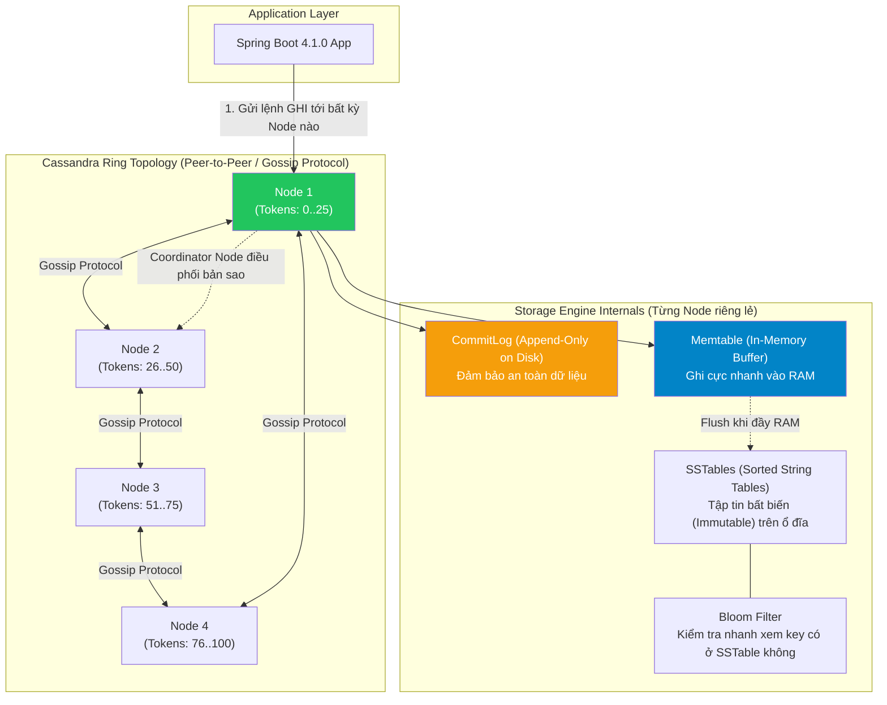
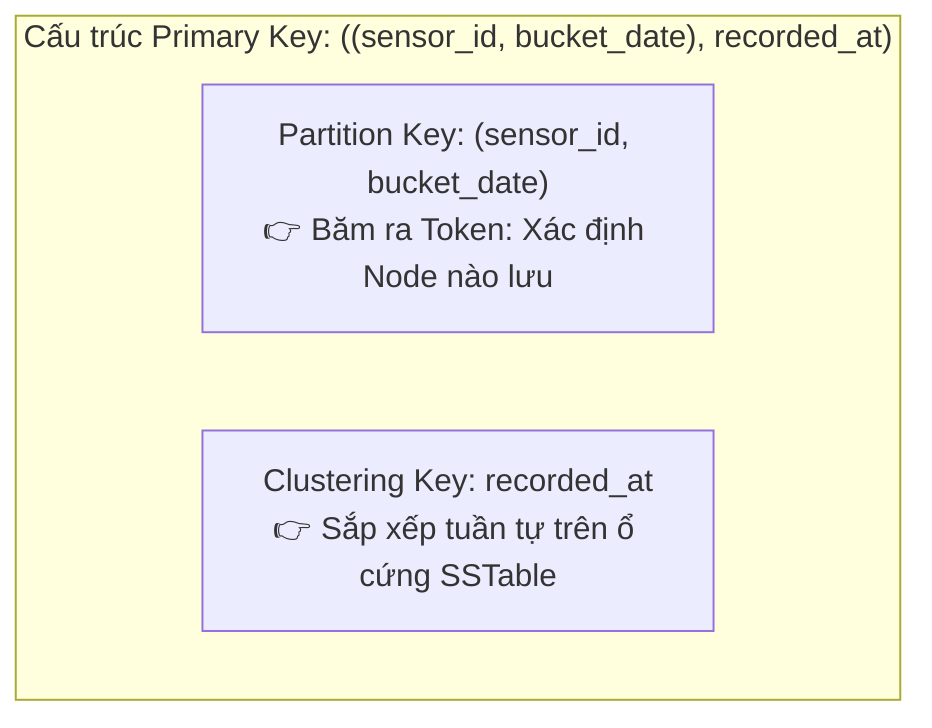

# 👁️ Database NoSQL: Apache Cassandra — Hệ quản trị CSDL phân tán Wide-Column hiệu năng ghi cực đại

> **Nguồn chính thống:** [Apache Cassandra Documentation](https://cassandra.apache.org/doc/latest/) | [DataStax Java Driver for Apache Cassandra](https://docs.datastax.com/en/developer/java-driver/latest/) | [Spring Data Cassandra Reference](https://docs.spring.io/spring-data/cassandra/reference/index.html)
>
> **Thuộc roadmap:** `5. Database → No SQL → Cassandra`

---

## 1. Giới thiệu Apache Cassandra

> *"Apache Cassandra is an open source distributed NoSQL database trusted by thousands of companies for high scalability and high availability without compromising performance."*
>
> — **cassandra.apache.org**

### Dịch & giải thích đơn giản:

**Apache Cassandra** là hệ quản trị cơ sở dữ liệu NoSQL phân tán thuộc nhóm **Wide-Column Store (CSDL cột rộng)**, ban đầu được phát triển bởi Facebook để giải quyết tính năng tìm kiếm hộp thư (Inbox Search) và sau đó được trao tặng cho Apache Software Foundation.

Trong định lý **CAP**, Cassandra là một hệ thống **AP (High Availability + Partition Tolerance)** điển hình với khả năng **tinh chỉnh tính nhất quán (Tunable Consistency)**.

```
RDBMS (MySQL/PostgreSQL)          Apache Cassandra (NoSQL)
─────────────────────────────────────────────────────────────
Database                 ───►    Keyspace
Table                    ───►    Table / Column Family
Row (Bản ghi)            ───►    Row (Xác định bởi Primary Key)
Column (Cột)             ───►    Column (Cell có kèm Timestamp)
Master - Replica         ───►    Peer-to-Peer (Masterless - Tất cả các node bình đẳng)
Scale Up (Tăng RAM/CPU)  ───►    Scale Out (Thêm Server vào Cluster dễ dàng)
```

**Tại sao Cassandra được các công ty Big Tech (Netflix, Apple, Uber) tin dùng?**
- **Hiệu năng ghi cực đại (Write-Heavy Workloads):** Có thể xử lý hàng triệu lượt ghi dữ liệu mỗi giây với độ trễ chỉ tính bằng mili-giây (thường dưới 2ms).
- **Kiến trúc Masterless (Không có Node chủ):** Mọi Node trên Cluster đều có vai trò như nhau. Không có hiện tượng nút cổ chai (Single Point of Failure - SPOF). Nếu 1 hoặc vài node bị chết cháy, hệ thống vẫn tiếp tục phục vụ 100% người dùng bình thường.
- **Mở rộng tuyến tính (Linear Scalability):** Tăng gấp đôi số lượng server sẽ tăng gấp đôi thông lượng xử lý mà không cần cấu hình phức tạp.
- **Phân tán đa trung tâm dữ liệu (Multi-Datacenter Replication):** Sao chép dữ liệu tức thời giữa các Cloud Regions khác nhau (AWS, GCP, Azure hoặc On-premise).

---

## 2. Kiến trúc Apache Cassandra



### Các thành phần bên trong một Cassandra Node:
1. **Coordinator Node:** Node bất kỳ đầu tiên nhận được request từ client. Node này sẽ chịu trách nhiệm băm Partition Key và điều phối ghi/đọc đến các Node đang giữ bản sao dữ liệu.
2. **CommitLog:** File ghi nhật ký tuần tự (Sequential append-only write) trên ổ cứng. Do ghi tuần tự (không tốn công tìm kiếm sector), tốc độ ghi cực nhanh và bảo vệ dữ liệu khi mất điện đột ngột.
3. **Memtable:** Bộ nhớ đệm trên RAM. Sau khi ghi vào CommitLog, dữ liệu được nạp vào Memtable và trả phản hồi (ACK) ngay lập tức cho client.
4. **SSTable (Sorted String Table):** Khi Memtable đầy, dữ liệu được ghi xuống đĩa thành file SSTable bất biến (Immutable). Không bao giờ có thao tác ghi đè trực tiếp lên SSTable cũ.
5. **Bloom Filter:** Thuật toán xác suất trong bộ nhớ giúp Cassandra biết chắc chắn một SSTable **KHÔNG chứa** dữ liệu cần tìm, tránh việc đọc đĩa lãng phí.
6. **Compaction:** Tiến trình chạy ngầm gom các file SSTable nhỏ lại thành file lớn, loại bỏ các bản ghi cũ hoặc các dòng đã bị đánh dấu xóa (Tombstones).

---

## 3. Cài đặt & Cấu hình Cassandra

### 3.1 Chạy nhanh với Docker (Development)

```bash
# Tạo container Cassandra 5.0
docker run -d \
  --name cassandra-dev \
  -p 9042:9042 \
  -e CASSANDRA_CLUSTER_NAME="DevCluster" \
  -e CASSANDRA_DC="datacenter1" \
  -v cassandra_data:/var/lib/cassandra \
  cassandra:5.0

# Kiểm tra trạng thái Cluster
docker exec -it cassandra-dev nodetool status

# Truy cập vào CQL Shell (cqlsh)
docker exec -it cassandra-dev cqlsh
```

### 3.2 Docker Compose (Cấu hình bộ nhớ tối ưu)

```yaml
# docker-compose.yml
services:
  cassandra:
    image: cassandra:5.0
    container_name: cassandra-node
    restart: always
    environment:
      - CASSANDRA_CLUSTER_NAME=ProductionCluster
      - CASSANDRA_DC=datacenter1
      - CASSANDRA_ENDPOINT_SNITCH=GossipingPropertyFileSnitch
      - MAX_HEAP_SIZE=2048M
      - HEAP_NEWSIZE=512M
    ports:
      - "9042:9042" # CQL Native Transport Port
    volumes:
      - cassandra_data:/var/lib/cassandra
    healthcheck:
      test: ["CMD-SHELL", "cqlsh -e 'DESCRIBE KEYSPACES;' || exit 1"]
      interval: 15s
      timeout: 10s
      retries: 5

volumes:
  cassandra_data:
```

---

## 4. Kiểu dữ liệu CQL & Tư duy thiết kế "Query-Driven Modeling"

### 4.1 Bảng ánh xạ kiểu dữ liệu CQL sang Java

| Kiểu dữ liệu CQL | Ý nghĩa / Kích thước | Java Type (Driver 4.x) | Use Case |
|------------------|----------------------|------------------------|----------|
| `uuid` | Chuỗi định danh 128-bit chuẩn RFC 4122 | `java.util.UUID` | ID ngẫu nhiên phân tán ⭐ |
| `timeuuid` | UUID phiên bản 1 (chứa timestamp) | `com.datastax.oss.driver.api.core.uuid.Uuids` | Sắp xếp lịch sử tin nhắn, log theo thời gian ⭐ |
| `text` / `varchar` | Chuỗi UTF-8 | `java.lang.String` | Tên, nội dung bài viết |
| `int` | Số nguyên 32-bit | `java.lang.Integer` | Tuổi, số đếm |
| `bigint` | Số nguyên 64-bit | `java.lang.Long` | Số lượt xem, timestamp |
| `decimal` | Số thực chính xác tuyệt đối | `java.math.BigDecimal` | Giao dịch tài chính |
| `timestamp` | Ngày giờ kèm timezone (epoch millis) | `java.time.Instant` | Thời điểm ghi log, sensor time |
| `boolean` | Đúng / Sai | `java.lang.Boolean` | Cờ trạng thái |
| `list<T>` | Danh sách có thứ tự | `java.util.List<T>` | Danh sách tags nhỏ |
| `set<T>` | Tập hợp không trùng lặp | `java.util.Set<T>` | Danh sách vai trò (roles) |
| `map<K,V>` | Cặp khóa - giá trị | `java.util.Map<K, V>` | Thuộc tính động của thiết bị |
| `frozen<UDT>` | Kiểu dữ liệu người dùng tự định nghĩa | Class Java tương ứng | Địa chỉ, cấu trúc cố định |

---

### 4.2 Cốt lõi của Cassandra: Cấu trúc Primary Key

Trong Cassandra, cấu trúc của **Primary Key** quyết định hoàn toàn việc dữ liệu được lưu trên Node nào và được sắp xếp ra sao trên đĩa:

```
PRIMARY KEY = ((Partition Key), Clustering Keys)
```

1. **Partition Key (Khóa phân vùng):**
   - Được đưa qua hàm băm **Murmur3Partitioner** để sinh ra một mã Token (từ $-2^{63}$ đến $2^{63}-1$).
   - Token này quyết định chính xác **Node nào trên Ring** sẽ lưu giữ Partition dữ liệu đó.
2. **Clustering Key (Khóa gom cụm / sắp xếp):**
   - Dữ liệu trong cùng một Partition sẽ được sắp xếp vật lý theo thứ tự (ASC/DESC) trên đĩa cứng SSTable theo các cột Clustering Key này.



> [!CAUTION]
> **Quy tắc vàng:** *"Trong Cassandra, bạn KHÔNG thiết kế bảng theo thực thể (Entity) mà phải thiết kế bảng theo đúng CÂU HỎI TRUY VẤN (Query) mà bạn sẽ gọi!"*.
> - KHÔNG có lệnh `JOIN`.
> - KHÔNG có `GROUP BY` tùy tiện trên cột không phải partition key.
> - Nếu ứng dụng cần 3 cách truy vấn khác nhau, bạn phải tạo **3 bảng khác nhau** chứa cùng một luồng dữ liệu (chấp nhận lưu dư thừa - Denormalization).

---

### 4.3 Cạm bẫy "Tombstones" khi xóa dữ liệu (Sát thủ hiệu năng)

Trong Cassandra, khi bạn chạy lệnh `DELETE`, dữ liệu **không bị xóa ngay lập tức** khỏi đĩa!
- Thay vào đó, Cassandra ghi thêm một điểm đánh dấu đặc biệt gọi là **Tombstone** (Bia mộ) kèm thời gian xóa.
- Khi truy vấn `SELECT`, Cassandra phải duyệt qua tất cả các Tombstone này. Nếu trong bảng có quá nhiều Tombstone (ví dụ: trên 100.000), hệ thống sẽ kích hoạt cảnh báo hoặc quăng lỗi `TombstoneOverwhelmingException` làm sập câu truy vấn!
- Tombstone chỉ được dọn dẹp vật lý sau khi vượt qua khoảng thời gian `gc_grace_seconds` (mặc định 10 ngày) trong quá trình Compaction.

---

## 5. Thao tác với ngôn ngữ CQL (Cassandra Query Language)

```sql
-- 1. Tạo Keyspace (Tương đương Database) với Replication Factor = 3
CREATE KEYSPACE IF NOT EXISTS iot_tracking
WITH replication = {
    'class': 'SimpleStrategy',           -- Dev dùng SimpleStrategy; Production dùng NetworkTopologyStrategy
    'replication_factor': 3              -- Dữ liệu được nhân bản trên 3 node khác nhau
};

USE iot_tracking;

-- 2. Tạo bảng đo nhiệt độ cảm biến
CREATE TABLE IF NOT EXISTS sensor_telemetry (
    sensor_id       uuid,
    bucket_date     date,                 -- Kỹ thuật bucketing chia nhỏ partition
    recorded_at     timestamp,
    temperature     decimal,
    humidity        decimal,
    firmware_ver    text,
    PRIMARY KEY ((sensor_id, bucket_date), recorded_at)
) WITH CLUSTERING ORDER BY (recorded_at DESC)
  AND default_time_to_live = 2592000     -- Tự động dọn dẹp sau 30 ngày (TTL)
  AND compaction = {
      'class': 'TimeWindowCompactionStrategy', -- Tối ưu chuyên biệt cho Time-Series
      'compaction_window_unit': 'DAYS',
      'compaction_window_size': '1'
  };

-- 3. Thêm dữ liệu (INSERT)
INSERT INTO sensor_telemetry (sensor_id, bucket_date, recorded_at, temperature, humidity, firmware_ver)
VALUES (123e4567-e89b-12d3-a456-426614174000, '2026-10-26', toTimestamp(now()), 28.5, 65.2, 'v2.1.0')
USING TTL 86400; -- TTL riêng cho bản ghi này (1 ngày)

-- 4. Truy vấn dữ liệu (SELECT)
-- Hợp lệ: Truy vấn cung cấp ĐẦY ĐỦ Partition Key
SELECT * FROM sensor_telemetry
WHERE sensor_id = 123e4567-e89b-12d3-a456-426614174000
  AND bucket_date = '2026-10-26'
  AND recorded_at >= '2026-10-26 00:00:00'
ORDER BY recorded_at DESC
LIMIT 50;

-- 5. LƯU Ý LỚN: Câu lệnh này sẽ BỊ TỪ CHỐI nếu không có ALLOW FILTERING
-- SELECT * FROM sensor_telemetry WHERE firmware_ver = 'v2.1.0'; 
-- (Tránh dùng ALLOW FILTERING trên production vì nó quét toàn bộ cluster!)
```

---

## 6. Tích hợp Cassandra với Spring Boot 4.1.0 & Spring Framework 7.0.8

### 6.1 Khai báo Dependencies (`pom.xml`)

```xml
<dependencies>
    <!-- Spring Data Cassandra -->
    <dependency>
        <groupId>org.springframework.boot</groupId>
        <artifactId>spring-boot-starter-data-cassandra</artifactId>
    </dependency>

    <!-- DataStax Java Driver 4.x Extensions -->
    <dependency>
        <groupId>com.datastax.oss</groupId>
        <artifactId>java-driver-query-builder</artifactId>
    </dependency>
</dependencies>
```

### 6.2 Cấu hình kết nối (`application.yml`)

```yaml
spring:
  cassandra:
    keyspace-name: iot_tracking
    contact-points: localhost:9042
    local-datacenter: datacenter1
    schema-action: NONE                   # Production: Tuyệt đối dùng NONE (quản lý schema qua script)
    request:
      timeout: 5s
      consistency: LOCAL_QUORUM           # Mức nhất quán mặc định cho hệ thống thực tế
    connection:
      connect-timeout: 10s
      init-query-timeout: 10s
    pool:
      heartbeat-interval: 30s
      max-requests-per-connection: 1024   # Tận dụng multiplexing kết nối của Driver 4.x
```

### 6.3 Định nghĩa Khóa phức hợp và Entity

```java
package com.example.cassandra.entity;

import org.springframework.data.cassandra.core.cql.Ordering;
import org.springframework.data.cassandra.core.cql.PrimaryKeyType;
import org.springframework.data.cassandra.core.mapping.PrimaryKey;
import org.springframework.data.cassandra.core.mapping.PrimaryKeyClass;
import org.springframework.data.cassandra.core.mapping.PrimaryKeyColumn;
import org.springframework.data.cassandra.core.mapping.Table;

import java.io.Serializable;
import java.math.BigDecimal;
import java.time.Instant;
import java.time.LocalDate;
import java.util.UUID;

@Table("sensor_telemetry")
public class SensorTelemetry {

    @PrimaryKeyClass
    public static class Key implements Serializable {

        // Partition Key: Quyết định Node lưu trữ
        @PrimaryKeyColumn(name = "sensor_id", type = PrimaryKeyType.PARTITIONED, ordinal = 0)
        private UUID sensorId;

        // Partition Key bổ trợ (Bucketing theo ngày tránh tràn kích thước partition 100MB)
        @PrimaryKeyColumn(name = "bucket_date", type = PrimaryKeyType.PARTITIONED, ordinal = 1)
        private LocalDate bucketDate;

        // Clustering Key: Sắp xếp vật lý on-disk thời gian mới nhất lên đầu
        @PrimaryKeyColumn(name = "recorded_at", type = PrimaryKeyType.CLUSTERED, ordering = Ordering.DESCENDING, ordinal = 2)
        private Instant recordedAt;

        public Key() {}

        public Key(UUID sensorId, LocalDate bucketDate, Instant recordedAt) {
            this.sensorId = sensorId;
            this.bucketDate = bucketDate;
            this.recordedAt = recordedAt;
        }
        // getters & setters...
    }

    @PrimaryKey
    private Key key;

    private BigDecimal temperature;
    private BigDecimal humidity;
    private String firmwareVer;

    // constructors, getters & setters...
}
```

### 6.4 Triển khai Repository & PagingState Cursor

```java
package com.example.cassandra.repository;

import com.example.cassandra.entity.SensorTelemetry;
import org.springframework.data.cassandra.repository.CassandraRepository;
import org.springframework.data.cassandra.repository.Query;
import org.springframework.stereotype.Repository;

import java.time.LocalDate;
import java.util.List;
import java.util.UUID;

@Repository
public interface SensorTelemetryRepository extends CassandraRepository<SensorTelemetry, SensorTelemetry.Key> {

    // Derived Query: Tìm theo Partition Key
    List<SensorTelemetry> findByKeySensorIdAndKeyBucketDate(UUID sensorId, LocalDate bucketDate);

    // Custom CQL Query giới hạn số bản ghi mới nhất
    @Query("SELECT * FROM sensor_telemetry WHERE sensor_id = ?0 AND bucket_date = ?1 LIMIT ?2")
    List<SensorTelemetry> findLatestReadings(UUID sensorId, LocalDate bucketDate, int limit);
}
```

---

## 7. Cơ chế Ghi (Write Path), Đọc (Read Path) & Tính nhất quán (Tunable Consistency)

### 7.1 Tại sao tốc độ ghi của Cassandra lại nhanh nhất thế giới?
- Ghi vào Cassandra **KHÔNG BAO GIỜ** phải tìm kiếm ngẫu nhiên trên đĩa (Random Disk I/O) hay khóa bảng (Table locking).
- Lệnh ghi chỉ gồm 2 thao tác siêu nhẹ:
  1. Ghi nối đuôi vào cuối file `CommitLog` (Sequential Write I/O).
  2. Ghi vào bộ nhớ đệm RAM `Memtable`.
- Sau 2 bước này, node trả về trạng thái **Thành công** ngay cho Client mà không cần đợi ghi xuống đĩa SSTable.

---

### 7.2 Công thức tính nhất quán mạnh (Strong Consistency Formula)

Cassandra cho phép lập trình viên tinh chỉnh mức độ nhất quán trên từng câu truy vấn:

| Mức nhất quán (Consistency Level) | Ý nghĩa |
|---|---|
| `ANY` | Chỉ cần ghi vào 1 node hoặc gửi vào Hinted Handoff là xong (Nhanh nhất, rủi ro mất dữ liệu). |
| `ONE` | Chỉ cần 1 bản sao (replica node) xác nhận thành công. |
| `QUORUM` | Đa số các bản sao trên toàn bộ cluster phải xác nhận: $(\lfloor N/2 \rfloor + 1)$. |
| `LOCAL_QUORUM` ⭐ | Đa số các bản sao **trong cùng Datacenter nội bộ** xác nhận (Chuẩn sản xuất khuyến nghị). |
| `ALL` | Mọi bản sao đều phải xác nhận (Chậm nhất, mất tính sẵn sàng nếu 1 node chết). |

> [!IMPORTANT]
> **Công thức đảm bảo đọc được dữ liệu mới nhất (Strong Consistency):**
> $$R + W > N$$
> Trong đó:
> - $R$ = Mức độ nhất quán khi ĐỌC (Read Consistency Level)
> - $W$ = Mức độ nhất quán khi GHI (Write Consistency Level)
> - $N$ = Hệ số bản sao (Replication Factor)
>
> **Ví dụ thực tế:** Cluster có $N = 3$ (Replication Factor = 3).
> - Nếu Ghi dùng `QUORUM` (cần $2$ node đồng ý).
> - Đọc dùng `QUORUM` (hỏi $2$ node).
> - $\implies R + W = 2 + 2 = 4 > 3$.  
> $\rightarrow$ Đảm bảo **100% dữ liệu đọc ra luôn là mới nhất**, không bao giờ bị hiện tượng stale data!

---

## 🔥 Ứng dụng thực tế (Thực tế dùng để làm gì? Giải quyết vấn đề gì?)

### Cassandra được sử dụng ở đâu trong thực tế:

| Tập đoàn | Quy mô dữ liệu | Ứng dụng thực tế |
|---|---|---|
| **Netflix** | Hàng chục Petabytes dữ liệu | Lưu lịch sử xem phim của hàng trăm triệu người dùng trên toàn cầu; phân tích thói quen xem phim theo thời gian thực. |
| **Apple** | Hơn 160.000 Cassandra Nodes | Lưu trữ dữ liệu iCloud, tin nhắn, dữ liệu ứng dụng đồng bộ của hàng tỷ thiết bị iPhone/Mac. |
| **Discord** | Hàng nghìn tỷ tin nhắn | Lưu lịch sử hội thoại (Chat History) của toàn bộ các server Discord trên thế giới, tốc độ truy cập tin nhắn tức thì. |
| **Uber** | Hàng triệu chuyến xe | Theo dõi tọa độ vị trí thực tế của tài xế và hành khách theo từng giây (Real-time Location Tracking). |

### Khi nào nên chọn Cassandra vs Khi nào KHÔNG nên:

| Tình huống | Nên chọn Cassandra? | Lý do kỹ thuật |
|---|:---:|---|
| Tốc độ ghi cực lớn (Write-Heavy) hàng triệu events/giây | ✅ | Ghi tuần tự CommitLog + Memtable với độ trễ < 2ms. |
| Yêu cầu hệ thống KHÔNG BAO GIỜ được sập (99.999% Uptime) | ✅ | Kiến trúc Masterless Peer-to-Peer, không có Single Point of Failure. |
| Lưu dữ liệu chuỗi thời gian (Time-series data: IoT, Audit Logs) | ✅ | Clustering key sắp xếp on-disk cực nhanh; Compaction TWCS chuyên biệt. |
| Ứng dụng cần JOIN nhiều bảng và tính toán quan hệ phức tạp | ❌ | Cassandra không hỗ trợ JOIN. Hãy dùng RDBMS (PostgreSQL). |
| Ứng dụng thường xuyên chạy các câu UPDATE và DELETE nhiều dòng | ❌ | Gây ra bão Tombstone làm sụt giảm nghiêm trọng hiệu năng đọc. |
| Hệ thống cần tìm kiếm full-text tự do nhiều cột linh hoạt | ❌ | Cassandra chỉ tìm kiếm tốt qua Partition Key. Tìm kiếm linh hoạt hãy dùng Elasticsearch. |

---

## 9. Tổng hợp các chủ đề (Bản đồ tra cứu)

### 🟢 Ưu tiên phải biết trước (Bắt buộc)
- Triết lý NoSQL Wide-Column & Định lý CAP (Tính chất AP của Cassandra).
- Kiến trúc Peer-to-Peer không có Master (Masterless Ring Topology).
- Cài đặt Cassandra bằng Docker và thao tác lệnh `cqlsh`, `nodetool status`.
- Khái niệm Keyspace và Replication Factor.
- Phân biệt rõ **Partition Key** vs **Clustering Key**.
- Viết câu lệnh CQL căn bản: `CREATE TABLE`, `INSERT`, `SELECT` theo đúng Partition Key.

### 🟡 Nhóm trung cấp
- Tư duy "Query-Driven Modeling": Thiết kế cấu trúc bảng phục vụ trực tiếp cho câu query.
- Kiểu dữ liệu nâng cao: `timeuuid`, `tuple`, `frozen<UDT>`, Collection (`list`, `set`, `map`).
- Tích hợp Spring Boot: `spring-boot-starter-data-cassandra`, `@PrimaryKeyClass`, `@PrimaryKeyColumn`.
- Cơ chế TTL (Time-To-Live) tự động dọn dẹp dữ liệu cũ.
- Tinh chỉnh tính nhất quán (Tunable Consistency): `ONE`, `LOCAL_QUORUM`, `QUORUM`.
- Phân trang dạng luồng với `PagingState` của Driver 4.x.

### 🔴 Nhóm nâng cao
- Bản chất Storage Engine: CommitLog, Memtable, SSTable, Bloom Filter.
- Hiểm họa **Tombstones** khi xóa dữ liệu & Chiến lược điều chỉnh `gc_grace_seconds`.
- Các chiến lược dọn dẹp đĩa (Compaction Strategies): `SizeTieredCompactionStrategy` vs `LeveledCompactionStrategy` vs `TimeWindowCompactionStrategy`.
- Giao dịch nhẹ phân tán (Lightweight Transactions - LWT) dựa trên thuật toán Paxos (`IF NOT EXISTS`).
- Kiến trúc Multi-Datacenter Replication và tránh hiện tượng Split-Brain.
- Nodetool Operations: `nodetool repair`, `nodetool cleanup`, `nodetool compact`.

---

## 📚 Tài liệu tham khảo chính thống

| Tài liệu | Đường dẫn liên kết |
|---|---|
| Apache Cassandra 5.0 Documentation | [cassandra.apache.org/doc/latest](https://cassandra.apache.org/doc/latest/) |
| DataStax Java Driver 4.x for Apache Cassandra | [docs.datastax.com/java-driver](https://docs.datastax.com/en/developer/java-driver/latest/) |
| DataStax Academy (Các khóa đào tạo Cassandra miễn phí) | [academy.datastax.com](https://academy.datastax.com/) |
| Spring Data Cassandra Reference Documentation | [docs.spring.io/spring-data/cassandra](https://docs.spring.io/spring-data/cassandra/reference/index.html) |
| Cassandra: The Definitive Guide (O'Reilly) | [oreilly.com/library/view/cassandra-the-definitive](https://www.oreilly.com/library/view/cassandra-the-definitive/9781098115159/) |

---

> **Quay lại roadmap tổng thể:** [roadmap.txt](file:///d:/WebSpace/Java-Backend/roadmap.txt)
