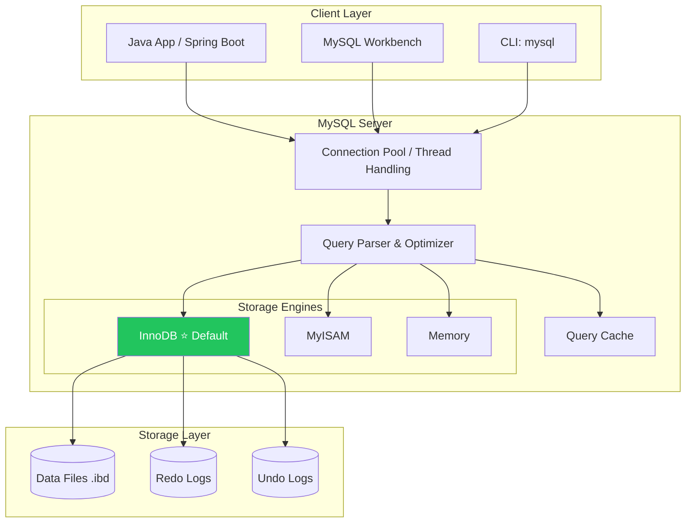
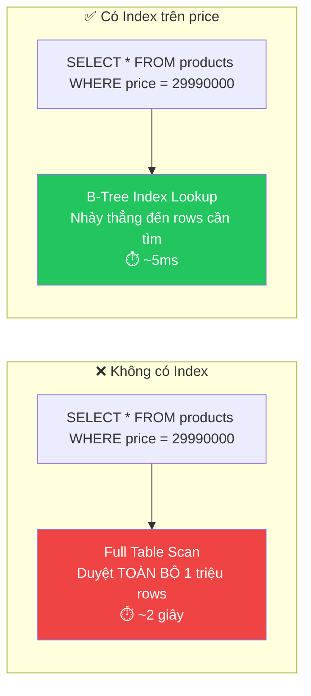

# 🐬 Database SQL: MySQL — Hệ quản trị cơ sở dữ liệu quan hệ phổ biến nhất

> **Nguồn chính thống:** [MySQL 9.x Reference Manual](https://dev.mysql.com/doc/refman/9.0/en/) | [Spring Data JPA — MySQL](https://docs.spring.io/spring-boot/reference/data/sql.html)
>
> **Thuộc roadmap:** `5. Database → SQL → MySQL`

---

## 1. Giới thiệu MySQL

> *"MySQL is the world's most popular open source relational database management system."*
>
> — **mysql.com**

### Dịch & giải thích đơn giản:

**MySQL** là hệ quản trị cơ sở dữ liệu quan hệ (RDBMS) mã nguồn mở **phổ biến nhất thế giới**, thuộc sở hữu của Oracle Corporation. Dữ liệu được tổ chức thành **bảng (tables)** với các **hàng (rows)** và **cột (columns)**, liên kết với nhau qua **khóa ngoại (foreign keys)**.

**Tại sao MySQL phổ biến?**
- **Miễn phí & mã nguồn mở:** Community Edition hoàn toàn free
- **Dễ học, dễ cài đặt:** Setup trong vài phút, cú pháp SQL trực quan
- **Hiệu năng cao:** Tối ưu cho read-heavy workloads
- **Hệ sinh thái rộng lớn:** Hỗ trợ bởi hầu hết frameworks, hosting, cloud providers
- **Cộng đồng lớn:** Stack Overflow, tutorials, documentation phong phú

> [!NOTE]
> **MySQL vs MariaDB:** MariaDB là fork (nhánh) từ MySQL do người sáng lập MySQL tạo ra sau khi Oracle mua lại. Về cơ bản tương thích nhau, nhưng MariaDB có thêm nhiều tính năng mới. Nhiều Linux distro đã chuyển sang MariaDB làm mặc định.

---

## 2. Kiến trúc MySQL



### Storage Engines quan trọng:

| Engine | Transactions | Foreign Key | Full-text Search | Use Case |
|--------|:----------:|:-----------:|:----------------:|----------|
| **InnoDB** ⭐ | ✅ | ✅ | ✅ (5.6+) | Mặc định — dùng cho hầu hết ứng dụng |
| **MyISAM** | ❌ | ❌ | ✅ | Legacy — read-heavy, không cần transaction |
| **Memory** | ❌ | ❌ | ❌ | Dữ liệu tạm, cache — mất khi restart |

> [!IMPORTANT]
> **Luôn dùng InnoDB** cho ứng dụng mới. InnoDB hỗ trợ ACID transactions, row-level locking, crash recovery, và foreign keys. MyISAM chỉ còn dùng trong hệ thống legacy.

---

## 3. Cài đặt & Cấu hình MySQL

### 3.1 Cài đặt với Docker (Khuyên dùng cho Development)

```bash
# Tạo và chạy MySQL container
docker run -d \
  --name mysql-dev \
  -e MYSQL_ROOT_PASSWORD=root123 \
  -e MYSQL_DATABASE=myapp_db \
  -e MYSQL_USER=myapp_user \
  -e MYSQL_PASSWORD=myapp_pass \
  -p 3306:3306 \
  -v mysql_data:/var/lib/mysql \
  mysql:9.0

# Kiểm tra container
docker ps

# Kết nối vào MySQL CLI
docker exec -it mysql-dev mysql -u myapp_user -p
```

### 3.2 Docker Compose (cho dự án thực tế)

```yaml
# docker-compose.yml
services:
  mysql:
    image: mysql:9.0
    container_name: mysql-dev
    environment:
      MYSQL_ROOT_PASSWORD: root123
      MYSQL_DATABASE: myapp_db
      MYSQL_USER: myapp_user
      MYSQL_PASSWORD: myapp_pass
    ports:
      - "3306:3306"
    volumes:
      - mysql_data:/var/lib/mysql
      - ./init-scripts:/docker-entrypoint-initdb.d  # SQL scripts chạy khi khởi tạo
    command: >
      --character-set-server=utf8mb4
      --collation-server=utf8mb4_unicode_ci
      --default-authentication-plugin=caching_sha2_password
    healthcheck:
      test: ["CMD", "mysqladmin", "ping", "-h", "localhost"]
      interval: 10s
      timeout: 5s
      retries: 3

volumes:
  mysql_data:
```

---

## 4. Kiểu dữ liệu MySQL quan trọng

### 4.1 Số (Numeric)

| Kiểu | Kích thước | Phạm vi (Signed) | Java Type | Use Case |
|------|:----------:|-------------------|-----------|----------|
| `TINYINT` | 1 byte | -128 → 127 | `Byte` | Cờ (flag), trạng thái nhỏ |
| `SMALLINT` | 2 bytes | -32,768 → 32,767 | `Short` | Mã bưu điện, tuổi |
| `INT` | 4 bytes | -2.1 tỷ → 2.1 tỷ | `Integer` | ID, số lượng ⭐ |
| `BIGINT` | 8 bytes | ±9.2 × 10¹⁸ | `Long` | ID lớn, timestamp ⭐ |
| `DECIMAL(p,s)` | Tuỳ | Chính xác | `BigDecimal` | Tiền, giá ⭐ |
| `FLOAT` | 4 bytes | Xấp xỉ | `Float` | Đo lường (không dùng cho tiền!) |
| `DOUBLE` | 8 bytes | Xấp xỉ | `Double` | Tính toán khoa học |

> [!CAUTION]
> **KHÔNG BAO GIỜ** dùng `FLOAT` hoặc `DOUBLE` cho **tiền tệ/giá cả**! Dùng `DECIMAL(19,4)` để tránh lỗi làm tròn. Ví dụ: `FLOAT` có thể lưu `19.99` thành `19.989999...`

### 4.2 Chuỗi (String)

| Kiểu | Kích thước tối đa | Java Type | Use Case |
|------|:-----------------:|-----------|----------|
| `CHAR(n)` | 255 chars (cố định) | `String` | Mã cố định: mã quốc gia (VN), giới tính (M/F) |
| `VARCHAR(n)` | 65,535 chars | `String` | Tên, email, địa chỉ ⭐ |
| `TEXT` | 65,535 chars | `String` | Nội dung bài viết, mô tả dài |
| `MEDIUMTEXT` | 16 MB | `String` | HTML content, JSON lớn |
| `LONGTEXT` | 4 GB | `String` | Tài liệu rất lớn |
| `ENUM(...)` | Giá trị từ danh sách | `String`/`Enum` | Trạng thái: 'ACTIVE','INACTIVE' |

### 4.3 Ngày giờ (Date/Time)

| Kiểu | Format | Java Type | Use Case |
|------|--------|-----------|----------|
| `DATE` | `YYYY-MM-DD` | `LocalDate` | Ngày sinh, ngày tạo |
| `TIME` | `HH:MM:SS` | `LocalTime` | Giờ mở cửa |
| `DATETIME` | `YYYY-MM-DD HH:MM:SS` | `LocalDateTime` | Thời điểm tạo/cập nhật ⭐ |
| `TIMESTAMP` | `YYYY-MM-DD HH:MM:SS` | `Instant` | Auto-update, timezone-aware ⭐ |
| `YEAR` | `YYYY` | `Year` | Năm sản xuất |

> [!TIP]
> **DATETIME vs TIMESTAMP:**
> - `DATETIME`: Lưu đúng giá trị bạn truyền vào (không chuyển timezone) — phạm vi `1000-01-01` → `9999-12-31`
> - `TIMESTAMP`: Tự động chuyển sang UTC khi lưu, chuyển về timezone server khi đọc — phạm vi `1970-01-01` → `2038-01-19` (⚠️ Year 2038 Problem)
>
> **Khuyến nghị:** Dùng `DATETIME` cho hầu hết trường hợp + xử lý timezone ở application layer.

---

## 5. SQL cơ bản trong MySQL

### 5.1 DDL — Data Definition Language (Tạo/sửa cấu trúc)

```sql
-- Tạo database
CREATE DATABASE IF NOT EXISTS myapp_db
    CHARACTER SET utf8mb4
    COLLATE utf8mb4_unicode_ci;

USE myapp_db;

-- Tạo bảng users
CREATE TABLE users (
    id          BIGINT          AUTO_INCREMENT PRIMARY KEY,
    email       VARCHAR(255)    NOT NULL UNIQUE,
    username    VARCHAR(100)    NOT NULL UNIQUE,
    password    VARCHAR(255)    NOT NULL,
    full_name   VARCHAR(200)    NOT NULL,
    phone       VARCHAR(20),
    avatar_url  VARCHAR(500),
    role        ENUM('ADMIN', 'MANAGER', 'USER') NOT NULL DEFAULT 'USER',
    is_active   BOOLEAN         NOT NULL DEFAULT TRUE,
    created_at  DATETIME        NOT NULL DEFAULT CURRENT_TIMESTAMP,
    updated_at  DATETIME        NOT NULL DEFAULT CURRENT_TIMESTAMP ON UPDATE CURRENT_TIMESTAMP,

    INDEX idx_email (email),
    INDEX idx_username (username),
    INDEX idx_role (role),
    INDEX idx_created_at (created_at)
) ENGINE=InnoDB DEFAULT CHARSET=utf8mb4 COLLATE=utf8mb4_unicode_ci;

-- Tạo bảng products
CREATE TABLE products (
    id              BIGINT          AUTO_INCREMENT PRIMARY KEY,
    name            VARCHAR(200)    NOT NULL,
    slug            VARCHAR(250)    NOT NULL UNIQUE,
    description     TEXT,
    price           DECIMAL(19,4)   NOT NULL,
    discount_price  DECIMAL(19,4),
    stock_quantity  INT             NOT NULL DEFAULT 0,
    category_id     BIGINT          NOT NULL,
    is_active       BOOLEAN         NOT NULL DEFAULT TRUE,
    created_at      DATETIME        NOT NULL DEFAULT CURRENT_TIMESTAMP,
    updated_at      DATETIME        NOT NULL DEFAULT CURRENT_TIMESTAMP ON UPDATE CURRENT_TIMESTAMP,

    FOREIGN KEY (category_id) REFERENCES categories(id) ON DELETE RESTRICT,
    INDEX idx_slug (slug),
    INDEX idx_category (category_id),
    INDEX idx_price (price),
    FULLTEXT INDEX ft_name_desc (name, description)  -- Full-text search
) ENGINE=InnoDB DEFAULT CHARSET=utf8mb4 COLLATE=utf8mb4_unicode_ci;

-- Sửa bảng
ALTER TABLE users ADD COLUMN date_of_birth DATE AFTER full_name;
ALTER TABLE users MODIFY COLUMN phone VARCHAR(30);
ALTER TABLE users DROP COLUMN avatar_url;

-- Xoá bảng
DROP TABLE IF EXISTS temp_table;
```

### 5.2 DML — Data Manipulation Language (CRUD dữ liệu)

```sql
-- INSERT — Thêm dữ liệu
INSERT INTO users (email, username, password, full_name, role)
VALUES ('admin@example.com', 'admin', '$2a$10$hash...', 'Admin User', 'ADMIN');

-- INSERT nhiều hàng (batch insert — nhanh hơn nhiều lần insert đơn)
INSERT INTO products (name, slug, price, stock_quantity, category_id)
VALUES
    ('iPhone 16 Pro', 'iphone-16-pro', 29990000, 100, 1),
    ('Samsung Galaxy S26', 'samsung-galaxy-s26', 24990000, 150, 1),
    ('MacBook Pro M4', 'macbook-pro-m4', 42990000, 50, 2);

-- SELECT — Đọc dữ liệu
SELECT id, name, price, stock_quantity
FROM products
WHERE category_id = 1
  AND price BETWEEN 20000000 AND 35000000
  AND is_active = TRUE
ORDER BY price ASC
LIMIT 10 OFFSET 0;  -- Pagination: trang 1, 10 items/trang

-- SELECT với JOIN
SELECT
    o.id AS order_id,
    o.total_amount,
    o.status,
    u.full_name AS customer_name,
    u.email
FROM orders o
INNER JOIN users u ON o.user_id = u.id
WHERE o.status = 'DELIVERED'
  AND o.created_at >= '2026-09-01'
ORDER BY o.created_at DESC;

-- UPDATE — Cập nhật dữ liệu
UPDATE products
SET price = 27990000,
    discount_price = 25990000,
    updated_at = CURRENT_TIMESTAMP
WHERE id = 1;

-- DELETE — Xoá dữ liệu (cẩn thận!)
DELETE FROM products WHERE id = 999;

-- Soft delete (khuyến nghị)
UPDATE products SET is_active = FALSE, updated_at = CURRENT_TIMESTAMP
WHERE id = 999;
```

### 5.3 Aggregate Functions & GROUP BY

```sql
-- Tổng doanh thu theo tháng
SELECT
    DATE_FORMAT(created_at, '%Y-%m') AS month,
    COUNT(*) AS total_orders,
    SUM(total_amount) AS revenue,
    AVG(total_amount) AS avg_order_value,
    MAX(total_amount) AS max_order,
    MIN(total_amount) AS min_order
FROM orders
WHERE status = 'DELIVERED'
  AND created_at >= '2026-01-01'
GROUP BY DATE_FORMAT(created_at, '%Y-%m')
HAVING revenue > 100000000  -- Chỉ lấy tháng có doanh thu > 100 triệu
ORDER BY month DESC;
```

---

## 6. Tích hợp MySQL với Spring Boot 4.1.0

### 6.1 Dependencies (pom.xml)

```xml
<dependencies>
    <!-- Spring Data JPA -->
    <dependency>
        <groupId>org.springframework.boot</groupId>
        <artifactId>spring-boot-starter-data-jpa</artifactId>
    </dependency>

    <!-- MySQL Connector -->
    <dependency>
        <groupId>com.mysql</groupId>
        <artifactId>mysql-connector-j</artifactId>
        <scope>runtime</scope>
    </dependency>

    <!-- HikariCP (Connection Pool — đã tích hợp sẵn trong Spring Boot) -->
</dependencies>
```

### 6.2 Cấu hình application.yml

```yaml
spring:
  datasource:
    url: jdbc:mysql://localhost:3306/myapp_db?useSSL=false&serverTimezone=Asia/Ho_Chi_Minh&characterEncoding=utf8mb4
    username: myapp_user
    password: myapp_pass
    driver-class-name: com.mysql.cj.jdbc.Driver

    # HikariCP Connection Pool
    hikari:
      pool-name: MyApp-HikariCP
      maximum-pool-size: 20          # Số connection tối đa
      minimum-idle: 5                # Số connection idle tối thiểu
      idle-timeout: 300000           # 5 phút — đóng connection idle
      max-lifetime: 1800000          # 30 phút — thời gian sống tối đa của connection
      connection-timeout: 20000      # 20 giây — timeout khi lấy connection từ pool
      leak-detection-threshold: 60000 # 1 phút — phát hiện connection leak

  jpa:
    database-platform: org.hibernate.dialect.MySQLDialect
    hibernate:
      ddl-auto: validate              # Production: validate | Dev: update
    show-sql: false                    # Production: false
    properties:
      hibernate:
        format_sql: true
        jdbc:
          batch_size: 50               # Batch insert/update 50 records/lần
        order_inserts: true            # Gom insert cùng bảng
        order_updates: true            # Gom update cùng bảng
        generate_statistics: false     # Production: false
```

### 6.3 Entity & Repository

```java
@Entity
@Table(name = "products", indexes = {
    @Index(name = "idx_slug", columnList = "slug", unique = true),
    @Index(name = "idx_category", columnList = "category_id"),
    @Index(name = "idx_price", columnList = "price")
})
@Getter @Setter
@NoArgsConstructor
@AllArgsConstructor
@Builder
public class Product {

    @Id
    @GeneratedValue(strategy = GenerationType.IDENTITY)
    private Long id;

    @Column(nullable = false, length = 200)
    private String name;

    @Column(nullable = false, unique = true, length = 250)
    private String slug;

    @Column(columnDefinition = "TEXT")
    private String description;

    @Column(nullable = false, precision = 19, scale = 4)
    private BigDecimal price;

    @Column(name = "discount_price", precision = 19, scale = 4)
    private BigDecimal discountPrice;

    @Column(name = "stock_quantity", nullable = false)
    private Integer stockQuantity = 0;

    @Column(name = "is_active", nullable = false)
    private Boolean isActive = true;

    @ManyToOne(fetch = FetchType.LAZY)
    @JoinColumn(name = "category_id", nullable = false)
    private Category category;

    @Column(name = "created_at", nullable = false, updatable = false)
    private LocalDateTime createdAt;

    @Column(name = "updated_at", nullable = false)
    private LocalDateTime updatedAt;

    @PrePersist
    protected void onCreate() {
        createdAt = LocalDateTime.now();
        updatedAt = LocalDateTime.now();
    }

    @PreUpdate
    protected void onUpdate() {
        updatedAt = LocalDateTime.now();
    }
}
```

```java
public interface ProductRepository extends JpaRepository<Product, Long> {

    // Spring Data JPA tự tạo query từ tên method
    Optional<Product> findBySlug(String slug);

    List<Product> findByCategoryIdAndIsActiveTrue(Long categoryId);

    Page<Product> findByPriceBetween(BigDecimal minPrice, BigDecimal maxPrice, Pageable pageable);

    // Custom JPQL query
    @Query("SELECT p FROM Product p WHERE p.category.id = :categoryId AND p.price <= :maxPrice AND p.isActive = true")
    Page<Product> findByCategoryAndMaxPrice(
            @Param("categoryId") Long categoryId,
            @Param("maxPrice") BigDecimal maxPrice,
            Pageable pageable);

    // Native MySQL query (khi cần MySQL-specific features)
    @Query(value = """
        SELECT p.* FROM products p
        WHERE MATCH(p.name, p.description) AGAINST(:keyword IN BOOLEAN MODE)
          AND p.is_active = TRUE
        ORDER BY MATCH(p.name, p.description) AGAINST(:keyword IN BOOLEAN MODE) DESC
        """, nativeQuery = true)
    List<Product> fullTextSearch(@Param("keyword") String keyword);

    // Count & Exists
    long countByCategoryId(Long categoryId);
    boolean existsBySlug(String slug);
}
```

---

## 7. Index (Chỉ mục) — Tối ưu hiệu năng truy vấn



### Khi nào tạo Index:

| Nên tạo Index | Không nên tạo Index |
|---------------|-------------------|
| Cột trong `WHERE` clause thường xuyên | Bảng ít dữ liệu (< 1000 rows) |
| Cột trong `JOIN` (foreign keys) | Cột ít giá trị unique (gender, boolean) |
| Cột trong `ORDER BY` | Bảng thường xuyên INSERT/UPDATE |
| Cột trong `GROUP BY` | Cột TEXT/BLOB dài |

```sql
-- Tạo index
CREATE INDEX idx_products_price ON products(price);

-- Composite index (nhiều cột)
CREATE INDEX idx_products_cat_price ON products(category_id, price);

-- Kiểm tra query có dùng index không
EXPLAIN SELECT * FROM products WHERE category_id = 1 AND price < 30000000;
-- Xem cột "key" — nếu NULL nghĩa là full table scan (chậm!)
```

> [!WARNING]
> **Index KHÔNG miễn phí!** Mỗi index chiếm thêm bộ nhớ và làm chậm INSERT/UPDATE (vì MySQL phải cập nhật index). Chỉ tạo index cho các cột thực sự cần thiết.

---

## 8. Transaction trong MySQL

```java
@Service
@RequiredArgsConstructor
public class OrderService {

    private final OrderRepository orderRepository;
    private final ProductRepository productRepository;

    @Transactional  // Spring quản lý transaction
    public OrderResponse placeOrder(OrderCreateRequest request) {
        // 1. Kiểm tra tồn kho
        Product product = productRepository.findById(request.getProductId())
                .orElseThrow(() -> new ResourceNotFoundException("Product", "id", request.getProductId()));

        if (product.getStockQuantity() < request.getQuantity()) {
            throw new InsufficientStockException("Sản phẩm không đủ tồn kho.");
        }

        // 2. Trừ tồn kho
        product.setStockQuantity(product.getStockQuantity() - request.getQuantity());
        productRepository.save(product);

        // 3. Tạo đơn hàng
        Order order = Order.builder()
                .userId(request.getUserId())
                .totalAmount(product.getPrice().multiply(BigDecimal.valueOf(request.getQuantity())))
                .status(OrderStatus.PENDING)
                .build();
        orderRepository.save(order);

        // Nếu bất kỳ bước nào fail → TẤT CẢ đều rollback
        return orderMapper.toResponse(order);
    }
}
```

---

## 🔥 Ứng dụng thực tế (Thực tế dùng để làm gì? Giải quyết vấn đề gì?)

### MySQL được dùng ở đâu trong thực tế:

| Công ty / Sản phẩm | Quy mô | Vai trò MySQL |
|-------|--------|--------------|
| **Facebook** | Hàng tỷ users | Database chính cho user data, messages |
| **YouTube** | 2B+ users | Metadata video, user accounts |
| **Twitter/X** | 500M+ users | Tweet storage, user graph |
| **Shopee / Lazada** | E-commerce | Sản phẩm, đơn hàng, user |
| **WordPress** | 43% websites | Content management, posts, comments |
| **Booking.com** | Travel | Khách sạn, đặt phòng, reviews |

### Khi nào chọn MySQL:

| Tình huống | MySQL phù hợp? | Lý do |
|-----------|:--------------:|-------|
| Ứng dụng web CRUD | ✅ | Đơn giản, nhanh, dễ triển khai |
| E-commerce | ✅ | Transaction ACID, JOIN tốt |
| Blog / CMS | ✅ | WordPress ecosystem |
| Real-time analytics | ⚠️ | Cần thêm caching layer (Redis) |
| Big Data / Data Warehouse | ❌ | Dùng ClickHouse, BigQuery |
| Document storage (JSON) | ⚠️ | Có JSON type nhưng MongoDB tốt hơn |
| Graph relationships | ❌ | Dùng Neo4j |

---

## 9. Tổng hợp các chủ đề (Bản đồ tra cứu)

### 🟢 Ưu tiên phải biết trước (Bắt buộc)
- Kiến trúc MySQL & Storage Engine (InnoDB)
- Kiểu dữ liệu: `BIGINT`, `VARCHAR`, `DECIMAL`, `DATETIME`, `BOOLEAN`
- SQL cơ bản: `CREATE TABLE`, `INSERT`, `SELECT`, `UPDATE`, `DELETE`
- `JOIN` (INNER, LEFT, RIGHT)
- Spring Boot + MySQL: datasource config, Entity, Repository
- `@Transactional` và ACID properties
- Cài đặt MySQL với Docker

### 🟡 Nhóm trung cấp
- Index (B-Tree) và `EXPLAIN` để tối ưu query
- Composite index và index strategy
- Connection pool (HikariCP) tuning
- Batch insert/update (`hibernate.jdbc.batch_size`)
- Full-text search (`MATCH...AGAINST`)
- Aggregate functions (`COUNT`, `SUM`, `AVG`, `GROUP BY`, `HAVING`)

### 🔴 Nhóm nâng cao
- Replication (Master-Slave) cho read scaling
- Partitioning cho bảng lớn
- Query optimization và slow query log
- Deadlock detection và lock strategy
- MySQL 9.x JSON column type
- Database migration (Flyway / Liquibase)
- Monitoring (MySQL Performance Schema, Grafana)

---

## 📚 Tài liệu tham khảo chính thống

| Tài liệu | Link |
|-----------|------|
| MySQL 9.0 Reference Manual | [dev.mysql.com](https://dev.mysql.com/doc/refman/9.0/en/) |
| MySQL Tutorial — W3Schools | [w3schools.com](https://www.w3schools.com/mysql/) |
| Spring Boot — SQL Databases | [docs.spring.io](https://docs.spring.io/spring-boot/reference/data/sql.html) |
| Spring Data JPA Reference | [docs.spring.io](https://docs.spring.io/spring-data/jpa/reference/) |
| HikariCP — Connection Pool | [github.com/brettwooldridge](https://github.com/brettwooldridge/HikariCP) |
| MySQL Docker Image | [hub.docker.com](https://hub.docker.com/_/mysql) |

---

> **Tiếp theo trong roadmap:** `PostgreSQL` — Hệ quản trị CSDL quan hệ mạnh mẽ nhất, hỗ trợ JSON, full-text search, và nhiều tính năng nâng cao.
