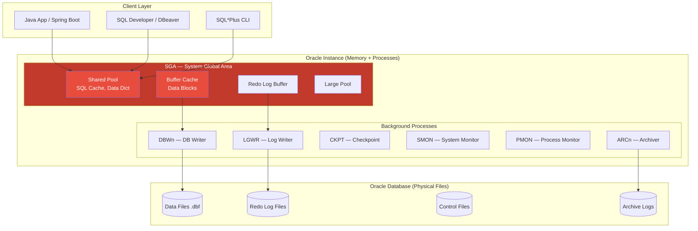

# 🏛️ Database SQL: Oracle — Hệ quản trị CSDL doanh nghiệp hàng đầu

> **Nguồn chính thống:** [Oracle Database 23ai Documentation](https://docs.oracle.com/en/database/oracle/oracle-database/23/) | [Spring Data JPA — Oracle](https://docs.spring.io/spring-boot/reference/data/sql.html)
>
> **Thuộc roadmap:** `5. Database → SQL → Oracle`

---

## 1. Giới thiệu Oracle Database

> *"Oracle Database is an enterprise-grade relational database management system known for its scalability, reliability, and comprehensive feature set."*
>
> — **oracle.com**

### Dịch & giải thích đơn giản:

**Oracle Database** là hệ quản trị cơ sở dữ liệu quan hệ **thương mại hàng đầu**, được thiết kế cho các doanh nghiệp lớn (enterprise) cần xử lý **hàng triệu giao dịch mỗi giây** với độ tin cậy cao nhất.

**Tại sao Oracle vẫn thống trị enterprise?**
- **Độ tin cậy tuyệt đối:** 99.999% uptime (5 phút downtime/năm) với Real Application Clusters (RAC)
- **Scalability:** Xử lý petabytes dữ liệu, triệu transactions/giây
- **Feature-rich:** PL/SQL, Partitioning, In-Memory, Multitenant, Data Guard...
- **Support 24/7:** Oracle cung cấp support cấp doanh nghiệp (có SLA)
- **Tích hợp sâu với Java:** JDBC driver tối ưu, Oracle AQ, Oracle JET...

### So sánh nhanh: MySQL vs PostgreSQL vs Oracle

| Đặc điểm | MySQL | PostgreSQL | Oracle |
|-----------|:-----:|:----------:|:------:|
| **License** | Open Source (GPL) | Open Source (PostgreSQL) | Commercial 💰 |
| **Chi phí** | Miễn phí | Miễn phí | Rất đắt ($17,500+/processor) |
| **Đối tượng** | Web apps, startups | Mọi quy mô | Enterprise, ngân hàng, chính phủ |
| **Scalability** | Tốt | Rất tốt | Xuất sắc ⭐ |
| **HA/DR** | Replication | Replication + failover | RAC + Data Guard ⭐ |
| **PL/SQL** | ❌ (có Stored Proc) | PL/pgSQL (tương tự) | PL/SQL gốc ⭐ |
| **Dễ học** | ⭐⭐⭐⭐⭐ | ⭐⭐⭐⭐ | ⭐⭐⭐ |
| **Job market (VN)** | Cao | Đang tăng | Cao (ngân hàng, telco) |

> [!NOTE]
> **Oracle Database XE (Express Edition)** là phiên bản **miễn phí** cho development và production nhỏ. Giới hạn: 2 CPUs, 2GB RAM, 12GB data. Đủ dùng cho học tập và dự án nhỏ.

---

## 2. Kiến trúc Oracle Database



### Khái niệm quan trọng:

| Khái niệm | Mô tả |
|-----------|--------|
| **Instance** | Memory (SGA/PGA) + Background Processes — 1 instance = 1 database (Single Instance) |
| **SGA** | Shared memory cho tất cả sessions (SQL cache, data buffer, redo buffer) |
| **PGA** | Private memory cho mỗi session (sort, hash join) |
| **Tablespace** | Logical container cho data files — quản lý storage |
| **Schema** | = User — mỗi user sở hữu 1 schema chứa tables, views, indexes... |
| **RAC** | Real Application Clusters — nhiều instances truy cập cùng 1 database → HA |
| **Data Guard** | Standby database cho Disaster Recovery |
| **CDB / PDB** | Container DB / Pluggable DB — 1 server chạy nhiều databases riêng biệt (Multitenant) |

---

## 3. Cài đặt Oracle Database

### 3.1 Docker (Oracle XE — Development)

```bash
# Oracle XE 23ai Free — phiên bản miễn phí
docker run -d \
  --name oracle-xe \
  -e ORACLE_PWD=Oracle123 \
  -e ORACLE_CHARACTERSET=AL32UTF8 \
  -p 1521:1521 \
  -p 5500:5500 \
  -v oracle_data:/opt/oracle/oradata \
  container-registry.oracle.com/database/express:latest

# Chờ database khởi tạo (có thể mất 5-10 phút lần đầu)
docker logs -f oracle-xe

# Kết nối SQL*Plus
docker exec -it oracle-xe sqlplus sys/Oracle123@//localhost:1521/XEPDB1 as sysdba
```

### 3.2 Docker Compose

```yaml
# docker-compose.yml
services:
  oracle:
    image: container-registry.oracle.com/database/express:latest
    container_name: oracle-xe
    environment:
      ORACLE_PWD: Oracle123
      ORACLE_CHARACTERSET: AL32UTF8
    ports:
      - "1521:1521"     # TNS Listener
      - "5500:5500"     # Enterprise Manager Express (Web GUI)
    volumes:
      - oracle_data:/opt/oracle/oradata
      - ./init-scripts:/opt/oracle/scripts/startup  # Scripts chạy khi khởi tạo
    healthcheck:
      test: ["CMD", "healthcheck.sh"]
      interval: 30s
      timeout: 10s
      retries: 5
      start_period: 120s  # Oracle cần thời gian khởi tạo lâu

volumes:
  oracle_data:
```

### 3.3 Tạo User & Schema

```sql
-- Kết nối SYS (admin)
-- Tạo user (= schema trong Oracle)
ALTER SESSION SET CONTAINER = XEPDB1;

CREATE USER myapp_user IDENTIFIED BY "myapp_pass"
    DEFAULT TABLESPACE users
    TEMPORARY TABLESPACE temp
    QUOTA UNLIMITED ON users;

-- Cấp quyền
GRANT CONNECT, RESOURCE TO myapp_user;
GRANT CREATE SESSION TO myapp_user;
GRANT CREATE TABLE TO myapp_user;
GRANT CREATE SEQUENCE TO myapp_user;
GRANT CREATE VIEW TO myapp_user;
GRANT CREATE PROCEDURE TO myapp_user;

-- Kết nối bằng user mới
-- Connection string: myapp_user/myapp_pass@//localhost:1521/XEPDB1
```

---

## 4. Cú pháp SQL — Khác biệt giữa Oracle và MySQL/PostgreSQL

### 4.1 Kiểu dữ liệu Oracle

| Oracle | MySQL tương đương | PostgreSQL tương đương | Java Type |
|--------|-------------------|----------------------|-----------|
| `NUMBER(p,s)` | `DECIMAL(p,s)` | `NUMERIC(p,s)` | `BigDecimal` |
| `NUMBER(10)` | `INT` / `BIGINT` | `INTEGER` / `BIGINT` | `Long` |
| `VARCHAR2(n)` ⭐ | `VARCHAR(n)` | `VARCHAR(n)` | `String` |
| `NVARCHAR2(n)` | `NVARCHAR(n)` | `VARCHAR(n)` | `String` |
| `CLOB` | `LONGTEXT` | `TEXT` | `String` |
| `BLOB` | `LONGBLOB` | `BYTEA` | `byte[]` |
| `DATE` ⭐ | `DATETIME` | `TIMESTAMP` | `LocalDateTime` |
| `TIMESTAMP` | `TIMESTAMP` | `TIMESTAMP` | `LocalDateTime` |
| `TIMESTAMP WITH TIME ZONE` | ❌ | `TIMESTAMPTZ` | `OffsetDateTime` |
| `RAW(16)` | `BINARY(16)` | `UUID` | `UUID` |

> [!WARNING]
> **Oracle `DATE` ≠ MySQL `DATE`!** Oracle `DATE` chứa cả **ngày VÀ giờ** (tương đương `DATETIME` trong MySQL). Nếu chỉ cần ngày, vẫn dùng `DATE` nhưng khi so sánh phải `TRUNC(date_column)`.

### 4.2 DDL — Tạo bảng trong Oracle

```sql
-- Oracle dùng SEQUENCE thay vì AUTO_INCREMENT
CREATE SEQUENCE seq_users_id START WITH 1 INCREMENT BY 1;
CREATE SEQUENCE seq_products_id START WITH 1 INCREMENT BY 1;

-- Tạo bảng users
CREATE TABLE users (
    id          NUMBER(19)      DEFAULT seq_users_id.NEXTVAL PRIMARY KEY,
    email       VARCHAR2(255)   NOT NULL UNIQUE,
    username    VARCHAR2(100)   NOT NULL UNIQUE,
    password    VARCHAR2(255)   NOT NULL,
    full_name   NVARCHAR2(200)  NOT NULL,    -- NVARCHAR2 cho Unicode (tiếng Việt)
    phone       VARCHAR2(20),
    role        VARCHAR2(20)    DEFAULT 'USER' NOT NULL
                CHECK (role IN ('ADMIN', 'MANAGER', 'USER')),  -- Thay cho ENUM
    is_active   NUMBER(1)       DEFAULT 1 NOT NULL,             -- Oracle không có BOOLEAN
    created_at  TIMESTAMP       DEFAULT SYSTIMESTAMP NOT NULL,
    updated_at  TIMESTAMP       DEFAULT SYSTIMESTAMP NOT NULL
);

-- Index
CREATE INDEX idx_users_email ON users(email);
CREATE INDEX idx_users_role ON users(role);

-- Tạo bảng products
CREATE TABLE products (
    id              NUMBER(19)      DEFAULT seq_products_id.NEXTVAL PRIMARY KEY,
    name            NVARCHAR2(200)  NOT NULL,
    slug            VARCHAR2(250)   NOT NULL UNIQUE,
    description     CLOB,
    price           NUMBER(19,4)    NOT NULL,
    discount_price  NUMBER(19,4),
    stock_quantity  NUMBER(10)      DEFAULT 0 NOT NULL,
    category_id     NUMBER(19)      NOT NULL,
    is_active       NUMBER(1)       DEFAULT 1 NOT NULL,
    created_at      TIMESTAMP       DEFAULT SYSTIMESTAMP NOT NULL,
    updated_at      TIMESTAMP       DEFAULT SYSTIMESTAMP NOT NULL,

    CONSTRAINT fk_product_category FOREIGN KEY (category_id)
        REFERENCES categories(id) ON DELETE CASCADE
);

-- Trigger để auto-update updated_at (Oracle không có ON UPDATE)
CREATE OR REPLACE TRIGGER trg_products_updated_at
BEFORE UPDATE ON products
FOR EACH ROW
BEGIN
    :NEW.updated_at := SYSTIMESTAMP;
END;
/
```

> [!IMPORTANT]
> **Khác biệt quan trọng với MySQL:**
> 1. Oracle dùng `SEQUENCE` thay vì `AUTO_INCREMENT`
> 2. Oracle dùng `VARCHAR2` thay vì `VARCHAR` (VARCHAR2 là khuyên dùng)
> 3. Oracle **KHÔNG** có kiểu `BOOLEAN` → dùng `NUMBER(1)` (0 = false, 1 = true)
> 4. Oracle **KHÔNG** có `ENUM` → dùng `CHECK` constraint
> 5. Oracle **KHÔNG** có `ON UPDATE CURRENT_TIMESTAMP` → dùng `TRIGGER`
> 6. Tên bảng/cột mặc định **IN HOA** (case-insensitive, trừ khi dùng dấu "")

### 4.3 DML — Cú pháp khác biệt

```sql
-- Pagination trong Oracle (KHÔNG có LIMIT/OFFSET)
-- Cách mới (Oracle 12c+): FETCH FIRST
SELECT id, name, price
FROM products
WHERE is_active = 1
ORDER BY price ASC
OFFSET 10 ROWS FETCH NEXT 10 ROWS ONLY;  -- Trang 2, 10 items/trang

-- Cách cũ (Oracle 11g trở về trước): ROWNUM
SELECT * FROM (
    SELECT p.*, ROWNUM AS rn FROM (
        SELECT id, name, price FROM products
        WHERE is_active = 1
        ORDER BY price ASC
    ) p WHERE ROWNUM <= 20  -- offset + limit
) WHERE rn > 10;            -- offset

-- Lấy thời gian hiện tại
-- MySQL:      NOW(), CURRENT_TIMESTAMP
-- PostgreSQL: NOW(), CURRENT_TIMESTAMP
-- Oracle:     SYSDATE (DATE), SYSTIMESTAMP (TIMESTAMP)
SELECT SYSDATE FROM DUAL;      -- DUAL là bảng dummy trong Oracle
SELECT SYSTIMESTAMP FROM DUAL;

-- String concatenation
-- MySQL:      CONCAT(a, b) hoặc CONCAT_WS
-- PostgreSQL: a || b
-- Oracle:     a || b hoặc CONCAT(a, b) (chỉ 2 tham số)
SELECT first_name || ' ' || last_name AS full_name FROM users;

-- NVL thay cho IFNULL/COALESCE (Oracle cũng hỗ trợ COALESCE)
SELECT NVL(discount_price, price) AS final_price FROM products;
SELECT COALESCE(discount_price, price) AS final_price FROM products;  -- Chuẩn SQL

-- DECODE — switch/case dạng ngắn (Oracle-specific)
SELECT name,
    DECODE(role, 'ADMIN', 'Quản trị viên',
                 'MANAGER', 'Quản lý',
                 'USER', 'Người dùng',
                 'Không xác định') AS role_name
FROM users;

-- Hoặc dùng CASE (chuẩn SQL — khuyên dùng)
SELECT name,
    CASE role
        WHEN 'ADMIN' THEN 'Quản trị viên'
        WHEN 'MANAGER' THEN 'Quản lý'
        WHEN 'USER' THEN 'Người dùng'
        ELSE 'Không xác định'
    END AS role_name
FROM users;
```

---

## 5. PL/SQL — Ngôn ngữ lập trình trong Oracle

**PL/SQL (Procedural Language/SQL)** là ngôn ngữ lập trình tích hợp trong Oracle, cho phép viết logic phức tạp ngay trong database.

### 5.1 Stored Procedure

```sql
-- Stored Procedure: Đặt hàng
CREATE OR REPLACE PROCEDURE place_order(
    p_user_id    IN  NUMBER,
    p_product_id IN  NUMBER,
    p_quantity   IN  NUMBER,
    p_order_id   OUT NUMBER,
    p_status     OUT VARCHAR2
) AS
    v_price         NUMBER(19,4);
    v_stock         NUMBER(10);
    v_total_amount  NUMBER(19,4);
BEGIN
    -- 1. Kiểm tra tồn kho (FOR UPDATE = khóa row)
    SELECT price, stock_quantity
    INTO v_price, v_stock
    FROM products
    WHERE id = p_product_id
    FOR UPDATE;

    IF v_stock < p_quantity THEN
        p_status := 'INSUFFICIENT_STOCK';
        RETURN;
    END IF;

    -- 2. Trừ tồn kho
    UPDATE products
    SET stock_quantity = stock_quantity - p_quantity,
        updated_at = SYSTIMESTAMP
    WHERE id = p_product_id;

    -- 3. Tạo đơn hàng
    v_total_amount := v_price * p_quantity;

    INSERT INTO orders (user_id, total_amount, status, created_at)
    VALUES (p_user_id, v_total_amount, 'PENDING', SYSTIMESTAMP)
    RETURNING id INTO p_order_id;

    p_status := 'SUCCESS';
    COMMIT;

EXCEPTION
    WHEN OTHERS THEN
        ROLLBACK;
        p_status := 'ERROR: ' || SQLERRM;
END place_order;
/
```

### 5.2 Gọi Stored Procedure từ Spring Boot

```java
@Repository
public class OrderOracleRepository {

    @PersistenceContext
    private EntityManager entityManager;

    public OrderResult placeOrder(Long userId, Long productId, int quantity) {
        StoredProcedureQuery query = entityManager
                .createStoredProcedureQuery("place_order")
                .registerStoredProcedureParameter("p_user_id", Long.class, ParameterMode.IN)
                .registerStoredProcedureParameter("p_product_id", Long.class, ParameterMode.IN)
                .registerStoredProcedureParameter("p_quantity", Integer.class, ParameterMode.IN)
                .registerStoredProcedureParameter("p_order_id", Long.class, ParameterMode.OUT)
                .registerStoredProcedureParameter("p_status", String.class, ParameterMode.OUT)
                .setParameter("p_user_id", userId)
                .setParameter("p_product_id", productId)
                .setParameter("p_quantity", quantity);

        query.execute();

        Long orderId = (Long) query.getOutputParameterValue("p_order_id");
        String status = (String) query.getOutputParameterValue("p_status");

        return new OrderResult(orderId, status);
    }
}
```

---

## 6. Tích hợp Oracle với Spring Boot 4.1.0

### 6.1 Dependencies (pom.xml)

```xml
<dependencies>
    <dependency>
        <groupId>org.springframework.boot</groupId>
        <artifactId>spring-boot-starter-data-jpa</artifactId>
    </dependency>

    <!-- Oracle JDBC Driver (từ Maven Central — không cần download thủ công) -->
    <dependency>
        <groupId>com.oracle.database.jdbc</groupId>
        <artifactId>ojdbc11</artifactId>
        <scope>runtime</scope>
    </dependency>
</dependencies>
```

### 6.2 Cấu hình application.yml

```yaml
spring:
  datasource:
    url: jdbc:oracle:thin:@//localhost:1521/XEPDB1
    username: myapp_user
    password: myapp_pass
    driver-class-name: oracle.jdbc.OracleDriver

    hikari:
      pool-name: MyApp-Oracle-HikariCP
      maximum-pool-size: 20
      minimum-idle: 5
      connection-timeout: 20000

  jpa:
    database-platform: org.hibernate.dialect.OracleDialect
    hibernate:
      ddl-auto: validate
    properties:
      hibernate:
        jdbc:
          batch_size: 50
        order_inserts: true
        order_updates: true
```

### 6.3 Entity cho Oracle

```java
@Entity
@Table(name = "PRODUCTS")  // Oracle: tên bảng thường IN HOA
@Getter @Setter
@NoArgsConstructor
public class Product {

    @Id
    @GeneratedValue(strategy = GenerationType.SEQUENCE,
                    generator = "seq_products")
    @SequenceGenerator(name = "seq_products",
                       sequenceName = "SEQ_PRODUCTS_ID",
                       allocationSize = 1)
    private Long id;

    @Column(name = "NAME", nullable = false, length = 200)
    private String name;

    @Column(name = "PRICE", nullable = false, precision = 19, scale = 4)
    private BigDecimal price;

    @Column(name = "DESCRIPTION", columnDefinition = "CLOB")
    @Lob
    private String description;

    // Oracle không có BOOLEAN → dùng NUMBER(1)
    @Column(name = "IS_ACTIVE", nullable = false)
    @Convert(converter = OracleBooleanConverter.class)
    private Boolean isActive = true;

    @Column(name = "CREATED_AT", nullable = false, updatable = false)
    private LocalDateTime createdAt;

    @Column(name = "UPDATED_AT", nullable = false)
    private LocalDateTime updatedAt;

    @PrePersist
    protected void onCreate() {
        createdAt = LocalDateTime.now();
        updatedAt = LocalDateTime.now();
    }

    @PreUpdate
    protected void onUpdate() {
        updatedAt = LocalDateTime.now();
    }
}

// Custom converter: Java Boolean ↔ Oracle NUMBER(1)
@Converter
public class OracleBooleanConverter implements AttributeConverter<Boolean, Integer> {

    @Override
    public Integer convertToDatabaseColumn(Boolean attribute) {
        return attribute != null && attribute ? 1 : 0;
    }

    @Override
    public Boolean convertToEntityAttribute(Integer dbData) {
        return dbData != null && dbData == 1;
    }
}
```

### 6.4 Repository với Oracle-specific queries

```java
public interface ProductRepository extends JpaRepository<Product, Long> {

    // Spring Data JPA tự tạo query (hoạt động giống MySQL/PostgreSQL)
    Optional<Product> findBySlug(String slug);

    Page<Product> findByIsActiveTrue(Pageable pageable);

    // Native Oracle query (khi cần Oracle-specific syntax)
    @Query(value = """
        SELECT * FROM products
        WHERE is_active = 1
        ORDER BY price ASC
        OFFSET :offset ROWS FETCH NEXT :limit ROWS ONLY
        """, nativeQuery = true)
    List<Product> findWithPagination(
            @Param("offset") int offset,
            @Param("limit") int limit);

    // Oracle CONNECT BY — hierarchical query (cây danh mục)
    @Query(value = """
        SELECT id, name, parent_id, LEVEL as depth
        FROM categories
        START WITH parent_id IS NULL
        CONNECT BY PRIOR id = parent_id
        ORDER SIBLINGS BY name
        """, nativeQuery = true)
    List<Object[]> findCategoryTree();
}
```

---

## 7. Bảng tổng hợp cú pháp: MySQL vs PostgreSQL vs Oracle

| Chức năng | MySQL | PostgreSQL | Oracle |
|-----------|-------|-----------|--------|
| **Auto-increment** | `AUTO_INCREMENT` | `SERIAL` / `GENERATED ALWAYS` | `SEQUENCE` + trigger |
| **Pagination** | `LIMIT 10 OFFSET 20` | `LIMIT 10 OFFSET 20` | `OFFSET 20 ROWS FETCH NEXT 10 ROWS ONLY` |
| **Boolean** | `BOOLEAN` / `TINYINT(1)` | `BOOLEAN` | `NUMBER(1)` |
| **Current time** | `NOW()` | `NOW()` | `SYSDATE` / `SYSTIMESTAMP` |
| **String concat** | `CONCAT(a,b,c)` | `a \|\| b \|\| c` | `a \|\| b \|\| c` |
| **NULL replace** | `IFNULL(a, b)` | `COALESCE(a, b)` | `NVL(a, b)` / `COALESCE(a, b)` |
| **Substring** | `SUBSTRING(s, 1, 5)` | `SUBSTRING(s, 1, 5)` | `SUBSTR(s, 1, 5)` |
| **Length** | `LENGTH(s)` | `LENGTH(s)` | `LENGTH(s)` |
| **ENUM** | `ENUM('A','B','C')` | `CREATE TYPE ... AS ENUM` | `CHECK (col IN ('A','B','C'))` |
| **UUID** | `UUID()` (function) | `gen_random_uuid()` | `SYS_GUID()` |
| **JSON** | `JSON` | `JSONB` ⭐ | `JSON` (21c+) |
| **Dummy table** | Không cần | Không cần | `FROM DUAL` |
| **Top N rows** | `LIMIT N` | `LIMIT N` | `FETCH FIRST N ROWS ONLY` |
| **UPSERT** | `ON DUPLICATE KEY UPDATE` | `ON CONFLICT DO UPDATE` | `MERGE INTO` |

---

## 🔥 Ứng dụng thực tế (Thực tế dùng để làm gì? Giải quyết vấn đề gì?)

### Oracle Database được dùng ở đâu trong thực tế:

| Ngành | Công ty tiêu biểu | Vai trò Oracle |
|-------|-------------------|---------------|
| **Ngân hàng** | Vietcombank, BIDV, VPBank, Techcombank | Core banking, giao dịch tài chính |
| **Viễn thông** | Viettel, VNPT, Mobifone | Quản lý thuê bao, billing, CDR |
| **Chính phủ** | Bảo hiểm XH, Tổng cục Thuế | Hệ thống quản lý dữ liệu quốc gia |
| **Hàng không** | Vietnam Airlines, Amadeus | Đặt vé, quản lý chuyến bay |
| **Bán lẻ** | Walmart, Amazon (một phần) | Inventory, supply chain |
| **ERP** | SAP, Oracle ERP Cloud | Quản trị doanh nghiệp tổng thể |

### Khi nào chọn Oracle:

| Tình huống | Oracle phù hợp? | Lý do |
|-----------|:--------------:|-------|
| Ngân hàng / tài chính | ✅ | ACID tuyệt đối, RAC cho HA, compliance |
| Startup / SME | ❌ | Quá đắt — dùng PostgreSQL hoặc MySQL |
| Hệ thống legacy enterprise | ✅ | Đã đầu tư, có đội ngũ DBA Oracle |
| Cloud-native microservices | ⚠️ | Có thể, nhưng PostgreSQL/MySQL phổ biến hơn |
| Cần PL/SQL phức tạp | ✅ | PL/SQL mạnh nhất trong các RDBMS |
| Personal project | ❌ | Dùng XE nếu muốn học, production dùng PostgreSQL |

---

## 8. Tổng hợp các chủ đề (Bản đồ tra cứu)

### 🟢 Ưu tiên phải biết trước (Bắt buộc)
- Khác biệt cú pháp SQL giữa Oracle, MySQL, PostgreSQL (bảng so sánh)
- Kiểu dữ liệu Oracle: `NUMBER`, `VARCHAR2`, `DATE`, `TIMESTAMP`, `CLOB`
- `SEQUENCE` thay cho `AUTO_INCREMENT`
- Pagination: `OFFSET ... ROWS FETCH NEXT ... ROWS ONLY`
- Spring Boot + Oracle: datasource config, Entity với `@SequenceGenerator`
- Cài đặt Oracle XE với Docker
- `DUAL` — bảng dummy

### 🟡 Nhóm trung cấp
- PL/SQL cơ bản: Stored Procedure, Function, Trigger
- Gọi Stored Procedure từ Spring Boot (`StoredProcedureQuery`)
- `MERGE INTO` (UPSERT trong Oracle)
- Hierarchical queries (`CONNECT BY`)
- `NVL`, `NVL2`, `DECODE` functions
- Oracle Boolean handling (`NUMBER(1)` + `@Converter`)
- Tablespace và storage management

### 🔴 Nhóm nâng cao
- Real Application Clusters (RAC) cho High Availability
- Data Guard cho Disaster Recovery
- Oracle Partitioning (Range, List, Hash, Composite)
- Oracle In-Memory Database
- Multitenant Architecture (CDB/PDB)
- AWR (Automatic Workload Repository) cho performance tuning
- Oracle 23ai — AI Vector Search, JSON Relational Duality

---

## 📚 Tài liệu tham khảo chính thống

| Tài liệu | Link |
|-----------|------|
| Oracle 23ai Documentation | [docs.oracle.com](https://docs.oracle.com/en/database/oracle/oracle-database/23/) |
| Oracle SQL Language Reference | [docs.oracle.com](https://docs.oracle.com/en/database/oracle/oracle-database/23/sqlrf/) |
| Oracle PL/SQL Reference | [docs.oracle.com](https://docs.oracle.com/en/database/oracle/oracle-database/23/lnpls/) |
| Spring Boot — SQL Databases | [docs.spring.io](https://docs.spring.io/spring-boot/reference/data/sql.html) |
| Oracle JDBC Driver (Maven) | [mvnrepository.com](https://mvnrepository.com/artifact/com.oracle.database.jdbc/ojdbc11) |
| Oracle XE Download | [oracle.com](https://www.oracle.com/database/technologies/xe-downloads.html) |
| Oracle Docker Images | [container-registry.oracle.com](https://container-registry.oracle.com/) |

---

> **Tiếp theo trong roadmap:** `5. Database → NoSQL` — Cơ sở dữ liệu phi quan hệ (MongoDB, Cassandra) — khi nào dùng NoSQL thay vì SQL.
