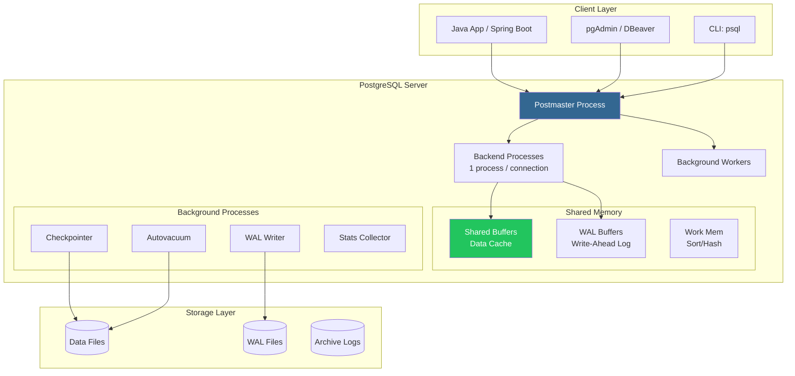

# 🐘 Database SQL: PostgreSQL — Hệ quản trị CSDL quan hệ mạnh mẽ nhất thế giới

> **Nguồn chính thống:** [PostgreSQL 17 Documentation](https://www.postgresql.org/docs/17/) | [Spring Data JPA — PostgreSQL](https://docs.spring.io/spring-boot/reference/data/sql.html)
>
> **Thuộc roadmap:** `5. Database → SQL → PostgreSQL`

---

## 1. Giới thiệu PostgreSQL

> *"PostgreSQL is the world's most **advanced** open source relational database."*
>
> — **postgresql.org**

### Dịch & giải thích đơn giản:

**PostgreSQL** (đọc: "Post-gres-Q-L" hoặc "Postgres") là hệ quản trị cơ sở dữ liệu quan hệ-đối tượng (ORDBMS) mã nguồn mở **mạnh mẽ và tuân thủ SQL chuẩn nhất**. Nếu MySQL nổi tiếng vì "dễ dùng", thì PostgreSQL nổi tiếng vì **"mạnh mẽ và đúng đắn"**.

**Tại sao chọn PostgreSQL?**
- **Tuân thủ SQL chuẩn tốt nhất:** Gần như 100% SQL:2023 standard
- **Kiểu dữ liệu phong phú:** JSON/JSONB, Array, Range, UUID, Geometric, Network...
- **Full ACID compliant:** Transaction mạnh mẽ hơn MySQL trong nhiều edge cases
- **Extensible:** Tạo custom types, functions, operators, index methods
- **MVCC (Multi-Version Concurrency Control):** Đọc không block ghi, ghi không block đọc
- **Advanced features:** CTE, Window Functions, Partitioning, Parallel Query, Full-Text Search...

### MySQL vs PostgreSQL — So sánh nhanh:

| Đặc điểm | MySQL | PostgreSQL |
|-----------|:-----:|:----------:|
| **Phổ biến** | ⭐⭐⭐⭐⭐ | ⭐⭐⭐⭐ |
| **SQL Standard** | Khá tốt | Xuất sắc ⭐ |
| **JSON Support** | Cơ bản | Mạnh mẽ (JSONB) ⭐ |
| **Full-text Search** | Cơ bản | Mạnh mẽ ⭐ |
| **Complex Queries** | Tốt | Xuất sắc ⭐ |
| **Read Performance** | Nhanh hơn ⭐ | Rất tốt |
| **Write Performance** | Tốt | Tốt hơn cho concurrent writes ⭐ |
| **Replication** | Dễ setup | Mạnh mẽ hơn ⭐ |
| **Dễ học** | Dễ hơn ⭐ | Phức tạp hơn |
| **License** | GPL (Oracle owns) | PostgreSQL License (MIT-like) ⭐ |

> [!NOTE]
> **Xu hướng 2025-2026:** PostgreSQL đang tăng trưởng nhanh nhất trong các RDBMS. Nhiều công ty lớn (Instagram, Uber, Reddit, Discord) đã chuyển từ MySQL sang PostgreSQL.

---

## 2. Kiến trúc PostgreSQL



### Khái niệm quan trọng:

- **MVCC:** PostgreSQL giữ nhiều "phiên bản" của mỗi row → đọc không block ghi, ghi không block đọc
- **WAL (Write-Ahead Log):** Ghi log TRƯỚC khi ghi data → đảm bảo crash recovery
- **VACUUM:** Dọn dẹp các row phiên bản cũ (dead tuples) → PostgreSQL cần VACUUM định kỳ (autovacuum)

---

## 3. Cài đặt & Cấu hình PostgreSQL

### 3.1 Docker Compose (Development)

```yaml
# docker-compose.yml
services:
  postgres:
    image: postgres:17
    container_name: postgres-dev
    environment:
      POSTGRES_DB: myapp_db
      POSTGRES_USER: myapp_user
      POSTGRES_PASSWORD: myapp_pass
      PGDATA: /var/lib/postgresql/data/pgdata
    ports:
      - "5432:5432"
    volumes:
      - postgres_data:/var/lib/postgresql/data
      - ./init-scripts:/docker-entrypoint-initdb.d
    healthcheck:
      test: ["CMD-SHELL", "pg_isready -U myapp_user -d myapp_db"]
      interval: 10s
      timeout: 5s
      retries: 3

  # pgAdmin — GUI quản lý (tùy chọn)
  pgadmin:
    image: dpage/pgadmin4:latest
    container_name: pgadmin
    environment:
      PGADMIN_DEFAULT_EMAIL: admin@example.com
      PGADMIN_DEFAULT_PASSWORD: admin123
    ports:
      - "5050:80"
    depends_on:
      - postgres

volumes:
  postgres_data:
```

```bash
docker compose up -d
# Kết nối psql
docker exec -it postgres-dev psql -U myapp_user -d myapp_db
```

---

## 4. Kiểu dữ liệu PostgreSQL — Phong phú hơn MySQL

### 4.1 Kiểu dữ liệu đặc biệt (PostgreSQL-only)

| Kiểu | Mô tả | Java Type | Ví dụ |
|------|--------|-----------|-------|
| `UUID` | Universally Unique Identifier | `UUID` | `'a0eebc99-9c0b-4ef8-bb6d-6bb9bd380a11'` |
| `JSONB` ⭐ | JSON binary (query được, index được) | `String` / `JsonNode` | `'{"name": "iPhone", "specs": {...}}'` |
| `ARRAY` | Mảng giá trị | `List<>` / `String[]` | `'{tag1, tag2, tag3}'` |
| `INET` / `CIDR` | Địa chỉ IP / Network | `String` | `'192.168.1.0/24'` |
| `TSRANGE` | Khoảng thời gian | Custom | `'[2026-01-01, 2026-12-31)'` |
| `TSVECTOR` | Full-text search vector | Custom | `'iphone:1 16:2 pro:3'` |
| `HSTORE` | Key-value pairs | `Map<String,String>` | `'"color"=>"red","size"=>"M"'` |
| `INTERVAL` | Khoảng thời gian | `Duration` | `'2 hours 30 minutes'` |
| `SERIAL` / `BIGSERIAL` | Auto-increment | `Integer` / `Long` | Tự tăng 1, 2, 3... |
| `MONEY` | Tiền tệ (có format) | `BigDecimal` | `'$1,000.00'` |

> [!TIP]
> **JSON vs JSONB:**
> - `JSON`: Lưu raw text, parse mỗi lần truy vấn → chậm
> - `JSONB`: Lưu binary format, có thể tạo index, query nhanh → **LUÔN DÙNG JSONB**

### 4.2 Ví dụ kiểu dữ liệu đặc biệt

```sql
-- UUID làm Primary Key (thay vì BIGSERIAL)
CREATE TABLE orders (
    id          UUID PRIMARY KEY DEFAULT gen_random_uuid(),
    user_id     UUID NOT NULL REFERENCES users(id),
    items       JSONB NOT NULL,           -- Lưu chi tiết items dạng JSON
    tags        TEXT[] DEFAULT '{}',       -- Mảng tags
    total       DECIMAL(19,4) NOT NULL,
    status      VARCHAR(20) NOT NULL DEFAULT 'PENDING',
    created_at  TIMESTAMPTZ NOT NULL DEFAULT NOW()
);

-- Insert với UUID, JSONB, ARRAY
INSERT INTO orders (user_id, items, tags, total)
VALUES (
    'a0eebc99-9c0b-4ef8-bb6d-6bb9bd380a11',
    '[
        {"product_id": 1, "name": "iPhone 16", "price": 29990000, "quantity": 1},
        {"product_id": 2, "name": "AirPods Pro", "price": 6990000, "quantity": 2}
    ]'::jsonb,
    ARRAY['electronics', 'premium', 'express-delivery'],
    43970000
);

-- Query JSONB
SELECT id, items->0->>'name' AS first_item_name,
       items->0->>'price' AS first_item_price
FROM orders
WHERE items @> '[{"product_id": 1}]';  -- Chứa product_id = 1

-- Query ARRAY
SELECT * FROM orders WHERE 'premium' = ANY(tags);

-- Index trên JSONB (GIN index)
CREATE INDEX idx_orders_items ON orders USING GIN (items);
```

---

## 5. Tính năng nâng cao PostgreSQL

### 5.1 CTE (Common Table Expression) — WITH queries

```sql
-- Tính doanh thu tích lũy theo tháng
WITH monthly_revenue AS (
    SELECT
        DATE_TRUNC('month', created_at) AS month,
        SUM(total) AS revenue
    FROM orders
    WHERE status = 'DELIVERED'
    GROUP BY DATE_TRUNC('month', created_at)
)
SELECT
    month,
    revenue,
    SUM(revenue) OVER (ORDER BY month) AS cumulative_revenue,
    revenue - LAG(revenue) OVER (ORDER BY month) AS growth
FROM monthly_revenue
ORDER BY month;
```

### 5.2 Window Functions

```sql
-- Xếp hạng sản phẩm bán chạy nhất trong mỗi category
SELECT
    name,
    category,
    total_sold,
    RANK() OVER (PARTITION BY category ORDER BY total_sold DESC) AS rank_in_category,
    ROW_NUMBER() OVER (ORDER BY total_sold DESC) AS overall_rank
FROM products
WHERE is_active = TRUE;
```

### 5.3 Full-Text Search (tích hợp sẵn — không cần Elasticsearch)

```sql
-- Tạo search vector column
ALTER TABLE products ADD COLUMN search_vector TSVECTOR;

-- Cập nhật search vector
UPDATE products
SET search_vector = to_tsvector('english', coalesce(name,'') || ' ' || coalesce(description,''));

-- Tạo GIN index cho full-text search
CREATE INDEX idx_products_search ON products USING GIN (search_vector);

-- Search
SELECT name, description,
       ts_rank(search_vector, query) AS rank
FROM products, to_tsquery('english', 'iphone & pro') AS query
WHERE search_vector @@ query
ORDER BY rank DESC;
```

### 5.4 Table Partitioning

```sql
-- Partition bảng orders theo thời gian (Range Partitioning)
CREATE TABLE orders (
    id          UUID NOT NULL DEFAULT gen_random_uuid(),
    user_id     UUID NOT NULL,
    total       DECIMAL(19,4) NOT NULL,
    status      VARCHAR(20) NOT NULL,
    created_at  TIMESTAMPTZ NOT NULL DEFAULT NOW()
) PARTITION BY RANGE (created_at);

-- Tạo partition cho từng quý
CREATE TABLE orders_2026_q1 PARTITION OF orders
    FOR VALUES FROM ('2026-01-01') TO ('2026-04-01');

CREATE TABLE orders_2026_q2 PARTITION OF orders
    FOR VALUES FROM ('2026-04-01') TO ('2026-07-01');

CREATE TABLE orders_2026_q3 PARTITION OF orders
    FOR VALUES FROM ('2026-07-01') TO ('2026-10-01');

CREATE TABLE orders_2026_q4 PARTITION OF orders
    FOR VALUES FROM ('2026-10-01') TO ('2027-01-01');

-- Query tự động chỉ scan partition cần thiết
SELECT * FROM orders WHERE created_at >= '2026-07-01' AND created_at < '2026-10-01';
-- → Chỉ scan orders_2026_q3, bỏ qua các partition khác ✅
```

---

## 6. Tích hợp PostgreSQL với Spring Boot 4.1.0

### 6.1 Dependencies (pom.xml)

```xml
<dependencies>
    <dependency>
        <groupId>org.springframework.boot</groupId>
        <artifactId>spring-boot-starter-data-jpa</artifactId>
    </dependency>

    <!-- PostgreSQL Driver -->
    <dependency>
        <groupId>org.postgresql</groupId>
        <artifactId>postgresql</artifactId>
        <scope>runtime</scope>
    </dependency>
</dependencies>
```

### 6.2 Cấu hình application.yml

```yaml
spring:
  datasource:
    url: jdbc:postgresql://localhost:5432/myapp_db
    username: myapp_user
    password: myapp_pass
    driver-class-name: org.postgresql.Driver

    hikari:
      pool-name: MyApp-HikariCP
      maximum-pool-size: 20
      minimum-idle: 5

  jpa:
    database-platform: org.hibernate.dialect.PostgreSQLDialect
    hibernate:
      ddl-auto: validate
    properties:
      hibernate:
        jdbc:
          batch_size: 50
        order_inserts: true
        order_updates: true
```

### 6.3 Entity với kiểu dữ liệu PostgreSQL

```java
@Entity
@Table(name = "products")
@Getter @Setter
@NoArgsConstructor
public class Product {

    @Id
    @GeneratedValue(strategy = GenerationType.UUID)  // UUID thay vì IDENTITY
    private UUID id;

    @Column(nullable = false, length = 200)
    private String name;

    @Column(nullable = false, precision = 19, scale = 4)
    private BigDecimal price;

    // JSONB column
    @JdbcTypeCode(SqlTypes.JSON)
    @Column(columnDefinition = "jsonb")
    private Map<String, Object> specifications;

    // Array column
    @JdbcTypeCode(SqlTypes.ARRAY)
    @Column(columnDefinition = "text[]")
    private String[] tags;

    @Column(name = "created_at", nullable = false, updatable = false)
    private OffsetDateTime createdAt;

    @PrePersist
    protected void onCreate() {
        createdAt = OffsetDateTime.now();
    }
}
```

### 6.4 Repository với PostgreSQL-specific queries

```java
public interface ProductRepository extends JpaRepository<Product, UUID> {

    // JSONB query — tìm sản phẩm theo spec
    @Query(value = """
        SELECT * FROM products
        WHERE specifications->>'brand' = :brand
          AND (specifications->>'ram')::int >= :minRam
        """, nativeQuery = true)
    List<Product> findBySpecifications(
            @Param("brand") String brand,
            @Param("minRam") int minRam);

    // Array query — tìm sản phẩm có tag
    @Query(value = """
        SELECT * FROM products
        WHERE :tag = ANY(tags)
        """, nativeQuery = true)
    List<Product> findByTag(@Param("tag") String tag);

    // Full-text search
    @Query(value = """
        SELECT *, ts_rank(search_vector, to_tsquery('english', :query)) AS rank
        FROM products
        WHERE search_vector @@ to_tsquery('english', :query)
        ORDER BY rank DESC
        """, nativeQuery = true)
    List<Product> fullTextSearch(@Param("query") String query);
}
```

---

## 🔥 Ứng dụng thực tế (Thực tế dùng để làm gì? Giải quyết vấn đề gì?)

### PostgreSQL được dùng ở đâu trong thực tế:

| Công ty / Sản phẩm | Quy mô | Vai trò PostgreSQL |
|-------|--------|--------------|
| **Instagram** | 2B+ users | Primary database cho mọi thứ |
| **Uber** | Millions rides/day | Trip data, geospatial queries |
| **Reddit** | 500M+ users | Posts, comments, votes |
| **Discord** | 200M+ users | Messages (trillions of rows!) |
| **Spotify** | 600M+ users | User data, playlists |
| **Apple** | iCloud | Lưu trữ dữ liệu người dùng |
| **Supabase** | BaaS | PostgreSQL as a Service |

### Khi nào chọn PostgreSQL thay vì MySQL:

| Tình huống | Chọn PostgreSQL | Lý do |
|-----------|:--------------:|-------|
| Cần lưu JSON phức tạp | ✅ | JSONB + GIN index mạnh hơn MySQL JSON |
| Full-text search | ✅ | Tích hợp sẵn, không cần Elasticsearch |
| Dữ liệu địa lý (GIS) | ✅ | PostGIS extension vượt trội |
| Complex queries (CTE, Window) | ✅ | SQL standard compliance tốt nhất |
| UUID làm primary key | ✅ | Native UUID type + gen_random_uuid() |
| Concurrent writes cao | ✅ | MVCC mạnh hơn |
| Cần đơn giản, nhanh | ❌ | MySQL dễ hơn cho beginners |
| Tích hợp WordPress | ❌ | WordPress chỉ hỗ trợ MySQL |

---

## 7. Tổng hợp các chủ đề (Bản đồ tra cứu)

### 🟢 Ưu tiên phải biết trước (Bắt buộc)
- Khác biệt giữa PostgreSQL và MySQL
- Cài đặt PostgreSQL với Docker
- Kiểu dữ liệu cơ bản + `UUID`, `JSONB`, `TIMESTAMPTZ`
- DDL: `CREATE TABLE`, `ALTER TABLE` với PostgreSQL syntax
- DML: `INSERT`, `SELECT`, `UPDATE`, `DELETE`
- Spring Boot + PostgreSQL: datasource config, Entity, Repository
- `@GeneratedValue(strategy = GenerationType.UUID)`

### 🟡 Nhóm trung cấp
- **JSONB** queries và GIN index
- **Array** type và queries
- CTE (WITH queries) và Window Functions
- Full-text search (`TSVECTOR`, `TSQUERY`)
- `EXPLAIN ANALYZE` để tối ưu query
- Table Partitioning (Range, List, Hash)
- Database migration (Flyway / Liquibase)

### 🔴 Nhóm nâng cao
- MVCC internals và VACUUM strategy
- Logical Replication và Streaming Replication
- PostGIS extension cho geospatial data
- Custom data types và extensions
- PgBouncer (connection pooler)
- PostgreSQL 17 new features
- Monitoring (pg_stat_statements, pgMonitor)

---

## 📚 Tài liệu tham khảo chính thống

| Tài liệu | Link |
|-----------|------|
| PostgreSQL 17 Documentation | [postgresql.org](https://www.postgresql.org/docs/17/) |
| PostgreSQL Tutorial | [postgresqltutorial.com](https://www.postgresqltutorial.com/) |
| Spring Boot — SQL Databases | [docs.spring.io](https://docs.spring.io/spring-boot/reference/data/sql.html) |
| Spring Data JPA Reference | [docs.spring.io](https://docs.spring.io/spring-data/jpa/reference/) |
| PostgreSQL Docker Image | [hub.docker.com](https://hub.docker.com/_/postgres) |
| PostgreSQL Wiki — Performance | [wiki.postgresql.org](https://wiki.postgresql.org/wiki/Performance_Optimization) |

---

> **Tiếp theo trong roadmap:** `Oracle` — Hệ quản trị CSDL thương mại hàng đầu dành cho doanh nghiệp lớn (enterprise).
