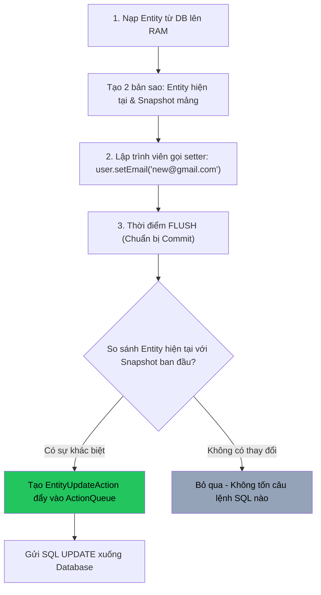

# ⚡ Cơ chế Dirty Checking, Flush Mode, Flush Order (ActionQueue) & First-Level Cache

> **Nguồn chính thống:** [Jakarta Persistence 3.2 Specification](https://jakarta.ee/specifications/persistence/3.2/) | [Hibernate ORM 7.x User Guide — Flushing & Caching](https://hibernate.org/orm/documentation/) | [Spring Framework 7.0.8 — Data Access](https://docs.spring.io/spring-framework/reference/data-access.html)
>
> **Thuộc roadmap:** `5. Database → Spring Data → Spring Data JPA → Core Architecture & Internals → Dirty Checking Mechanism, Flush Mode, Flush Order (ActionQueue) & First-Level Cache`

---

## 1. First-Level Cache (L1 Cache / Session Cache)

Trong Hibernate và JPA, **First-Level Cache** luôn luôn được bật mặc định và **không có tùy chọn nào để tắt bỏ**. Nó gắn liền trực tiếp với vòng đời của một `EntityManager` (hoặc Hibernate `Session`).

```
┌────────────────────────────────────────────────────────────────────────┐
│               EntityManager (Hibernate SessionImpl)                    │
│                                                                        │
│   ┌────────────────────────────────────────────────────────────────┐   │
│   │               First-Level Cache (Persistence Context)          │   │
│   │                                                                │   │
│   │   1. Identity Map:  Map<EntityKey, Object>                     │   │
│   │      (Khóa: Class + ID -> Giá trị: Đối tượng Entity đang chạy) │   │
│   │                                                                │   │
│   │   2. Snapshots Repository:  Map<EntityKey, Object[]>           │   │
│   │      (Mảng giá trị ban đầu lúc đọc từ DB để so sánh Dirty)     │   │
│   └────────────────────────────────────────────────────────────────┘   │
└────────────────────────────────────────────────────────────────────────┘
```

### 1.1 Tính chất cốt lõi:
1. **Phạm vi (Scope):** Chỉ tồn tại trong phạm vi của một Transaction hoặc Request hiện tại. Khi Transaction đóng lại, L1 Cache bị giải phóng hoàn toàn khỏi bộ nhớ RAM.
2. **Đảm bảo tính đồng nhất cá thể (Identity Map):** Nếu bạn truy vấn cùng một ID nhiều lần trong 1 transaction, Hibernate đảm bảo trả về **chính xác cùng một tham chiếu bộ nhớ (memory address)** ($e_1 == e_2$ là `true`).

### 1.2 Câu hỏi phỏng vấn Senior: "Tại sao câu lệnh JPQL vẫn gửi SELECT dù dữ liệu đã nằm trong L1 Cache?"
> **Tình huống:** Bạn đã load `Product(id=1)` vào L1 Cache. Ngay sau đó, bạn chạy câu lệnh JPQL:
> ```java
> List<Product> list = entityManager.createQuery("SELECT p FROM Product p WHERE p.price > 100", Product.class).getResultList();
> ```
> **Tại sao Hibernate vẫn bắt buộc phải gửi câu lệnh SELECT xuống CSDL?**

**Giải thích cấp độ Senior:**
- CSDL quan hệ là nguồn chân lý duy nhất (Source of Truth) cho các điều kiện lọc động (`WHERE p.price > 100`). Hibernate trên máy chủ ứng dụng **không thể biết trước** được ở dưới CSDL có những dòng nào thỏa mãn điều kiện đó nếu không gửi câu query xuống.
- **Tuy nhiên, luồng tối ưu ngầm diễn ra như sau:**
  1. Câu `SELECT` được gửi xuống CSDL và trả về danh sách các ID.
  2. Với mỗi dòng trả về, Hibernate kiểm tra ID đó trong **First-Level Cache**.
  3. Nếu `Product(id=1)` **đã có trong L1 Cache**, Hibernate sẽ **bỏ qua dữ liệu trong ResultSet** và sử dụng lại chính đối tượng Java đang có sẵn trong RAM!

---

## 2. Cơ chế Dirty Checking (Tự động phát hiện thay đổi)

**Dirty Checking** là tính năng kỳ diệu cho phép Hibernate phát hiện các thuộc tính của Entity bị thay đổi để tự động sinh câu lệnh SQL `UPDATE` tương ứng.



### 2.1 Chi phí tài nguyên của Dirty Checking
- **Gấp đôi bộ nhớ RAM:** Mọi Managed Entity đều tiêu tốn gấp 2 lần dung lượng Heap vì Hibernate phải lưu một bản snapshot tương đương.
- **Tiêu tốn chu kỳ CPU:** Khi có 10.000 entities trong Session, tại thời điểm flush, Hibernate phải duyệt so sánh hàng trăm nghìn thuộc tính qua Reflection hoặc Accessor.

### 2.2 Kỹ thuật tối ưu hóa Senior:
1. **`@Transactional(readOnly = true)`:** Báo cho Hibernate biết phương thức này chỉ đọc. Hibernate sẽ **hoàn toàn không tạo Snapshot** và **bỏ qua Dirty Checking**, giảm 50% RAM và tăng tốc độ xử lý rõ rệt.
2. **Hibernate Bytecode Enhancement:** Dùng plugin Maven/Gradle can thiệp vào file `.class` lúc compile. Mỗi khi gọi `setter`, một cờ `isDirty = true` được bật trực tiếp, giúp Hibernate không cần so sánh mảng snapshot nữa.

---

### 2.3 Cạm bẫy Dirty Checking trên Collection: `PersistentBag` vs `PersistentSet`

Một cạm bẫy tinh vi liên quan đến Dirty Checking nằm ở kiểu dữ liệu của Collection trong Entity:

```java
// ❌ DÙNG LIST: Hibernate wrap thành PersistentBag
@OneToMany(mappedBy = "order", cascade = CascadeType.ALL, orphanRemoval = true)
private List<OrderItem> items = new ArrayList<>();

// ✅ DÙNG SET: Hibernate wrap thành PersistentSet
@OneToMany(mappedBy = "order", cascade = CascadeType.ALL, orphanRemoval = true)
private Set<OrderItem> items = new HashSet<>();
```

> **Tại sao dùng `List` lại nguy hiểm khi xóa phần tử?**
> - Khi bạn dùng `List`, Hibernate sử dụng `PersistentBag`. Vì `List` cho phép phần tử trùng lặp và không có ràng buộc định danh, khi bạn gọi `items.remove(0)`, Hibernate **không thể xác định chính xác phần tử nào bị xóa bằng hash code**.
> - Trong nhiều trường hợp (đặc biệt khi không có Khóa chính độc lập hoặc `@OrderColumn`), Hibernate có thể **chạy lệnh xóa TOÀN BỘ các dòng trong bảng con rồi chèn lại từ đầu**!
> - Khi bạn dùng `Set`, Hibernate sử dụng `PersistentSet`. Nhờ có hàm `equals()` và `hashCode()`, Hibernate xác định chính xác dòng nào cần xóa và chỉ chạy **duy nhất 1 câu lệnh SQL `DELETE WHERE id = ?`**!

---

## 3. Flush Mode trong JPA & Hibernate

**Flush** là hành động đồng bộ hóa trạng thái giữa bộ nhớ đệm Persistence Context và Cơ sở dữ liệu vật lý (Đẩy các câu lệnh SQL đang chờ trong hàng đợi xuống DB qua JDBC connection).

JPA cung cấp cơ chế điều khiển thông qua `FlushModeType`:

| FlushModeType | Khi nào tiến trình Flush được kích hoạt? | Ghi chú & Đánh giá |
| :--- | :--- | :--- |
| **`AUTO`** ⭐ *(Mặc định)* | 1. Trước khi Commit Transaction.<br>2. **Trước khi thực thi một câu query (JPQL/SQL)** nếu câu query đó có liên quan đến bảng đang bị thay đổi trong RAM. | An toàn tuyệt đối, đảm bảo câu query luôn nhìn thấy dữ liệu mới nhất. |
| **`COMMIT`** | Chỉ Flush duy nhất 1 lần khi **Commit Transaction**. | Nhanh hơn nhưng nguy hiểm: Các câu query ở giữa transaction có thể đọc phải dữ liệu cũ (Stale Data). |

### Cạm bẫy: "Auto-Flush kích hoạt câu lệnh UPDATE trước khi bạn muốn"
```java
@Transactional
public void demoAutoFlushTrap() {
    User user = userRepository.findById(1L).orElseThrow();
    user.setBalance(new BigDecimal("500")); // Mới đổi trong RAM, chưa commit

    // Câu query JPQL dưới đây sẽ KÍCH HOẠT AUTO-FLUSH ngay lập tức!
    // Vì Hibernate phát hiện query nhắm vào bảng 'users', nó phải đẩy UPDATE balance xuống DB trước
    // để kết quả COUNT bên dưới chính xác.
    long totalUsers = entityManager.createQuery("SELECT COUNT(u) FROM User u", Long.class)
                                   .getSingleResult();
}
```

---

## 4. Thứ tự thực thi SQL: Hibernate ActionQueue Flush Order

Một trong những bí mật lớn nhất của Hibernate mà các kỹ sư Junior/Middle ít biết: **Hibernate KHÔNG thực thi các câu lệnh SQL theo thứ tự bạn viết code!**

Khi bạn gọi `persist()`, `remove()` hay thay đổi field, các hành động được đẩy vào một hàng đợi nội bộ gọi là **`ActionQueue`** (`org.hibernate.engine.spi.ActionQueue`). Khi đến thời điểm `flush()`, Hibernate luôn thực thi theo một **TRẬT TỰ CỐ ĐỊNH** sau:

```
┌────────────────────────────────────────────────────────────────────────┐
│                     ActionQueue Execution Order                        │
├────────────────────────────────────────────────────────────────────────┤
│  1. OrphanRemovalAction                                                │
│  2. EntityInsertAction (hoặc IdentityInsertAction)                     │
│  3. EntityUpdateAction                                                 │
│  4. QueuedOperationCollectionAction                                    │
│  5. CollectionRemoveAction                                             │
│  6. CollectionUpdateAction                                             │
│  7. CollectionRecreateAction                                           │
│  8. EntityDeleteAction                                                 │
└────────────────────────────────────────────────────────────────────────┘
```

---

### 4.1 Bẫy kinh điển: Lỗi Unique Constraint Violation do ActionQueue

> **Tình huống bài toán:**
> Bảng `users` có cột `email` được đánh chỉ mục **UNIQUE**.
> Bạn muốn thay thế tài khoản cũ bằng một tài khoản mới có cùng email:

```java
@Transactional
public void replaceUser(Long oldUserId, String email) {
    User oldUser = userRepository.findById(oldUserId).orElseThrow();
    
    // Bước 1: Xóa user cũ
    userRepository.delete(oldUser);

    // Bước 2: Tạo user mới với cùng email
    User newUser = new User();
    newUser.setEmail(email);
    userRepository.save(newUser);
}
```

> **Kết quả thực tế:**
> Hệ thống nổ lỗi ngay lập tức: **`DataIntegrityViolationException: Duplicate entry 'email@example.com' for key 'users.uk_email'`**!

#### Tại sao lại lỗi dù code viết lệnh DELETE trước INSERT?
- Nhìn vào bảng thứ tự của **`ActionQueue`**:
  - `EntityInsertAction` xếp ở vị trí **số 2**.
  - `EntityDeleteAction` xếp ở vị trí **số 8** (cuối cùng!).
- Khi commit, Hibernate sẽ gửi lệnh `INSERT newUser` xuống CSDL **TRƯỚC**, sau đó mới gửi lệnh `DELETE oldUser`! Do CSDL thấy 2 dòng cùng email nên lập tức quăng lỗi vi phạm Unique Constraint!

#### Giải pháp của Senior Engineer:
Bắt buộc phải gọi **`flush()` thủ công** ngay sau lệnh xóa để ép Hibernate đẩy câu lệnh `DELETE` xuống CSDL trước:

```java
@Transactional
public void replaceUserSafe(Long oldUserId, String email) {
    User oldUser = userRepository.findById(oldUserId).orElseThrow();
    
    userRepository.delete(oldUser);
    userRepository.flush(); // ⭐ ÉP BUỘC CHẠY SQL DELETE NGAY TẠI ĐÂY!

    User newUser = new User();
    newUser.setEmail(email);
    userRepository.save(newUser);
    // Bây giờ INSERT chạy sau DELETE -> Thành công 100%!
}
```

---

### 4.2 Nguy cơ Deadlock giữa các Thread do ActionQueue
Khi nhiều thread cùng chạy đồng thời, nếu một thread thực hiện:
- Thread 1: `UPDATE Order` rồi `INSERT OrderItem`.
- Thread 2: `INSERT OrderItem` rồi `UPDATE Order`.
Do Hibernate sắp xếp lại thứ tự hành động trong `ActionQueue` (Insert luôn chạy trước Update), thứ tự chiếm giữ khóa tài nguyên (Lock Acquisition Order) giữa 2 bảng có thể bị xung đột chéo, dẫn đến **Deadlock ở mức Database**!

**Quy tắc phòng ngừa:** Luôn sắp xếp thứ tự thao tác nhất quán giữa các Service và giữ Transaction càng ngắn càng tốt.

---

## 5. Giám sát & Đo lường hiệu năng với Hibernate Statistics

Làm thế nào để biết hệ thống của bạn có đang bị lãng phí CPU do Dirty Checking hoặc bị thừa câu lệnh Flush? Trong Spring Boot 4.1.0, bạn có thể bật giám sát qua cấu hình:

```yaml
spring:
  jpa:
    properties:
      hibernate:
        generate_statistics: true # Bật bộ đo lường hiệu năng nội bộ
logging:
  level:
    org.hibernate.stat: DEBUG    # Log chi tiết số lượng flush và query
```

Khi bật cấu hình này, ở cuối mỗi Transaction, Hibernate sẽ in ra bản báo cáo hiệu năng:

```text
Session Metrics {
    2500 nanoseconds spent acquiring 1 JDBC connections;
    0 nanoseconds spent releasing 0 JDBC connections;
    1500000 nanoseconds spent executing 1 flushes (flushing a total of 50 entities and 10 collections);
    3500000 nanoseconds spent executing 2 partial-flushes;
    12000000 nanoseconds spent executing 5 JDBC statements;
}
```

Dựa vào chỉ số `nanoseconds spent executing flushes`, bạn sẽ biết chính xác hàm nào đang bị nghẽn do Dirty Checking để áp dụng kịp thời `@Transactional(readOnly = true)`.

---

## 6. Code minh họa chuyên sâu trong Spring Boot 4.1.0 (Java 21+)

Dưới đây là một ví dụ kiểm soát Flush Mode và tối ưu hóa xử lý Dirty Checking thủ công:

```java
package com.example.service;

import com.example.entity.Product;
import jakarta.persistence.EntityManager;
import jakarta.persistence.FlushModeType;
import jakarta.persistence.PersistenceContext;
import org.springframework.stereotype.Service;
import org.springframework.transaction.annotation.Transactional;

import java.math.BigDecimal;
import java.util.List;

@Service
public class ProductOptimizationService {

    @PersistenceContext
    private EntityManager entityManager;

    // 1. Tối ưu hóa đọc dữ liệu quy mô lớn (Vô hiệu hóa Snapshot & Dirty Checking)
    @Transactional(readOnly = true)
    public List<Product> fetchCatalogForExport() {
        return entityManager.createQuery("SELECT p FROM Product p", Product.class)
                .getResultList(); 
        // Siêu nhanh, RAM tiêu thụ giảm 50% vì Hibernate không lưu Snapshots
    }

    // 2. Kiểm soát FlushMode để tăng tốc độ ghi dữ liệu
    @Transactional
    public void processBulkPrices() {
        // Chuyển FlushMode sang COMMIT để tránh Auto-Flush ngầm khi chạy query xen kẽ
        entityManager.setFlushMode(FlushModeType.COMMIT);

        List<Product> products = entityManager.createQuery("SELECT p FROM Product p WHERE p.category = 'TECH'", Product.class)
                .getResultList();

        for (Product p : products) {
            p.setPrice(p.getPrice().multiply(new BigDecimal("1.05"))); // Tăng giá 5%
        }

        // Ép toàn bộ thay đổi xuống DB cùng một lúc trước khi kết thúc
        entityManager.flush();
    }
}
```

---

## 🔥 Ứng dụng thực tế (Thực tế dùng để làm gì? Giải quyết vấn đề gì?)

1. **Hiểu bản chất để tối ưu hóa hiệu năng cực đại:** Nắm được cơ chế lưu Snapshot của Dirty Checking giúp các kỹ sư luôn ghi nhớ quy tắc đánh dấu `@Transactional(readOnly = true)` cho toàn bộ các hàm SELECT trong hệ thống.
2. **Làm chủ thời điểm thực thi của SQL:** Không còn bị bất ngờ bởi việc câu lệnh `UPDATE` hay `DELETE` bị trì hoãn hoặc chạy sai thứ tự so với suy nghĩ thông thường.
3. **Phòng chống các lỗi bí ẩn về Unique Constraint:** Biết cách sử dụng `flush()` đúng lúc khi thực hiện logic xóa-rồi-tạo-lại bản ghi trong cùng một giao dịch.

---

## 7. Tổng hợp các chủ đề (Bản đồ tra cứu)

### 🟢 Ưu tiên phải biết trước (Bắt buộc)
- Khái niệm First-Level Cache (Identity Map) và phạm vi sống trong 1 Transaction.
- Cơ chế Dirty Checking: Hibernate tự động so sánh trạng thái để sinh lệnh `UPDATE`.
- Sự khác nhau giữa `flush()` (đồng bộ SQL xuống DB) và `commit()` (lưu vĩnh viễn và đóng giao dịch).
- Tầm quan trọng của `@Transactional(readOnly = true)` trong việc tăng tốc độ đọc dữ liệu.

### 🟡 Nhóm trung cấp
- Sự khác biệt giữa `FlushModeType.AUTO` và `FlushModeType.COMMIT`.
- Hiện tượng Auto-Flush ngầm khi chạy một câu query JPQL nhắm vào bảng đang có dữ liệu chờ trong RAM.
- Tại sao JPQL query vẫn phải gửi SQL xuống DB dù entity đã có trong L1 Cache.
- Vấn đề hiệu năng khi dùng `List` thay vì `Set` trong quan hệ `@OneToMany` (PersistentBag vs PersistentSet).

### 🔴 Nhóm nâng cao
- Thứ tự thực thi cố định của **Hibernate `ActionQueue`** và cách xử lý lỗi Unique Key Violation khi đổi chỗ DELETE/INSERT.
- Cơ chế Bytecode Enhancement để thay thế Dirty Checking snapshot truyền thống.
- Ảnh hưởng của L1 Cache đối với các tác vụ Bulk Operation (`@Modifying` queries) và tại sao phải đặt `clearAutomatically = true`.
- Đo lường và profiling hiệu năng flush bằng `hibernate.generate_statistics`.

---

## 📚 Tài liệu tham khảo chính thống

| Tài liệu | Link liên kết |
|---|---|
| Hibernate ORM 7.0 User Guide — Flushing and the ActionQueue | [docs.jboss.org/hibernate/orm/7.0/userguide/html_single/Hibernate_User_Guide.html#flushing](https://docs.jboss.org/hibernate/orm/7.0/userguide/html_single/Hibernate_User_Guide.html#flushing) |
| Vlad Mihalcea — A beginner’s guide to Hibernate FlushMode | [vladmihalcea.com/a-beginners-guide-to-hibernate-flush-operation/](https://vladmihalcea.com/a-beginners-guide-to-hibernate-flush-operation/) |
| Vlad Mihalcea — The Hibernate ActionQueue Order | [vladmihalcea.com/hibernate-actionqueue-order/](https://vladmihalcea.com/hibernate-actionqueue-order/) |
| Vlad Mihalcea — Why you should use Set instead of List for Collections in Hibernate | [vladmihalcea.com/hibernate-collections/](https://vladmihalcea.com/hibernate-collections/) |
| Baeldung — Dirty Checking in Hibernate | [baeldung.com/hibernate-dirty-checking](https://www.baeldung.com/hibernate-dirty-checking) |

---

> **Tài liệu tiếp theo:** [Open Session In View (OSIV) Anti-Pattern.md](file:///d:/WebSpace/Java-Backend/05-Database/Spring-Data/Spring-Data-JPA/Core%20Architecture%20&%20Internals/Open%20Session%20In%20View%20%28OSIV%29%20Anti-Pattern.md) — Phân tích cặn kẽ tại sao Spring Boot bật OSIV mặc định và lý do 100% dự án Production bắt buộc phải tắt nó!
