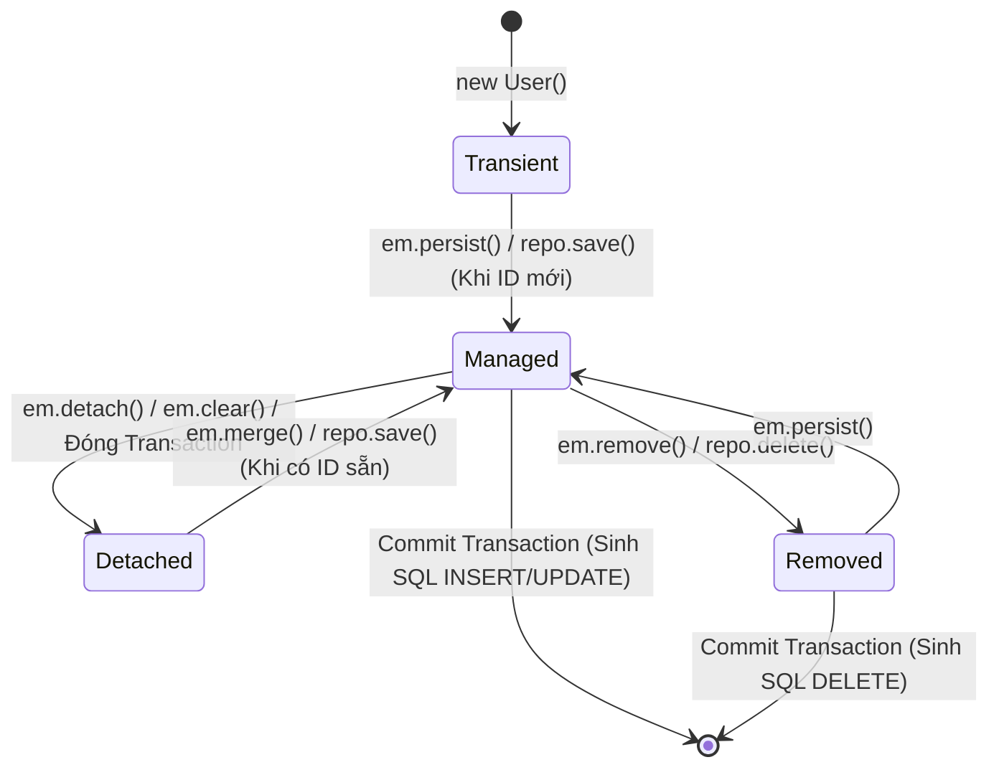
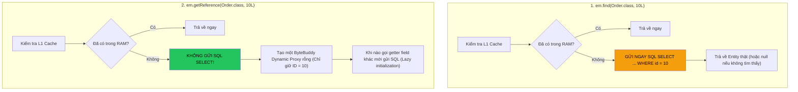
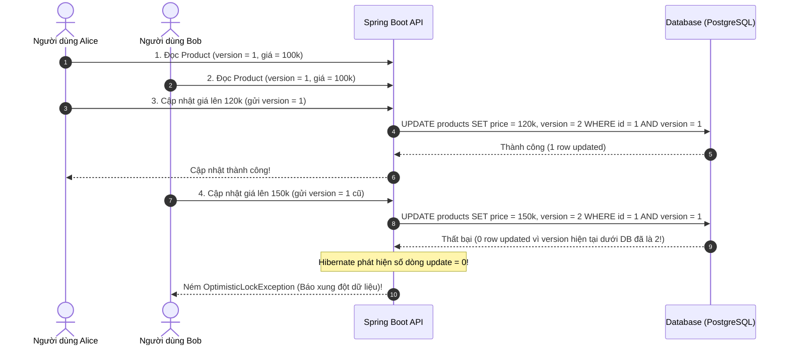

# 🔄 Vòng đời Entity trong JPA: Transient, Managed, Detached & Removed

> **Nguồn chính thống:** [Jakarta Persistence 3.2 Specification](https://jakarta.ee/specifications/persistence/3.2/) | [Hibernate ORM 7.x User Guide — Entity Lifecycle](https://hibernate.org/orm/documentation/) | [Spring Data JPA Reference](https://docs.spring.io/spring-data/jpa/reference/index.html)
>
> **Thuộc roadmap:** `5. Database → Spring Data → Spring Data JPA → Core Architecture & Internals → Entity Lifecycle States (Transient, Managed, Detached, Removed)`

---

## 1. Bản chất cốt lõi của Entity Lifecycle

Trong các ứng dụng Java thông thường, một đối tượng (Object) chỉ có hai trạng thái: được cấp phát trên Heap qua từ khóa `new` và bị bộ thu gom rác (Garbage Collector) dọn dẹp khi không còn tham chiếu nào trỏ tới.

Tuy nhiên, trong thế giới của JPA/Hibernate, một `@Entity` là đại diện ánh xạ cho một **dòng dữ liệu (Row)** dưới cơ sở dữ liệu quan hệ. Để quản lý sự đồng bộ trạng thái giữa bộ nhớ RAM và đĩa cứng, JPA định nghĩa **4 trạng thái vòng đời (Entity Lifecycle States)** được theo dõi nghiêm ngặt bởi **Persistence Context**:



---

## 2. Chi tiết 4 trạng thái & Sự chuyển dịch (Transitions)

### 2.1 Transient (New) — Đối tượng "Tạm thời / Mới tinh"
- **Định nghĩa:** Đối tượng vừa được khởi tạo bằng toán tử `new` trong mã Java.
- **Vị trí lưu trữ:** Nằm hoàn toàn trên bộ nhớ Heap bình thường của máy ảo JVM.
- **Persistence Context:** Hoàn toàn **KHÔNG biết** đến sự tồn tại của đối tượng này.
- **Database Identity:** Chưa có ID khóa chính (trừ khi lập trình viên tự gán thủ công) và chưa có dòng tương ứng nào dưới CSDL.
- **Hành vi:** Mọi thay đổi thuộc tính trên đối tượng này hoàn toàn không kích hoạt bất kỳ câu lệnh SQL nào. Nếu biến tham chiếu bị gán bằng `null` hoặc ra khỏi scope của hàm, Garbage Collector sẽ dọn dẹp nó như mọi Java Object bình thường.

```java
// Trạng thái Transient
User user = new User();
user.setUsername("john_doe");
user.setEmail("john@example.com");
// Lúc này user chỉ là một Java Object thông thường, không được JPA theo dõi
```

---

### 2.2 Managed (Persistent) — Đối tượng "Đang được quản lý" ⭐
- **Định nghĩa:** Entity đã được gắn vào **Persistence Context** và có một định danh duy nhất (Database Identity / Primary Key).
- **Cách thức trở thành Managed:**
  1. Gọi `entityManager.persist(entity)` hoặc `repository.save(newEntity)`.
  2. Đọc từ CSDL lên thông qua `find()`, `findById()`, hoặc câu query JPQL/Criteria.
  3. Lấy tham chiếu Proxy qua `entityManager.getReference(Entity.class, id)`.
  4. Gọi `entityManager.merge(detachedEntity)` (Bản sao mới trả về sẽ là Managed).
- **Hành vi ma thuật của Managed Entity:**
  - Nằm trong **First-Level Cache (Identity Map)** của Session.
  - Được tự động giám sát bởi cơ chế **Dirty Checking**: Mọi thay đổi thông qua hàm `setter` sẽ được Hibernate chụp ảnh so sánh (Snapshot comparison) và tự động sinh câu lệnh SQL `UPDATE` khi Transaction commit mà **KHÔNG CẦN gọi `save()` hay `update()`**!

```java
@Transactional
public void updateUserName(Long userId, String newName) {
    // 1. user trở thành MANAGED ngay sau khi đọc từ CSDL
    User user = entityManager.find(User.class, userId);

    // 2. Thao tác chỉnh sửa trực tiếp trên RAM
    user.setUsername(newName);

    // 3. KẾT THÚC METHOD: Transaction commit -> Dirty checking tự sinh SQL UPDATE!
    // Tuyệt đối không cần gọi: userRepository.save(user) -> Viết thừa thãi!
}
```

---

### 2.3 Detached — Đối tượng "Tách rời / Mất kết nối"
- **Định nghĩa:** Entity đã có ID và có dòng tương ứng dưới CSDL, nhưng **KHÔNG CÒN nằm trong Persistence Context** nữa.
- **Nguyên nhân rơi vào trạng thái Detached:**
  1. Transaction kết thúc (`@Transactional` đóng lại, Session bị đóng).
  2. Lập trình viên chủ động đẩy ra bằng `entityManager.detach(entity)`.
  3. Gọi `entityManager.clear()` (xóa sạch toàn bộ L1 Cache) hoặc `close()`.
  4. Chuyển Entity qua mạng (Serialize thành JSON trả về REST API Controller).
- **Hậu quả & Cạm bẫy:**
  - Mọi thay đổi trên field của Detached Entity **sẽ KHÔNG được lưu xuống CSDL**.
  - **Sát thủ `LazyInitializationException`:** Nếu bạn cố truy cập vào một quan hệ được đánh dấu `FetchType.LAZY` (ví dụ: `user.getOrders().size()`) khi Entity đang ở trạng thái Detached, Hibernate sẽ ném lỗi ngay vì không còn Session để mượn kết nối JDBC query CSDL nữa!

---

### 2.4 Removed — Đối tượng "Được đánh dấu xóa"
- **Định nghĩa:** Entity vẫn còn nằm trong Persistence Context nhưng đã được gắn cờ chuẩn bị xóa.
- **Cách kích hoạt:** Gọi `entityManager.remove(entity)` hoặc `repository.delete(entity)`.
- **Hành vi:**
  - Chưa bị xóa ngay lập tức khỏi CSDL (do cơ chế Write-Behind).
  - Lệnh SQL `DELETE` sẽ được đẩy vào hàng đợi `ActionQueue` và chỉ thực thi khi `flush()` hoặc trước khi Transaction commit.

---

## 3. Ma trận chuyển dịch trạng thái toàn diện (Lifecycle Transition Matrix)

Bảng dưới đây tổng hợp hành vi chính xác của từng phương thức trong JPA khi tác động lên các trạng thái khác nhau:

| Phương thức JPA | Tác động lên **Transient** | Tác động lên **Managed** | Tác động lên **Detached** | Tác động lên **Removed** |
| :--- | :--- | :--- | :--- | :--- |
| **`em.persist(e)`** | Chuyển thành **Managed**. Lên lịch chạy SQL `INSERT`. | Bỏ qua (Đã Managed). | Ném ngoại lệ `EntityExistsException` (hoặc lỗi flush). | Đổi trạng thái ngược lại thành **Managed**. |
| **`em.remove(e)`** | Bỏ qua hoặc ném `IllegalArgumentException`. | Chuyển thành **Removed**. Lên lịch chạy SQL `DELETE`. | Ném ngoại lệ `IllegalArgumentException` (Bắt buộc phải merge trước khi remove!). | Bỏ qua (Đã Removed). |
| **`em.merge(e)`** | Copy dữ liệu sang instance mới, chuyển thành **Managed**. | Bỏ qua, trả về chính nó. | Tìm bản sao trong Session hoặc CSDL, copy dữ liệu, trả về bản sao **Managed**. | Ném ngoại lệ `IllegalArgumentException`. |
| **`em.detach(e)`** | Bỏ qua (Chưa từng Managed). | Chuyển thành **Detached**. Dừng theo dõi Dirty Checking. | Bỏ qua (Đã Detached). | Chuyển thành **Detached**. Hủy lệnh chạy SQL `DELETE`! |
| **`em.refresh(e)`** | Ném ngoại lệ `IllegalArgumentException`. | Đọc lại từ CSDL, đè lên RAM, hủy mọi thay đổi chưa commit. | Ném ngoại lệ `IllegalArgumentException`. | Ném ngoại lệ `IllegalArgumentException`. |

---

## 4. Phân tích chuyên sâu: `em.find()` vs `em.getReference()`

Rất nhiều kỹ sư backend chỉ biết dùng `find()`, bỏ lỡ một vũ khí tối ưu hiệu năng cực mạnh của JPA là `getReference()`:



### Kịch bản thực tế Senior: Gán khóa ngoại mà không tốn câu lệnh SELECT!
> **Bài toán:** Bạn cần tạo mới một `OrderItem` và liên kết nó với `Order(id = 100)`.  
> Bạn đã biết chắc chắn `Order(id = 100)` tồn tại.

```java
// ❌ CÁCH VIẾT TỐN KÉM:
Order order = entityManager.find(Order.class, 100L); // Tốn 1 câu SQL SELECT Order không cần thiết!
OrderItem item = new OrderItem();
item.setOrder(order);
item.setPrice(BigDecimal.valueOf(50));
entityManager.persist(item);

// ✅ CÁCH VIẾT CHUẨN SENIOR:
Order orderProxy = entityManager.getReference(Order.class, 100L); // 0 câu SQL SELECT!
OrderItem item = new OrderItem();
item.setOrder(orderProxy); // CSDL chỉ cần giá trị 100 để lưu vào cột order_id
item.setPrice(BigDecimal.valueOf(50));
entityManager.persist(item); // Chỉ chạy ĐÚNG 1 câu INSERT INTO order_items!
```

---

## 5. Xử lý Detached Entity trong Kiến trúc REST API Hiện đại

### 5.1 Tại sao Senior Engineer KHUYÊN KHÔNG DÙNG `em.merge()` cho API Update?
Trong các ứng dụng RESTful API, Client thường gửi một JSON request lên Controller để cập nhật thông tin. Ví dụ: Client chỉ muốn đổi tên người dùng nên chỉ gửi `{ "fullName": "Nguyễn Văn A" }`, các trường khác như `password`, `createdDate` là `null`.

> **Hậu quả nếu dùng `em.merge()`:**
> `em.merge()` sẽ copy **toàn bộ thuộc tính** từ đối tượng detached sang đối tượng managed. Kết quả: Các trường `null` sẽ ghi đè lên dữ liệu cũ, làm **xóa mất mật khẩu và ngày tạo** trong CSDL!

---

### 5.2 Giải pháp chuẩn mực: Fetch-and-Update (Read-Modify-Write Pattern)

Thay vì dùng `merge()`, kiến trúc chuẩn mực của doanh nghiệp luôn là:
1. Đọc Entity từ CSDL lên bằng `findById()` $\rightarrow$ Trở thành **Managed**.
2. Chỉ cập nhật những trường được phép từ DTO sang Entity.
3. Để **Dirty Checking** tự động sinh câu `UPDATE` chính xác.

```java
@Service
public class UserService {

    private final UserRepository userRepository;

    public UserService(UserRepository userRepository) {
        this.userRepository = userRepository;
    }

    @Transactional
    public UserProfileResponse updateUserProfile(Long userId, UpdateProfileRequest request) {
        // Bước 1: Fetch lên -> Trở thành MANAGED
        User user = userRepository.findById(userId)
                .orElseThrow(() -> new EntityNotFoundException("User not found: " + userId));

        // Bước 2: Chỉ cập nhật các field được phép
        if (request.fullName() != null) {
            user.setFullName(request.fullName());
        }
        if (request.phoneNumber() != null) {
            user.setPhoneNumber(request.phoneNumber());
        }

        // Bước 3: Hoàn tất -> Dirty checking tự động cập nhật CSDL khi commit!
        return new UserProfileResponse(user.getId(), user.getFullName(), user.getPhoneNumber());
    }
}
```

---

### 5.3 Optimistic Locking với Detached Entities (`@Version`)

Khi làm việc với các hệ thống phân tán, hai người dùng có thể cùng mở một trang thông tin (cùng đọc Entity ở phiên bản `version = 1`).



```java
@Entity
@Table(name = "products")
@Getter @Setter
public class Product {
    @Id
    @GeneratedValue(strategy = GenerationType.IDENTITY)
    private Long id;

    private String name;
    private BigDecimal price;

    @Version // Khóa lạc quan chống Lost Update
    private Long version;
}
```

---

## 6. Cạm bẫy thực tế & Phỏng vấn Senior

### 6.1 Bẫy chiến lược sinh khóa `@GeneratedValue(strategy = IDENTITY)`
- Với chiến lược `IDENTITY`, CSDL chỉ sinh ID khi câu lệnh `INSERT` thực sự chạy.
- Nhưng để một Entity trở thành `Managed`, JPA **bắt buộc phải có ID**.
- Do đó, khi bạn gọi `em.persist(entity)` với `IDENTITY`, Hibernate **bị ép buộc phải gửi ngay lập tức lệnh INSERT xuống DB** để lấy ID về, hoàn toàn phá vỡ cơ chế gom lệnh trễ (Write-Behind) và **vô hiệu hóa 100% JDBC Batching**!
- **Giải pháp Senior:** Với các hệ thống chịu tải lớn, luôn ưu tiên sử dụng chiến lược **`GenerationType.SEQUENCE`** kết hợp với `allocationSize = 50`.

---

### 6.2 Thảm họa `@EqualsAndHashCode` của Lombok trên JPA Entity
Nhiều lập trình viên có thói quen gắn `@Data` hoặc `@EqualsAndHashCode` của Lombok lên Entity:

```java
// ❌ SAI LẦM TAI HẠI:
@Entity
@Getter @Setter
@EqualsAndHashCode // Dùng tất cả các field (kể cả ID) để tính hash
public class Product {
    @Id
    @GeneratedValue(strategy = GenerationType.IDENTITY)
    private Long id;
    private String name;
}
```

> **Tại sao sai?**
> 1. Khi `product` ở trạng thái **Transient**: `id == null` $\rightarrow$ Mã `hashCode()` được tính theo `null`.
> 2. Bạn đưa `product` vào một `HashSet<Product>`.
> 3. Bạn gọi `repository.save(product)` $\rightarrow$ Trở thành **Managed**, `id` được gán giá trị (ví dụ: `id = 101`).
> 4. Lúc này mã `hashCode()` của đối tượng bị thay đổi!
> 5. Bạn gọi `set.contains(product)` $\rightarrow$ Trả về **`false`**! Đối tượng bị "mất tích" trong chính tập hợp `Set` vì bị đặt sai bucket băm.
>
> **Quy tắc Senior:** Trên JPA Entity, chỉ dùng `@Getter`, `@Setter`. Nếu cần override `equals()` và `hashCode()`, chỉ sử dụng **Natural Key / Business Key bất biến** (ví dụ: `uuid`, `isbn`, `sku`), hoặc so sánh theo `id` nhưng phải kiểm tra `id != null`.

---

## 🔥 Ứng dụng thực tế (Thực tế dùng để làm gì? Giải quyết vấn đề gì?)

1. **Hiểu rõ để không bao giờ viết code thừa:** Lập trình viên nắm vững vòng đời Entity sẽ không bao giờ viết lệnh `userRepository.save(user)` sau khi vừa đọc `user` lên và chỉnh sửa field trong cùng một method `@Transactional`.
2. **Loại bỏ hoàn toàn các câu query SELECT dư thừa:** Kỹ thuật `entityManager.getReference()` giúp tối ưu hóa các API tạo mới dữ liệu có liên kết khóa ngoại (như tạo đơn hàng, tạo bình luận), tiết kiệm hàng triệu câu query mỗi ngày trên hệ thống lớn.
3. **Bảo toàn dữ liệu trong môi trường nhiều người dùng (Concurrency):** Kết hợp hiểu biết về Detached Entity và `@Version` giúp các hệ thống đặt vé máy bay, thương mại điện tử không bao giờ bị ghi đè dữ liệu sai lệch khi nhiều khách hàng cùng thao tác.

---

## 7. Tổng hợp các chủ đề (Bản đồ tra cứu)

### 🟢 Ưu tiên phải biết trước (Bắt buộc)
- Phân biệt 4 trạng thái: `Transient`, `Managed`, `Detached`, `Removed`.
- Lợi ích của Managed Entity: Không cần gọi `save()` để cập nhật dữ liệu.
- Nguyên nhân phát sinh `LazyInitializationException` khi Entity ở trạng thái Detached.
- Cú pháp cơ bản: `persist()`, `merge()`, `remove()`.

### 🟡 Nhóm trung cấp
- Sự khác nhau bản chất giữa `persist()` (giữ nguyên tham chiếu) và `merge()` (tạo instance mới).
- Sử dụng `entityManager.getReference()` để gán khóa ngoại mà không tốn câu lệnh SELECT.
- Triển khai Pattern Fetch-and-Update thay vì `merge()` cho các API cập nhật dữ liệu.
- Tác động của `GenerationType.IDENTITY` làm mất tính năng trì hoãn ghi (Write-Behind).

### 🔴 Nhóm nâng cao
- Bắt và xử lý `OptimisticLockException` khi cập nhật dữ liệu từ Detached Entity có gắn `@Version`.
- Thiết kế `equals()` và `hashCode()` chuẩn mực dựa trên Natural Key bất biến.
- Quản trị vòng đời Entity trong môi trường phân tán đa luồng (Virtual Threads / Project Loom trong Java 21).

---

## 📚 Tài liệu tham khảo chính thống

| Tài liệu | Link liên kết |
|---|---|
| Jakarta Persistence 3.2 — Entity Instance Life Cycle | [jakarta.ee/specifications/persistence/3.2/](https://jakarta.ee/specifications/persistence/3.2/) |
| Hibernate ORM 7.0 User Guide — Persistence Lifecycle | [docs.jboss.org/hibernate/orm/7.0/userguide/html_single/Hibernate_User_Guide.html](https://docs.jboss.org/hibernate/orm/7.0/userguide/html_single/Hibernate_User_Guide.html) |
| Vlad Mihalcea — JPA & Hibernate Entity Lifecycle States | [vladmihalcea.com/jpa-entity-lifecycle/](https://vladmihalcea.com/jpa-entity-lifecycle/) |
| Vlad Mihalcea — Why you should use getReference instead of find | [vladmihalcea.com/entitymanager-getreference-jpa-hibernate/](https://vladmihalcea.com/entitymanager-getreference-jpa-hibernate/) |
| Thorben Janssen — The Ultimate Guide to Entity Lifecycle States | [thorben-janssen.com/entity-lifecycle-states/](https://thorben-janssen.com/entity-lifecycle-states/) |

---

> **Tài liệu tiếp theo:** [Dirty Checking Mechanism, Flush Mode, Flush Order (ActionQueue) & First-Level Cache.md](file:///d:/WebSpace/Java-Backend/05-Database/Spring-Data/Spring-Data-JPA/Core%20Architecture%20&%20Internals/Dirty%20Checking%20Mechanism%2C%20Flush%20Mode%2C%20Flush%20Order%20%28ActionQueue%29%20%26%20First-Level%20Cache.md) — Khám phá cơ chế Snapshot ngầm và thứ tự ưu tiên sinh SQL trong Hibernate.
