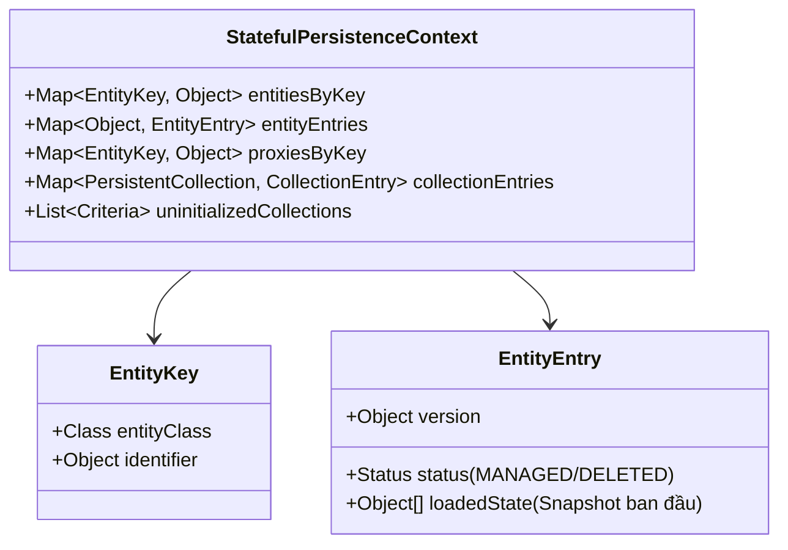
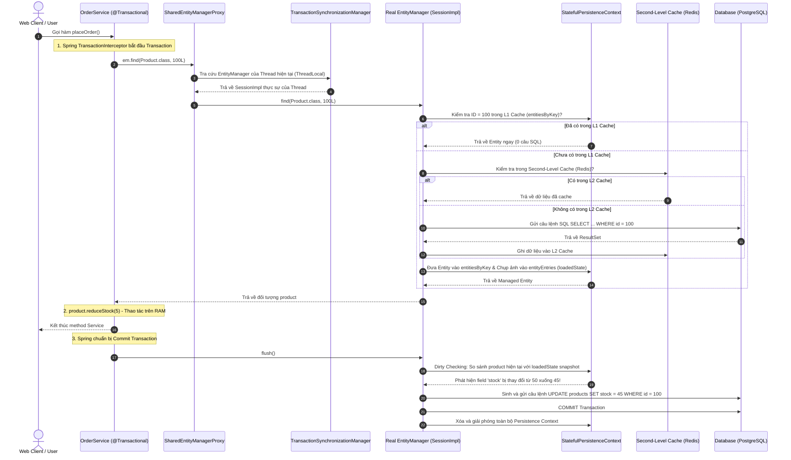
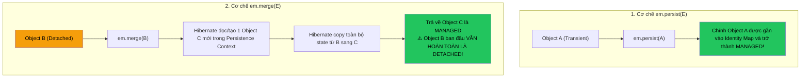

# 🧠 Trái tim của JPA: EntityManager, EntityManagerFactory & Persistence Context

> **Nguồn chính thống:** [Jakarta Persistence 3.2 Specification](https://jakarta.ee/specifications/persistence/3.2/) | [Hibernate ORM 7.x User Guide — Architecture & Persistence Context](https://hibernate.org/orm/documentation/) | [Spring Framework 7.0.8 — Data Access](https://docs.spring.io/spring-framework/reference/data-access.html)
>
> **Thuộc roadmap:** `5. Database → Spring Data → Spring Data JPA → Core Architecture & Internals → EntityManager, EntityManagerFactory & Persistence Context`

---

## 1. Định nghĩa chính thức & Bản chất kỹ thuật của bộ ba

Để thực sự làm chủ kiến trúc dữ liệu trong Java Backend ở đẳng cấp Middle/Senior, bạn bắt buộc phải hiểu thấu đáo cấu trúc bên trong và cơ chế tương tác của bộ ba: **`EntityManagerFactory`**, **`EntityManager`**, và **`Persistence Context`**.

```
┌────────────────────────────────────────────────────────────────────────┐
│                        EntityManagerFactory                            │
│  (1 Instance / Application — Khởi tạo rất nặng, Thread-Safe)           │
└───────────────────────────────────┬────────────────────────────────────┘
                                    │ Sinh ra nhiều
┌───────────────────────────────────▼────────────────────────────────────┐
│                           EntityManager                                │
│  (1 Instance / Request hoặc Transaction — Rất nhẹ, NON Thread-Safe)    │
└───────────────────────────────────┬────────────────────────────────────┘
                                    │ Quản lý & Giữ
┌───────────────────────────────────▼────────────────────────────────────┐
│                        Persistence Context                             │
│  (Vùng nhớ đệm RAM / First-Level Cache: Quản lý vòng đời Entity)       │
└────────────────────────────────────────────────────────────────────────┘
```

### 1.1 EntityManagerFactory — Nhà máy Khởi tạo Cấp cao
- **Bản chất:** Là một Factory Object đại diện cho cấu hình của toàn bộ đơn vị lưu trữ (Persistence Unit). Trong Hibernate, implementation thực sự của nó là **`SessionFactoryImpl`**.
- **Trách nhiệm:**
  1. Đọc và phân tích siêu dữ liệu (Metadata) của toàn bộ các class `@Entity` khi khởi động ứng dụng.
  2. Xác thực cấu trúc bảng CSDL (`ddl-auto=validate`).
  3. Khởi tạo và quản lý **Second-Level Cache (L2 Cache)** và **Connection Pool (HikariCP)**.
- **Chi phí khởi tạo:** **Cực kỳ nặng (Heavyweight)**. Thường mất từ 1 đến vài giây lúc ứng dụng khởi động.
- **Tính an toàn đa luồng:** **Thread-Safe 100%**. Trong cả vòng đời của một ứng dụng Spring Boot, chỉ có **duy nhất 1 bean `EntityManagerFactory`** (được Spring bọc trong `LocalContainerEntityManagerFactoryBean`).

---

### 1.2 EntityManager — Cây cầu Giao tiếp Độc lập
- **Bản chất:** Là giao diện (Interface) chính mà lập trình viên dùng để thao tác với CSDL (CRUD, tạo truy vấn JPQL/Criteria, kiểm soát transaction). Trong Hibernate, nó được thực thi bởi class **`SessionImpl`**.
- **Chi phí khởi tạo:** **Cực kỳ nhẹ (Lightweight)**. Nó chỉ là một lớp bọc mỏng xung quanh một kết nối JDBC vật lý.
- **Tính an toàn đa luồng:** **KHÔNG Thread-Safe (Non Thread-Safe)**. Tuyệt đối không bao giờ được chia sẻ một instance `EntityManager` cho nhiều thread dùng chung vì sẽ dẫn đến xung đột dữ liệu, làm sai lệch bộ đệm và race condition.
- **Vòng đời:** Sống ngắn hạn, thường chỉ tồn tại trong phạm vi của một HTTP Request hoặc một Transaction.

---

### 1.3 Persistence Context — Vùng nhớ Đệm RAM (First-Level Cache)
- **Bản chất:** Không phải là một file hay database, Persistence Context là một **cấu trúc dữ liệu trong bộ nhớ RAM** nằm trọn vẹn bên trong một `EntityManager`.
- **Nhiệm vụ cốt lõi:**
  1. Đóng vai trò là **First-Level Cache (Identity Map)**: Đảm bảo không có 2 Java Object khác nhau đại diện cho cùng 1 dòng dữ liệu trong cùng một transaction.
  2. Quản lý trạng thái vòng đời của Entity (`Transient`, `Managed`, `Detached`, `Removed`).
  3. Lưu giữ ảnh chụp nguyên bản (**Snapshots**) để phục vụ cơ chế tự động phát hiện thay đổi (**Dirty Checking**).
  4. Trì hoãn việc gửi SQL xuống CSDL thông qua hàng đợi **`ActionQueue`** (Write-Behind).

---

## 2. Giải phẫu cấu trúc bên trong của Hibernate `StatefulPersistenceContext`

Khi bạn debug sâu vào mã nguồn của Hibernate 7, bạn sẽ thấy `Persistence Context` thực chất được cài đặt bởi class **`org.hibernate.engine.internal.StatefulPersistenceContext`**. Dưới đây là các cấu trúc dữ liệu then chốt lưu trữ trong RAM:



1. **`entitiesByKey (Map<EntityKey, Object>)` — The Identity Map:**
   - Key là `EntityKey` (gồm Tên Entity + Primary Key).
   - Value là chính đối tượng Java đang nằm trên Heap RAM.
   - Nhờ map này, bất cứ khi nào bạn gọi `em.find(User.class, 1L)`, Hibernate chỉ cần tra cứu map với độ phức tạp $O(1)$. Nếu có, nó trả về ngay lập tức mà không tốn một lệnh SQL nào!
2. **`entityEntries (Map<Object, EntityEntry>)` — Trái tim của Dirty Checking:**
   - Lưu trữ siêu dữ liệu của từng đối tượng đang được quản lý.
   - Trường quan trọng nhất là **`Object[] loadedState`**: Đây chính là **bản Snapshot mảng** lưu trữ toàn bộ giá trị của các cột tại thời điểm Entity được đọc từ CSDL lên. Khi flush, Hibernate so sánh Entity hiện tại với mảng này để biết trường nào bị sửa!
3. **`proxiesByKey (Map<EntityKey, Object>)`:**
   - Quản lý các Dynamic Proxy chưa được nạp dữ liệu (Lazy Proxies) được tạo bởi thư viện ByteBuddy.

---

## 3. Cơ chế hoạt động bên dưới nắp ca-pô (Under the Hood)

Dưới đây là sơ đồ chi tiết luồng xử lý từ khi một HTTP Request đi vào Spring Service đến khi dữ liệu được ghi xuống CSDL:



---

## 4. Phân biệt 2 loại Persistence Context: Transaction-scoped vs Extended

Trong đặc tả JPA có hai loại phạm vi sống của Persistence Context:

| Tiêu chí | Transaction-scoped Persistence Context ⭐ | Extended Persistence Context |
| :--- | :--- | :--- |
| **Phạm vi sống (Scope)** | Gắn chặt chẽ với **vòng đời của một `@Transactional`**. | Sống xuyên suốt qua **nhiều Transaction liên tiếp**. |
| **Cơ chế khởi tạo & Đóng** | Mở khi Transaction bắt đầu, tự động đóng và giải phóng RAM ngay khi Transaction commit/rollback. | Vẫn mở sau khi Transaction kết thúc, chỉ đóng khi lập trình viên chủ động gọi `close()` hoặc Stateful Bean bị hủy. |
| **Cú pháp khai báo** | Mặc định trong Spring: `@PersistenceContext` | `@PersistenceContext(type = PersistenceContextType.EXTENDED)` |
| **Ứng dụng thực tế** | **99.9% ứng dụng Web REST API, Microservices**. | Các ứng dụng Desktop (JavaFX/Swing) hoặc Stateful Session Bean (EJB) làm form nhập liệu Wizard nhiều bước. |
| **Rủi ro** | Không có rủi ro rò rỉ RAM nếu thiết kế đúng. | **Cực kỳ nguy hiểm trên Web App:** Dễ gây rò rỉ bộ nhớ (Memory Leak) và lỗi đa luồng (Multi-threading race condition). |

---

## 5. Bí mật kiến trúc Spring: "Tại sao `EntityManager` không thread-safe nhưng lại an toàn trong Singleton Service?"

Đây là một trong những câu hỏi phỏng vấn Senior kinh điển nhất để phân loại ứng viên:

> **Câu hỏi:** Trong Spring Boot, các `@Service` mặc định đều là **Singleton** (chỉ có duy nhất 1 instance được chia sẻ cho hàng nghìn request chạy trên hàng trăm thread đồng thời).  
> Nếu `EntityManager` là **Non Thread-Safe**, tại sao việc inject trực tiếp như dưới đây lại hoàn toàn an toàn và không bao giờ bị xung đột dữ liệu giữa các người dùng?
>
> ```java
> @Service
> public class PaymentService {
>     @PersistenceContext
>     private EntityManager entityManager; // Có an toàn không?
> }
> ```

### Lời giải cấp độ Senior Architect:
1. Đối tượng `entityManager` được inject ở trên **KHÔNG PHẢI** là một `EntityManager` thật sự!
2. Nó là một **Dynamic Proxy** được tạo ra bởi Spring thông qua class **`SharedEntityManagerCreator`**.
3. **Cơ chế hoạt động khi runtime:**
   - Khi bạn gọi `entityManager.find(...)` hay bất kỳ method nào, Proxy này sẽ chặn (intercept) lời gọi lại.
   - Proxy tra cứu vào lớp quản lý luồng **`TransactionSynchronizationManager`**.
   - `TransactionSynchronizationManager` sử dụng một **`ThreadLocal<Map<Object, Object>>`** gắn riêng với Thread đang chạy để lấy đúng instance `EntityManager` (Hibernate `SessionImpl`) thật sự của riêng Thread đó.
   - Nếu trong Thread đó chưa có `EntityManager`, Spring sẽ mượn từ `EntityManagerFactory` và đăng ký vào ThreadLocal.
   - Khi Transaction commit, Spring tự động đóng `EntityManager` đó và xóa sạch khỏi ThreadLocal.
4. **Kết luận:** Mỗi HTTP Request (mỗi Thread) luôn luôn làm việc với một `EntityManager` và một `Persistence Context` hoàn toàn tách biệt, đảm bảo an toàn tuyệt đối 100%!

---

## 6. Phân biệt bản chất sâu sắc giữa `persist()` và `merge()`

Rất nhiều lập trình viên hiểu sai rằng: `persist()` là dùng để `INSERT`, còn `merge()` là dùng để `UPDATE`. Sự hiểu sai này dẫn đến những con bug tai hại!



### Minh họa bằng mã nguồn:

```java
@Transactional
public void demoPersistVsMerge() {
    // --- PERSIST ---
    Product p1 = new Product("Laptop", new BigDecimal("1000"));
    entityManager.persist(p1);
    p1.setPrice(new BigDecimal("1200")); // THÀNH CÔNG: p1 là Managed, Dirty checking sẽ cập nhật 1200!

    // --- MERGE (CẠM BẪY PHỔ BIẾN) ---
    Product detachedProduct = new Product("Mouse", new BigDecimal("50"));
    detachedProduct.setId(10L); // Giả lập đối tượng Detached từ Client gửi lên

    // ❌ SAI LẦM TAI HẠI:
    entityManager.merge(detachedProduct);
    detachedProduct.setPrice(new BigDecimal("99")); 
    // ⚠️ VÔ TÁC DỤNG! Giá trị '99' KHÔNG BAO GIỜ được lưu xuống CSDL! 
    // Vì detachedProduct vẫn là Detached!

    // ✅ CÁCH VIẾT ĐÚNG:
    Product managedProduct = entityManager.merge(detachedProduct);
    managedProduct.setPrice(new BigDecimal("99")); 
    // THÀNH CÔNG: managedProduct mới là đối tượng được Persistence Context quản lý!
}
```

---

## 7. Cạm bẫy tràn bộ nhớ OutOfMemory (OOM) khi xử lý dữ liệu lớn (Batch Processing)

Nếu bạn duyệt qua 500.000 bản ghi để tính toán và cập nhật, Persistence Context sẽ lưu giữ **cả 500.000 đối tượng Java cùng với 500.000 bản snapshot của chúng trong RAM**.

Do `Persistence Context` luôn giữ tham chiếu mạnh (**Strong Reference**) tới các Entity này, Bộ thu gom rác của JVM (**Garbage Collector**) hoàn toàn bất lực, không thể thu hồi bộ nhớ. Kết quả: **`java.lang.OutOfMemoryError: Java heap space`** làm sập server!

### Giải pháp chuẩn mực của Senior Engineer: Batching kết hợp `flush()` & `clear()`

```java
@Service
public class BigDataProcessingService {

    @PersistenceContext
    private EntityManager entityManager;

    @Transactional
    public void processLargeDataSet(List<UpdatePriceDto> dtoList) {
        int batchSize = 50; // Kích thước batch khuyến nghị cho JDBC

        for (int i = 0; i < dtoList.size(); i++) {
            UpdatePriceDto dto = dtoList.get(i);
            
            Product product = entityManager.find(Product.class, dto.productId());
            if (product != null) {
                product.setPrice(dto.newPrice());
            }

            // ⭐ ĐỊNH KỲ GIẢI PHÓNG BỘ NHỚ RAM
            if (i > 0 && i % batchSize == 0) {
                // 1. Đẩy toàn bộ các câu lệnh UPDATE đang chờ xuống CSDL qua JDBC Batching
                entityManager.flush();

                // 2. XÓA SẠCH toàn bộ Entity khỏi L1 Cache trong RAM để GC giải phóng Heap!
                entityManager.clear();
            }
        }
    }
}
```

---

## 8. Code mẫu ứng dụng thực tế: Điều khiển EntityManager trực tiếp trong Spring Boot 4.1.0

Dưới đây là một Service xử lý chuyển tiền ngân hàng áp dụng toàn diện các kỹ thuật: Khóa bi quan (`PESSIMISTIC_WRITE`), kiểm soát Dirty Checking và tối ưu hóa bộ nhớ:

```java
package com.example.service;

import com.example.entity.BankAccount;
import com.example.exception.InsufficientBalanceException;
import jakarta.persistence.EntityManager;
import jakarta.persistence.EntityNotFoundException;
import jakarta.persistence.LockModeType;
import jakarta.persistence.PersistenceContext;
import org.springframework.stereotype.Service;
import org.springframework.transaction.annotation.Transactional;

import java.math.BigDecimal;
import java.util.Objects;

@Service
public class BankTransferService {

    @PersistenceContext
    private EntityManager entityManager;

    @Transactional
    public void transferFunds(Long fromAccId, Long toAccId, BigDecimal amount) {
        Objects.requireNonNull(amount, "Số tiền không được null");
        if (amount.compareTo(BigDecimal.ZERO) <= 0) {
            throw new IllegalArgumentException("Số tiền chuyển phải lớn hơn 0");
        }

        // 1. Dùng EntityManager với Khóa bi quan (SELECT ... FOR UPDATE) chống Race Condition
        BankAccount fromAccount = entityManager.find(
                BankAccount.class, 
                fromAccId, 
                LockModeType.PESSIMISTIC_WRITE
        );
        if (fromAccount == null) throw new EntityNotFoundException("Tài khoản nguồn không tồn tại");

        BankAccount toAccount = entityManager.find(
                BankAccount.class, 
                toAccId, 
                LockModeType.PESSIMISTIC_WRITE
        );
        if (toAccount == null) throw new EntityNotFoundException("Tài khoản đích không tồn tại");

        // 2. Kiểm tra nghiệp vụ
        if (fromAccount.getBalance().compareTo(amount) < 0) {
            throw new InsufficientBalanceException("Số dư không đủ để thực hiện giao dịch");
        }

        // 3. Trừ và cộng tiền trực tiếp trên bộ nhớ RAM
        fromAccount.setBalance(fromAccount.getBalance().subtract(amount));
        toAccount.setBalance(toAccount.getBalance().add(amount));

        // 4. Tuyệt đối không cần gọi: entityManager.persist() hay save()!
        // Cơ chế Dirty Checking sẽ tự động so sánh loadedState snapshot và sinh ra 2 câu lệnh SQL UPDATE
        // chính xác khi transaction commit!
    }
}
```

---

## 🔥 Ứng dụng thực tế (Thực tế dùng để làm gì? Giải quyết vấn đề gì?)

1. **Bảo toàn dữ liệu tuyệt đối trong giao dịch tài chính:** Hiểu cách hoạt động của `Persistence Context` và các chế độ khóa (`PESSIMISTIC_WRITE`) giúp bạn ngăn chặn hoàn toàn việc tài khoản bị "âm tiền" hoặc lỗi mất cập nhật (Lost Update) khi có hàng nghìn giao dịch đồng thời.
2. **Tiết kiệm đến 70% số lượng truy vấn CSDL:** L1 Cache đóng vai trò như một tấm khiên bảo vệ CSDL. Khi xử lý một đơn hàng có 20 mặt hàng cùng thuộc một danh mục (`Category`), CSDL chỉ cần thực hiện đúng **1 câu SELECT Category duy nhất**, 19 lần còn lại được lấy trực tiếp từ RAM!
3. **Quản trị bộ nhớ máy chủ an toàn:** Nắm vững cơ chế `flush()` và `clear()` giúp các ứng dụng backend xử lý các file dữ liệu Excel/CSV hàng triệu dòng mà không bao giờ bị lỗi tràn bộ nhớ (OutOfMemoryError), giữ hệ thống luôn hoạt động ổn định 24/7.

---

## 9. Tổng hợp các chủ đề (Bản đồ tra cứu)

### 🟢 Ưu tiên phải biết trước (Bắt buộc)
- Khái niệm và nhiệm vụ của bộ ba: `EntityManagerFactory`, `EntityManager`, và `Persistence Context`.
- Tính chất Thread-Safe của `EntityManagerFactory` vs Non Thread-Safe của `EntityManager`.
- Nguyên lý hoạt động của **First-Level Cache (L1 Cache / Identity Map)**.
- Phân biệt rõ sự khác nhau giữa `persist()` (giữ tham chiếu) và `merge()` (tạo instance mới).

### 🟡 Nhóm trung cấp
- Giải phẫu cấu trúc `StatefulPersistenceContext` (`entitiesByKey` và `entityEntries` với mảng `loadedState`).
- Cơ chế giải phóng RAM khi xử lý dữ liệu lớn bằng `flush()` và `clear()`.
- Phân biệt giữa **Transaction-scoped Persistence Context** và **Extended Persistence Context**.
- Cách inject `EntityManager` vào Spring Service thông qua Dynamic Proxy `SharedEntityManagerCreator`.

### 🔴 Nhóm nâng cao
- Cơ chế hoạt động của `TransactionSynchronizationManager` trong việc quản lý ThreadLocal `SessionImpl`.
- Tương tác đa tầng giữa L1 Cache (Session) và L2 Cache (Redis/Hazelcast) khi gọi `em.find()`.
- Phân tích cơ chế Cascading Engine (`Cascade.cascade()`) bên trong EntityManager khi xử lý cây quan hệ cha-con phức tạp.

---

## 📚 Tài liệu tham khảo chính thống

| Tài liệu | Link liên kết |
|---|---|
| Jakarta Persistence 3.2 — Chapter 3: Entity Operations and Persistence Context | [jakarta.ee/specifications/persistence/3.2/](https://jakarta.ee/specifications/persistence/3.2/) |
| Hibernate ORM 7.0 User Guide — Persistence Context & Session Architecture | [docs.jboss.org/hibernate/orm/7.0/userguide/html_single/Hibernate_User_Guide.html](https://docs.jboss.org/hibernate/orm/7.0/userguide/html_single/Hibernate_User_Guide.html) |
| Spring Framework 7.0.8 Data Access — SharedEntityManagerCreator | [docs.spring.io/spring-framework/reference/data-access/orm/jpa.html](https://docs.spring.io/spring-framework/reference/data-access/orm/jpa.html) |
| Vlad Mihalcea — A beginner’s guide to JPA Persistence Context | [vladmihalcea.com/jpa-persistence-context/](https://vladmihalcea.com/jpa-persistence-context/) |
| Vlad Mihalcea — The difference between persist and merge in JPA | [vladmihalcea.com/jpa-persist-and-merge/](https://vladmihalcea.com/jpa-persist-and-merge/) |

---

> **Tài liệu tiếp theo:** [Entity Lifecycle States (Transient, Managed, Detached, Removed).md](file:///d:/WebSpace/Java-Backend/05-Database/Spring-Data/Spring-Data-JPA/Core%20Architecture%20&%20Internals/Entity%20Lifecycle%20States%20%28Transient,%20Managed,%20Detached,%20Removed%29.md) — Khám phá 4 trạng thái sinh tử của một Entity và cạm bẫy Lazy Proxy.
