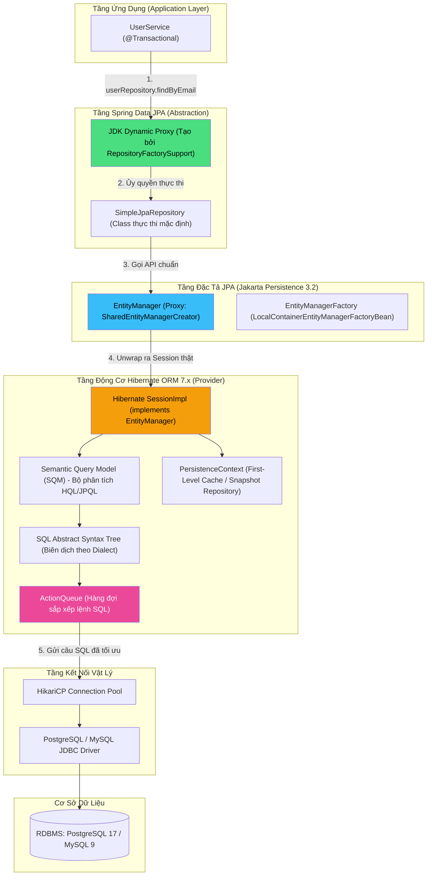
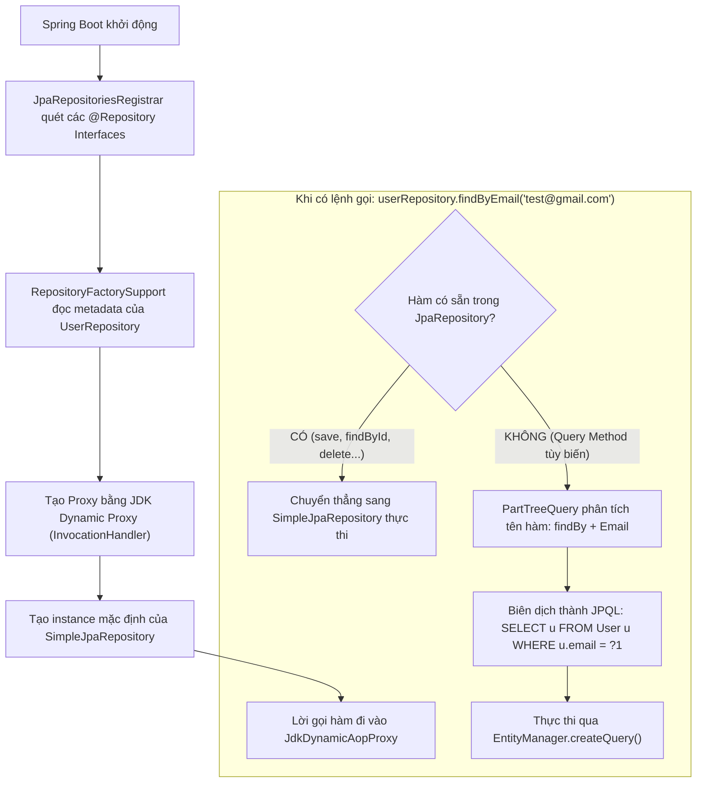

# 🏛️ Kiến trúc dữ liệu: JPA (Jakarta Persistence) vs Hibernate ORM vs Spring Data JPA

> **Nguồn chính thống:** [Jakarta Persistence 3.2 Specification](https://jakarta.ee/specifications/persistence/3.2/) | [Hibernate ORM 7.x User Guide](https://hibernate.org/orm/documentation/) | [Spring Data JPA Reference](https://docs.spring.io/spring-data/jpa/reference/index.html)
>
> **Thuộc roadmap:** `5. Database → Spring Data → Spring Data JPA → Core Architecture & Internals → JPA vs Hibernate ORM vs Spring Data JPA`

---

## 1. Bản chất cốt lõi: Phân định ranh giới 3 khái niệm

Một trong những câu hỏi phỏng vấn phổ biến nhất từ Junior đến Senior Backend là: *"Phân biệt sự khác nhau và mối liên hệ giữa JPA, Hibernate và Spring Data JPA?"*. Nếu không nắm rõ bản chất kiến trúc, lập trình viên sẽ dễ nhầm lẫn chức năng của từng tầng và không biết cách tối ưu hóa hiệu năng khi gặp sự cố.

```
┌────────────────────────────────────────────────────────────────────────┐
│                        Spring Data JPA                                 │
│  (Thư viện cấp cao: Cung cấp Repository Abstraction, sinh code tự động)│
└───────────────────────────────────┬────────────────────────────────────┘
                                    │ dựa trên / gọi
┌───────────────────────────────────▼────────────────────────────────────┐
│                    JPA (Jakarta Persistence)                           │
│  (Đặc tả kỹ thuật / Tiêu chuẩn: Bộ Interface, Annotation & Quy tắc)    │
└───────────────────────────────────┬────────────────────────────────────┘
                                    │ được thực thi bởi
┌───────────────────────────────────▼────────────────────────────────────┐
│                         Hibernate ORM                                  │
│  (Engine thực thi / Implementation: Mã nguồn thực hiện ánh xạ & SQL)   │
└───────────────────────────────────┬────────────────────────────────────┘
                                    │ thông qua
┌───────────────────────────────────▼────────────────────────────────────┐
│                      JDBC Driver & HikariCP                            │
│  (Kết nối vật lý, gửi lệnh SQL và nhận ResultSet từ CSDL)             │
└────────────────────────────────────────────────────────────────────────┘
```

### 1.1 JPA (Jakarta Persistence API) — Chuẩn mực Đặc tả (Specification)
- **Bản chất:** JPA là một **bản đặc tả kỹ thuật (Specification)** của Java EE (nay là Jakarta EE). Nó chỉ bao gồm một tập hợp các **Interfaces** (như `EntityManager`, `EntityManagerFactory`, `EntityTransaction`), các **Annotations** (như `@Entity`, `@Table`, `@Id`, `@OneToMany`) và các quy tắc chuẩn hóa cách một framework ORM phải hành xử.
- **Tính chất cốt lõi:** JPA **KHÔNG chứa bất kỳ dòng mã thực thi nào (No Implementation Code)**. Bạn không thể "chạy" JPA độc lập nếu không có một thư viện thực thi (JPA Provider) đứng phía sau.
- **Lịch sử định danh:**
  - *Java EE era (trước 2019):* Mang package `javax.persistence.*` (JPA 1.0, 2.0, 2.1, 2.2).
  - *Jakarta EE era (2019 đến nay):* Khi Oracle chuyển giao quyền quản lý cho Eclipse Foundation, toàn bộ namespace `javax.*` đổi thành `jakarta.*`.
  - Spring Boot 3.x sử dụng **Jakarta Persistence 3.1**.
  - Spring Boot 4.1.0 và Spring Framework 7.0.8 sử dụng **Jakarta Persistence 3.2** trên nền tảng **Java 21+**.

---

### 1.2 Hibernate ORM — Động cơ Thực thi (ORM Engine / Implementation)
- **Bản chất:** Hibernate là một **công cụ thực thi (Implementation / Provider)** của JPA. Hibernate chứa mã nguồn thực tế viết bằng Java để:
  1. Phân tích các class `@Entity` và ánh xạ sang bảng CSDL.
  2. Dịch các câu truy vấn JPQL/HQL thành câu lệnh SQL tương thích với từng hệ quản trị CSDL thông qua các **Database Dialects**.
  3. Quản lý bộ đệm cấp 1 (**First-Level Cache**), bộ đệm cấp 2 (**Second-Level Cache**), và theo dõi thay đổi dữ liệu (**Dirty Checking**).
- **Tính chất lịch sử:** Hibernate ra đời từ năm 2001 (bởi Gavin King), đi trước JPA rất nhiều năm. JPA ra đời sau đó (năm 2006) dựa trên sự thành công của chính Hibernate. Vì vậy, ngoài việc tuân thủ 100% chuẩn JPA, Hibernate còn sở hữu một kho tính năng nâng cao độc quyền mà đặc tả JPA không có:
  - `@BatchSize` (Triệt tiêu N+1 Query).
  - `@Formula` (Tính toán cột ảo bằng SQL native).
  - **Hibernate Envers** (Tự động ghi log lịch sử thay đổi bản ghi vào bảng `_AUD`).
  - **`StatelessSession`** (Engine ghi chép dữ liệu khổng lồ không tốn RAM cache).

---

### 1.3 Spring Data JPA — Lớp Trừu tượng Hóa Cấp cao (Abstraction Layer)
- **Bản chất:** Spring Data JPA **KHÔNG PHẢI** là một JPA Provider. Nó là một module nằm trong hệ sinh thái Spring Data, đóng vai trò là một **lớp trừu tượng (Abstraction Layer)** bọc bên ngoài JPA và Hibernate.
- **Nhiệm vụ cốt lõi:**
  1. **Triệt tiêu Boilerplate Code:** Thay vì lập trình viên phải tự tay inject `EntityManager`, tự mở Transaction, tự gọi `persist()`, `merge()`, Spring Data JPA cung cấp các interface sẵn có như `Repository`, `CrudRepository`, `ListCrudRepository`, `JpaRepository`.
  2. **Tự động sinh mã truy vấn runtime (Derived Query Methods):** Tự phân tích tên method như `findByEmailAndStatus(String email, Status status)` thành câu query JPQL tương ứng.
  3. **Chuẩn hóa phân trang và sắp xếp:** Tích hợp sâu các đối tượng `Pageable`, `Page`, `Slice`, `Sort` vào mọi câu truy vấn.
  4. **Tích hợp Transaction đồng bộ:** Tự động kết nối với `JpaTransactionManager` của Spring Framework để quản lý giao dịch qua `@Transactional`.

---

## 2. Sơ đồ kiến trúc phân tầng chuyên sâu (Under the Hood)

Dưới đây là bức tranh toàn cảnh chi tiết nhất về cách một phương thức gọi từ tầng Service đi xuyên qua các lớp thư viện trước khi chạm xuống CSDL:



---

## 3. Bảng đối chiếu chuyên sâu: JPA vs Hibernate vs Spring Data JPA

| Tiêu chí so sánh | JPA (Jakarta Persistence 3.2) | Hibernate ORM 7.x | Spring Data JPA (Spring Boot 4.1.0) |
| :--- | :--- | :--- | :--- |
| **Bản chất cốt lõi** | Bản đặc tả kỹ thuật (Specification / Standard). | Thư viện ORM (Engine / Implementation). | Framework trừu tượng hóa dữ liệu (Abstraction Framework). |
| **Đơn vị quản trị** | Eclipse Foundation (Jakarta EE Working Group). | Red Hat / Hibernate Community. | Broadcom / Spring Team (VMware Tanzu). |
| **Có mã thực thi không?** | ❌ **Không** (Chỉ có Interface & Annotation). | ✅ **Có** (Chứa mã kết nối CSDL, sinh SQL, quản lý cache). | ✅ **Có** (Chứa mã sinh Proxy Repository, phân tích cú pháp method). |
| **Namespace Package** | `jakarta.persistence.*` | `org.hibernate.*` | `org.springframework.data.jpa.*` |
| **Các API trung tâm** | `EntityManager`, `EntityManagerFactory`, `EntityTransaction`. | `Session`, `SessionFactory`, `StatelessSession`, `Query`. | `JpaRepository<T, ID>`, `JpaSpecificationExecutor`. |
| **Cơ chế truy vấn** | JPQL, Criteria API, Native SQL. | HQL (Hibernate Query Language), Native SQL, HQL Mutation. | Derived Query Methods, `@Query` (JPQL/Native), Specifications. |
| **Tính độc lập** | Không thể chạy một mình (Bắt buộc phải có Provider như Hibernate/EclipseLink). | Có thể chạy hoàn toàn độc lập trong ứng dụng Java thuần (không cần Spring, không cần JPA). | **Bắt buộc** phải có JPA Provider (mặc định là Hibernate) bên dưới để hoạt động. |
| **Chi phí cấu hình** | Cần file `META-INF/persistence.xml`. | Có thể cấu hình qua file `hibernate.cfg.xml` hoặc mã Java. | **Zero-config**: Spring Boot tự động cấu hình 100% qua `application.yml`. |

---

## 4. Sự tiến hóa qua 4 thời kỳ: Cùng 1 bài toán, 4 cách triển khai

> **Bài toán thực tế:** Tìm kiếm thông tin khách hàng (`Customer`) theo `id`, kiểm tra số dư và trừ tiền tài khoản an toàn.

### Thời kỳ 1: Pure JDBC (Thập niên 2000 — Nặng nề, rủi ro rò rỉ tài nguyên cao)
```java
Connection conn = null;
PreparedStatement psSelect = null;
PreparedStatement psUpdate = null;
ResultSet rs = null;
try {
    conn = dataSource.getConnection();
    conn.setAutoCommit(false); // Bắt đầu transaction thủ công

    // 1. SELECT dữ liệu
    psSelect = conn.prepareStatement("SELECT id, name, balance FROM customers WHERE id = ? FOR UPDATE");
    psSelect.setLong(1, customerId);
    rs = psSelect.executeQuery();
    
    if (rs.next()) {
        BigDecimal balance = rs.getBigDecimal("balance");
        if (balance.compareTo(amount) >= 0) {
            // 2. UPDATE thủ công
            psUpdate = conn.prepareStatement("UPDATE customers SET balance = balance - ? WHERE id = ?");
            psUpdate.setBigDecimal(1, amount);
            psUpdate.setLong(2, customerId);
            psUpdate.executeUpdate();
        }
    }
    conn.commit(); // Commit thủ công
} catch (Exception e) {
    if (conn != null) conn.rollback();
    throw new RuntimeException(e);
} finally {
    // Đóng toàn bộ resources thủ công - Rất dễ quên dẫn đến rò rỉ Connection Pool!
    if (rs != null) rs.close();
    if (psSelect != null) psSelect.close();
    if (psUpdate != null) psUpdate.close();
    if (conn != null) conn.close();
}
```

### Thời kỳ 2: Hibernate Native API (Trước khi có chuẩn JPA — Dùng Session & Transaction)
```java
// Lập trình viên phụ thuộc chặt chẽ vào API độc quyền của Hibernate
SessionFactory sessionFactory = new Configuration().configure().buildSessionFactory();
Session session = sessionFactory.openSession();
org.hibernate.Transaction tx = session.beginTransaction();
try {
    Customer customer = session.get(Customer.class, customerId);
    customer.deductBalance(amount);
    // Hibernate Dirty Checking tự động sinh UPDATE khi commit
    tx.commit();
} catch (Exception e) {
    tx.rollback();
    throw e;
} finally {
    session.close();
}
```

### Thời kỳ 3: JPA Standard API (Sử dụng EntityManager chuẩn)
```java
// Code độc lập với Hibernate, có thể tráo đổi sang EclipseLink mà không cần sửa code
EntityManagerFactory emf = Persistence.createEntityManagerFactory("production-pu");
EntityManager em = emf.createEntityManager();
EntityTransaction tx = em.getTransaction();
try {
    tx.begin();
    Customer customer = em.find(Customer.class, customerId);
    customer.deductBalance(amount);
    tx.commit();
} catch (Exception e) {
    if (tx.isActive()) tx.rollback();
    throw e;
} finally {
    em.close();
}
```

### Thời kỳ 4: Spring Data JPA hiện đại (Spring Boot 4.1.0 & Spring Framework 7.0.8)
```java
// Hoàn toàn không còn boilerplate code, không cần mở/đóng Session hay Transaction thủ công
@Service
public class CustomerService {

    private final CustomerRepository customerRepository;

    public CustomerService(CustomerRepository customerRepository) {
        this.customerRepository = customerRepository;
    }

    @Transactional // Spring AOP tự quản lý Transaction, Dirty Checking, Connection
    public void deductMoney(Long customerId, BigDecimal amount) {
        Customer customer = customerRepository.findById(customerId)
                .orElseThrow(() -> new EntityNotFoundException("Customer not found: " + customerId));

        customer.deductBalance(amount);
        // Không cần gọi customerRepository.save(customer)! Dirty checking tự động xử lý.
    }
}
```

---

## 5. Cơ chế sinh Dynamic Proxy của Spring Data JPA

Khi bạn khai báo một interface:

```java
public interface UserRepository extends JpaRepository<User, Long> {
    Optional<User> findByEmail(String email);
}
```

Bạn có bao giờ tự hỏi: **Tại sao một Interface không có code thực thi (không có `implements`) mà ứng dụng vẫn gọi được hàm bình thường khi runtime?**



1. **Giai đoạn khởi động (Startup):** `RepositoryFactorySupport` của Spring Data JPA quét toàn bộ các Interface kế thừa `Repository`. Nó sử dụng **JDK Dynamic Proxy** để tạo ra một đối tượng Proxy bọc quanh interface đó trong Spring Context.
2. **Hàm có sẵn (`save`, `findById`, `delete`...):** Proxy sẽ ủy quyền (delegate) trực tiếp sang class thực thi mặc định là **`SimpleJpaRepository`**.
3. **Query Method tùy biến (`findByEmail`):** Một bộ phân tích cú pháp cây (Parser) gọi là `PartTree` sẽ phân tách tên method thành các từ khóa (`find...By`, `Email`, `And`, `GreaterThan`), tự động sinh ra câu lệnh JPQL tương đương và thực thi qua `EntityManager.createQuery()`.

---

## 6. So sánh toàn diện các công nghệ Data Access trong hệ sinh thái Java

Khi nào nên chọn Spring Data JPA? Khi nào nên dùng jOOQ, MyBatis hay Pure JDBC? Dưới đây là bảng so sánh chuẩn kiến trúc dành cho Tech Lead / Senior Engineer:

| Tiêu chí | Pure JDBC | Spring JdbcTemplate | MyBatis | jOOQ | Hibernate ORM | Spring Data JPA |
| :--- | :---: | :---: | :---: | :---: | :---: | :---: |
| **Mô hình** | Manual SQL | Low-level SQL Wrapper | SQL Mapper (XML/Annotation) | Type-safe Fluent SQL Builder | Full ORM | High-level ORM Abstraction |
| **Tốc độ phát triển (CRUD)** | Cực chậm | Chậm | Trung bình | Khá | Rất nhanh | **Cực nhanh (Số 1)** |
| **Kiểm soát câu lệnh SQL** | 100% | 100% | 100% | 100% Type-safe | Thấp (ORM tự sinh) | Thấp (Tự động sinh) |
| **Hiệu năng xử lý (Raw Performance)** | ⭐⭐⭐⭐⭐ | ⭐⭐⭐⭐⭐ | ⭐⭐⭐⭐ | ⭐⭐⭐⭐⭐ | ⭐⭐⭐ (Trừ khi tối ưu) | ⭐⭐⭐ (Trừ khi tối ưu) |
| **First-Level Cache / Dirty Checking** | ❌ Không | ❌ Không | ❌ Không | ❌ Không | ✅ Có | ✅ Có |
| **Phù hợp nhất cho** | Driver nội bộ, hệ thống nhúng | Tác vụ bảo trì nhỏ, Script | Báo cáo tài chính phức tạp | Query OLAP phức tạp, Batch lớn | Ứng dụng doanh nghiệp lớn | **Web App, REST API, Microservices** |

---

## 7. Cạm bẫy thực tế & Phỏng vấn Senior

### 7.1 Cạm bẫy: Khi nào `SimpleJpaRepository.save()` gây suy giảm hiệu năng?
Khi bạn gọi `repository.save(entity)`, Hibernate không đơn giản là chạy `INSERT`. Bên dưới nắp ca-pô của `SimpleJpaRepository`:

```java
// Mã nguồn bên trong SimpleJpaRepository của Spring Data JPA:
@Transactional
@Override
public <S extends T> S save(S entity) {
    Assert.notNull(entity, "Entity must not be null");

    if (entityInformation.isNew(entity)) {
        em.persist(entity); // Nếu là mới tinh -> Chạy persist
        return entity;
    } else {
        return em.merge(entity); // Nếu ĐÃ CÓ ID -> Bắt buộc chạy merge!
    }
}
```

> **Cạm bẫy hiệu năng:**
> - Nếu bạn gán ID thủ công cho một Entity mới (ví dụ: gán UUID bằng code Java trước khi lưu), `entityInformation.isNew(entity)` sẽ trả về **`false`** (vì ID không phải là `null`)!
> - Hậu quả: Spring Data JPA sẽ gọi **`em.merge(entity)`**.
> - Hibernate sẽ **gửi một câu lệnh SQL `SELECT` vô nghĩa xuống CSDL** để kiểm tra xem ID đó đã tồn tại chưa, rồi mới chạy lệnh `INSERT`!
> - **Giải pháp Senior:** Implement interface `Persistable<ID>` trong Entity để tự kiểm soát logic `isNew()` (trả về `true` khi mới tạo), ngăn chặn hoàn toàn câu lệnh `SELECT` thừa thãi!

---

### 7.2 Khi nào bắt buộc phải "chọc thủng" Spring Data JPA để dùng Hibernate thuần?
Có những tác vụ phân tích hoặc xử lý dữ liệu hàng loạt (ETL) mà cả Spring Data JPA và `EntityManager` đều làm tràn bộ nhớ (OutOfMemoryError). Lúc này, Senior Engineer sẽ unwrap Session để sử dụng **`StatelessSession`**:

```java
@Service
public class BigDataEtlService {

    @PersistenceContext
    private EntityManager entityManager;

    public void processMillionsOfRecords() {
        // 1. Chọc thủng lớp bọc của JPA để lấy Hibernate Session thật
        org.hibernate.Session session = entityManager.unwrap(org.hibernate.Session.class);

        // 2. Mở một StatelessSession: Tắt bỏ 100% L1 Cache, Snapshot và Dirty Checking
        try (org.hibernate.StatelessSession statelessSession = session.getSessionFactory().openStatelessSession()) {
            org.hibernate.Transaction tx = statelessSession.beginTransaction();

            // Chèn 500.000 bản ghi mà RAM chỉ tiêu tốn như một ứng dụng Hello World!
            for (int i = 0; i < 500_000; i++) {
                LogEntry log = new LogEntry("Event " + i, Instant.now());
                statelessSession.insert(log); // Ghi thẳng xuống JDBC mà không giữ đối tượng trong RAM
            }

            tx.commit();
        }
    }
}
```

---

## 🔥 Ứng dụng thực tế (Thực tế dùng để làm gì? Giải quyết vấn đề gì?)

1. **Chuẩn hóa kiến trúc toàn dự án:** Hiểu rõ bộ ba giúp bạn xây dựng cấu trúc code chuẩn mực: Tầng Service chỉ tương tác với Repository interface; Tầng Repository bọc kín các câu query; và khi cần tối ưu hiệu năng cực hạn thì biết cách unwrap xuống tầng `EntityManager` hay `Session` mà không phá vỡ cấu trúc phần mềm.
2. **Khả năng chuyển đổi cơ sở dữ liệu linh hoạt:** Nhờ có lớp Hibernate Dialect và chuẩn JPA, ứng dụng backend có thể dễ dàng chuyển đổi từ H2 Database (khi chạy Unit Test) sang PostgreSQL/MySQL (khi chạy Production) chỉ bằng việc thay đổi file cấu hình, không cần sửa một dòng mã nghiệp vụ nào.
3. **Tối ưu hóa chi phí phát triển (Time-to-Market):** Spring Data JPA giúp các đội ngũ phần mềm giảm từ 40% đến 60% thời gian viết code thao tác dữ liệu so với thời kỳ Pure JDBC hay MyBatis, tập trung toàn bộ nguồn lực vào giải quyết bài toán nghiệp vụ của khách hàng.

---

## 8. Tổng hợp các chủ đề (Bản đồ tra cứu)

### 🟢 Ưu tiên phải biết trước (Bắt buộc)
- Phân biệt bản chất: JPA (Đặc tả) vs Hibernate (Thực thi) vs Spring Data JPA (Trừu tượng hóa).
- Package chuẩn của Jakarta EE hiện đại: `jakarta.persistence.*`.
- Các Interface cốt lõi: `Repository` $\rightarrow$ `CrudRepository` $\rightarrow$ `ListCrudRepository` $\rightarrow$ `JpaRepository`.
- Cách Spring Boot tự động kết nối và cấu hình DataSource qua `application.yml`.

### 🟡 Nhóm trung cấp
- Cơ chế sinh Dynamic Proxy của `RepositoryFactorySupport` và class thực thi `SimpleJpaRepository`.
- Quy tắc hoạt động của Database Dialects trong việc dịch HQL/JPQL sang câu lệnh SQL vật lý.
- Cách viết Custom Repository Implementation (`UserRepositoryCustom` + `UserRepositoryCustomImpl`) kết hợp `EntityManager`.
- Cạm bẫy câu lệnh `SELECT` thừa trong `SimpleJpaRepository.save()` khi Entity tự gán ID trước.

### 🔴 Nhóm nâng cao
- Pipeline biên dịch câu truy vấn của Hibernate 7: HQL/JPQL $\rightarrow$ Semantic Query Model (SQM) $\rightarrow$ SQL AST $\rightarrow$ Native SQL.
- Sử dụng `Persistable<ID>` để kiểm soát phương thức `isNew()` trong Spring Data JPA.
- Kỹ thuật `unwrap()` từ `EntityManager` sang Hibernate `StatelessSession` để xử lý High-volume Batch Processing.
- Kiến trúc tích hợp giữa Spring Transaction Manager (`JpaTransactionManager`) và Hibernate Session Synchronization.

---

## 📚 Tài liệu tham khảo chính thống

| Tài liệu | Link liên kết |
|---|---|
| Jakarta Persistence 3.2 Official Specification | [jakarta.ee/specifications/persistence/3.2/](https://jakarta.ee/specifications/persistence/3.2/) |
| Hibernate ORM 7.0 User Guide — Architecture & Dialects | [docs.jboss.org/hibernate/orm/7.0/userguide/html_single/Hibernate_User_Guide.html](https://docs.jboss.org/hibernate/orm/7.0/userguide/html_single/Hibernate_User_Guide.html) |
| Spring Data JPA 3.4 / 4.x Reference Documentation | [docs.spring.io/spring-data/jpa/reference/index.html](https://docs.spring.io/spring-data/jpa/reference/index.html) |
| Vlad Mihalcea — What is the difference between JPA and Hibernate | [vladmihalcea.com/jpa-hibernate-spring-data-jpa-difference/](https://vladmihalcea.com/jpa-hibernate-spring-data-jpa-difference/) |
| Baeldung — The Difference Between JPA, Hibernate and Spring Data JPA | [baeldung.com/jpa-hibernate-spring-data-jpa](https://www.baeldung.com/jpa-hibernate-spring-data-jpa) |

---

> **Tài liệu tiếp theo:** [EntityManager, EntityManagerFactory & Persistence Context.md](file:///d:/WebSpace/Java-Backend/05-Database/Spring-Data/Spring-Data-JPA/Core%20Architecture%20&%20Internals/EntityManager%2C%20EntityManagerFactory%20%26%20Persistence%20Context.md) — Đi sâu vào trái tim và khối óc của JPA, cơ chế First-Level Cache và Dirty Checking ngầm.
