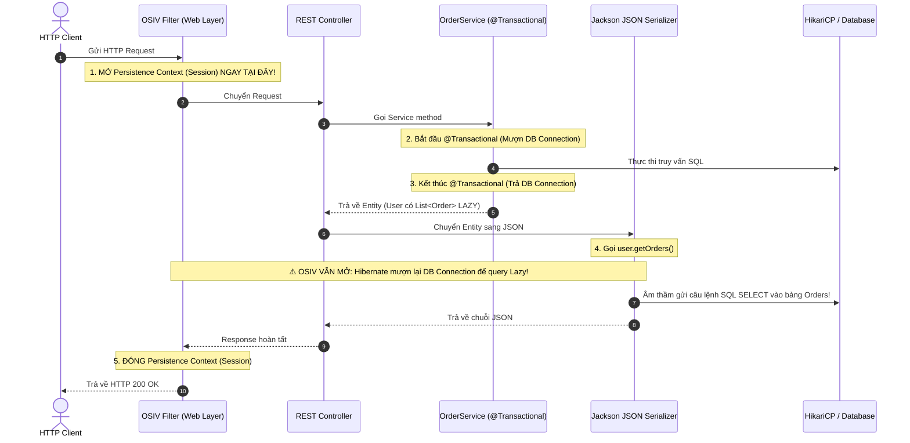
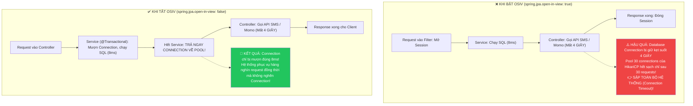

# 🚨 Open Session In View (OSIV) Anti-Pattern: Bản chất & Tại sao Production BẮT BUỘC phải tắt

> **Nguồn chính thống:** [Spring Boot Reference Guide — spring.jpa.open-in-view](https://docs.spring.io/spring-boot/reference/data/sql.html) | [Vlad Mihalcea — Why Open Session in View is an Anti-Pattern](https://vladmihalcea.com/the-open-session-in-view-anti-pattern/) | [Spring Framework 7.0.8 Web Support](https://docs.spring.io/spring-framework/reference/web.html)
>
> **Thuộc roadmap:** `5. Database → Spring Data → Spring Data JPA → Core Architecture & Internals → Open Session In View (OSIV) Anti-Pattern`

---

## 1. Giới thiệu OSIV (Open Session in View)

Khi bạn khởi tạo một dự án Spring Boot với Spring Data JPA, Spring Boot sẽ tự động in ra dòng cảnh báo này trong Console mỗi khi khởi động:

```text
WARN 1 --- [main] j.LocalContainerEntityManagerFactoryBean : 
spring.jpa.open-in-view is enabled by default. Therefore, database queries may be performed during view rendering. 
Explicitly configure spring.jpa.open-in-view to disable this warning
```

### 1.1 OSIV là gì?
- **OSIV** là viết tắt của **Open Session In View** (hoặc trong chuẩn JPA là `OpenEntityManagerInViewFilter` / `OpenEntityManagerInViewInterceptor`).
- **Cơ chế hoạt động:** Nó là một Servlet Filter của Spring. Khi một HTTP Request đi vào ứng dụng, OSIV sẽ **mở một Hibernate Session / EntityManager ngay từ tầng Filter (Web Layer)**, giữ cho Session này **mở liên tục** xuyên suốt qua Controller, Service, Repository, quay ngược lại Controller, và chỉ đóng lại sau khi **đã gửi xong toàn bộ dữ liệu JSON/HTML về cho Client**!



### 1.2 Tại sao Spring Boot lại bật `open-in-view = true` làm mặc định?
- **Mục đích duy nhất:** Thân thiện với người mới học (Beginner-friendly).
- Khi mới học Spring, lập trình viên thường trả trực tiếp Entity ra Controller. Nếu không có OSIV, khi Jackson serialize các thuộc tính `FetchType.LAZY`, hệ thống sẽ ném lỗi **`LazyInitializationException: could not initialize proxy - no Session`**.
- Để người mới học không phàn nàn và API "chạy được ngay", Spring Boot âm thầm bật sẵn OSIV.

---

## 2. Hai thảm họa của OSIV trên môi trường Production

Nếu bạn để `spring.jpa.open-in-view: true` trên môi trường Production chịu tải thực tế, hệ thống của bạn sẽ đối mặt với 2 nguy cơ sập nghiêm trọng:

### Thảm họa 1: Cạn kiệt Connection Pool (HikariCP Connection Starvation) ⭐⭐⭐

> **Case Study thực tế: "Sự cố sập sàn thương mại điện tử ngày Black Friday"**  
> Một hệ thống bán lẻ trực tuyến mở bán đợt Flash Sale. Lưu lượng truy cập tăng vọt từ 200 req/s lên 3.000 req/s.  
> - Tại API Checkout đơn hàng, sau khi gọi Service lưu đơn hàng (mất 8ms), Controller gọi tiếp một API bên thứ ba để gửi tin nhắn SMS thông báo mã vận đơn qua một nhà mạng viễn thông.
> - Đúng lúc đó, gateway của nhà mạng bị quá tải, phản hồi chậm mất **3 đến 4 giây**.
> - **Hậu quả kinh hoàng khi bật OSIV:**
>   - Vì OSIV giữ Session mở cho đến khi Controller kết thúc, kết nối JDBC vật lý từ HikariCP **bị giữ kẹt suốt 4 giây đó** dù không có câu lệnh SQL nào được chạy!
>   - Pool 30 connection của HikariCP bị cạn sạch chỉ sau 30 request đầu tiên!
>   - Hàng nghìn request tiếp theo (kể cả người dùng chỉ vào xem trang chủ `/home` hay xem danh mục sản phẩm) đều bị đứng đợi quá 30 giây và đồng loạt nhận lỗi **`504 Gateway Timeout`** hoặc **`ConnectionTimeoutException`**! Toàn bộ sàn thương mại điện tử bị tê liệt!



---

### Thảm họa 2: Sát thủ N+1 Query gián tiếp ngoài tầm kiểm soát

Khi trả trực tiếp một Entity ra tầng Controller có bật OSIV:
1. Bạn viết câu query trong Service chỉ lấy danh sách 100 `User`.
2. Ra đến Controller, thư viện Jackson duyệt qua từng field để chuyển thành JSON. Khi đọc đến field `orders` (được đánh dấu `FetchType.LAZY`), Jackson gọi hàm `user.getOrders()`.
3. Vì Session vẫn đang mở do OSIV, Hibernate **âm thầm kích hoạt 100 câu lệnh SQL `SELECT` phụ** để lấy đơn hàng của từng user!
4. **Hậu quả:** Tầng Service hoàn toàn không biết tại sao CSDL lại bị nghẽn CPU, log ứng dụng bị rác bởi hàng trăm câu query ngoài ý muốn!

---

### Thảm họa 3: Bẫy vòng lặp vô tận khi Serialize Entity sang JSON (StackOverflowError)

Khi quan hệ hai chiều `@OneToMany` và `@ManyToOne` được trả thẳng ra Controller:
- `User` trỏ đến danh sách `Order`.
- Mỗi `Order` lại trỏ ngược về `User`.
- Thư viện Jackson tuần tự hóa `User` $\rightarrow$ nạp `Order` $\rightarrow$ nạp lại `User` $\rightarrow$ nạp lại `Order`...
- **Kết quả:** Vòng lặp đệ quy vô tận dẫn đến **`java.lang.StackOverflowError`** làm sập thread xử lý!

> [!NOTE]
> Các annotation như `@JsonIgnore`, `@JsonManagedReference`, `@JsonBackReference` chỉ là những giải pháp "chữa cháy tạm bợ" (Workaround). Giải pháp chuẩn mực duy nhất của ngành công nghiệp là **BẮT BUỘC DÙNG DTO / RECORD**!

---

## 3. Cách tắt OSIV & Lộ trình Refactor an toàn cho dự án lớn

### Bước 1: Tắt OSIV trong file cấu hình
Trong file `application.yml` của mọi dự án Spring Boot thực tế:

```yaml
spring:
  jpa:
    open-in-view: false # BẮT BUỘC TẮT TRÊN MÔI TRƯỜNG DOANH NGHIỆP / PRODUCTION!
```

---

### Bước 2: Lộ trình Refactor an toàn cho dự án Legacy (500+ Endpoints)
Làm thế nào để tắt OSIV trên một dự án đang chạy mà không làm vỡ (break) toàn bộ hệ thống?
1. **Bật chế độ bắt lỗi ở môi trường Staging/Test:** Thiết lập `spring.jpa.open-in-view: false` trên môi trường kiểm thử tự động (CI/CD).
2. **Chạy toàn bộ bộ kiểm thử tự động (Integration Test):** Bất kỳ API nào đang gọi lazy collection ở tầng Controller sẽ ném lỗi `LazyInitializationException` ngay lập tức.
3. **Phân loại và áp dụng 3 giải pháp chuẩn:**
   - **Endpoint chỉ đọc thông tin tóm tắt:** Áp dụng **DTO Projection với Java 21 Record** (Giải pháp số 1).
   - **Endpoint thực sự cần toàn bộ dữ liệu cha-con:** Sử dụng **`JOIN FETCH`** hoặc **`@EntityGraph`**.

---

## 4. Ba giải pháp kiến trúc chuẩn Senior thay thế OSIV

### Giải pháp 1: Sử dụng DTO Projection với Java 21 `Record` ⭐⭐⭐ (Khuyên dùng số 1)
Tuyệt đối không bao giờ trả trực tiếp Entity ra ngoài REST Controller! Luôn chuyển đổi sang DTO/Record ngay tại tầng Service hoặc truy vấn trực tiếp từ Repository:

```java
// Định nghĩa DTO bất biến bằng Java Record
public record UserSummaryResponse(
    Long id,
    String username,
    String email,
    long totalOrders
) {}
```

```java
public interface UserRepository extends JpaRepository<User, Long> {

    // Projection trực tiếp: Chỉ query đúng các cột cần thiết, siêu nhanh!
    @Query("""
        SELECT new com.example.dto.UserSummaryResponse(
            u.id, u.username, u.email, COUNT(o.id)
        )
        FROM User u LEFT JOIN u.orders o
        GROUP BY u.id, u.username, u.email
    """)
    List<UserSummaryResponse> fetchUserSummaries();
}
```

---

### Giải pháp 2: Dùng `JOIN FETCH` trong JPQL khi cần lấy cả cha lẫn con
Nếu nghiệp vụ thực sự cần nạp cả danh sách quan hệ con, hãy dùng `JOIN FETCH` để gom toàn bộ dữ liệu vào **1 câu SQL duy nhất** trước khi transaction đóng lại:

```java
public interface UserRepository extends JpaRepository<User, Long> {

    @Query("SELECT u FROM User u JOIN FETCH u.orders WHERE u.id = :userId")
    Optional<User> findByIdWithOrders(@Param("userId") Long userId);
}
```

---

### Giải pháp 3: Dùng `@EntityGraph` linh hoạt
Định nghĩa các thuộc tính cần eager nạp kèm một cách linh động mà không cần viết lại toàn bộ câu JPQL phức tạp:

```java
public interface UserRepository extends JpaRepository<User, Long> {

    @EntityGraph(attributePaths = {"orders", "roles"})
    Optional<User> findByEmail(String email);
}
```

---

## 5. Giám sát HikariCP Connection Pool để phát hiện rò rỉ kết nối

Để bảo vệ hệ thống tuyệt đối khi chạy thực tế, hãy cấu hình giám sát HikariCP với Spring Boot Actuator và Prometheus:

```yaml
spring:
  datasource:
    hikari:
      pool-name: Production-HikariCP
      maximum-pool-size: 20
      minimum-idle: 5
      connection-timeout: 20000        # 20 giây: Báo lỗi nếu không lấy được connection
      leak-detection-threshold: 5000   # 5 giây: Tự động in log cảnh báo nếu 1 method giữ connection quá 5 giây!

management:
  endpoints:
    web:
      exposure:
        include: health, metrics, prometheus
```

Nếu một đoạn code Controller nào đó vô tình giữ kết nối quá 5 giây, HikariCP sẽ in ra vết ngăn xếp (Stacktrace) chỉ rõ chính xác dòng code vi phạm:

```text
WARN 1 --- [HikariPool-1 housekeeper] com.zaxxer.hikari.pool.ProxyLeakTask : 
Connection leak detection triggered for connection org.postgresql.jdbc.PgConnection@12345, 
stack trace follows:
    at com.example.service.ThirdPartyClient.callSlowApi(ThirdPartyClient.java:45)
```

---

## 6. Code mẫu kiến trúc chuẩn Production khi TẮT OSIV (Spring Boot 4.1.0)

Dưới đây là một cấu trúc Controller $\rightarrow$ Service $\rightarrow$ DTO chuẩn mực khi `spring.jpa.open-in-view = false`:

```java
package com.example.controller;

import com.example.dto.OrderDetailResponse;
import com.example.service.OrderQueryService;
import com.example.service.PaymentGatewayClient;
import org.springframework.http.ResponseEntity;
import org.springframework.web.bind.annotation.*;

@RestController
@RequestMapping("/api/v1/orders")
public class OrderController {

    private final OrderQueryService orderQueryService;
    private final PaymentGatewayClient paymentClient;

    public OrderController(OrderQueryService orderQueryService, PaymentGatewayClient paymentClient) {
        this.orderQueryService = orderQueryService;
        this.paymentClient = paymentClient;
    }

    @GetMapping("/{id}")
    public ResponseEntity<OrderDetailResponse> getOrderDetail(@PathVariable Long id) {
        // 1. Service lấy dữ liệu và map sang DTO. Transaction và Session đóng ngay tại Service!
        OrderDetailResponse response = orderQueryService.getOrderDetail(id);

        // 2. Tầng Controller gọi third-party API mất 3 giây -> HOÀN TOÀN KHÔNG GIỮ KẾT NỐI DB!
        paymentClient.verifyTransactionStatus(response.orderCode());

        // 3. Trả về JSON an toàn tuyệt đối, không có LazyInitializationException
        return ResponseEntity.ok(response);
    }
}
```

```java
package com.example.service;

import com.example.dto.OrderDetailResponse;
import com.example.repository.OrderRepository;
import jakarta.persistence.EntityNotFoundException;
import org.springframework.stereotype.Service;
import org.springframework.transaction.annotation.Transactional;

@Service
public class OrderQueryService {

    private final OrderRepository orderRepository;

    public OrderQueryService(OrderRepository orderRepository) {
        this.orderRepository = orderRepository;
    }

    // readOnly = true: Tối ưu bộ nhớ, giải phóng connection ngay khi return
    @Transactional(readOnly = true)
    public OrderDetailResponse getOrderDetail(Long orderId) {
        // Dùng EntityGraph hoặc DTO Projection để nạp sẵn dữ liệu con
        return orderRepository.findDetailById(orderId)
                .orElseThrow(() -> new EntityNotFoundException("Order not found with id: " + orderId));
    }
}
```

---

## 🔥 Ứng dụng thực tế (Thực tế dùng để làm gì? Giải quyết vấn đề gì?)

1. **Bảo vệ hệ thống khỏi sự cố sập Connection Pool giờ cao điểm:** Tắt OSIV đảm bảo ứng dụng giải phóng kết nối CSDL về cho HikariCP sớm nhất có thể (chỉ trong phạm vi vài mili-giây của tầng Service), giúp hệ thống phục vụ được hàng chục nghìn người dùng đồng thời chỉ với pool 20-30 connections.
2. **Ngăn chặn triệt để rò rỉ dữ liệu nhạy cảm:** Bắt buộc lập trình viên phải chuyển đổi sang DTO/Record thay vì trả trực tiếp Entity ra ngoài Controller, tránh nguy cơ vô tình làm lộ các trường nhạy cảm như `password_hash`, `ssn`, `internal_notes`.
3. **Minh bạch hóa hiệu năng (Performance Transparency):** Mọi câu lệnh SQL đều phải được khai báo rõ ràng ở tầng Repository/Service, không còn hiện tượng các câu query "ma" tự động sinh ra lúc render JSON ở tầng Presentation.

---

## 7. Tổng hợp các chủ đề (Bản đồ tra cứu)

### 🟢 Ưu tiên phải biết trước (Bắt buộc)
- Khái niệm OSIV (`spring.jpa.open-in-view`) và lý do Spring Boot bật mặc định.
- Tác hại của việc trả trực tiếp Entity ra ngoài tầng REST Controller.
- Cách tắt OSIV trong file cấu hình `application.yml` (`spring.jpa.open-in-view: false`).
- Khái niệm lỗi `LazyInitializationException`.

### 🟡 Nhóm trung cấp
- Mối quan hệ giữa thời gian sống của Session trong OSIV và thời gian giữ Connection của HikariCP.
- Nguy cơ phát sinh N+1 Query gián tiếp khi thư viện Jackson tuần tự hóa Entity sang JSON.
- Sử dụng DTO Record và `JOIN FETCH` để khắc phục `LazyInitializationException` khi đã tắt OSIV.
- Bẫy vòng lặp vô tận (Infinite Recursion) khi serialize quan hệ 2 chiều sang JSON.

### 🔴 Nhóm nâng cao
- Phân tích hiện tượng **Connection Starvation (Nghẽn cạn kiệt Connection Pool)** khi Controller gọi Third-Party API hoặc xử lý tác vụ I/O nặng trong khi OSIV đang bật.
- Cấu hình kiến trúc đa tầng tách biệt hoàn toàn giữa Persistence Layer và Presentation Layer trong hệ thống Microservices quy mô lớn.
- Sử dụng Dynamic `@EntityGraph` kết hợp với `JpaSpecificationExecutor` để tùy biến các đồ thị fetch dữ liệu mà không gây dư thừa.
- Cấu hình `leak-detection-threshold` trong HikariCP để phát hiện rò rỉ kết nối.

---

## 📚 Tài liệu tham khảo chính thống

| Tài liệu | Link liên kết |
|---|---|
| Vlad Mihalcea — Why Open Session in View is an Anti-Pattern | [vladmihalcea.com/the-open-session-in-view-anti-pattern/](https://vladmihalcea.com/the-open-session-in-view-anti-pattern/) |
| Spring Boot Reference — Database Initialization & SQL Dialect | [docs.spring.io/spring-boot/reference/data/sql.html](https://docs.spring.io/spring-boot/reference/data/sql.html) |
| Maciej Walkowiak — Open Session In View in Spring Boot | [maciejwalkowiak.com/blog/open-session-in-view-spring-boot/](https://maciejwalkowiak.com/blog/open-session-in-view-spring-boot/) |
| Thorben Janssen — What is Open Session in View and why you shouldn't use it | [thorben-janssen.com/lazyinitializationexception-open-session-in-view/](https://thorben-janssen.com/lazyinitializationexception-open-session-in-view/) |

---

> **Quay lại mục trước:** [Dirty Checking Mechanism, Flush Mode, Flush Order (ActionQueue) & First-Level Cache.md](file:///d:/WebSpace/Java-Backend/05-Database/Spring-Data/Spring-Data-JPA/Core%20Architecture%20&%20Internals/Dirty%20Checking%20Mechanism%2C%20Flush%20Mode%2C%20Flush%20Order%20%28ActionQueue%29%20%26%20First-Level%20Cache.md)
>
> **Mục tiếp theo (Module 2):** [Basic & Embedded Mapping and Primary Key Strategies.md](file:///d:/WebSpace/Java-Backend/05-Database/Spring-Data/Spring-Data-JPA/Entity%20Mapping%20&%20Relationships/Basic%20&%20Embedded%20Mapping%20and%20Primary%20Key%20Strategies.md)
