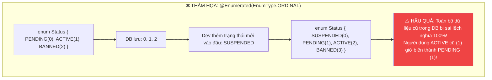
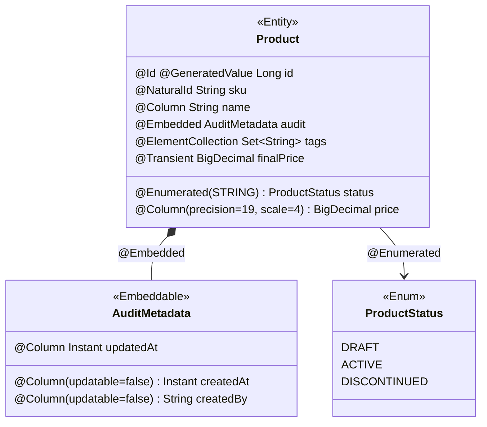

# 🏷️ Basic & Embedded Mapping (@Entity, @Table, @Id, @Column, @Embedded, @Embeddable, @ElementCollection)

> **Nguồn chính thống:** [Jakarta Persistence 3.2 Specification](https://jakarta.ee/specifications/persistence/3.2/) | [Hibernate ORM 7.x User Guide](https://docs.jboss.org/hibernate/orm/7.0/userguide/html_single/Hibernate_User_Guide.html) | [Spring Data JPA Reference](https://docs.spring.io/spring-data/jpa/reference/index.html)
>
> **Thuộc roadmap:** `5. Database → Spring Data → Spring Data JPA → Entity Mapping & Relationships → Basic & Embedded Mapping`

---

## 1. Định nghĩa chính thức từ Jakarta Persistence 3.2 Specification

> *"An **entity** is a lightweight persistent domain object. The primary programming artifact of an entity is the **entity class**. An entity class may make use of auxiliary classes that serve as helper classes or that are used to represent the **state** of the entity."*
>
> — **Jakarta Persistence 3.2 — Chapter 2: Entity Classes**

> *"An **embeddable** class is a class that is used to represent the state of an entity but which does **not** have a persistent identity of its own. Instances of an embeddable class share the identity of the entity that **owns** them."*
>
> — **Jakarta Persistence 3.2 — Chapter 2.6: Embeddable Classes**

### Dịch & giải thích đơn giản:

**Entity (Thực thể)** là một đối tượng Java nhẹ đại diện cho một bản ghi trong CSDL. Mỗi Entity class ánh xạ tới một bảng, mỗi thuộc tính (field) ánh xạ tới một cột.

**Embeddable (Đối tượng nhúng)** là một class phụ trợ **không có ID riêng** — nó chia sẻ danh tính (identity) với Entity sở hữu nó. Các thuộc tính của Embeddable trở thành các cột **ngay trong bảng** của Entity mẹ.

> **Hình dung đơn giản:**
> - `@Entity User` → Bảng `users` trong CSDL (có cột `id` riêng)
> - `@Embeddable Address` → **Không tạo bảng riêng** — các cột `street`, `city`, `zip_code` nằm luôn trong bảng `users`!

> [!IMPORTANT]
> Entity Mapping là nền tảng của mọi thứ trong JPA. Nếu bạn không hiểu rõ cách ánh xạ Java class ↔ Database table, mọi kiến thức về Repository, Query, Transaction phía sau đều sẽ không có ý nghĩa.

---

## 2. Các Annotation Ánh xạ Cơ bản (Basic Mapping)

### 2.1 `@Entity` — Đánh dấu một class là Thực thể JPA

**Theo đặc tả JPA 3.2, một Entity class BẮT BUỘC phải tuân thủ:**

| Quy tắc | Chi tiết kỹ thuật | Lý do |
| :--- | :--- | :--- |
| **Constructor no-arg** | Phải có constructor không tham số (`public` hoặc `protected`). | Hibernate sử dụng **Reflection** (`Class.getDeclaredConstructor().newInstance()`) để khởi tạo object trước khi nạp dữ liệu từ `ResultSet`. |
| **Không được `final`** | Class và các method **KHÔNG ĐƯỢC** là `final`. | Hibernate sử dụng **ByteBuddy** để tạo Proxy subclass phục vụ **Lazy Loading**. Nếu class/method là `final` → ByteBuddy không thể kế thừa → Lazy Loading thất bại! |
| **Phải có `@Id`** | Bắt buộc phải khai báo thuộc tính Khóa chính. | JPA sử dụng ID để quản lý Entity trong **Persistence Context** (Identity Map pattern). |
| **Phải là Top-level class** | Không được là inner class, enum, hoặc interface. | JPA cần class có lifecycle rõ ràng để quản lý vòng đời persist/detach/remove. |

```java
@Entity                              // ← Đánh dấu đây là Entity
@Table(name = "customers")            // ← Ánh xạ tới bảng "customers" trong CSDL
@Getter @Setter
@NoArgsConstructor(access = AccessLevel.PROTECTED) // ← Chuẩn: Constructor no-arg protected
public class Customer {

    @Id
    @GeneratedValue(strategy = GenerationType.IDENTITY)
    private Long id;

    @Column(nullable = false)
    private String fullName;
    // ...
}
```

> [!TIP]
> **Tại sao dùng `AccessLevel.PROTECTED` thay vì `public`?** Constructor `protected` ngăn chặn việc khởi tạo Entity trực tiếp bằng `new Customer()` từ code nghiệp vụ bên ngoài (vì Entity nên được tạo thông qua factory method hoặc constructor có tham số). Đồng thời, `protected` vẫn đủ cho Hibernate Reflection và ByteBuddy subclassing hoạt động bình thường.

---

### 2.2 `@Table` — Cấu hình bảng nâng cao

`@Table` không chỉ đặt tên bảng — nó cho phép định nghĩa toàn bộ cấu trúc DDL (ràng buộc và chỉ mục) ngay trong code Java:

```java
@Entity
@Table(
    name = "users",                  // Tên bảng trong CSDL
    schema = "auth_schema",          // Schema cụ thể (PostgreSQL, SQL Server)
    uniqueConstraints = {
        // Ràng buộc UNIQUE trên 1 cột
        @UniqueConstraint(name = "uk_users_email", columnNames = {"email"}),
        // Ràng buộc UNIQUE tổ hợp nhiều cột (Composite Unique)
        @UniqueConstraint(name = "uk_users_phone_country",
                          columnNames = {"phone_number", "country_code"})
    },
    indexes = {
        // Index thường (để tăng tốc tìm kiếm)
        @Index(name = "idx_users_created_at", columnList = "created_at DESC"),
        @Index(name = "idx_users_status", columnList = "status")
    }
)
public class User { ... }
```

**SQL DDL tương ứng được Hibernate sinh ra khi `ddl-auto = create`:**
```sql
CREATE TABLE auth_schema.users (
    -- ... các cột ...
    CONSTRAINT uk_users_email UNIQUE (email),
    CONSTRAINT uk_users_phone_country UNIQUE (phone_number, country_code)
);

CREATE INDEX idx_users_created_at ON auth_schema.users (created_at DESC);
CREATE INDEX idx_users_status ON auth_schema.users (status);
```

> [!NOTE]
> Nếu **không có** `@Table`, JPA mặc định sử dụng **tên class** làm tên bảng (ví dụ: class `User` → bảng `User`). Hibernate áp dụng `PhysicalNamingStrategy` để chuyển đổi sang snake_case nếu được cấu hình: `User` → `users`, `OrderItem` → `order_items`.

---

### 2.3 `@Id` — Mọi Entity đều phải có danh tính

Theo đặc tả JPA 3.2:

> *"Every entity must have a **primary key**. The primary key must be defined on the entity class that is the **root** of the entity hierarchy or on a **mapped superclass** that is a (direct or indirect) superclass of all entity classes in the entity hierarchy."*
>
> — **Jakarta Persistence 3.2 — Section 2.4: Primary Keys and Entity Identity**

`@Id` đánh dấu một thuộc tính là khóa chính. JPA sử dụng khóa chính để:
1. Xác định **danh tính duy nhất** của mỗi Entity trong Persistence Context (giống key trong HashMap).
2. Thực hiện thao tác `find()`, `merge()`, `remove()`.
3. Phân biệt entity mới (cần `INSERT`) và entity đã tồn tại (cần `UPDATE`).

```java
@Id
@GeneratedValue(strategy = GenerationType.IDENTITY)
private Long id;  // Khóa chính đơn giản nhất
```

> [!TIP]
> Chi tiết về các chiến lược sinh khóa chính (`IDENTITY`, `SEQUENCE`, `TABLE`, UUID v7), thuật toán Pooled-Lo Optimizer, cạm bẫy JDBC Batching, Composite Key, và `equals()`/`hashCode()` chuẩn Senior → Xem tài liệu chuyên sâu: [Primary Key Strategies.md](file:///d:/WebSpace/Java-Backend/05-Database/Spring-Data/Spring-Data-JPA/Entity%20Mapping%20%26%20Relationships/Primary%20Key%20Strategies.md)

---

### 2.4 `@Column` — Kiểm soát chi tiết từng cột

`@Column` cho phép kiểm soát chính xác cách mỗi thuộc tính Java ánh xạ sang cột CSDL:

| Thuộc tính | Kiểu | Ý nghĩa kỹ thuật | Mặc định |
| :--- | :---: | :--- | :---: |
| `name` | `String` | Tên cột thực tế trong bảng CSDL. | Tên field |
| `nullable` | `boolean` | `false` → ràng buộc `NOT NULL` ở mức DDL. | `true` |
| `unique` | `boolean` | Tạo ràng buộc `UNIQUE` cho cột này. | `false` |
| `length` | `int` | Độ dài tối đa cho kiểu chuỗi (`VARCHAR(length)`). | `255` |
| `precision`, `scale` | `int` | Dành cho `BigDecimal`: `precision` = tổng số chữ số, `scale` = số thập phân → `DECIMAL(19, 4)`. | `0` |
| `insertable` | `boolean` | Nếu `false`, cột bị loại khỏi câu `INSERT`. | `true` |
| `updatable` | `boolean` | Nếu `false`, cột **vĩnh viễn không bị UPDATE** dù có gọi setter. | `true` |
| `columnDefinition` | `String` | Ghi đè toàn bộ DDL của cột bằng SQL tùy chỉnh. | `""` |

```java
// ⭐ Ví dụ thực tế áp dụng các thuộc tính @Column:

@Column(name = "created_at", nullable = false, updatable = false)
private Instant createdAt;
// → NOT NULL + không bao giờ bị UPDATE (dù gọi setCreatedAt() cũng bị bỏ qua)

@Column(name = "total_amount", nullable = false, precision = 19, scale = 4)
private BigDecimal totalAmount;
// → DECIMAL(19, 4) — Chính xác tuyệt đối cho dữ liệu tài chính

@Column(name = "description", length = 2000)
private String description;
// → VARCHAR(2000) thay vì VARCHAR(255) mặc định

@Column(name = "status_updated_by", insertable = false, updatable = false)
private String statusUpdatedBy;
// → Cột chỉ đọc (Read-only) từ phía JPA, giá trị do CSDL Trigger tự gán

@Column(columnDefinition = "jsonb")
private String metadata;
// → Ghi đè DDL: Dùng kiểu jsonb của PostgreSQL thay vì VARCHAR mặc định
```

---

### 2.5 `@Enumerated` — Cạm bẫy chết người `ORDINAL` vs `STRING`

Khi ánh xạ một `Enum` trong Java xuống Database, JPA cung cấp 2 chế độ:
- `EnumType.ORDINAL` (Mặc định): Lưu chỉ số thứ tự số nguyên (0, 1, 2, ...).
- `EnumType.STRING`: Lưu tên chuỗi ký tự ("ACTIVE", "PENDING", ...).



> [!CAUTION]
> **Quy tắc bắt buộc:** **LUÔN LUÔN** sử dụng `@Enumerated(EnumType.STRING)`. Không bao giờ được dùng `ORDINAL` trên các hệ thống doanh nghiệp vì chỉ cần một đồng nghiệp vô tình đổi thứ tự enum hoặc chèn thêm giá trị mới là toàn bộ dữ liệu CSDL sẽ bị phá hủy âm thầm mà không có exception nào cảnh báo!

```java
// ✅ CHUẨN ENTERPRISE:
@Enumerated(EnumType.STRING)   // Lưu "ACTIVE", "PENDING" thay vì 0, 1
@Column(nullable = false, length = 30)
private OrderStatus status = OrderStatus.PENDING;
```

---

### 2.6 `@Temporal` & Ánh xạ kiểu Ngày/Giờ

Với **Java 8+** và **JPA 2.2+** (Jakarta Persistence 3.2), bạn nên dùng các kiểu `java.time.*` mà **không cần** `@Temporal`:

| Kiểu Java | Kiểu CSDL | Ghi chú |
| :--- | :--- | :--- |
| `Instant` ⭐ | `TIMESTAMP WITH TIME ZONE` | **Khuyến nghị** cho timestamp — luôn lưu UTC. |
| `LocalDateTime` | `TIMESTAMP` | Không có timezone — chỉ dùng khi chắc chắn không cần timezone. |
| `LocalDate` | `DATE` | Chỉ ngày, không có giờ. |
| `LocalTime` | `TIME` | Chỉ giờ, không có ngày. |
| `ZonedDateTime` | `TIMESTAMP WITH TIME ZONE` | Có timezone — nhưng `Instant` thường đủ tốt hơn. |
| `OffsetDateTime` | `TIMESTAMP WITH TIME ZONE` | Tương tự `ZonedDateTime`. |

```java
// ✅ Chuẩn hiện đại — KHÔNG cần @Temporal:
@Column(name = "created_at", nullable = false, updatable = false)
private Instant createdAt;     // Luôn lưu UTC, hiển thị theo timezone người dùng

@Column(name = "birth_date")
private LocalDate birthDate;   // Chỉ cần ngày sinh, không cần giờ

// ❌ Cách cũ (Java 7 trở về trước) — KHÔNG NÊN dùng nữa:
// @Temporal(TemporalType.TIMESTAMP)
// private java.util.Date createdAt;
```

> [!TIP]
> **Quy tắc vàng:** Luôn dùng `Instant` cho timestamp (thời điểm xảy ra sự kiện) và `LocalDate` cho ngày thuần (sinh nhật, ngày bắt đầu). Tuyệt đối **không dùng** `java.util.Date` hay `java.sql.Timestamp` trong dự án mới.

---

### 2.7 `@Lob` — Dữ liệu lớn (BLOB / CLOB)

Khi cần lưu dữ liệu lớn (văn bản dài, file nhị phân):

```java
@Lob
@Column(name = "description")
private String longDescription;  // → CLOB / TEXT trong CSDL

@Lob
@Column(name = "profile_picture")
private byte[] profilePicture;   // → BLOB / BYTEA trong CSDL
```

> [!WARNING]
> Lưu file lớn (ảnh, video) trực tiếp trong CSDL thường **không phải best practice**. Nên lưu file trên Object Storage (S3, MinIO) và chỉ lưu URL/path trong CSDL. `@Lob` phù hợp cho văn bản dài (mô tả sản phẩm, nội dung bài viết) hoặc file nhỏ (< 1MB).

---

### 2.8 `@Transient` — Thuộc tính không ánh xạ

Đánh dấu một thuộc tính **không được lưu** vào CSDL:

```java
@Entity
public class Product {
    @Id @GeneratedValue
    private Long id;

    @Column(nullable = false, precision = 19, scale = 4)
    private BigDecimal price;

    @Column(nullable = false)
    private int discountPercent;

    @Transient  // ← Không tạo cột trong DB, chỉ dùng trong Java
    private BigDecimal finalPrice;

    public BigDecimal getFinalPrice() {
        // Giá trị được tính toán runtime, không cần lưu
        return price.multiply(BigDecimal.valueOf(100 - discountPercent))
                    .divide(BigDecimal.valueOf(100));
    }
}
```

> [!NOTE]
> Có 3 cách đánh dấu transient: `@Transient` (JPA annotation), `transient` (Java keyword), và `@JsonIgnore` (Jackson — chỉ ẩn khỏi JSON, vẫn lưu DB). Để không lưu vào DB, dùng `@Transient` hoặc `transient`.

---

## 3. Embedded & Embeddable Objects (Value Objects Pattern)

### 3.1 Vấn đề: Tại sao cần Embeddable?

Giả sử bạn có Entity `Customer` với 12 cột:

```java
// ❌ Flat Entity — Khó bảo trì, vi phạm SRP (Single Responsibility Principle):
@Entity
public class Customer {
    @Id private Long id;
    private String name;
    private String email;
    // Thông tin địa chỉ giao hàng (6 fields):
    private String shippingStreet;
    private String shippingCity;
    private String shippingState;
    private String shippingZipCode;
    private String shippingCountry;
    private String shippingPhone;
    // Thông tin thanh toán (6 fields):
    private String billingStreet;
    private String billingCity;
    private String billingState;
    // ... (Lặp đi lặp lại!)
}
```

**Vấn đề:** Mỗi khi cần dùng khái niệm "Địa chỉ" ở Entity khác (`Supplier`, `Warehouse`), bạn phải **copy-paste** toàn bộ 6 fields → Vi phạm nguyên tắc DRY (Don't Repeat Yourself).

---

### 3.2 `@Embeddable` & `@Embedded` — Giải pháp chuẩn DDD

Trong Domain-Driven Design (DDD), **Value Object** là đối tượng không có danh tính riêng (không có ID), được định nghĩa hoàn toàn bởi giá trị các thuộc tính. `@Embeddable` chính là cách JPA hiện thực hóa Value Object:

```java
// ✅ Value Object: Địa chỉ không có ID riêng, gắn liền với Entity sở hữu
@Embeddable
@Getter @Setter
@NoArgsConstructor
@AllArgsConstructor
public class Address {
    private String street;
    private String city;
    private String state;

    @Column(name = "zip_code", length = 10)
    private String zipCode;

    @Column(length = 2)
    private String country;
}
```

```java
// ✅ Entity sử dụng Embeddable
@Entity
@Table(name = "customers")
public class Customer {
    @Id @GeneratedValue(strategy = GenerationType.IDENTITY)
    private Long id;

    @Column(nullable = false)
    private String name;

    @Embedded  // ← Nhúng Address vào bảng customers
    private Address homeAddress;
}
```

**Kết quả trong CSDL — CHỈ CÓ DUY NHẤT 1 BẢNG:**
```sql
CREATE TABLE customers (
    id         BIGINT PRIMARY KEY,
    name       VARCHAR(255) NOT NULL,
    street     VARCHAR(255),        -- ← Từ Address.street
    city       VARCHAR(255),        -- ← Từ Address.city
    state      VARCHAR(255),        -- ← Từ Address.state
    zip_code   VARCHAR(10),         -- ← Từ Address.zipCode
    country    VARCHAR(2)           -- ← Từ Address.country
);
-- ✅ Không có bảng "addresses" riêng biệt!
```

---

### 3.3 Tái sử dụng nhiều lần với `@AttributeOverrides`

Nếu một Entity có cả `shippingAddress` và `billingAddress`, hai đối tượng cùng kiểu `Address` sẽ bị **trùng tên cột** (`street`, `city`...). Ta dùng `@AttributeOverrides` để đổi tên cột:

```java
@Entity
@Table(name = "orders")
public class Order {
    @Id
    @GeneratedValue(strategy = GenerationType.IDENTITY)
    private Long id;

    @Embedded
    @AttributeOverrides({
        @AttributeOverride(name = "street",  column = @Column(name = "shipping_street")),
        @AttributeOverride(name = "city",    column = @Column(name = "shipping_city")),
        @AttributeOverride(name = "zipCode", column = @Column(name = "shipping_zip")),
        @AttributeOverride(name = "country", column = @Column(name = "shipping_country"))
    })
    private Address shippingAddress;

    @Embedded
    @AttributeOverrides({
        @AttributeOverride(name = "street",  column = @Column(name = "billing_street")),
        @AttributeOverride(name = "city",    column = @Column(name = "billing_city")),
        @AttributeOverride(name = "zipCode", column = @Column(name = "billing_zip")),
        @AttributeOverride(name = "country", column = @Column(name = "billing_country"))
    })
    private Address billingAddress;
}
```

**Kết quả — Vẫn chỉ 1 bảng `orders` với tên cột tùy chỉnh:**
```sql
CREATE TABLE orders (
    id                BIGINT PRIMARY KEY,
    shipping_street   VARCHAR(255),
    shipping_city     VARCHAR(255),
    shipping_zip      VARCHAR(10),
    shipping_country  VARCHAR(2),
    billing_street    VARCHAR(255),
    billing_city      VARCHAR(255),
    billing_zip       VARCHAR(10),
    billing_country   VARCHAR(2)
);
```

---

### 3.4 `@ElementCollection` & `@CollectionTable` — Lưu danh sách giá trị đơn giản

Khi bạn muốn lưu một danh sách các giá trị đơn giản (`List<String> tags`) hoặc danh sách các `@Embeddable` mà **không muốn tạo riêng một Entity có `@Id`**, hãy dùng `@ElementCollection`. JPA sẽ tạo một **bảng phụ** riêng biệt.

```java
@Entity
@Table(name = "products")
public class Product {
    @Id
    @GeneratedValue(strategy = GenerationType.IDENTITY)
    private Long id;

    private String name;

    // Lưu danh sách tags vào bảng phụ "product_tags"
    @ElementCollection(fetch = FetchType.LAZY)
    @CollectionTable(
        name = "product_tags",
        joinColumns = @JoinColumn(name = "product_id")
    )
    @Column(name = "tag_name")
    private Set<String> tags = new HashSet<>();

    // Lưu danh sách các Address (Embeddable) vào bảng phụ
    @ElementCollection
    @CollectionTable(
        name = "product_warehouses",
        joinColumns = @JoinColumn(name = "product_id")
    )
    private Set<Address> warehouseLocations = new HashSet<>();
}
```

**CSDL sinh ra 3 bảng:**
```sql
CREATE TABLE products (
    id   BIGINT PRIMARY KEY,
    name VARCHAR(255)
);

CREATE TABLE product_tags (
    product_id  BIGINT REFERENCES products(id),
    tag_name    VARCHAR(255)
);

CREATE TABLE product_warehouses (
    product_id  BIGINT REFERENCES products(id),
    street      VARCHAR(255),
    city        VARCHAR(255),
    -- ... (các cột của Address)
);
```

> [!WARNING]
> **Cạm bẫy hiệu năng nghiêm trọng khi dùng `List<T>` với `@ElementCollection`:**
>
> Khi bạn **xóa hoặc sửa** một phần tử trong `@ElementCollection` kiểu `List`, Hibernate có hành vi mặc định cực kỳ nguy hiểm:
> 1. **XÓA TOÀN BỘ** các dòng trong bảng phụ liên quan đến Entity mẹ (`DELETE FROM product_tags WHERE product_id = ?`).
> 2. **INSERT LẠI** toàn bộ danh sách từ đầu!
>
> **Lý do:** `List` cho phép phần tử trùng lặp → Hibernate không có cách nào xác định **chính xác** dòng nào cần xóa/sửa.
>
> **Giải pháp:** **Luôn sử dụng `Set<T>` thay vì `List<T>`** cho `@ElementCollection`. `Set` yêu cầu mỗi phần tử là duy nhất → Hibernate có thể xóa/sửa chính xác từng dòng.

### 3.5 `@ElementCollection` vs `@OneToMany` — Khi nào dùng cái nào?

| Tiêu chí | `@ElementCollection` | `@OneToMany` Entity |
| :--- | :--- | :--- |
| **Phần tử có ID?** | ❌ Không (Value type) | ✅ Có (`@Id`) |
| **Phần tử tồn tại độc lập?** | ❌ Không (phụ thuộc Entity mẹ) | ✅ Có thể |
| **Có thể query trực tiếp?** | ❌ Phải query qua Entity mẹ | ✅ Có Repository riêng |
| **Cascade/orphanRemoval?** | Tự động (luôn cascade) | Phải cấu hình |
| **Hiệu năng xóa/sửa** | ⚠️ Kém (DELETE all + INSERT all nếu List) | ✅ Tốt (xóa/sửa từng dòng) |
| **Dùng khi** | Tags, labels, enum list, Value Objects nhỏ | Entity con có nghiệp vụ riêng |

---

## 4. Sơ đồ tổng hợp: Mọi Annotation cùng trong 1 Entity



---

## 5. Code mẫu hoàn chỉnh chuẩn Spring Boot 4.1.0 & Java 21

Dưới đây là một Entity hoàn chỉnh áp dụng toàn bộ các thực hành tốt nhất (Best Practices):

```java
package com.example.domain;

import jakarta.persistence.*;
import lombok.AccessLevel;
import lombok.Getter;
import lombok.NoArgsConstructor;
import lombok.Setter;
import org.hibernate.annotations.NaturalId;

import java.math.BigDecimal;
import java.time.Instant;
import java.util.HashSet;
import java.util.Objects;
import java.util.Set;

@Entity
@Table(
    name = "products",
    indexes = {
        @Index(name = "idx_product_sku", columnList = "sku", unique = true),
        @Index(name = "idx_product_category", columnList = "category")
    }
)
@Getter @Setter
@NoArgsConstructor(access = AccessLevel.PROTECTED) // 1️⃣ Constructor no-arg protected cho JPA Proxy
public class Product {

    // 2️⃣ Chiến lược khóa chính: SEQUENCE + allocationSize cho JDBC Batching
    @Id
    @GeneratedValue(strategy = GenerationType.SEQUENCE, generator = "product_seq")
    @SequenceGenerator(name = "product_seq", sequenceName = "products_seq", allocationSize = 50)
    private Long id;

    // 3️⃣ NaturalId: Khóa tự nhiên bất biến để so sánh equals/hashCode an toàn
    @NaturalId
    @Column(nullable = false, unique = true, updatable = false, length = 64)
    private String sku;

    @Column(nullable = false, length = 200)
    private String name;

    // 4️⃣ Enum STRING bắt buộc
    @Enumerated(EnumType.STRING)
    @Column(nullable = false, length = 30)
    private ProductStatus status = ProductStatus.DRAFT;

    // 5️⃣ BigDecimal cho dữ liệu tài chính
    @Column(nullable = false, precision = 19, scale = 4)
    private BigDecimal price;

    // 6️⃣ Embeddable cho Value Object theo chuẩn DDD
    @Embedded
    private AuditMetadata auditMetadata = new AuditMetadata();

    // 7️⃣ ElementCollection luôn dùng Set thay vì List
    @ElementCollection
    @CollectionTable(name = "product_tags", joinColumns = @JoinColumn(name = "product_id"))
    @Column(name = "tag", length = 50)
    private Set<String> tags = new HashSet<>();

    // 8️⃣ Transient: Giá trị tính toán, không lưu DB
    @Transient
    private BigDecimal discountedPrice;

    // 9️⃣ Constructor nghiệp vụ rõ ràng
    public Product(String sku, String name, BigDecimal price) {
        this.sku = Objects.requireNonNull(sku, "SKU không được null");
        this.name = name;
        this.price = price;
    }

    // 🔟 EQUALS & HASHCODE CHUẨN: Dựa trên NaturalId bất biến
    @Override
    public boolean equals(Object o) {
        if (this == o) return true;
        if (!(o instanceof Product product)) return false;
        return Objects.equals(sku, product.sku);
    }

    @Override
    public int hashCode() {
        return Objects.hash(sku);
    }
}
```

```java
// Embeddable phụ trợ — Metadata kiểm toán tái sử dụng ở mọi Entity
@Embeddable
@Getter @Setter
public class AuditMetadata {

    @Column(name = "created_at", nullable = false, updatable = false)
    private Instant createdAt = Instant.now();

    @Column(name = "updated_at")
    private Instant updatedAt;

    @Column(name = "created_by", updatable = false, length = 100)
    private String createdBy;

    @Column(name = "updated_by", length = 100)
    private String updatedBy;
}
```

---

## 🔥 Ứng dụng thực tế (Thực tế dùng để làm gì? Giải quyết vấn đề gì?)

### Ví dụ thực tế 1: Hệ thống E-commerce — Thiết kế Entity cho sản phẩm

**Yêu cầu nghiệp vụ:** Xây dựng hệ thống quản lý sản phẩm cho sàn thương mại điện tử với hàng triệu sản phẩm.

| Quyết định thiết kế | Giải pháp | Lý do |
| :--- | :--- | :--- |
| Trạng thái sản phẩm | `@Enumerated(EnumType.STRING)` | Bảo vệ dữ liệu khi thêm trạng thái mới (`FLASH_SALE`, `PRE_ORDER`). |
| Địa chỉ kho hàng | `@Embeddable Address` + `@ElementCollection` | Một sản phẩm có thể ở nhiều kho, mỗi kho là Value Object không cần ID. |
| Thông tin kiểm toán | `@Embedded AuditMetadata` | Tái sử dụng ở mọi Entity: `Product`, `Order`, `Customer` đều embed cùng class. |
| Giá tiền | `BigDecimal` + `precision = 19, scale = 4` | Tuyệt đối không dùng `Double` cho tiền tệ (lỗi làm tròn floating-point). |
| Mô tả dài | `@Column(length = 5000)` hoặc `@Lob` | Mô tả sản phẩm có thể dài hàng nghìn ký tự. |

### Ví dụ thực tế 2: Mã nguồn sạch và tái sử dụng (DRY) với Embeddable

Sử dụng `@Embeddable` cho các khái niệm DDD như `Address`, `AuditMetadata`, `Money`, `DateRange`:

```java
// Một class Embeddable — Tái sử dụng ở 10+ Entity khác nhau:
@Embeddable
public class Money {
    @Column(precision = 19, scale = 4)
    private BigDecimal amount;

    @Column(length = 3)
    private String currency;  // "VND", "USD", "EUR"
}

@Embeddable
public class DateRange {
    @Column(nullable = false)
    private LocalDate startDate;

    private LocalDate endDate;  // null = vô thời hạn
}
```

→ Bất kỳ Entity nào cần giá tiền chỉ cần `@Embedded private Money price;` — **không cần copy-paste 2 cột**. Bất kỳ Entity nào cần khoảng thời gian chỉ cần `@Embedded private DateRange validPeriod;`.

### Ví dụ thực tế 3: Hibernate NamingStrategy — Tự động snake_case

Trong Spring Boot 4.1.0, Hibernate mặc định dùng `SpringPhysicalNamingStrategy` để tự động chuyển đổi:

```
Java field name    →    Database column name
──────────────────────────────────────────────
firstName          →    first_name
orderItems         →    order_items
createdAt          →    created_at
UserProfile (class)→    user_profile (table)
```

→ Bạn **không cần** viết `@Column(name = "first_name")` cho mỗi field nếu đã dùng NamingStrategy mặc định. Chỉ cần `@Column(name = ...)` khi muốn tên cột **khác** quy tắc snake_case.

---

## 6. Tổng hợp các chủ đề (Bản đồ tra cứu)

### 🟢 Ưu tiên phải biết trước (Bắt buộc)
1. **Các Annotation cơ bản:** `@Entity`, `@Table`, `@Id`, `@Column` — nền tảng của mọi thứ trong JPA.
2. **Quy tắc Entity class:** Constructor no-arg bắt buộc, không được `final` (vì ByteBuddy Proxy).
3. **`@Enumerated(EnumType.STRING)`:** Quy tắc bắt buộc — **KHÔNG BAO GIỜ dùng `ORDINAL`** trên production.
4. **Bản chất `@Embeddable` & `@Embedded`:** Value Object không có ID riêng, các cột nằm chung bảng với Entity mẹ.
5. **Kiểu ngày/giờ hiện đại:** Dùng `Instant` (timestamp UTC) và `LocalDate` (ngày), bỏ `java.util.Date`.

### 🟡 Nhóm trung cấp
1. **Tái sử dụng Embeddable với `@AttributeOverrides`:** Khi cùng một class Embeddable xuất hiện nhiều lần trong Entity.
2. **`@ElementCollection` + `Set<T>`:** Lưu danh sách giá trị đơn giản vào bảng phụ, luôn dùng `Set` thay vì `List` để tránh DELETE-all + INSERT-all.
3. **`@ElementCollection` vs `@OneToMany`:** Hiểu khi nào dùng Value type (Element) và khi nào cần Entity con riêng.
4. **`@Transient` vs `transient` keyword:** Cả hai đều không lưu DB, nhưng `@Transient` rõ ràng hơn cho JPA.
5. **`columnDefinition` cho DDL tùy chỉnh:** Sử dụng khi cần kiểu dữ liệu CSDL đặc biệt (`jsonb`, `uuid`, `tsvector`).

### 🔴 Nhóm nâng cao
1. **Hibernate `NamingStrategy`:** `PhysicalNamingStrategy` vs `ImplicitNamingStrategy` — kiểm soát quy tắc đặt tên bảng/cột toàn dự án.
2. **`@Lob` và dữ liệu lớn:** Trade-off giữa lưu file trong DB vs Object Storage, kỹ thuật streaming cho BLOB lớn.
3. **`@Formula` (Hibernate extension):** Cột ảo tính toán bằng SQL native mà không lưu trong DB.
4. **`@ColumnTransformer` (Hibernate extension):** Mã hóa/giải mã dữ liệu tự động khi read/write (ví dụ: AES encryption cho PII data).

---

## 📚 Tài liệu tham khảo chính thống

| Tài liệu | Link liên kết |
|---|---|
| Jakarta Persistence 3.2 — Chapter 2: Entity Classes & Annotations | [jakarta.ee/specifications/persistence/3.2](https://jakarta.ee/specifications/persistence/3.2/) |
| Hibernate ORM 7.0 User Guide — Basic Types | [docs.jboss.org/hibernate/orm/7.0 — Basic Types](https://docs.jboss.org/hibernate/orm/7.0/userguide/html_single/Hibernate_User_Guide.html#basic-types) |
| Hibernate ORM 7.0 — Naming Strategies | [docs.jboss.org/hibernate/orm/7.0 — Naming](https://docs.jboss.org/hibernate/orm/7.0/userguide/html_single/Hibernate_User_Guide.html#naming) |
| Vlad Mihalcea — How to map Date and Timestamp with JPA and Hibernate | [vladmihalcea.com/date-timestamp-jpa-hibernate](https://vladmihalcea.com/date-timestamp-jpa-hibernate/) |
| Baeldung — JPA @Embedded and @Embeddable | [baeldung.com/jpa-embedded-embeddable](https://www.baeldung.com/jpa-embedded-embeddable) |
| Baeldung — JPA @Column Annotation | [baeldung.com/jpa-column-annotation](https://www.baeldung.com/jpa-entity-table-names) |

---

> **Tài liệu tiếp theo:** [Primary Key Strategies.md](file:///d:/WebSpace/Java-Backend/05-Database/Spring-Data/Spring-Data-JPA/Entity%20Mapping%20%26%20Relationships/Primary%20Key%20Strategies.md) — Chiến lược sinh khóa chính IDENTITY, SEQUENCE, TABLE, UUID v7, Composite Key, thuật toán Pooled-Lo Optimizer, `equals()`/`hashCode()` chuẩn Senior, và `@MappedSuperclass`.
