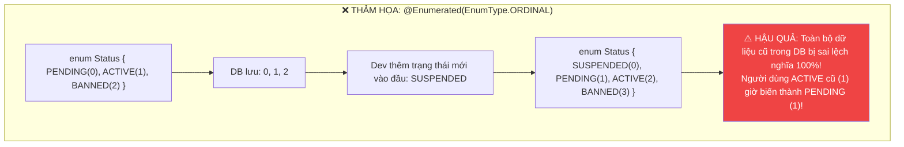
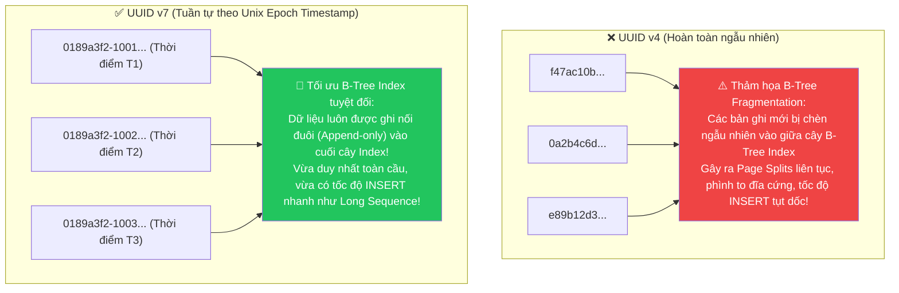

# 🏷️ Basic & Embedded Mapping & Chiến lược Khóa chính (Primary Key Strategies)

> **Nguồn chính thống:** [Jakarta Persistence 3.2 Specification](https://jakarta.ee/specifications/persistence/3.2/) | [Hibernate ORM 7.x User Guide](https://hibernate.org/orm/documentation/) | [Spring Data JPA Reference](https://docs.spring.io/spring-data/jpa/reference/index.html)
>
> **Thuộc roadmap:** `5. Database → Spring Data → Spring Data JPA → Entity Mapping & Relationships → Basic & Embedded Mapping & Primary Key Strategies`

---

## 1. Các Annotation Ánh xạ Cơ bản (Basic Mapping)

Một Entity trong JPA là một lớp Java (POJO) đại diện cho một bảng trong CSDL. Để JPA hiểu cách chuyển đổi qua lại giữa Java và Database, ta sử dụng các annotation chuẩn sau:

### 1.1 `@Entity` & Yêu cầu của JPA Proxy
- **Bản chất:** Đánh dấu một class là một Entity được quản lý bởi JPA.
- **Quy tắc bắt buộc từ đặc tả JPA:**
  1. **Bắt buộc phải có Constructor không tham số (No-arg constructor):** Có thể là `public` hoặc `protected`. Hibernate sử dụng Reflection để khởi tạo object trước khi nạp dữ liệu từ ResultSet.
  2. **Class và các method KHÔNG ĐƯỢC là `final`:** Hibernate sử dụng thư viện **ByteBuddy** để tạo các lớp con Proxy (Subclassing proxy). Nếu class hoặc method bị đánh dấu `final`, Hibernate không thể tạo Proxy để thực hiện Lazy Loading!
  3. **Bắt buộc phải có thuộc tính Khóa chính (`@Id`).**

```java
@Entity
@Table(name = "customers")
@Getter @Setter
@NoArgsConstructor(access = AccessLevel.PROTECTED) // Chuẩn: Constructor no-arg protected
public class Customer {
    @Id
    @GeneratedValue(strategy = GenerationType.IDENTITY)
    private Long id;
    // ...
}
```

---

### 1.2 `@Table` — Cấu hình bảng nâng cao
Không chỉ dừng lại ở việc đặt tên bảng, `@Table` cho phép bạn định nghĩa các ràng buộc toàn vẹn và chỉ mục CSDL ngay trong code Java:

```java
@Entity
@Table(
    name = "users",
    schema = "auth_schema", // Định danh schema (PostgreSQL)
    uniqueConstraints = {
        @UniqueConstraint(name = "uk_users_email", columnNames = {"email"}),
        @UniqueConstraint(name = "uk_users_phone_country", columnNames = {"phone_number", "country_code"})
    },
    indexes = {
        @Index(name = "idx_users_created_at", columnList = "created_at DESC"),
        @Index(name = "idx_users_status", columnList = "status")
    }
)
public class User { ... }
```

---

### 1.3 `@Column` — Định nghĩa thuộc tính chi tiết

| Thuộc tính của `@Column` | Kiểu | Ý nghĩa kỹ thuật |
| :--- | :---: | :--- |
| `name` | `String` | Tên cột thực tế trong bảng CSDL. |
| `nullable` | `boolean` | `false` tương đương ràng buộc `NOT NULL` ở mức DDL và Validation. |
| `unique` | `boolean` | Tạo ràng buộc `UNIQUE` cho cột này. |
| `length` | `int` | Độ dài tối đa cho kiểu chuỗi (`VARCHAR(length)`), mặc định là 255. |
| `precision`, `scale` | `int` | Dành cho `BigDecimal`: `precision` là tổng số chữ số, `scale` là số chữ số thập phân (`DECIMAL(19, 4)`). |
| `insertable` | `boolean` | Nếu `false`, cột này sẽ bị loại trừ khỏi câu lệnh SQL `INSERT`. |
| `updatable` | `boolean` | Nếu `false`, cột này **vĩnh viễn không bị UPDATE** dù bạn có gọi `setter` (Rất hữu ích cho cột `created_at` hoặc `user_id` sở hữu). |

```java
@Column(name = "created_at", nullable = false, updatable = false)
private Instant createdAt;

@Column(name = "total_amount", nullable = false, precision = 19, scale = 4)
private BigDecimal totalAmount;
```

---

### 1.4 `@Enumerated` — Cạm bẫy chết người `ORDINAL` vs `STRING`

Khi ánh xạ một `Enum` trong Java xuống Database, JPA cung cấp 2 chế độ:
- `EnumType.ORDINAL`: Lưu chỉ số thứ tự số nguyên của Enum (0, 1, 2, ...).
- `EnumType.STRING`: Lưu tên chuỗi ký tự của Enum ("ACTIVE", "PENDING", ...).



> [!CAUTION]
> **Quy tắc bắt buộc:** **LUÔN LUÔN** sử dụng `@Enumerated(EnumType.STRING)`. Không bao giờ được dùng `ORDINAL` trên các hệ thống doanh nghiệp vì chỉ cần một đồng nghiệp vô tình đổi thứ tự enum hoặc chèn thêm giá trị mới là toàn bộ dữ liệu CSDL sẽ bị phá hủy!

---

## 2. Embedded & Embeddable Objects (Value Objects Pattern)

Trong thiết kế phần mềm hướng miền (Domain-Driven Design - DDD), **Value Object** là những đối tượng không có danh tính độc lập (không có ID riêng) mà gắn liền với Entity mẹ.

### 2.1 `@Embeddable` & `@Embedded`
- `@Embeddable`: Đánh dấu một class là đối tượng nhúng.
- `@Embedded`: Nhúng class đó vào Entity.
- CSDL chỉ tạo **duy nhất 1 bảng**, các thuộc tính của Embeddable sẽ trở thành các cột trong bảng đó.

```java
@Embeddable
@Getter @Setter
@NoArgsConstructor
@AllArgsConstructor
public class Address {
    private String street;
    private String city;
    private String zipCode;
    private String country;
}
```

### 2.2 Tái sử dụng nhiều lần với `@AttributeOverrides`
Nếu một Entity có cả `shippingAddress` và `billingAddress`, hai đối tượng này sẽ bị trùng tên cột (`street`, `city`...). Ta dùng `@AttributeOverrides` để định nghĩa lại tên cột:

```java
@Entity
@Table(name = "orders")
public class Order {
    @Id
    @GeneratedValue(strategy = GenerationType.IDENTITY)
    private Long id;

    @Embedded
    @AttributeOverrides({
        @AttributeOverride(name = "street", column = @Column(name = "shipping_street")),
        @AttributeOverride(name = "city", column = @Column(name = "shipping_city")),
        @AttributeOverride(name = "zipCode", column = @Column(name = "shipping_zip")),
        @AttributeOverride(name = "country", column = @Column(name = "shipping_country"))
    })
    private Address shippingAddress;

    @Embedded
    @AttributeOverrides({
        @AttributeOverride(name = "street", column = @Column(name = "billing_street")),
        @AttributeOverride(name = "city", column = @Column(name = "billing_city")),
        @AttributeOverride(name = "zipCode", column = @Column(name = "billing_zip")),
        @AttributeOverride(name = "country", column = @Column(name = "billing_country"))
    })
    private Address billingAddress;
}
```

---

### 2.3 `@ElementCollection` & `@CollectionTable`
Khi bạn muốn lưu một danh sách các giá trị đơn giản (`List<String> tags`) hoặc danh sách các `@Embeddable` mà **không muốn tạo riêng một Entity có `@Id`**, hãy dùng `@ElementCollection`.

```java
@Entity
@Table(name = "products")
public class Product {
    @Id
    @GeneratedValue(strategy = GenerationType.IDENTITY)
    private Long id;

    private String name;

    @ElementCollection(fetch = FetchType.LAZY)
    @CollectionTable(
        name = "product_tags", 
        joinColumns = @JoinColumn(name = "product_id")
    )
    @Column(name = "tag_name")
    private Set<String> tags = new HashSet<>();
}
```

> [!WARNING]
> Khi bạn xóa hoặc sửa một phần tử trong `@ElementCollection` kiểu `List`, Hibernate có hành vi mặc định rất nguy hiểm: **Xóa TOÀN BỘ các dòng trong bảng phụ rồi INSERT lại từ đầu!**  
> **Giải pháp:** Luôn sử dụng `Set<T>` thay vì `List<T>` cho `@ElementCollection`.

---

## 3. Chiến lược sinh Khóa chính (Primary Key Strategies)

JPA cung cấp 4 chiến lược sinh khóa thông qua `@GeneratedValue(strategy = ...)`:

```
┌────────────────────────────────────────────────────────────────────────┐
│                        GenerationType Strategies                       │
├──────────────────┬──────────────────┬──────────────────┬───────────────┤
│    IDENTITY      │     SEQUENCE     │      TABLE       │     AUTO      │
│ (DB Auto-inc)    │ (DB Sequence)    │ (Bảng phụ - Chậm)│ (JPA tự chọn) │
└──────────────────┴──────────────────┴──────────────────┴───────────────┘
```

### 3.1 `GenerationType.IDENTITY`
- **Cơ chế:** Dựa vào cột `AUTO_INCREMENT` của MySQL hoặc `SERIAL` / `IDENTITY` của PostgreSQL. CSDL tự động sinh ID khi câu lệnh SQL `INSERT` được thực thi.
- **Ưu điểm:** Đơn giản, dễ hiểu, phù hợp dự án nhỏ.
- **Nhược điểm chí mạng (Senior Gotcha):**
  - JPA bắt buộc phải có ID để nạp Entity vào Persistence Context (Identity Map).
  - Vì vậy, khi gọi `em.persist(entity)`, Hibernate **bị ép buộc phải gửi ngay lập tức lệnh INSERT xuống DB** để lấy ID về.
  - **Hậu quả:** Hoàn toàn phá vỡ cơ chế trì hoãn ghi (Write-Behind) và **vô hiệu hóa 100% JDBC Batching**!

---

### 3.2 `GenerationType.SEQUENCE` ⭐ (Chuẩn Enterprise Khuyên dùng)
- **Cơ chế:** Dựa vào đối tượng `SEQUENCE` độc lập trong CSDL (PostgreSQL, Oracle, SQL Server).
- **Thuật toán tối ưu HiLo / Pooled-Lo Optimizer:**
  - Nhờ tham số `allocationSize = 50`, Hibernate chỉ cần gọi `SELECT nextval('my_seq')` **đúng 1 lần để lấy trước một dải 50 ID**.
  - Sau đó, 49 lệnh `persist()` tiếp theo Hibernate tự sinh ID trên bộ nhớ RAM mà **không cần chạm vào CSDL**!
  - **Ưu điểm vượt trội:** Giữ nguyên vẹn tính năng Write-Behind và hỗ trợ hoàn hảo **JDBC Batching** hàng chục nghìn bản ghi.

```java
@Id
@GeneratedValue(strategy = GenerationType.SEQUENCE, generator = "order_seq_gen")
@SequenceGenerator(
    name = "order_seq_gen",
    sequenceName = "orders_id_seq",
    initialValue = 1,
    allocationSize = 50 // Lấy trước 50 ID mỗi lần gọi CSDL
)
private Long id;
```

---

### 3.3 Chuẩn hiện đại: UUID v7 (Time-Ordered Epoch UUID) trong Hibernate 7 & Spring Boot 4.1.0

Trong kiến trúc phân tán (Microservices), dùng khóa chính tự tăng (`Long IDENTITY / SEQUENCE`) có các nhược điểm:
1. Dễ bị tấn công Enumeration Attack (Kẻ gian đoán được ID: `/api/orders/101`, `/api/orders/102`).
2. Khó phân tán dữ liệu khi chia Sharding hoặc Multi-Database.

Tuy nhiên, nếu dùng **UUID v4 (Random)** truyền thống, bạn sẽ gặp thảm họa hiệu năng B-Tree Index:



#### Cấu hình UUID v7 chuẩn trong Hibernate 7 / Spring Boot 4.1.0:
Từ Hibernate 6.5+ và Hibernate 7.x, Hibernate đã tích hợp sẵn generator cho **UUID v7**:

```java
@Entity
@Table(name = "invoices")
public class Invoice {

    @Id
    @GeneratedValue(generator = "uuid7-generator")
    @org.hibernate.annotations.GenericGenerator(
        name = "uuid7-generator",
        type = org.hibernate.id.uuid.UuidGenerator.class,
        parameters = @org.hibernate.annotations.Parameter(
            name = "uuid_gen_strategy",
            value = "org.hibernate.id.uuid.CustomVersionSevenStrategy"
        )
    )
    @Column(columnDefinition = "uuid", updatable = false, nullable = false)
    private UUID id;

    private String invoiceNumber;
    private BigDecimal amount;
    // ...
}
```

---

## 4. Code mẫu hoàn chỉnh chuẩn Spring Boot 4.1.0 & Java 21

Dưới đây là một Entity hoàn chỉnh áp dụng toàn bộ các thực hành tốt nhất (Best Practices) của Senior:

```java
package com.example.domain;

import jakarta.persistence.*;
import lombok.AccessLevel;
import lombok.Getter;
import lombok.NoArgsConstructor;
import lombok.Setter;
import org.hibernate.annotations.NaturalId;

import java.math.BigDecimal;
import java.time.Instant;
import java.util.HashSet;
import java.util.Objects;
import java.util.Set;
import java.util.UUID;

@Entity
@Table(
    name = "products",
    indexes = {
        @Index(name = "idx_product_sku", columnList = "sku", unique = true),
        @Index(name = "idx_product_category", columnList = "category")
    }
)
@Getter @Setter
@NoArgsConstructor(access = AccessLevel.PROTECTED) // Bảo vệ Constructor cho JPA Proxy
public class Product {

    @Id
    @GeneratedValue(strategy = GenerationType.SEQUENCE, generator = "product_seq")
    @SequenceGenerator(name = "product_seq", sequenceName = "products_seq", allocationSize = 50)
    private Long id;

    @NaturalId // Khóa tự nhiên bất biến để so sánh equals/hashCode an toàn
    @Column(nullable = false, unique = true, updatable = false, length = 64)
    private String sku;

    @Column(nullable = false, length = 200)
    private String name;

    @Enumerated(EnumType.STRING) // BẮT BUỘC dùng STRING
    @Column(nullable = false, length = 30)
    private ProductStatus status = ProductStatus.DRAFT;

    @Column(nullable = false, precision = 19, scale = 4)
    private BigDecimal price;

    @Embedded
    private AuditMetadata auditMetadata = new AuditMetadata();

    @ElementCollection
    @CollectionTable(name = "product_tags", joinColumns = @JoinColumn(name = "product_id"))
    @Column(name = "tag", length = 50)
    private Set<String> tags = new HashSet<>(); // Luôn dùng Set cho ElementCollection

    public Product(String sku, String name, BigDecimal price) {
        this.sku = Objects.requireNonNull(sku, "SKU không được null");
        this.name = name;
        this.price = price;
    }

    // ⭐ EQUALS VÀ HASHCODE CHUẨN SENIOR (Dựa trên NaturalId bất biến)
    @Override
    public boolean equals(Object o) {
        if (this == o) return true;
        if (!(o instanceof Product product)) return false;
        return Objects.equals(sku, product.sku);
    }

    @Override
    public int hashCode() {
        return Objects.hash(sku);
    }
}
```

---

## 🔥 Ứng dụng thực tế (Thực tế dùng để làm gì? Giải quyết vấn đề gì?)

1. **Bảo vệ toàn vẹn dữ liệu qua nhiều năm:** Dùng `@Enumerated(EnumType.STRING)` và `@Column(updatable = false)` giúp dữ liệu tài chính, ngày tạo đơn hàng không bao giờ bị biến đổi hoặc lỗi logic khi mở rộng hệ thống.
2. **Tối ưu hóa B-Tree Index cho Microservices:** Chuyển đổi từ UUID v4 ngẫu nhiên sang **UUID v7 tuần tự** giúp giảm 70% dung lượng phân mảnh index, tăng tốc độ chèn dữ liệu lên gấp 3 lần trong các hệ thống ghi lớn.
3. **Mã nguồn sạch và tái sử dụng cao (DRY):** Sử dụng `@Embeddable` cho các khái niệm như `Address`, `AuditMetadata`, `Money` giúp gom nhóm logic nghiệp vụ chặt chẽ theo chuẩn Domain-Driven Design (DDD).

---

## 5. Tổng hợp các chủ đề (Bản đồ tra cứu)

### 🟢 Ưu tiên phải biết trước (Bắt buộc)
- Các Annotation cơ bản: `@Entity`, `@Table`, `@Id`, `@Column`.
- Bắt buộc phải có Constructor no-arg và không được khai báo class/method là `final`.
- Quy tắc bắt buộc: Luôn sử dụng `@Enumerated(EnumType.STRING)` thay vì `ORDINAL`.
- Bản chất và cách dùng `@Embeddable` & `@Embedded`.

### 🟡 Nhóm trung cấp
- Cách giải quyết trùng tên cột với `@AttributeOverrides`.
- Lưu trữ danh sách giá trị phụ với `@ElementCollection` (Tại sao nên dùng `Set` thay vì `List`).
- Phân biệt chi tiết 4 chiến lược sinh khóa: `IDENTITY`, `SEQUENCE`, `TABLE`, `AUTO`.
- Tối ưu hóa Sequence với `allocationSize` (HiLo algorithm).

### 🔴 Nhóm nâng cao
- Bản chất tại sao `IDENTITY` phá vỡ Write-Behind và JDBC Batching.
- Hiện tượng B-Tree Index Fragmentation khi dùng UUID v4 và giải pháp **UUID v7 Time-Ordered** trong Hibernate 7.
- Thiết kế `equals()` và `hashCode()` cho Entity dựa trên `@NaturalId` để an toàn tuyệt đối với `HashSet` và `HashMap`.

---

## 📚 Tài liệu tham khảo chính thống

| Tài liệu | Link liên kết |
|---|---|
| Jakarta Persistence 3.2 — Chapter 2: Entity Classes & Annotations | [jakarta.ee/specifications/persistence/3.2](https://jakarta.ee/specifications/persistence/3.2/) |
| Hibernate ORM 7.0 User Guide — Identifiers & Generators | [docs.jboss.org/hibernate/orm/7.0/userguide/html_single/Hibernate_User_Guide.html#identifiers](https://docs.jboss.org/hibernate/orm/7.0/userguide/html_single/Hibernate_User_Guide.html#identifiers) |
| Vlad Mihalcea — Why you should use UUID v7 in database | [vladmihalcea.com/uuid-database-primary-key/](https://vladmihalcea.com/uuid-database-primary-key/) |
| Vlad Mihalcea — How to implement equals and hashCode for JPA Entities | [vladmihalcea.com/how-to-implement-equals-and-hashcode-using-the-jpa-entity-identifier/](https://vladmihalcea.com/how-to-implement-equals-and-hashcode-using-the-jpa-entity-identifier/) |

---

> **Tài liệu tiếp theo:** [Relationship Mappings (@OneToOne, @OneToMany, @ManyToOne, @ManyToMany).md](file:///d:/WebSpace/Java-Backend/05-Database/Spring-Data/Spring-Data-JPA/Relationship%20Mappings%20%28@OneToOne,%20@OneToMany,%20@ManyToOne,%20@ManyToMany%29.md) — Đi sâu vào nghệ thuật ánh xạ quan hệ bảng, khái niệm Owning Side và Helper Methods.
