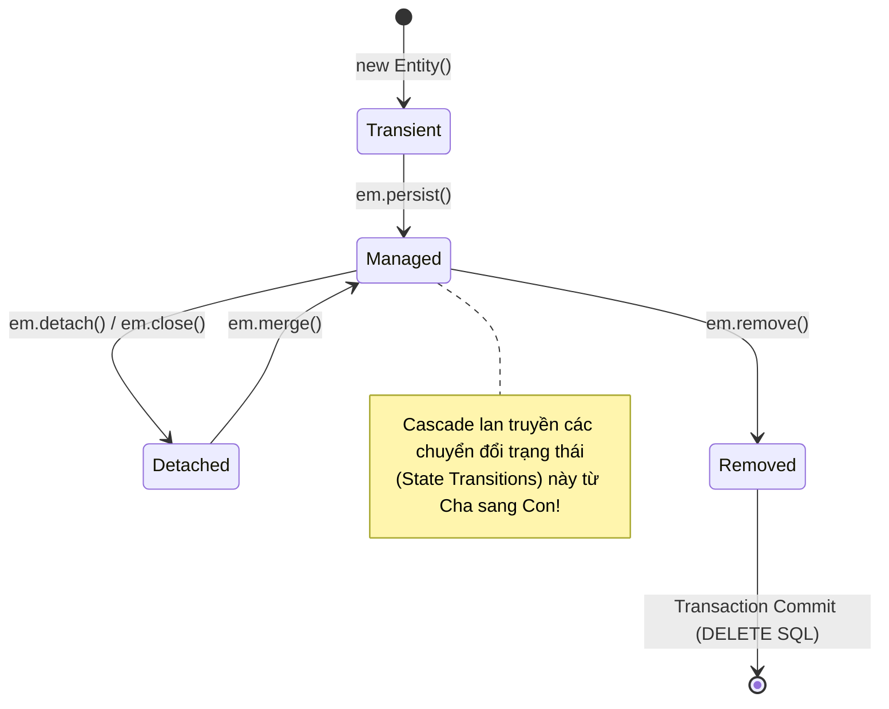
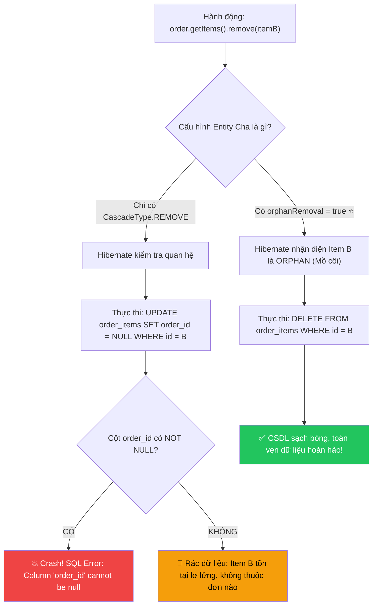
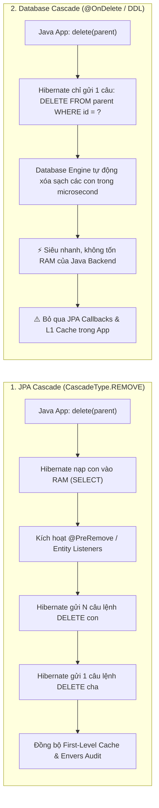
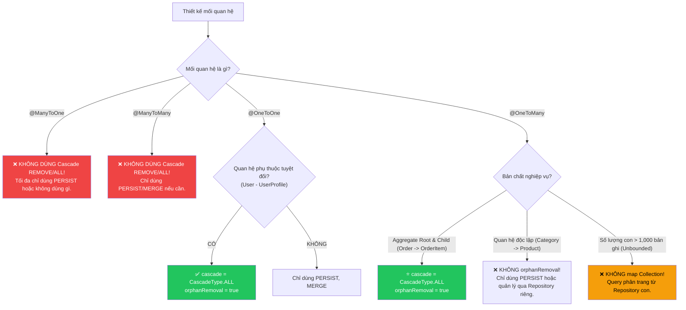

# 🌊 Cascade Types trong JPA & orphanRemoval: Cơ chế Lan truyền Thao tác & Quản lý Bản ghi Mồ côi

> **Nguồn chính thống:** [Jakarta Persistence 3.2 Specification — Chapter 3.2.7: Cascading Operations](https://jakarta.ee/specifications/persistence/3.2/) | [Hibernate ORM 7.x User Guide — Cascading Operations](https://docs.jboss.org/hibernate/orm/7.0/userguide/html_single/Hibernate_User_Guide.html#pc-cascade) | [Spring Data JPA Reference](https://docs.spring.io/spring-data/jpa/reference/index.html)
>
> **Thuộc roadmap:** `5. Database → Spring Data → Spring Data JPA → Entity Mapping & Relationships → Cascade Types & orphanRemoval`
>
> **Môi trường & Công nghệ:** Java 21+ | Spring Boot 4.1.0 | Spring Framework 7.0.8 | Hibernate ORM 7.x | Jakarta Persistence 3.2

---

## 1. Định nghĩa chính thức từ Jakarta Persistence 3.2 Specification & Hibernate ORM 7.x

### 1.1 Trích dẫn chuẩn đặc tả (Specification)

> *"An entity relationship may be configured for cascade operation: **`CascadeType.PERSIST`**, **`CascadeType.MERGE`**, **`CascadeType.REMOVE`**, **`CascadeType.REFRESH`**, or **`CascadeType.DETACH`**. The cascade operations correspond to the operations of the `EntityManager` interface: `persist`, `merge`, `remove`, `refresh`, and `detach`."*
>
> — **Jakarta Persistence 3.2 — Section 3.2.7: Cascading Operations**

> *"Cascade configuration provides cascading of entity state transitions. It allows you to propagate the state change applied to a parent entity across to its associated child entities without having to invoke the operation on each associated entity explicitly."*
>
> — **Hibernate ORM 7.0 User Guide — Section 3.3: Cascading**

### 1.2 Dịch & giải thích cốt lõi

Trong mô hình hướng đối tượng (OOP), các đối tượng liên kết với nhau thành một đồ thị đối tượng (**Object Graph**). Khi bạn tác động lên đối tượng gốc (Entity Cha), bạn có muốn thao tác đó **tự động lan truyền (Cascade)** xuống các đối tượng phụ thuộc (Entity Con) hay không?

- **Không có Cascade:** Bạn phải thủ công gọi `save()`, `delete()`, hoặc `merge()` cho từng Entity con một cách riêng lẻ.
- **Có Cascade:** Bạn chỉ cần thao tác trên Entity Cha, Hibernate sẽ **tự động phân tích đồ thị liên kết** và áp dụng hành vi tương ứng xuống toàn bộ các Entity con.



> [!IMPORTANT]
> **Cascade trong JPA chỉ có tác dụng trong bộ nhớ (Java Persistence Context)**: Nó điều khiển cách các trạng thái thực thể chuyển dịch trong EntityManager. Nó **hoàn toàn khác** với ràng buộc `ON DELETE CASCADE` ở mức CSDL quan hệ vật lý.

---

## 2. Chi tiết từng `CascadeType` trong JPA (`jakarta.persistence.CascadeType`)

Jakarta Persistence cung cấp Enum `jakarta.persistence.CascadeType` bao gồm 6 giá trị:

| Giá trị CascadeType | Thao tác EntityManager tương ứng | Hành vi lan truyền sang Entity Con | Kịch bản sử dụng phổ biến |
| :--- | :--- | :--- | :--- |
| **`PERSIST`** | `em.persist(parent)` | Khi cha chuyển từ **Transient → Managed** (chuẩn bị INSERT), các con cũng được chuyển sang **Managed** và được INSERT. | Tạo mới toàn bộ cây đối tượng (Order + OrderItems). |
| **`MERGE`** | `em.merge(parent)` | Khi cha ở trạng thái **Detached** được merge lại vào Persistence Context (chuẩn bị UPDATE), các con cũng được merge theo. | Cập nhật dữ liệu nhận từ DTO/API bên ngoài. |
| **`REMOVE`** | `em.remove(parent)` | Khi cha bị xóa (chuẩn bị DELETE), tất cả các con liên kết với cha cũng bị chuyển sang **Removed** và bị DELETE. | Xóa bài viết xóa kèm tất cả bình luận độc quyền của bài đó. |
| **`REFRESH`** | `em.refresh(parent)` | Nạp lại trạng thái mới nhất của cha từ CSDL, đồng thời nạp lại toàn bộ trạng thái của các con từ CSDL. | Hoàn tác các sửa đổi tạm thời trong RAM bằng dữ liệu thật từ DB. |
| **`DETACH`** | `em.detach(parent)` | Tách cha ra khỏi Persistence Context (không theo dõi dirty checking nữa), các con cũng bị tách ra theo. | Giải phóng bộ nhớ RAM khi xử lý batch lớn. |
| **`ALL`** | Tất cả các hàm trên | Tương đương việc bật đồng thời cả 5 loại: `PERSIST, MERGE, REMOVE, REFRESH, DETACH`. | Mối quan hệ Aggregate Root mật thiết (Cha sinh con, Cha chết con chết). |

---

### 2.1 `CascadeType.PERSIST` — Lan truyền lưu mới (INSERT)

Khi bạn tạo một thực thể cha mới và gán các thực thể con mới vào, bạn chỉ cần gọi lệnh lưu đối tượng cha. Hibernate sẽ duyệt cây quan hệ và tự động sinh câu lệnh `INSERT` cho cả các đối tượng con.

```mermaid
sequenceDiagram
    autonumber
    participant App as Service Layer
    participant EM as EntityManager / Hibernate
    participant DB as Database

    Note over App: Order order = new Order();<br>order.addItem(new OrderItem("MacBook", 1));
    App->>EM: orderRepository.save(order)
    Note over EM: CascadeType.PERSIST phát hiện<br>OrderItem đang Transient!
    EM->>DB: 1. INSERT INTO orders (id, code) VALUES (1, 'ORD-001')
    EM->>DB: 2. INSERT INTO order_items (id, order_id, name) VALUES (10, 1, 'MacBook')
    Note over DB: ✅ Cả Order và OrderItem được lưu thành công!
```

```java
// Khai báo trên Entity Cha:
@OneToMany(mappedBy = "order", cascade = CascadeType.PERSIST)
private List<OrderItem> items = new ArrayList<>();
```

> [!NOTE]
> Nếu **không cấu hình** `CascadeType.PERSIST` (hoặc `ALL`) mà bạn chỉ lưu cha trong khi con là thực thể mới (`Transient`), Hibernate sẽ ném ngay ngoại lệ:
> `org.hibernate.TransientPropertyValueException: object references an unsaved transient instance - save the transient instance before flushing`.

---

### 2.2 `CascadeType.MERGE` — Lan truyền cập nhật (UPDATE & Re-attachment)

Trong các ứng dụng REST API hiện đại (Spring Boot), dữ liệu gửi lên từ Client thường được chuyển đổi thành Entity nhưng ở trạng thái **Detached** (nằm ngoài Transaction và Persistence Context trước đó).

Khi bạn gọi `orderRepository.save(detachedOrder)` (bản chất bên trong Spring Data JPA là gọi `em.merge()` nếu Entity đã có ID):
- Hibernate kiểm tra Entity Cha và kéo bản ghi hiện tại từ DB vào Persistence Context.
- Nhờ `CascadeType.MERGE`, Hibernate tiếp tục duyệt qua danh sách `items`, tìm các `OrderItem` tương ứng trong DB để đồng bộ các trường đã thay đổi.

```java
@OneToMany(mappedBy = "order", cascade = {CascadeType.PERSIST, CascadeType.MERGE})
private List<OrderItem> items = new ArrayList<>();
```

> [!WARNING]
> **Cạm bẫy hiệu năng của `CascadeType.MERGE`:** Khi gọi `merge()`, Hibernate bắt buộc phải thực hiện các câu lệnh `SELECT` để kiểm tra xem từng Entity con đã tồn tại trong CSDL hay chưa trước khi quyết định chạy `INSERT` hay `UPDATE`. Nếu danh sách con có hàng trăm phần tử, bạn có thể vô tình kích hoạt hàng loạt câu SELECT độc lập.

---

### 2.3 `CascadeType.REMOVE` — Lan truyền thao tác xóa (DELETE Cha kéo theo Con)

Khi đối tượng cha bị xóa, toàn bộ đối tượng con liên kết cũng sẽ bị đánh dấu xóa và sinh câu lệnh `DELETE` tương ứng khi Transaction commit.

```java
@OneToMany(mappedBy = "order", cascade = CascadeType.REMOVE)
private List<OrderItem> items = new ArrayList<>();
```

**Thứ tự thực thi SQL của Hibernate (ActionQueue):**
```sql
-- 1. Xóa tất cả các con trước để tránh lỗi Foreign Key Constraint
DELETE FROM order_items WHERE id = 10;
DELETE FROM order_items WHERE id = 11;

-- 2. Sau khi dọn sạch con, mới xóa bảng cha
DELETE FROM orders WHERE id = 1;
```

> [!CAUTION]
> `CascadeType.REMOVE` chỉ hoạt động khi bạn **xóa bản ghi Cha**. Nó **KHÔNG HỀ** có tác dụng nếu bạn chỉ gỡ phần tử con ra khỏi danh sách của cha trong bộ nhớ RAM! Đây là lý do khái niệm `orphanRemoval` ra đời.

---

### 2.4 `CascadeType.REFRESH` & `CascadeType.DETACH`

#### `CascadeType.REFRESH`
Hữu ích khi bạn đang chạy một transaction dài hoặc có các tiến trình ngầm (Database Triggers, Batch Jobs) vừa cập nhật dữ liệu trực tiếp trong CSDL:
```java
// Đồng bộ lại toàn bộ Order và các OrderItem tương ứng với DB:
entityManager.refresh(order); 
```
Mọi thay đổi chưa flush trong RAM của cả Cha và Con sẽ bị hủy bỏ, nạp lại đúng giá trị từ các cột trong CSDL.

#### `CascadeType.DETACH`
Khi bạn muốn gỡ thực thể cha ra khỏi bộ theo dõi (Dirty Checking) của Hibernate để tiết kiệm RAM hoặc ngăn ngừa việc tự động lưu ngoài ý muốn:
```java
entityManager.detach(order);
```
Cả `order` và toàn bộ các `order.getItems()` đều chuyển sang trạng thái **Detached**. Bạn có thể thoải mái sửa đổi thuộc tính của chúng trong RAM mà Hibernate sẽ không tự động `UPDATE` xuống DB khi kết thúc hàm.

---

## 3. Bản chất của `orphanRemoval = true` & So sánh Sống Còn với `CascadeType.REMOVE`

Đây là chủ đề gây nhầm lẫn nhiều nhất trong các buổi phỏng vấn Senior Java/Spring Backend và là nguyên nhân của rất nhiều lỗi rò rỉ dữ liệu mồ côi trong database.

### 3.1 Bản ghi mồ côi (Orphan Entity) là gì?

> **Định nghĩa:** Một bản ghi con được gọi là **mồ côi (orphan)** khi nó bị **cắt đứt tham chiếu** khỏi đối tượng cha sở hữu nó trong bộ nhớ Java (ví dụ: bị xóa khỏi `List`/`Set` của cha), trong khi bản thân đối tượng cha vẫn còn tồn tại.

```java
// Ví dụ thực tế: Khách hàng bỏ 1 món hàng ra khỏi đơn hàng
Order order = orderRepository.findById(1L).orElseThrow();

// Lấy item ra khỏi danh sách
OrderItem itemToRemove = order.getItems().get(0);
order.getItems().remove(itemToRemove);

orderRepository.save(order);
// Chuyện gì xảy ra với itemToRemove trong Database?
```

### 3.2 Bảng so sánh đối đầu toàn diện: `CascadeType.REMOVE` vs `orphanRemoval = true`

| Tình huống thực tế | Chỉ có `cascade = CascadeType.REMOVE` | Có `orphanRemoval = true` |
| :--- | :--- | :--- |
| **Kịch bản 1: Xóa Cha**<br>`orderRepository.delete(order)` | ✅ **Xóa cả con:** Hibernate chạy `DELETE` toàn bộ items, sau đó `DELETE` order. | ✅ **Xóa cả con:** Hibernate chạy `DELETE` toàn bộ items, sau đó `DELETE` order. |
| **Kịch bản 2: Gỡ con khỏi danh sách**<br>`order.getItems().remove(item)` | ❌ **KHÔNG XÓA CON!**<br>Hibernate chỉ cố gắng chạy `UPDATE order_items SET order_id = NULL WHERE id = ...`.<br>⚠️ Nếu cột `order_id` có ràng buộc `NOT NULL`, hệ thống **ném lỗi `DataIntegrityViolationException` ngay lập tức**! Nếu cho phép NULL, item biến thành **bản ghi rác mồ côi vĩnh viễn** trong CSDL! | ⭐ **TỰ ĐỘNG XÓA CON KHỎI DB!**<br>Hibernate phát hiện item không còn cha sở hữu nữa và tự động sinh câu lệnh: <br>`DELETE FROM order_items WHERE id = ?`. |
| **Kịch bản 3: Xóa sạch danh sách**<br>`order.getItems().clear()` | ❌ Không xóa con trong DB. Sinh UPDATE set FK = NULL hoặc crash ứng dụng. | ⭐ Tự động sinh `DELETE FROM order_items WHERE order_id = 1` dọn dẹp sạch sẽ. |
| **Bản chất ý nghĩa nghiệp vụ** | Lan truyền hành động xóa từ đỉnh xuống đáy. | Quản lý **sự phụ thuộc vòng đời độc quyền** (Composition / Aggregate Boundary). Con không có lý do để tồn tại nếu không thuộc về cha! |

---

### 3.3 Sơ đồ trực quan hóa cơ chế `orphanRemoval`



---

### 3.4 Cạm bẫy chết người: Gán đè Collection mới khi có `orphanRemoval = true`

Hãy quan sát đoạn code tưởng chừng vô hại này:

```java
// ❌ CẠM BẪY CHẾT NGƯỜI:
@Transactional
public void updateOrderItems(Long orderId, List<OrderItem> newItems) {
    Order order = orderRepository.findById(orderId).orElseThrow();

    // Lập trình viên lười biếng gán đè collection mới:
    order.setItems(newItems); 
    
    orderRepository.save(order);
}
```

**Hậu quả thảm khốc:**
1. **Mất cơ chế theo dõi của Hibernate:** Khi nạp Entity, Hibernate bọc danh sách `items` bằng class nội bộ của nó là `org.hibernate.collection.spi.PersistentBag`. Khi bạn gọi `order.setItems(newItems)`, bạn đã thay thế `PersistentBag` bằng một `ArrayList` thông thường!
2. **Kích hoạt xóa nhầm dữ liệu:** Với `orphanRemoval = true`, Hibernate coi **toàn bộ các phần tử cũ trong `PersistentBag` ban đầu đều là trẻ mồ côi**! Kết quả là Hibernate sẽ phát lệnh `DELETE` toàn bộ các phần tử cũ trước khi insert các phần tử mới, hoặc ném ngoại lệ:
   `org.hibernate.HibernateException: A collection with cascade="all-delete-orphan" was no longer referenced by the owning entity instance`.

> [!TIP]
> **Quy tắc bất biến:** Tuyệt đối không viết hàm setter cho Collection (`setItems(...)`). Nếu muốn thay đổi toàn bộ danh sách, hãy dùng phương thức `clear()` và `addAll()`, hoặc sử dụng Helper Method:
> ```java
> public void replaceItems(List<OrderItem> newItems) {
>     this.items.clear();
>     if (newItems != null) {
>         newItems.forEach(this::addItem);
>     }
> }
> ```

---

## 4. JPA Cascade vs CSDL `ON DELETE CASCADE` (`@OnDelete`)

Nhiều lập trình viên đặt câu hỏi: *"Tại sao không đặt thẳng `ON DELETE CASCADE` trong câu lệnh DDL của CSDL (hoặc qua Flyway/Liquibase) mà phải cấu hình `CascadeType.REMOVE` trong JPA?"*

Dưới đây là sự khác biệt bản chất giữa 2 cơ chế:



### 4.1 Bảng so sánh chi tiết

| Đặc điểm | JPA `CascadeType.REMOVE` | Database `ON DELETE CASCADE` (`@OnDelete`) |
| :--- | :--- | :--- |
| **Nơi thực thi** | Tầng ứng dụng (Hibernate ORM Engine). | Trực tiếp trong nhân CSDL (PostgreSQL, MySQL, Oracle Engine). |
| **Số câu lệnh SQL phát sinh** | **N + 1 câu SQL:** Phải `SELECT` kéo toàn bộ con vào RAM, sau đó chạy `N` câu `DELETE con`, rồi mới `1` câu `DELETE cha`. | **1 câu SQL duy nhất:** `DELETE FROM parent WHERE id = ?`. CSDL tự xử lý phần còn lại. |
| **Tốc độ & Tiêu tốn RAM** | Chậm và tốn RAM nếu số lượng con lớn (hàng nghìn con). | **Cực nhanh (Blazing fast)**, không tốn tài nguyên ứng dụng. |
| **JPA Lifecycle Callbacks (`@PreRemove`, `@PostRemove`)** | ✅ **Được kích hoạt đầy đủ** cho cả Cha và từng thực thể Con. | ❌ **Bị bỏ qua hoàn toàn** đối với các thực thể Con. |
| **Hibernate Envers (Audit Logging)** | ✅ Ghi nhận được lịch sử xóa của từng con. | ❌ Không ghi được audit log cho các con bị xóa ngầm dưới DB. |
| **First-Level Cache (Persistence Context)** | ✅ Bộ nhớ đệm cấp 1 đồng bộ chuẩn xác. | ⚠️ Persistence Context có thể giữ trạng thái cũ (Stale Object) nếu session còn mở. |
| **Cách khai báo** | `@OneToMany(cascade = CascadeType.REMOVE)` | `@OnDelete(action = OnDeleteAction.CASCADE)` *(Hibernate Annotation)* kết hợp DDL DB. |

---

## 5. Các Cạm bẫy Chết người (Production Anti-patterns)

### 5.1 Cạm bẫy 1: Đặt `CascadeType.REMOVE` hoặc `CascadeType.ALL` trên `@ManyToOne` ❌

Đây là một trong những **thảm họa kinh hoàng nhất** trong thế giới JPA.

Hãy tưởng tượng bạn có quan hệ giữa `Department` (Phòng ban) và `Employee` (Nhân viên). Một phòng ban có nhiều nhân viên.

```java
// ❌ THẢM HỌA: Cấu hình CascadeType.ALL trên @ManyToOne!
@Entity
public class Employee {
    @Id @GeneratedValue
    private Long id;
    private String name;

    @ManyToOne(fetch = FetchType.LAZY, cascade = CascadeType.ALL) // ☠️ NGUY HIỂM CHẾT NGƯỜI
    @JoinColumn(name = "department_id")
    private Department department;
}
```

**Kịch bản xảy ra sự cố:**
1. Một nhân viên thử việc nghỉ việc, HR gọi hàm `employeeRepository.delete(internEmployee)`.
2. Do có `cascade = CascadeType.ALL` (bao gồm `REMOVE`) ở phía `@ManyToOne`, Hibernate suy luận: *"Muốn xóa Employee này thì phải xóa luôn Department của nó!"*.
3. Hibernate phát lệnh: `DELETE FROM departments WHERE id = ...`.
4. Nếu bảng `departments` có cascade xuống các nhân viên khác, **toàn bộ phòng ban và hàng trăm nhân sự khác trong công ty sẽ bị xóa sạch khỏi database** chỉ vì một bạn thực tập sinh nghỉ việc!

> [!CAUTION]
> **Quy tắc vàng:** **TUYỆT ĐỐI KHÔNG BAO GIỜ** đặt `CascadeType.REMOVE` hoặc `CascadeType.ALL` trên `@ManyToOne`! Mối quan hệ `@ManyToOne` chỉ là bên tham chiếu (Child trỏ tới Parent), con không bao giờ có quyền xóa cha.

---

### 5.2 Cạm bẫy 2: Đặt `CascadeType.REMOVE` trên `@ManyToMany` ❌

Xem xét mối quan hệ nhiều-nhiều giữa `Post` (Bài viết) và `Tag` (Thẻ nhãn, ví dụ: `#java`, `#spring`):

```java
// ❌ CẠM BẪY: Xóa bài viết kéo theo xóa luôn Tag dùng chung
@Entity
public class Post {
    @Id @GeneratedValue
    private Long id;

    @ManyToMany(cascade = CascadeType.ALL) // ☠️ Bao gồm REMOVE!
    @JoinTable(name = "post_tags", ...)
    private Set<Tag> tags = new HashSet<>();
}
```

**Hậu quả:** Khi tác giả xóa bài viết `Post A`, do có cascade REMOVE sang `Tag`, Hibernate sẽ xóa luôn tag `#java` trong bảng `tags`. Kết quả là hàng nghìn bài viết khác (`Post B`, `Post C`) đang gắn nhãn `#java` sẽ bị lỗi khóa ngoại hoặc mất toàn bộ nhãn liên kết!

> [!IMPORTANT]
> Trong quan hệ `@ManyToMany`, chỉ nên dùng `cascade = {CascadeType.PERSIST, CascadeType.MERGE}` (hoặc không dùng cascade nào). Tuyệt đối **không bao giờ** dùng `CascadeType.REMOVE` hay `CascadeType.ALL`!

---

### 5.3 Cạm bẫy 3: Lan truyền trên Unbounded Collections (Tập hợp vô hạn) ❌

Xem xét trường hợp một khách hàng (`Customer`) có hàng chục nghìn lịch sử giao dịch (`Transaction`):

```java
@Entity
public class Customer {
    @Id @GeneratedValue
    private Long id;

    // ❌ CẠM BẪY BỘ NHỚ:
    @OneToMany(mappedBy = "customer", cascade = CascadeType.ALL)
    private List<BankTransaction> transactions = new ArrayList<>();
}
```

Nếu một khách hàng có 200,000 giao dịch:
- Mỗi khi bạn lưu hoặc cập nhật thông tin địa chỉ của `Customer`, Hibernate có thể phải nạp toàn bộ 200,000 entity con vào bộ nhớ RAM (First-Level Cache) để kiểm tra dirty checking và lan truyền thao tác.
- Kết quả: Server bị đứng hình (Stop-the-world GC) và ném ra **`java.lang.OutOfMemoryError: Java heap space`**.

> [!TIP]
> Với các bảng có số lượng con lớn hoặc tăng trưởng không ngừng (Unbounded):
> 1. **Loại bỏ hoàn toàn collection** `@OneToMany` ở phía Cha.
> 2. Chỉ giữ `@ManyToOne` ở phía Con.
> 3. Muốn lấy danh sách con, hãy dùng Spring Data Repository phân trang:
>    `Page<BankTransaction> findByCustomerId(Long customerId, Pageable pageable);`

---

## 6. Mẫu thiết kế chuẩn mực & Code Thực chiến (Spring Boot 4.1.0 & Spring Framework 7.0.8)

Dưới đây là một mô hình thiết kế chuẩn mực Enterprise theo triết lý **Domain-Driven Design (DDD) Aggregate Root** cho mối quan hệ `Invoice` (Hóa đơn) và `InvoiceLineItem` (Dòng chi tiết hóa đơn).

### 6.1 Entity Con: `InvoiceLineItem` (Dependent Entity)

```java
package com.example.billing.domain;

import jakarta.persistence.*;
import lombok.AccessLevel;
import lombok.Getter;
import lombok.NoArgsConstructor;
import lombok.Setter;

import java.math.BigDecimal;
import java.util.Objects;

@Entity
@Table(name = "invoice_line_items")
@Getter
@Setter
@NoArgsConstructor(access = AccessLevel.PROTECTED)
public class InvoiceLineItem {

    @Id
    @GeneratedValue(strategy = GenerationType.SEQUENCE, generator = "invoice_item_seq")
    @SequenceGenerator(name = "invoice_item_seq", sequenceName = "invoice_line_items_seq", allocationSize = 50)
    private Long id;

    @ManyToOne(fetch = FetchType.LAZY, optional = false)
    @JoinColumn(name = "invoice_id", nullable = false)
    private Invoice invoice;

    @Column(nullable = false, length = 150)
    private String description;

    @Column(nullable = false, precision = 12, scale = 2)
    private BigDecimal unitPrice;

    @Column(nullable = false)
    private int quantity;

    public InvoiceLineItem(String description, BigDecimal unitPrice, int quantity) {
        this.description = description;
        this.unitPrice = unitPrice;
        this.quantity = quantity;
    }

    public BigDecimal calculateSubtotal() {
        return unitPrice.multiply(BigDecimal.valueOf(quantity));
    }

    // ⭐ Bắt buộc override equals & hashCode theo Business Key hoặc ID để Set/List hoạt động đúng
    @Override
    public boolean equals(Object o) {
        if (this == o) return true;
        if (!(o instanceof InvoiceLineItem that)) return false;
        return id != null && id.equals(that.getId());
    }

    @Override
    public int hashCode() {
        return getClass().hashCode();
    }
}
```

---

### 6.2 Entity Cha: `Invoice` (Aggregate Root)

```java
package com.example.billing.domain;

import jakarta.persistence.*;
import lombok.AccessLevel;
import lombok.Getter;
import lombok.NoArgsConstructor;
import lombok.Setter;

import java.math.BigDecimal;
import java.time.Instant;
import java.util.ArrayList;
import java.util.Collections;
import java.util.List;

@Entity
@Table(name = "invoices")
@Getter
@Setter
@NoArgsConstructor(access = AccessLevel.PROTECTED)
public class Invoice {

    @Id
    @GeneratedValue(strategy = GenerationType.SEQUENCE, generator = "invoice_seq")
    @SequenceGenerator(name = "invoice_seq", sequenceName = "invoices_seq", allocationSize = 50)
    private Long id;

    @Column(nullable = false, unique = true, length = 50)
    private String invoiceNumber;

    @Column(nullable = false)
    private Instant createdAt = Instant.now();

    // ⭐ CẤU HÌNH VÀNG: CascadeType.ALL + orphanRemoval = true
    // Hóa đơn quản lý tuyệt đối vòng đời của các dòng chi tiết
    @OneToMany(
        mappedBy = "invoice",
        cascade = CascadeType.ALL,
        orphanRemoval = true
    )
    private List<InvoiceLineItem> items = new ArrayList<>();

    public Invoice(String invoiceNumber) {
        this.invoiceNumber = invoiceNumber;
    }

    // ⭐ Cung cấp unmodifiable view để bảo vệ Collection không bị can thiệp trực tiếp từ bên ngoài
    public List<InvoiceLineItem> getItems() {
        return Collections.unmodifiableList(items);
    }

    // ══════════════════════════════════════════════════════════
    // ⭐ DEFENSIVE HELPER METHODS: Đảm bảo đồng bộ 2 chiều trong RAM
    // ══════════════════════════════════════════════════════════
    public void addItem(InvoiceLineItem item) {
        items.add(item);
        item.setInvoice(this); // Gán khóa ngoại Owning Side!
    }

    public void removeItem(InvoiceLineItem item) {
        items.remove(item);
        item.setInvoice(null); // Kích hoạt cơ chế orphanRemoval
    }

    public void clearItems() {
        for (InvoiceLineItem item : new ArrayList<>(items)) {
            removeItem(item);
        }
    }

    public BigDecimal calculateTotalAmount() {
        return items.stream()
                .map(InvoiceLineItem::calculateSubtotal)
                .reduce(BigDecimal.ZERO, BigDecimal::add);
    }
}
```

---

### 6.3 Service Layer: Xử lý Cập nhật Danh sách thông minh (Diff & Update)

```java
package com.example.billing.service;

import com.example.billing.domain.Invoice;
import com.example.billing.domain.InvoiceLineItem;
import com.example.billing.repository.InvoiceRepository;
import lombok.RequiredArgsConstructor;
import org.springframework.stereotype.Service;
import org.springframework.transaction.annotation.Transactional;

import java.math.BigDecimal;
import java.util.List;

public record LineItemDto(Long id, String description, BigDecimal unitPrice, int quantity) {}

@Service
@RequiredArgsConstructor
public class InvoiceService {

    private final InvoiceRepository invoiceRepository;

    /**
     * Cập nhật danh sách items: Thêm mới, Sửa cũ, và Xóa những item không còn trên UI
     */
    @Transactional
    public Invoice updateInvoiceItems(Long invoiceId, List<LineItemDto> dtos) {
        Invoice invoice = invoiceRepository.findById(invoiceId)
                .orElseThrow(() -> new IllegalArgumentException("Không tìm thấy Invoice ID: " + invoiceId));

        // 1. Dọn sạch hoặc đồng bộ danh sách
        // Nhờ orphanRemoval = true, các item bị gỡ sẽ tự động bị DELETE khỏi DB!
        invoice.clearItems();

        // 2. Thêm lại các item mới/cập nhật
        for (LineItemDto dto : dtos) {
            InvoiceLineItem item = new InvoiceLineItem(dto.description(), dto.unitPrice(), dto.quantity());
            invoice.addItem(item);
        }

        // Không cần gọi invoiceRepository.save() vì đã có @Transactional Dirty Checking!
        return invoice;
    }
}
```

---

## 🔥 Ứng dụng thực tế (Thực tế dùng để làm gì? Giải quyết vấn đề gì?)

### Ví dụ thực tế 1: Xử lý giỏ hàng thương mại điện tử (Dynamic E-commerce Cart)

**Vấn đề thực tiễn:**
Trên giao diện Web/Mobile, người dùng mở Giỏ hàng:
1. Đổi số lượng món A từ 1 thành 2.
2. Bấm nút ❌ xóa món B khỏi giỏ.
3. Bấm chọn thêm món C vào giỏ.
4. Bấm nút **"Cập nhật giỏ hàng"**.

Client gửi toàn bộ danh sách sản phẩm mới về backend dưới dạng JSON.

**Giải pháp với `CascadeType.ALL` + `orphanRemoval = true`:**
- Lập trình viên không cần viết các câu truy vấn phức tạp: kiểm tra món nào có trong DB mà không có trong request thì viết `DELETE`, món nào mới thì viết `INSERT`, món nào đổi số lượng thì `UPDATE`.
- Chỉ cần cấu hình `orphanRemoval = true` và gọi `cart.syncItems(requestItems)`:
  - Món B bị gỡ khỏi collection → Hibernate tự động sinh câu lệnh `DELETE FROM cart_items WHERE id = B`.
  - Món C mới được thêm → Hibernate tự động sinh `INSERT INTO cart_items ...`.
  - Món A đổi số lượng → Hibernate Dirty Checking tự động sinh `UPDATE cart_items SET quantity = 2 ...`.
- **Kết quả:** Tiết kiệm hơn 70% lượng code nghiệp vụ và loại bỏ 100% nguy cơ sót dữ liệu rác.

---

### Ví dụ thực tế 2: Bài học xương máu — "Thảm họa xóa ngược" làm mất hợp đồng của khách hàng

**Vấn đề thực tiễn:**
Một công ty tài chính quản lý các bản ghi `LoanContract` (Hợp đồng vay tiền) gắn với `Customer` (Khách hàng). Một lập trình viên Junior viết entity như sau:

```java
@Entity
public class LoanContract {
    @Id @GeneratedValue
    private Long id;

    // Lỗi chết người: Thấy tiện tay copy-paste cascade = CascadeType.ALL
    @ManyToOne(fetch = FetchType.LAZY, cascade = CascadeType.ALL)
    @JoinColumn(name = "customer_id")
    private Customer customer;
}
```

**Hậu quả:**
Khi một hợp đồng vay nháp bị khách hàng hủy bỏ, Admin bấm nút "Xóa hợp đồng nháp".
Hàm `contractRepository.deleteById(draftContractId)` được gọi.
Do có `CascadeType.ALL` ở `@ManyToOne`, Hibernate lập tức **xóa luôn đối tượng `Customer` sở hữu hợp đồng đó**. Tiếp theo, toàn bộ các hợp đồng vay khác, lịch sử giao dịch và tài khoản ngân hàng của khách hàng này bị xóa sạch hoặc rơi vào trạng thái lỗi dữ liệu nghiêm trọng!

**Giải pháp khắc phục:**
1. Lập tức bỏ thuộc tính `cascade` khỏi `@ManyToOne`.
2. Đào tạo toàn bộ đội ngũ: `@ManyToOne` **chỉ được phép đọc hoặc cập nhật liên kết, tuyệt đối không bao giờ được phép xóa lan truyền**.

---

### Ví dụ thực tế 3: Tối ưu hiệu năng dọn dẹp dữ liệu khổng lồ (GDPR / Data Retention Purge)

**Vấn đề thực tiễn:**
Theo quy định quyền riêng tư (GDPR), khi người dùng yêu cầu "Xóa tài khoản của tôi", hệ thống phải xóa toàn bộ dữ liệu của người dùng đó.
Tuy nhiên, một tài khoản người dùng hoạt động 5 năm có:
- 1 Profile
- 5 Địa chỉ
- 250 Đơn hàng
- **1,500,000 sự kiện Tracking/Logs** ( bảng `user_activity_logs`)

**Phân tích giải pháp:**
- Nếu dùng JPA `CascadeType.REMOVE`:
  Hibernate sẽ cố gắng thực hiện `SELECT` nạp 1,500,000 bản ghi logs vào bộ nhớ RAM của server để chuẩn bị xóa. Server Java sẽ cạn sạch Heap Memory và lăn ra chết (`OutOfMemoryError`), làm sập toàn bộ hệ thống!
- **Giải pháp tối ưu kết hợp (Hybrid Architecture):**
  1. Với các thực thể nghiệp vụ cốt lõi, ít bản ghi (`Profile`, `Address`): Sử dụng **JPA Cascade & orphanRemoval** để duy trì toàn vẹn dữ liệu và ghi nhận audit log.
  2. Với bảng dữ liệu khổng lồ (`user_activity_logs`): **KHÔNG MAP vào JPA Collection** của `User`. Thay vào đó, sử dụng Database-level cascade:
     ```sql
     ALTER TABLE user_activity_logs 
     ADD CONSTRAINT fk_user_logs 
     FOREIGN KEY (user_id) REFERENCES users(id) 
     ON DELETE CASCADE;
     ```
     Hoặc kích hoạt một Spring Batch Job / Bulk Delete Query chạy bất đồng bộ:
     ```java
     @Modifying
     @Query("DELETE FROM UserActivityLog l WHERE l.user.id = :userId")
     void deleteAllByUserId(@Param("userId") Long userId);
     ```

---

## 7. Ma trận Quyết định: Khi nào nên dùng Cascade & orphanRemoval?

Dưới đây là bảng tra cứu phản xạ nhanh khi thiết kế bất kỳ Entity nào trong dự án:



| Mối quan hệ | Cấu hình Cascade khuyến nghị | orphanRemoval | Ghi chú & Cảnh báo |
| :--- | :---: | :---: | :--- |
| **`@OneToMany` (Cha - Con gắn liền)**<br>*(Order → OrderItem, Invoice → LineItem)* | `CascadeType.ALL` | ⭐ **`true`** | **Mẫu chuẩn DDD Aggregate:** Con sống phụ thuộc hoàn toàn vào cha. |
| **`@OneToMany` (Cha - Con độc lập)**<br>*(Category → Product, Department → Employee)* | `NONE` hoặc `CascadeType.PERSIST` | ❌ **`false`** | Khi xóa danh mục, sản phẩm không được phép bị xóa mà chuyển sang category khác. |
| **`@OneToOne` (Sở hữu tuyệt đối)**<br>*(User → UserProfile, Person → CitizenId)* | `CascadeType.ALL` | ⭐ **`true`** | Thường kết hợp với `@MapsId` để tối ưu Shared Primary Key. |
| **`@ManyToOne`**<br>*(Mọi quan hệ nhiều - một)* | `NONE` | ❌ **Không hỗ trợ** | 🚫 **NGHIÊM CẤM:** Không bao giờ dùng `CascadeType.REMOVE` hoặc `CascadeType.ALL`! |
| **`@ManyToMany`**<br>*(Student ↔ Course, Post ↔ Tag)* | `CascadeType.PERSIST, CascadeType.MERGE` | ❌ **Không hỗ trợ** | 🚫 **NGHIÊM CẤM:** Tuyệt đối không dùng `REMOVE`. Nên chuyển sang Entity trung gian. |

---

## 8. Tổng hợp các chủ đề (Bản đồ tra cứu)

### 🟢 Ưu tiên phải biết trước (Bắt buộc)
1. **Phân biệt `CascadeType.PERSIST` vs `CascadeType.REMOVE`:** Hiểu cách lan truyền lệnh tạo mới (INSERT) và xóa (DELETE) từ cha sang con.
2. **`orphanRemoval = true` là gì:** Hiểu lý do tại sao xóa phần tử khỏi Collection trong Java mà không có thuộc tính này thì CSDL sẽ không xóa bản ghi con.
3. **Cấm kỵ tuyệt đối:** Không bao giờ đặt `CascadeType.REMOVE` hay `CascadeType.ALL` trên `@ManyToOne` và `@ManyToMany`.
4. **Helper Methods:** Luôn triển khai `addChild()` và `removeChild()` để đồng bộ hai đầu mối quan hệ trong RAM khi sử dụng cascade.

### 🟡 Nhóm trung cấp
1. **`CascadeType.MERGE` và chi phí câu lệnh SELECT:** Hiểu cơ chế re-attachment của các Entity Detached từ REST DTO và chi phí kiểm tra CSDL.
2. **Cạm bẫy gán đè Collection (`setter`):** Hiểu cách Hibernate quản lý collection qua `PersistentCollection` (`PersistentBag`) và tại sao việc gán đè collection mới phá vỡ `orphanRemoval`.
3. **Bảo vệ tính đóng gói của Collection:** Luôn trả về `Collections.unmodifiableList(...)` trong getter của Entity cha để ép buộc các tầng bên ngoài phải thao tác qua helper methods.
4. **Hiểu rõ `equals()` và `hashCode()`:** Tầm quan trọng của việc so sánh thực thể chính xác để các thao tác `List.remove()` / `Set.remove()` kích hoạt đúng `orphanRemoval`.

### 🔴 Nhóm nâng cao
1. **JPA Cascade vs Database `ON DELETE CASCADE` (`@OnDelete`):** Hiểu rõ sự đánh đổi giữa hiệu năng tầng DB (1 câu SQL, siêu nhanh) với tầng ứng dụng (kích hoạt đầy đủ Lifecycle Callbacks `@PreRemove`/`@PostRemove`, Envers Audit).
2. **ActionQueue & Thứ tự Flush trong Hibernate:** Hiểu cách Hibernate sắp xếp thứ tự thực thi câu lệnh SQL (Inserts trước, Updates, sau đó đến Deletions của con rồi mới tới Deletions của cha).
3. **Chiến lược dọn dẹp dữ liệu khổng lồ (Unbounded Collections):** Thay thế Cascade bằng Bulk Delete (`@Modifying DELETE`) hoặc Spring Batch để tránh lỗi cạn kiệt bộ nhớ Heap (`OutOfMemoryError`).
4. **Hibernate Specific Cascade Types:** Sự khác biệt giữa `jakarta.persistence.CascadeType` và `org.hibernate.annotations.CascadeType` (như `LOCK`, `REPLICATE`).

---

## 📚 Tài liệu tham khảo chính thống

| Tài liệu / Chủ đề | Đường dẫn liên kết |
| :--- | :--- |
| **Jakarta Persistence 3.2 Specification — Section 3.2.7** | [jakarta.ee/specifications/persistence/3.2](https://jakarta.ee/specifications/persistence/3.2/) |
| **Hibernate ORM 7.0 User Guide — Cascading Operations** | [docs.jboss.org/hibernate/orm/7.0 — Cascading](https://docs.jboss.org/hibernate/orm/7.0/userguide/html_single/Hibernate_User_Guide.html#pc-cascade) |
| **Vlad Mihalcea — JPA & Hibernate Cascade Types Guide** | [vladmihalcea.com/jpa-hibernate-cascade-types](https://vladmihalcea.com/a-beginners-guide-to-jpa-and-hibernate-cascade-types/) |
| **Vlad Mihalcea — JPA orphanRemoval vs CascadeType.REMOVE** | [vladmihalcea.com/orphanremoval-vs-cascadetype-remove](https://vladmihalcea.com/jpa-orphanremoval-cascadetype-remove/) |
| **Thorben Janssen — Ultimate Guide to CascadeType in JPA** | [thorben-janssen.com/cascade-types-jpa-hibernate](https://thorben-janssen.com/ultimate-guide-cascade-types-jpa-hibernate/) |
| **Spring Data JPA Reference Documentation** | [docs.spring.io/spring-data/jpa/reference](https://docs.spring.io/spring-data/jpa/reference/index.html) |

---

> **Tài liệu tiếp theo:** **FetchType Strategies (LAZY vs EAGER - Best Practices & Anti-patterns)** — Phân tích chi tiết cơ chế ByteBuddy Proxy, nguyên nhân gốc rễ và giải pháp khắc phục triệt để vấn đề truy vấn N+1, cạm bẫy EAGER mặc định trong `@ManyToOne`/`@OneToOne`, và quy chuẩn thiết kế LAZY 100% trong môi trường High-Concurrency.
