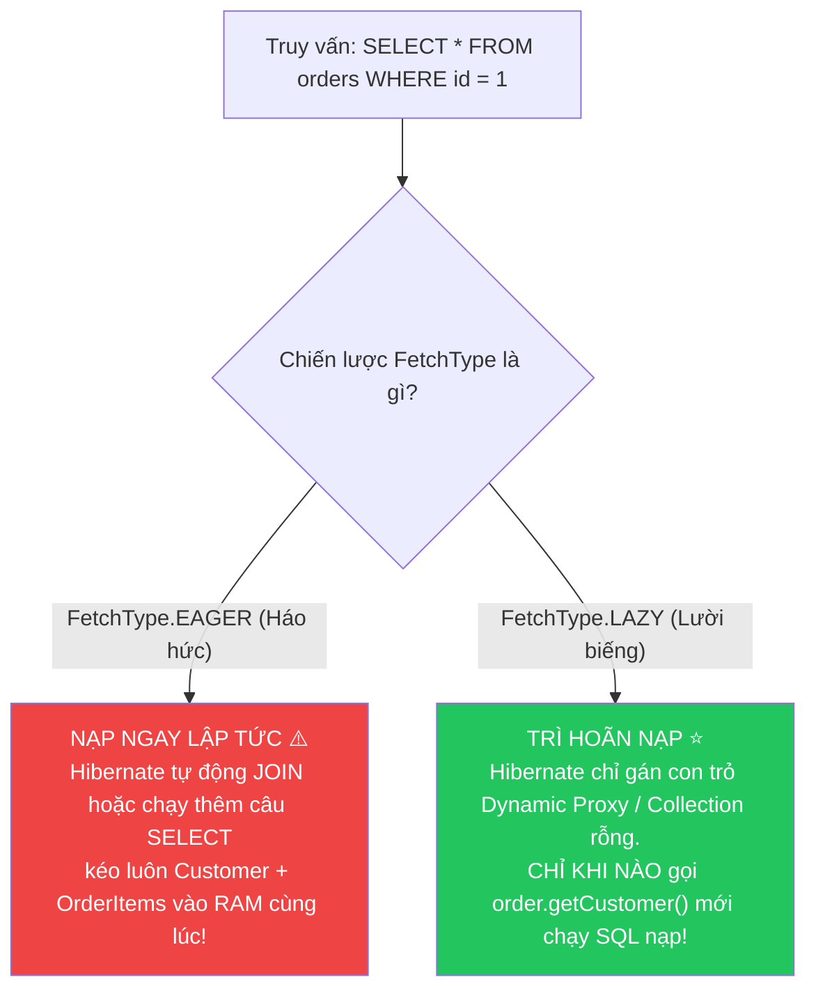
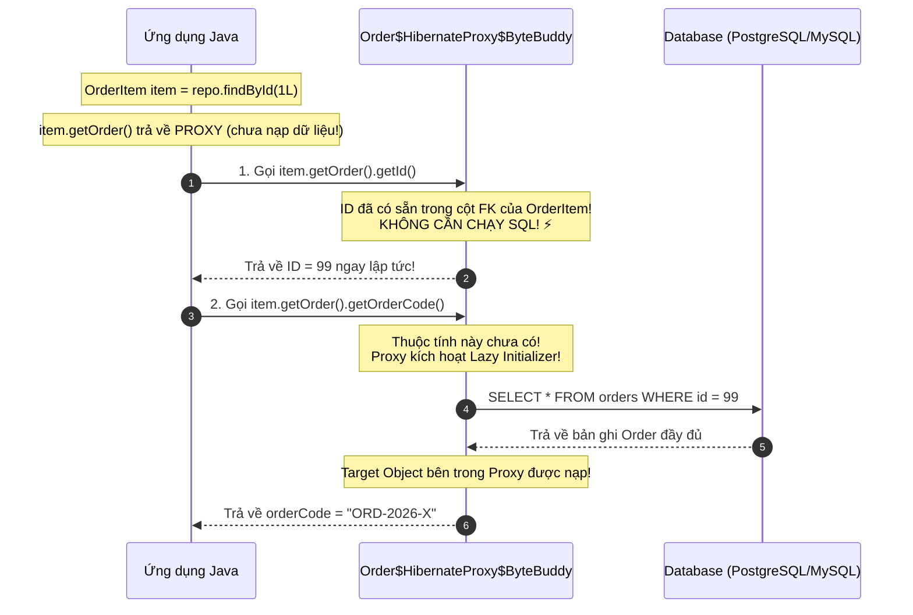
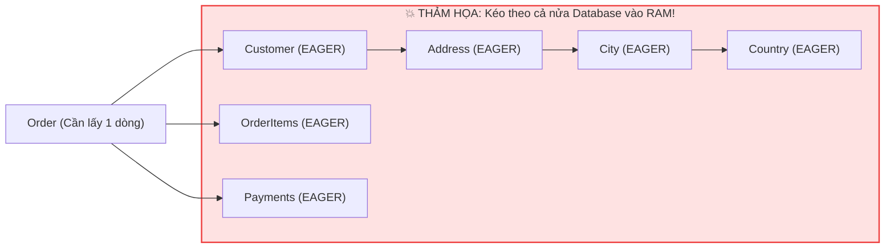
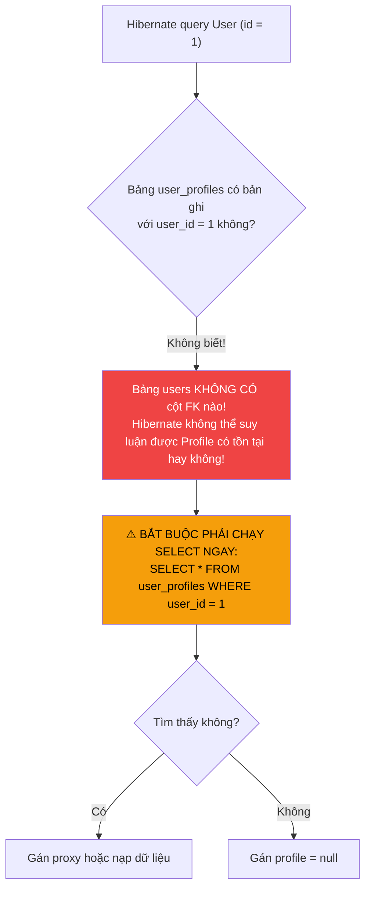

# ⚡ Chiến lược FetchType trong JPA: LAZY vs EAGER (Best Practices & Anti-patterns)

> **Nguồn chính thống:** [Jakarta Persistence 3.2 Specification — Chapter 2.10: Fetch Type](https://jakarta.ee/specifications/persistence/3.2/) | [Hibernate ORM 7.x User Guide — Fetching](https://docs.jboss.org/hibernate/orm/7.0/userguide/html_single/Hibernate_User_Guide.html#fetching) | [Spring Data JPA Reference](https://docs.spring.io/spring-data/jpa/reference/index.html)
>
> **Thuộc roadmap:** `5. Database → Spring Data → Spring Data JPA → Entity Mapping & Relationships → FetchType Strategies (LAZY vs EAGER)`
>
> **Môi trường & Công nghệ:** Java 21+ | Spring Boot 4.1.0 | Spring Framework 7.0.8 | Hibernate ORM 7.x | Jakarta Persistence 3.2

---

## 1. Định nghĩa chính thức từ Jakarta Persistence 3.2 Specification

### 1.1 Trích dẫn chuẩn đặc tả (Specification)

> *"The `fetch` member defines the requirement for fetching data from the database. The `FetchType` enum defines the values `LAZY` and `EAGER`.
> - **`LAZY`**: A hint to the persistence provider that data should be fetched lazily when first accessed.
> - **`EAGER`**: A requirement on the persistence provider that data must be eagerly fetched."*
>
> — **Jakarta Persistence 3.2 — Section 11.1.18: FetchType Enum**

> *"The `EAGER` fetch type is a requirement that the persistence provider runtime must load the relationship immediately upon query execution, whereas `LAZY` is a directive that permits the runtime to defer fetching until the relationship is navigated."*
>
> — **Hibernate ORM 7.0 User Guide — Section 11.1: Fetching Basics**

### 1.2 Dịch & giải thích trực quan

Khi bạn truy vấn một bản ghi `Order` (Đơn hàng) từ CSDL, đơn hàng đó có liên kết tới `Customer` (Khách hàng) và danh sách `OrderItem` (Chi tiết món hàng). Câu hỏi cốt tử đặt ra cho ORM là:

**"Khi tôi nạp `Order`, tôi có cần nạp luôn toàn bộ dữ liệu của `Customer` và hàng chục `OrderItem` đi kèm ngay lập tức hay không?"**



> [!IMPORTANT]
> - **`FetchType.EAGER`** là một **MỆNH LỆNH BẮT BUỘC (Requirement)**: Hibernate **phải** nạp dữ liệu liên quan ngay khi Entity cha được query. Bạn không có cách nào ngăn cản nó một khi đã khai báo tĩnh trên Entity!
> - **`FetchType.LAZY`** là một **GỢI Ý (Directive/Hint)**: Hibernate trì hoãn việc đọc CSDL cho tới khi bạn thực sự truy cập vào getter của trường đó trong một Transaction còn mở.

---

## 2. Bảng giá trị mặc định của `FetchType` trong JPA

Đây là bảng quy ước mặc định của Jakarta Persistence. Điểm đặc biệt nguy hiểm là các mối quan hệ đuôi `-ToOne` mặc định là `EAGER`!

| Mối quan hệ Annotation | FetchType Mặc định theo Chuẩn JPA | Đánh giá kiến trúc | Hành động bắt buộc của Developer |
| :--- | :---: | :---: | :--- |
| **`@ManyToOne`** | ⚠️ **`FetchType.EAGER`** | ☠️ **CỰC KỲ NGUY HIỂM** | ⭐ **Đổi ngay sang `FetchType.LAZY` 100%!** |
| **`@OneToOne`** | ⚠️ **`FetchType.EAGER`** | ☠️ **CỰC KỲ NGUY HIỂM** | ⭐ **Đổi ngay sang `FetchType.LAZY` 100%!** |
| **`@OneToMany`** | ✅ **`FetchType.LAZY`** | 🛡️ An toàn mặc định | Giữ nguyên `LAZY`. |
| **`@ManyToMany`** | ✅ **`FetchType.LAZY`** | 🛡️ An toàn mặc định | Giữ nguyên `LAZY`. |
| **`@ElementCollection`** | ✅ **`FetchType.LAZY`** | 🛡️ An toàn mặc định | Giữ nguyên `LAZY`. |
| **`@Basic`** (Cột thông thường) | ✅ **`FetchType.EAGER`** | ✅ Hợp lý | Giữ nguyên (trừ cột LOB/CLOB khổng lồ). |

> [!CAUTION]
> **Quy tắc ghi nhớ:** Mọi quan hệ có đuôi **`ToOne`** (`@ManyToOne`, `@OneToOne`) đều mặc định là **`EAGER`**. Đây chính là "nguồn gốc của mọi tội lỗi" gây ra thảm họa hiệu năng N+1 Query trong các ứng dụng Spring Boot!

---

## 3. Bản chất kỹ thuật ngầm: Dynamic Proxy & `PersistentCollection`

Làm thế nào mà Hibernate có thể trì hoãn việc nạp dữ liệu khi bạn dùng `FetchType.LAZY`?

Hibernate sử dụng thư viện **ByteBuddy** để tạo ra các lớp kế thừa động (**Dynamic Proxy**) ngay trong thời gian chạy (Runtime).

### 3.1 Cơ chế ByteBuddy Proxy cho `@ManyToOne` / `@OneToOne`

Khi bạn truy vấn một `OrderItem`, trường `order` không chứa một đối tượng `Order` thật mà chứa một **Proxy Object** kế thừa từ `Order`:



```java
OrderItem item = orderItemRepository.findById(1L).orElseThrow();

// Kiểm tra kiểu thực tế của đối tượng:
Order orderProxy = item.getOrder();
System.out.println(orderProxy.getClass().getName());
// Output thực tế: com.example.domain.Order$HibernateProxy$e89f81a7

// Kiểm tra trạng thái nạp của Proxy:
boolean isLoaded = Hibernate.isInitialized(orderProxy);
System.out.println("Đã nạp chưa: " + isLoaded); // false!

// Kích hoạt nạp chủ động (chỉ làm khi session còn mở):
Hibernate.initialize(orderProxy);
System.out.println("Sau khi nạp: " + Hibernate.isInitialized(orderProxy)); // true!
```

---

### 3.2 Cơ chế `PersistentCollection` cho `@OneToMany` / `@ManyToMany`

Với Collection, Hibernate không dùng `ArrayList` thông thường mà bọc danh sách bằng `org.hibernate.collection.spi.PersistentBag` hoặc `PersistentSet`:

```java
Order order = orderRepository.findById(1L).orElseThrow();

List<OrderItem> items = order.getItems();
System.out.println(items.getClass().getName());
// Output: org.hibernate.collection.spi.PersistentBag

// PersistentBag rỗng và chưa hề truy vấn CSDL!
// CHỈ KHI BẠN GỌI:
items.size();    // -> Phát lệnh SELECT count hoặc SELECT *
items.get(0);   // -> Phát lệnh SELECT kéo toàn bộ items
for (OrderItem item : items) { ... } // -> Phát lệnh SELECT
```

---

## 4. Góc tối của `FetchType.EAGER` — Kẻ hủy diệt hiệu năng số 1 trong JPA

Tại sao toàn bộ cộng đồng chuyên gia JPA (Vlad Mihalcea, Thorben Janssen, Hibernate Core Team) đều coi `FetchType.EAGER` là một **Code Smell (Anti-pattern)** nghiêm trọng?

### 4.1 Cạm bẫy "2 bộ mặt" của Hibernate: `em.find()` vs JPQL / Spring Data Query

Nhiều lập trình viên lầm tưởng: *"Tôi dùng EAGER thì Hibernate sẽ tự động viết lệnh `LEFT JOIN` để lấy hết một lần, vừa tiện vừa nhanh!"*. 

**Thực tế hoàn toàn không như vậy!**

#### 1. Khi dùng `entityManager.find()` hoặc `repository.findById()`:
Hibernate có thể tối ưu bằng câu lệnh `LEFT OUTER JOIN`:
```sql
SELECT o.id, o.order_code, c.id, c.customer_name 
FROM orders o 
LEFT OUTER JOIN customers c ON o.customer_id = c.id 
WHERE o.id = 1;
-- ✅ Chỉ 1 câu SQL
```

#### 2. Nhưng khi dùng JPQL, HQL, `@Query`, hoặc Derived Queries (`findAll()`, `findByStatus()`):
Chuẩn JPA quy định: **JPQL phải được dịch nguyên văn sang SQL trước tiên**, sau đó mới xét đến quy tắc nạp quan hệ!

```java
// Bạn chỉ muốn lấy danh sách 100 đơn hàng:
List<Order> orders = orderRepository.findByStatus("NEW");
```

**Thảm họa SQL bùng nổ (N+1 Query Problem):**
```sql
-- Bước 1: Hibernate chạy câu lệnh JPQL gốc để lấy 100 orders:
SELECT id, order_code, customer_id, status FROM orders WHERE status = 'NEW';

-- Bước 2: Do Customer được đặt EAGER, Hibernate BẮT BUỘC PHẢI NẠP NGAY LẬP TỨC!
-- Hibernate chạy 100 câu SELECT riêng rẽ tới bảng customers:
SELECT id, customer_name, address FROM customers WHERE id = 101;
SELECT id, customer_name, address FROM customers WHERE id = 102;
SELECT id, customer_name, address FROM customers WHERE id = 103;
... (lặp lại 100 lần!) ...
SELECT id, customer_name, address FROM customers WHERE id = 200;
```
> **1 câu query lấy orders biến thành $1 + 100 = 101$ câu SQL!** Database Connection Pool bị chiếm dụng toàn bộ, CPU database chạm đỉnh 100%, và ứng dụng sập!

---

### 4.2 Thảm họa "Vụ nổ tích Descartes" (Cartesian Product Explosion)

Nếu trong hệ thống của bạn có chuỗi liên kết EAGER dây chuyền:
`Order` $\to$ EAGER `Customer` $\to$ EAGER `Address` $\to$ EAGER `City` $\to$ EAGER `Country`!

Khi bạn chỉ muốn xem ngày tạo đơn hàng:
- Hibernate buộc phải kéo theo cả Customer, Address, City, Country của khách hàng đó.
- Nếu có thêm 2 Collection con đặt EAGER (ví dụ: `Order` EAGER `OrderItems` và `Order` EAGER `PaymentTransactions`):
  Database sẽ sinh ra bảng tích Descartes: $10 \text{ items} \times 5 \text{ payments} = 50 \text{ dòng kết quả lặp đi lặp lại}$.
  Bộ nhớ Heap của server tràn ngập dữ liệu rác không cần thiết!



---

## 5. Quy tắc Vàng: "Fetch Everything LAZY" (Mặc định LAZY 100%)

> [!TIP]
> **Quy tắc kiến trúc cốt tử của Senior Backend:**
> Mọi mối quan hệ trong toàn bộ hệ thống (`@OneToOne`, `@ManyToOne`, `@OneToMany`, `@ManyToMany`, `@ElementCollection`) **BẮT BUỘC PHẢI KHAI BÁO `FetchType.LAZY` 100%**. Tuyệt đối không có ngoại lệ tĩnh nào trên Entity!

```java
// ═══════════════════════════════════════════════════════════
// ✅ CHUẨN MỰC ENTERPRISE: LAZY 100% TRÊN MỌI ANNOTATION
// ═══════════════════════════════════════════════════════════
@Entity
@Table(name = "order_items")
public class OrderItem {

    // Luôn ghi đè EAGER mặc định bằng LAZY:
    @ManyToOne(fetch = FetchType.LAZY, optional = false)
    @JoinColumn(name = "order_id", nullable = false)
    private Order order;

    @ManyToOne(fetch = FetchType.LAZY, optional = false)
    @JoinColumn(name = "product_id", nullable = false)
    private Product product;
}
```

### Nhưng nếu một Business Flow thực sự cần nạp cả cha lẫn con thì giải quyết thế nào?

**Quy tắc:** Chúng ta biến việc nạp dữ liệu từ **Tĩnh (Static Configuration trên Entity)** thành **Động theo từng truy vấn (Dynamic per Query)**! Chỉ nạp những gì màn hình hoặc API đó thực sự cần.

Có 3 giải pháp chuẩn Enterprise:

#### Giải pháp 1: Sử dụng `JOIN FETCH` trong JPQL (Kiểm soát 100% SQL)
```java
public interface OrderRepository extends JpaRepository<Order, Long> {

    @Query("""
        SELECT o FROM Order o
        JOIN FETCH o.customer
        JOIN FETCH o.items i
        JOIN FETCH i.product
        WHERE o.id = :orderId
    """)
    Optional<Order> findDetailById(@Param("orderId") Long orderId);
}
// ✅ Hibernate sinh đúng 1 câu SQL duy nhất với các mệnh đề INNER/LEFT JOIN!
```

#### Giải pháp 2: Sử dụng `@EntityGraph` (Chuẩn JPA 2.1+)
```java
public interface OrderRepository extends JpaRepository<Order, Long> {

    // Nạp sẵn 'customer' và 'items' một cách linh hoạt mà không cần viết lại toàn bộ câu JPQL:
    @EntityGraph(attributePaths = {"customer", "items"})
    List<Order> findByStatus(String status);
}
```

#### Giải pháp 3: DTO Projection (Tối ưu tuyệt đối hiệu năng)
Nếu bạn chỉ cần hiển thị tóm tắt đơn hàng lên lưới danh sách, đừng bao giờ nạp toàn bộ Entity:
```java
public record OrderSummaryDto(
    Long orderId,
    String orderCode,
    String customerName,
    BigDecimal totalAmount
) {}

public interface OrderRepository extends JpaRepository<Order, Long> {

    @Query("""
        SELECT new com.example.dto.OrderSummaryDto(
            o.id, o.orderCode, o.customer.name, o.totalAmount
        )
        FROM Order o
        WHERE o.status = :status
    """)
    List<OrderSummaryDto> findSummariesByStatus(@Param("status") String status);
}
// ⚡ Chỉ SELECT đúng 4 cột cần thiết, bỏ qua toàn bộ quan hệ phức tạp và không tốn chi phí quản lý Entity!
```

---

## 6. Cạm bẫy `@OneToOne` LAZY: Tại sao đặt `LAZY` nhưng Hibernate vẫn chạy `EAGER`?

Đây là một cạm bẫy kỹ thuật cực kỳ tinh vi mà hơn 80% developer JPA gặp phải mà không hiểu nguyên nhân.

### 6.1 Hiện tượng kỳ lạ

Xem xét mối quan hệ 1-1 giữa `User` và `UserProfile`:
- Bảng `user_profiles` giữ khóa ngoại `user_id` (Owning Side).
- Bảng `users` là Inverse Side với `mappedBy = "user"`.

```java
// Phía Inverse Side:
@Entity
public class User {
    @Id @GeneratedValue
    private Long id;

    // Rõ ràng đã đặt FetchType.LAZY:
    @OneToOne(mappedBy = "user", fetch = FetchType.LAZY)
    private UserProfile profile;
}
```

Khi bạn chạy:
```java
User user = userRepository.findById(1L).orElseThrow();
```
**Bất ngờ xảy ra:** Hibernate vẫn âm thầm phát lệnh `SELECT * FROM user_profiles WHERE user_id = 1` ngay lập tức! **`FetchType.LAZY` hoàn toàn bị phớt lờ!**

---

### 6.2 Nguyên nhân gốc rễ (Root Cause)

Để tạo được ByteBuddy Dynamic Proxy, Hibernate cần biết: **Trường `profile` trong Java nên gán bằng `null` hay gán bằng một đối tượng `UserProfile$Proxy`?**



- Trong quan hệ `@ManyToOne`, bảng hiện tại **có cột FK** (`order_id`). Nếu cột FK mang giá trị `5`, Hibernate biết chắc chắn có thể tạo `Order$Proxy(id=5)`. Nếu FK là `null`, nó gán thẳng `null` mà không cần query.
- Nhưng ở phía `@OneToOne(mappedBy = ...)` (Inverse Side), bảng `users` **không hề có cột khóa ngoại nào**! Hibernate không có cách nào biết được `User` này đã có profile hay chưa nếu không thực hiện một câu lệnh `SELECT` sang bảng `user_profiles`!

> [!CAUTION]
> **Kết luận cay đắng:** Phía `mappedBy` (Inverse Side) của quan hệ `@OneToOne` hai chiều **KHÔNG BAO GIỜ có thể LAZY** nếu chỉ dùng annotation thông thường!

### 6.3 Giải pháp triệt để

1. **Giải pháp 1 (Khuyên dùng nhất): Sử dụng `@MapsId` (Shared Primary Key):**
   Như đã hướng dẫn ở bài Relationship Mappings, chia sẻ chung ID làm cho quan hệ trở nên đồng nhất và loại bỏ sự phụ thuộc vòng đời mập mờ.
2. **Giải pháp 2: Chuyển sang `@OneToMany` (giới hạn 1 phần tử):**
   Collections luôn luôn LAZY được mà không cần quan tâm có phần tử hay không (khi chưa query thì coi như collection rỗng).
3. **Giải pháp 3: Hibernate Bytecode Enhancement (Nâng cao):**
   Sử dụng Hibernate Maven/Gradle Plugin để can thiệp trực tiếp vào mã bytecode của class Entity lúc build, cho phép tạo proxy ngay cả trên các trường primitive hoặc one-to-one nullability.

---

## 7. Mẫu triển khai Thực chiến (Spring Boot 4.1.0 & Spring Framework 7.0.8)

Dưới đây là một ví dụ kiến trúc hoàn chỉnh, thể hiện cách cấu hình LAZY 100% an toàn và các kỹ thuật nạp dữ liệu theo nhu cầu:

### 7.1 Domain Entity: Tuân thủ LAZY 100%

```java
package com.example.ecommerce.domain;

import jakarta.persistence.*;
import lombok.AccessLevel;
import lombok.Getter;
import lombok.NoArgsConstructor;
import lombok.Setter;

import java.math.BigDecimal;
import java.util.ArrayList;
import java.util.List;

@Entity
@Table(name = "customers")
@Getter @Setter
@NoArgsConstructor(access = AccessLevel.PROTECTED)
public class Customer {

    @Id
    @GeneratedValue(strategy = GenerationType.IDENTITY)
    private Long id;

    @Column(nullable = false)
    private String fullName;

    @Column(nullable = false, unique = true)
    private String email;

    public Customer(String fullName, String email) {
        this.fullName = fullName;
        this.email = email;
    }
}
```

```java
package com.example.ecommerce.domain;

import jakarta.persistence.*;
import lombok.AccessLevel;
import lombok.Getter;
import lombok.NoArgsConstructor;
import lombok.Setter;

import java.math.BigDecimal;
import java.time.Instant;
import java.util.ArrayList;
import java.util.List;

@Entity
@Table(name = "orders")
@Getter @Setter
@NoArgsConstructor(access = AccessLevel.PROTECTED)
public class Order {

    @Id
    @GeneratedValue(strategy = GenerationType.IDENTITY)
    private Long id;

    @Column(nullable = false, unique = true)
    private String orderCode;

    @Column(nullable = false)
    private Instant orderDate = Instant.now();

    @Column(nullable = false)
    private String status;

    // ⭐ BẮT BUỘC LAZY! (Ghi đè mặc định EAGER)
    @ManyToOne(fetch = FetchType.LAZY, optional = false)
    @JoinColumn(name = "customer_id", nullable = false)
    private Customer customer;

    // Collection mặc định đã là LAZY
    @OneToMany(mappedBy = "order", cascade = CascadeType.ALL, orphanRemoval = true)
    private List<OrderItem> items = new ArrayList<>();

    public Order(String orderCode, Customer customer, String status) {
        this.orderCode = orderCode;
        this.customer = customer;
        this.status = status;
    }
}
```

---

### 7.2 Repository: Phân hóa các phương thức nạp linh hoạt

```java
package com.example.ecommerce.repository;

import com.example.ecommerce.domain.Order;
import com.example.ecommerce.dto.OrderListProjection;
import org.springframework.data.domain.Page;
import org.springframework.data.domain.Pageable;
import org.springframework.data.jpa.repository.EntityGraph;
import org.springframework.data.jpa.repository.JpaRepository;
import org.springframework.data.jpa.repository.Query;
import org.springframework.data.repository.query.Param;

import java.util.Optional;

public interface OrderRepository extends JpaRepository<Order, Long> {

    // 1. Dùng cho API xem chi tiết: Cần cả Khách hàng và Danh sách mặt hàng
    // Sử dụng JOIN FETCH giải quyết triệt để N+1 Query trong 1 câu SQL duy nhất
    @Query("""
        SELECT o FROM Order o
        JOIN FETCH o.customer
        JOIN FETCH o.items i
        JOIN FETCH i.product
        WHERE o.id = :id
    """)
    Optional<Order> findDetailById(@Param("id") Long id);

    // 2. Dùng cho API quản lý đơn hàng theo trạng thái: Cần kèm theo thông tin Customer
    // Sử dụng @EntityGraph nhẹ nhàng và thanh lịch
    @EntityGraph(attributePaths = {"customer"})
    Page<Order> findByStatus(@Param("status") String status, Pageable pageable);

    // 3. Dùng cho API hiển thị danh sách (High Performance Data Grid)
    // DTO Interface Projection: Database CHỈ ĐỌC các cột này, siêu nhẹ và nhanh!
    @Query("""
        SELECT 
            o.id AS orderId,
            o.orderCode AS orderCode,
            o.orderDate AS orderDate,
            o.customer.fullName AS customerName,
            o.status AS status
        FROM Order o
        WHERE o.status = :status
    """)
    Page<OrderListProjection> findSummaryByStatus(@Param("status") String status, Pageable pageable);
}
```

---

## 🔥 Ứng dụng thực tế (Thực tế dùng để làm gì? Giải quyết vấn đề gì?)

### Ví dụ thực tế 1: Cứu vãn hệ thống E-Commerce sập vào dịp Flash Sale 11/11

**Bối cảnh:**
Vào ngày lễ mua sắm 11/11, một sàn thương mại điện tử gặp sự cố nghiêm trọng: Sau 3 phút mở bán, database connection pool bị cạn kiệt hoàn toàn, thời gian phản hồi API tăng từ 50ms lên 12,000ms, hàng chục nghìn người dùng nhận lỗi `504 Gateway Timeout`.

**Nguyên nhân gốc rễ điều tra qua APM Tool (Dynatrace / Datadog):**
Trong entity `OrderItem`, lập trình viên để quan hệ:
```java
@ManyToOne // ☠️ Mặc định là FetchType.EAGER!
private Product product;
```
Khi người dùng truy vấn danh sách 20 đơn hàng gần nhất trong trang cá nhân:
- Hệ thống query 20 đơn hàng, mỗi đơn hàng có trung bình 5 sản phẩm $\to$ tổng cộng 100 `OrderItem`.
- Do `product` là `EAGER`, Hibernate tự động bắn thêm **100 câu lệnh `SELECT * FROM products WHERE id = ?`**.
- Với 5,000 người dùng đồng thời tải trang $\to$ Hệ thống phải gánh:
  $$5,000 \times 101 = \mathbf{505,000 \text{ câu lệnh SQL / giây}}!$$

**Giải pháp khắc phục khẩn cấp:**
1. Thêm `(fetch = FetchType.LAZY)` vào tất cả các annotation `@ManyToOne` và `@OneToOne`.
2. Viết lại hàm nạp đơn hàng bằng `@EntityGraph(attributePaths = {"items.product"})`.
3. Số lượng query giảm từ **505,000 queries** xuống còn **5,000 queries** (giảm 99% tải cho database!). Hệ thống hoạt động mượt mà trở lại.

---

### Ví dụ thực tế 2: Tối ưu API Danh sách sản phẩm (Product Catalog Listing API)

**Vấn đề thực tiễn:**
Trang danh mục sản phẩm của một trang tin tức công nghệ cần hiển thị 50 bài viết mới nhất. Mỗi bài viết có liên kết tới `Author` (Tác giả) và `Category` (Chuyên mục).

**Cách làm sai lầm (EAGER):**
- Đặt `Author` và `Category` là `EAGER`.
- Khi gọi `postRepository.findAll(pageable)`:
  - 1 câu SELECT 50 posts.
  - 50 câu SELECT authors.
  - 50 câu SELECT categories.
  - Tốn 101 câu SQL, dung lượng payload tiêu thụ 4.5MB RAM cho các entity object không dùng đến.

**Cách làm chuẩn mực (LAZY + Record Projection):**
- Toàn bộ Entity đặt `FetchType.LAZY`.
- Dùng Java Record Projection để chỉ lấy đúng 4 trường cần hiển thị:
  ```java
  public record PostCardResponse(Long id, String title, String authorName, String categoryName) {}
  ```
- Hibernate sinh ra câu lệnh duy nhất:
  ```sql
  SELECT p.id, p.title, a.full_name, c.name 
  FROM posts p 
  JOIN authors a ON p.author_id = a.id 
  JOIN categories c ON p.category_id = c.id 
  LIMIT 50;
  ```
- **Kết quả:** Thời gian phản hồi giảm từ 380ms xuống **18ms**, throughput tăng gấp 15 lần.

---

### Ví dụ thực tế 3: Giải quyết vấn đề nghẽn bộ nhớ của quan hệ 1-1 giữa User và UserSecuritySetting

**Vấn đề thực tiễn:**
Bảng `users` liên kết 1-1 với `user_security_settings` (chứa các cấu hình bảo mật 2FA, mã hóa khóa công khai, biometric data rất nặng). 
Khi nhân viên đăng nhập hoặc kiểm tra token JWT, hệ thống chỉ cần đọc `username` và `password_hash` từ bảng `users`.
Tuy nhiên, do `@OneToOne` mặc định là `EAGER`, mỗi lần xác thực token của bất kỳ request nào, Hibernate đều tự động JOIN hoặc SELECT bảng `user_security_settings`.

**Giải pháp thực tiễn:**
- Tách quan hệ này sang sử dụng `@MapsId` ở `UserSecuritySetting` (để ID hai bảng bằng nhau).
- Trong `User`, loại bỏ hẳn field `@OneToOne UserSecuritySetting` (chuyển sang Unidirectional từ phía SecuritySetting sang User).
- Khi kiểm tra JWT, chỉ query bảng `users` $\to$ Cực nhẹ, tiết kiệm hàng gigabyte băng thông mạng nội bộ giữa App Server và Database Server.

---

## 8. Tổng hợp các chủ đề (Bản đồ tra cứu)

### 🟢 Ưu tiên phải biết trước (Bắt buộc)
1. **Giá trị mặc định:** Ghi nhớ nằm lòng: `-ToOne` mặc định là `EAGER`, `-ToMany` mặc định là `LAZY`.
2. **Quy tắc vàng 100% LAZY:** Luôn luôn khai báo `fetch = FetchType.LAZY` trên tất cả `@ManyToOne` và `@OneToOne`.
3. **Hiểu bản chất EAGER:** Biết tại sao EAGER lại sinh ra N+1 query khi dùng JPQL/HQL/Spring Data JPA.
4. **Cơ chế Proxy:** Hiểu rằng đối tượng LAZY thực chất là ByteBuddy Dynamic Proxy, chỉ nạp dữ liệu khi gọi hàm lấy thuộc tính (getter).

### 🟡 Nhóm trung cấp
1. **Nạp dữ liệu theo nhu cầu (Dynamic Fetching):** Thành thạo cách dùng `JOIN FETCH` trong JPQL và `@EntityGraph` của Spring Data JPA.
2. **DTO Projection:** Biết cách sử dụng Java Record hoặc Interface Projection để bỏ qua hoàn toàn việc nạp Entity khi chỉ cần đọc dữ liệu hiển thị.
3. **`Hibernate.isInitialized()` & `Hibernate.initialize()`:** Biết cách kiểm tra xem một proxy đã được nạp hay chưa và cách kích hoạt nạp thủ công trong transaction.
4. **Kiểm tra SQL thực tế:** Luôn bật cấu hình logging SQL và datasource-proxy trong môi trường dev để phát hiện ngay các câu SELECT ngoài ý muốn.

### 🔴 Nhóm nâng cao
1. **Cạm bẫy `@OneToOne` mappedBy không thể LAZY:** Hiểu nguyên nhân kỹ thuật tại sao Hibernate không thể tạo proxy khi không biết thực thể con có null hay không, và cách khắc phục bằng `@MapsId`.
2. **Hibernate Bytecode Enhancement:** Kỹ thuật can thiệp bytecode lúc build để hỗ trợ Lazy Loading ở cấp độ từng trường riêng lẻ (Field-level lazy loading cho các cột CLOB/BLOB lớn).
3. **Hiểm họa MultipleBagFetchException:** Hiểu tại sao không thể dùng cùng lúc 2 `JOIN FETCH` trên 2 Collection kiểu `List` và giải pháp chuyển sang `Set` hoặc dùng `@BatchSize`.
4. **Phân biệt SQL Join vs In-memory Join:** Hiểu sự khác biệt giữa `JOIN FETCH` (kết hợp trên CSDL) và việc Hibernate nạp lười từng đợt để tối ưu hoá bộ nhớ.

---

## 📚 Tài liệu tham khảo chính thống

| Tài liệu / Chủ đề | Đường dẫn liên kết |
| :--- | :--- |
| **Jakarta Persistence 3.2 Specification — Section 11.1.18** | [jakarta.ee/specifications/persistence/3.2](https://jakarta.ee/specifications/persistence/3.2/) |
| **Hibernate ORM 7.0 User Guide — Fetching Strategies** | [docs.jboss.org/hibernate/orm/7.0 — Fetching](https://docs.jboss.org/hibernate/orm/7.0/userguide/html_single/Hibernate_User_Guide.html#fetching) |
| **Vlad Mihalcea — EAGER fetching is a code smell** | [vladmihalcea.com/eager-fetching-is-a-code-smell](https://vladmihalcea.com/eager-fetching-is-a-code-smell/) |
| **Vlad Mihalcea — Why @OneToOne(mappedBy) is not lazy** | [vladmihalcea.com/the-best-way-to-map-a-onetoone](https://vladmihalcea.com/the-best-way-to-map-a-onetoone-relationship-with-jpa-and-hibernate/) |
| **Thorben Janssen — Complete Guide to JPA FetchType** | [thorben-janssen.com/lazy-basics](https://thorben-janssen.com/lazy-basics/) |
| **Spring Data JPA Reference Documentation — Entity Graphs** | [docs.spring.io/spring-data/jpa/reference — entity-graph](https://docs.spring.io/spring-data/jpa/reference/jpa/query-methods.html#jpa.entity-graph) |

---

> **Tài liệu tiếp theo:** **LazyInitializationException: Root Cause, Anti-patterns & Clean Architectural Solutions** — Mổ xẻ chi tiết nguyên nhân gốc rễ gây ra ngoại lệ huyền thoại `could not initialize proxy - no Session`, vạch trần các cạm bẫy tai hại như `spring.jpa.open-in-view=true` hay `enable_lazy_load_no_trans`, và xây dựng kiến trúc chuẩn mực xử lý DTO mapping trong Transaction boundaries.
