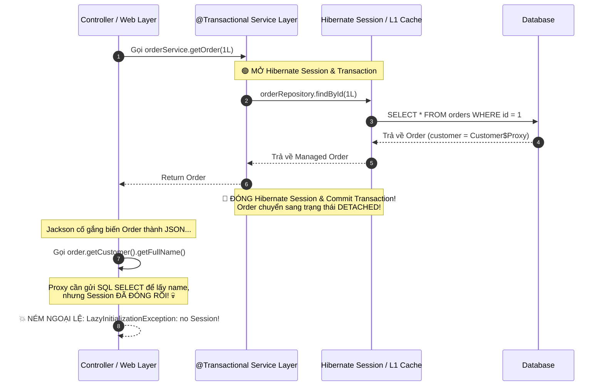
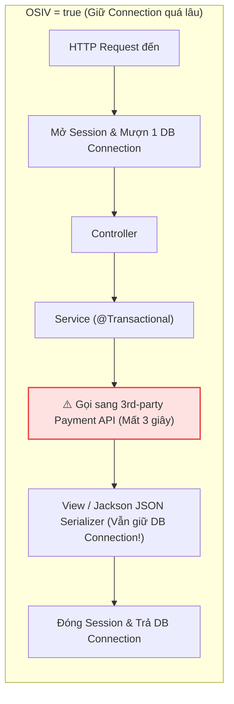
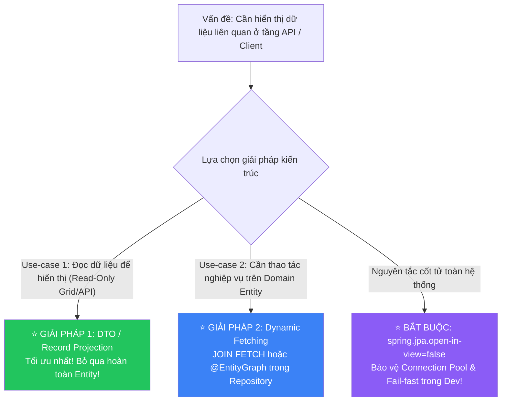

# 🛑 LazyInitializationException trong JPA: Nguyên nhân gốc rễ, Cạm bẫy Anti-patterns & Giải pháp Kiến trúc Chuẩn mực

> **Nguồn chính thống:** [Hibernate ORM 7.x User Guide — Lazy Fetching & Proxies](https://docs.jboss.org/hibernate/orm/7.0/userguide/html_single/Hibernate_User_Guide.html#fetching-lazy) | [Spring Data JPA Reference](https://docs.spring.io/spring-data/jpa/reference/index.html) | [Vlad Mihalcea — The Open Session in View Anti-Pattern](https://vladmihalcea.com/the-open-session-in-view-anti-pattern/)
>
> **Thuộc roadmap:** `5. Database → Spring Data → Spring Data JPA → Entity Mapping & Relationships → LazyInitializationException`
>
> **Môi trường & Công nghệ:** Java 21+ | Spring Boot 4.1.0 | Spring Framework 7.0.8 | Hibernate ORM 7.x | Jakarta Persistence 3.2

---

## 1. Định nghĩa chính thức & Bản chất Ngoại lệ

### 1.1 Trích dẫn ngoại lệ kinh điển (Stacktrace)

```text
org.hibernate.LazyInitializationException: could not initialize proxy [com.example.domain.Customer#42] - no Session
    at org.hibernate.proxy.AbstractLazyInitializer.initialize(AbstractLazyInitializer.java:169)
    at org.hibernate.proxy.AbstractLazyInitializer.getImplementation(AbstractLazyInitializer.java:340)
    at org.hibernate.proxy.pojo.bytebuddy.ByteBuddyInterceptor.intercept(ByteBuddyInterceptor.java:45)
    at com.example.domain.Customer$HibernateProxy$abcdef12.getFullName(Unknown Source)
    at com.example.controller.OrderController.getOrder(OrderController.java:38)
```

Hoặc đối với Collections (`@OneToMany` / `@ManyToMany`):

```text
org.hibernate.LazyInitializationException: failed to lazily initialize a collection of role: com.example.domain.Order.items: could not initialize proxy - no Session
    at org.hibernate.collection.spi.AbstractPersistentCollection.throwLazyInitializationException(AbstractPersistentCollection.java:635)
```

### 1.2 Dịch & giải thích bản chất gốc rễ (Root Cause)

Ngoại lệ này xảy ra khi hội tụ **đầy đủ 3 điều kiện** sau:

1. Bạn có một mối quan hệ được cấu hình **`FetchType.LAZY`** (hoặc mặc định là LAZY như `@OneToMany`, `@ManyToMany`). Lúc này, thuộc tính bên trong Entity chỉ là một **ByteBuddy Dynamic Proxy** hoặc `PersistentCollection` chưa nạp dữ liệu thật.
2. Entity đã chuyển sang trạng thái **`Detached`** (Bị tách rời), vì Hibernate Session / Persistence Context đã **ĐÓNG LẠI** (thông thường là khi hàm `@Transactional` ở Service layer đã thực thi xong và commit).
3. Một thành phần bên ngoài (Controller, Jackson ObjectMapper khi serialize JSON, hoặc View template như Thymeleaf) cố tình gọi một hàm getter (`order.getCustomer().getFullName()` hoặc `order.getItems().size()`) để truy cập dữ liệu bên trong Proxy đó.



> [!IMPORTANT]
> **Tóm tắt cốt lõi trong 1 câu:** Hibernate **không thể thực hiện truy vấn SQL** để nạp dữ liệu cho một Proxy hoặc PersistentCollection nếu **không còn kết nối CSDL (Session) nào đang mở** gắn với nó!

---

## 2. Các Anti-patterns Chắp vá Độc hại (Cách sửa sai lầm phổ biến)

Khi gặp lỗi này, nhiều lập trình viên thiếu kinh nghiệm thường tìm kiếm trên mạng và áp dụng những cách "sửa nhanh" cực kỳ nguy hiểm. Đây là những cạm bẫy hủy hoại hệ thống của bạn!

### 2.1 Anti-pattern 1: Đổi ngược lại thành `FetchType.EAGER` ❌

> *"Lỗi bảo không load được Lazy chứ gì? Vậy tôi đổi thành EAGER là xong ngay!"*

```java
// ❌ CẠM BẪY SỐ 1: Chữa lợn lành thành lợn què!
@ManyToOne(fetch = FetchType.EAGER) // ☠️ Đổi sang EAGER để trốn lỗi
private Customer customer;
```

- **Hậu quả:** Như đã học ở bài trước, `EAGER` sẽ biến một câu truy vấn danh sách đơn giản thành thảm họa **N+1 Query** hoặc **Vụ nổ tích Descartes**. 
- Bạn giải quyết được 1 lỗi crash ở màn hình hiện tại nhưng lại **bắn rơi toàn bộ database server** khi lượng truy cập tăng cao!

---

### 2.2 Anti-pattern 2: Bật "Thần chú tử thần" `enable_lazy_load_no_trans` ❌

Trong file `application.yml`, một số người thêm vào dòng cấu hình sau:

```yaml
# ❌ CẠM BẪY SỐ 2: Cấu hình ma quỷ bị chính Hibernate cảnh báo
spring:
  jpa:
    properties:
      hibernate:
        enable_lazy_load_no_trans: true # ☠️ TUYỆT ĐỐI KHÔNG DÙNG!
```

> *"Mỗi khi cần dữ liệu lazy ngoài session, Hibernate sẽ tự động âm thầm mượn một Connection mới từ Connection Pool, chạy câu SELECT, rồi trả Connection về."*

**Hậu quả kinh hoàng:**
1. **N Connection Leaks:** Nếu một danh sách có 100 phần tử, việc gọi getter trong vòng lặp sẽ mở và đóng kết nối CSDL **100 lần liên tiếp**!
2. **Không có Transaction:** Việc đọc dữ liệu diễn ra ngoài transaction có thể dẫn đến hiện tượng đọc dữ liệu bẩn (Dirty/Non-repeatable Read) và không đảm bảo tính toàn vẹn.
3. **Cạn kiệt HikariCP Connection Pool:** Chỉ vài request đồng thời lặp qua các quan hệ lazy có thể chiếm sạch toàn bộ pool kết nối, làm treo cứng toàn bộ ứng dụng.

> [!CAUTION]
> Tài liệu chính thức của Hibernate gọi cấu hình này là **"An anti-pattern that should never be used in production"**!

---

### 2.3 Anti-pattern 3: Lạm dụng Open Session In View (`OSIV = true`) ❌

Spring Boot mặc định từ xưa bật cờ:
```properties
spring.jpa.open-in-view=true # ⚠️ Mặc định của Spring Boot nhưng là Anti-pattern
```

**Cơ chế của OSIV:**
Spring dựng một Servlet Filter chặn ở cổng vào HTTP Request:
- Khi request đến $\to$ Mở một Hibernate Session và giữ nguyên nó xuyên suốt qua Controller, Service, cho tới tận View/Jackson Serializer.
- Khi response đã gửi xong về client $\to$ Mới đóng Session.



**Tại sao môi trường Production bắt buộc phải tắt OSIV (`spring.jpa.open-in-view=false`)?**
1. **Giam cầm DB Connection:** Kết nối CSDL là tài nguyên cực kỳ đắt đỏ (HikariCP pool mặc định chỉ có 10 connections). Nếu request phải gọi một WebService bên thứ 3 (ZaloPay, VNPay, SendGrid) mất 2-3 giây, thì kết nối CSDL cũng bị giam lỏng vô ích suốt 3 giây đó!
2. **Che giấu câu truy vấn N+1:** Developer không hề hay biết rằng Jackson Serializer đang âm thầm chạy thêm hàng chục câu SELECT ở tầng Web.
3. **Ranh giới kiến trúc bị phá vỡ:** Tầng Web (Controller/View) lại có quyền kích hoạt truy vấn dữ liệu CSDL thay vì tầng Persistence/Service.

---

### 2.4 Anti-pattern 4: Chắp vá bằng `Hibernate.initialize()` thủ công vô tội vạ ❌

```java
// ❌ CẠM BẪY SỐ 4: Chắp vá ngẫu hứng trong Service
@Transactional
public Order getOrder(Long id) {
    Order order = orderRepository.findById(id).orElseThrow();
    
    // Developer gọi hàm này để "ép" Hibernate nạp trước khi đóng session:
    Hibernate.initialize(order.getCustomer());
    Hibernate.initialize(order.getItems());
    
    return order;
}
```

- **Vấn đề:** Bản chất `Hibernate.initialize(order.getItems())` vẫn phát ra một câu lệnh `SELECT` riêng lẻ độc lập (N+1 query). 
- Nếu bạn lấy một danh sách 50 `Order` và for-each gọi `Hibernate.initialize(...)`, bạn vừa tự tay viết ra N+1 query một cách thủ công!

---

## 3. Các Giải pháp Kiến trúc Chuẩn mực (Clean Architectural Solutions)

Để xử lý triệt để tận gốc rễ `LazyInitializationException` mà hệ thống vẫn đạt hiệu năng tối đa, chuẩn Enterprise sử dụng **bộ ba giải pháp** sau:



---

### 3.1 Giải pháp 1: Dynamic Fetching theo từng Use-case (`JOIN FETCH` hoặc `@EntityGraph`)

Nếu tầng Service thực sự cần một Entity nguyên vẹn cùng các thực thể con để thực thi logic nghiệp vụ, hãy yêu cầu Repository nạp trước bằng một câu lệnh `JOIN` duy nhất.

#### Cách 1.1: Sử dụng `JOIN FETCH` trong JPQL (Khuyên dùng khi truy vấn phức tạp)
```java
public interface OrderRepository extends JpaRepository<Order, Long> {

    @Query("""
        SELECT o FROM Order o
        JOIN FETCH o.customer
        JOIN FETCH o.items i
        JOIN FETCH i.product
        WHERE o.id = :orderId
    """)
    Optional<Order> findByIdWithDetails(@Param("orderId") Long orderId);
}
```
**SQL Hibernate sinh ra (1 câu lệnh duy nhất nạp sạch mọi thứ vào RAM):**
```sql
SELECT o.id, o.order_code, c.id, c.full_name, i.id, i.quantity, p.id, p.name
FROM orders o
INNER JOIN customers c ON o.customer_id = c.id
INNER JOIN order_items i ON o.id = i.order_id
INNER JOIN products p ON i.product_id = p.id
WHERE o.id = ?;
-- ✅ Khi session đóng, toàn bộ proxy đã được nạp đầy đủ -> 0% nguy cơ LazyInitException!
```

#### Cách 1.2: Sử dụng `@EntityGraph` (Thanh lịch & Linh hoạt)
```java
public interface OrderRepository extends JpaRepository<Order, Long> {

    @EntityGraph(attributePaths = {"customer", "items.product"})
    Optional<Order> findWithGraphById(Long id);
}
```

---

### 3.2 Giải pháp 2: DTO Projection (Chuẩn mực Tối thượng trong Kiến trúc REST API)

> [!TIP]
> **Quy tắc vàng của Clean Architecture:**
> **TUYỆT ĐỐI KHÔNG BAO GIỜ** trả trực tiếp JPA Entity ra ngoài tầng `@RestController`! 
> Hãy luôn chuyển đổi (Map) dữ liệu sang **DTO (Data Transfer Object)** hoặc **Java Record** ngay bên trong ranh giới `@Transactional` của Service layer.

#### Tại sao DTO giải quyết 100% `LazyInitializationException`?
Bởi vì DTO là các Java Object thuần túy (POJO / Record). Nó chỉ chứa dữ liệu phẳng, **không hề có Hibernate Proxy, không phụ thuộc vào Hibernate Session**, và có thể serialize thành JSON ở bất kỳ đâu mà không bao giờ gặp lỗi!

#### Triển khai với Java 21 Record + Constructor Expression trong JPQL:

```java
// 1. Định nghĩa DTO bằng Java Record bất biến, gọn gàng:
public record OrderDetailResponse(
    Long orderId,
    String orderCode,
    String customerName,
    String customerEmail,
    Instant createdAt
) {}
```

```java
// 2. Repository truy vấn trực tiếp vào DTO:
public interface OrderRepository extends JpaRepository<Order, Long> {

    @Query("""
        SELECT new com.example.dto.OrderDetailResponse(
            o.id,
            o.orderCode,
            o.customer.fullName,
            o.customer.email,
            o.createdAt
        )
        FROM Order o
        WHERE o.id = :id
    """)
    Optional<OrderDetailResponse> findDtoById(@Param("id") Long id);
}
```

**Lợi ích vượt trội:**
1. **Tốc độ tia chớp (Blazing fast):** Hibernate không cần khởi tạo Persistent Context, không cần dirty checking, không cần tạo ByteBuddy Proxy.
2. **Tiết kiệm RAM:** Database chỉ trả về đúng 5 cột cần thiết qua đường truyền mạng.
3. **Tuyệt đối miễn nhiễm với `LazyInitializationException`!**

---

### 3.3 Giải pháp 3: Bắt buộc tắt OSIV trong môi trường Production

Hãy thêm cấu hình này vào `application.yml`:

```yaml
spring:
  jpa:
    open-in-view: false # ⭐ BẮT BUỘC TẮT TRONG MỌI DỰ ÁN PRODUCTION!
```

**Tại sao việc tắt này lại là giải pháp?**
Khi bạn tắt OSIV:
- Nếu lập trình viên vô tình gọi getter của một quan hệ Lazy ngoài tầng Service, ứng dụng sẽ **ném lỗi ngay lập tức lúc chạy thử (Fail-fast)** thay vì âm thầm chạy hàng trăm câu SELECT ngầm.
- Lập trình viên sẽ buộc phải viết câu lệnh `JOIN FETCH`, `@EntityGraph`, hoặc dùng DTO một cách bài bản ngay từ đầu.
- Connection Pool được trả về ngay khi Service kết thúc, bảo vệ hệ thống không bao giờ bị cạn kiệt kết nối CSDL.

---

## 4. Jackson Serialization Trap: Vòng lặp Vô tận & Giải pháp Triệt để

Một trong những tình huống khiến `LazyInitializationException` xảy ra nhiều nhất là khi Spring Boot chuyển đổi Entity thành JSON để trả về cho Client.

### 4.1 Hiện tượng vòng lặp vô tận (Infinite Recursion)

Xem xét quan hệ hai chiều: `Order` $\leftrightarrow$ `OrderItem`.
1. Jackson duyệt `Order` $\to$ đọc trường `items`.
2. Jackson duyệt từng `OrderItem` $\to$ đọc trường `order`.
3. Jackson lại đọc `Order` $\to$ đọc trường `items`...
4. **Kết quả:** `java.lang.StackOverflowError` làm sập luồng xử lý!

### 4.2 Các cách chữa cháy nửa vời & Nhược điểm

| Cách xử lý tạm bợ | Cách viết | Hạn chế & Lý do không nên dùng trong Enterprise |
| :--- | :--- | :--- |
| **`@JsonIgnore`** | `@JsonIgnore private Customer customer;` | Cứng nhắc. Nếu màn hình khác cần thông tin customer thì không lấy được vì field đã bị ẩn hoàn toàn khỏi JSON. |
| **`@JsonManagedReference` & `@JsonBackReference`** | Đặt trên 2 đầu quan hệ 2 chiều. | Chỉ giải quyết được vòng lặp vô tận, **vẫn ném `LazyInitializationException`** nếu đối tượng chưa được nạp. |
| **`jackson-datatype-hibernate6`** | Thư viện bỏ qua các Proxy chưa khởi tạo (trả về `null`). | Nguy hiểm: Khách hàng nhận được dữ liệu `null` mà không rõ lý do, rất khó debug logic nghiệp vụ. |

> [!NOTE]
> **Giải pháp chuẩn công nghiệp duy nhất:** **Luôn luôn ánh xạ (Map) Entity sang DTO / Response Model trước khi đưa cho Jackson serialize!** Không bao giờ để Jackson chạm trực tiếp vào JPA Entity.

---

## 5. Mẫu Thiết kế Hoàn chỉnh (Spring Boot 4.1.0 & Spring Framework 7.0.8, Java 21)

Dưới đây là một ví dụ kiến trúc mẫu thể hiện luồng xử lý chuẩn mực không bao giờ gặp lỗi `LazyInitializationException`.

### 5.1 Các Entity chuẩn: 100% LAZY

```java
package com.example.shop.domain;

import jakarta.persistence.*;
import lombok.AccessLevel;
import lombok.Getter;
import lombok.NoArgsConstructor;
import lombok.Setter;

import java.math.BigDecimal;
import java.time.Instant;
import java.util.ArrayList;
import java.util.List;

@Entity
@Table(name = "customers")
@Getter @Setter
@NoArgsConstructor(access = AccessLevel.PROTECTED)
public class Customer {
    @Id @GeneratedValue(strategy = GenerationType.IDENTITY)
    private Long id;

    @Column(nullable = false)
    private String fullName;

    @Column(nullable = false, unique = true)
    private String email;

    public Customer(String fullName, String email) {
        this.fullName = fullName;
        this.email = email;
    }
}
```

```java
package com.example.shop.domain;

import jakarta.persistence.*;
import lombok.AccessLevel;
import lombok.Getter;
import lombok.NoArgsConstructor;
import lombok.Setter;

import java.math.BigDecimal;
import java.time.Instant;
import java.util.ArrayList;
import java.util.List;

@Entity
@Table(name = "orders")
@Getter @Setter
@NoArgsConstructor(access = AccessLevel.PROTECTED)
public class Order {
    @Id @GeneratedValue(strategy = GenerationType.IDENTITY)
    private Long id;

    @Column(nullable = false, unique = true)
    private String orderCode;

    @Column(nullable = false)
    private Instant createdAt = Instant.now();

    // ⭐ LAZY 100%
    @ManyToOne(fetch = FetchType.LAZY, optional = false)
    @JoinColumn(name = "customer_id", nullable = false)
    private Customer customer;

    // ⭐ LAZY 100%
    @OneToMany(mappedBy = "order", cascade = CascadeType.ALL, orphanRemoval = true)
    private List<OrderItem> items = new ArrayList<>();

    public Order(String orderCode, Customer customer) {
        this.orderCode = orderCode;
        this.customer = customer;
    }

    public void addItem(OrderItem item) {
        items.add(item);
        item.setOrder(this);
    }
}
```

---

### 5.2 Record DTOs (Phục vụ API Response)

```java
package com.example.shop.dto;

import java.math.BigDecimal;
import java.time.Instant;
import java.util.List;

public record OrderItemResponse(
    Long itemId,
    String productName,
    BigDecimal unitPrice,
    int quantity,
    BigDecimal subtotal
) {}

public record OrderDetailResponse(
    Long orderId,
    String orderCode,
    Instant createdAt,
    String customerName,
    String customerEmail,
    List<OrderItemResponse> items
) {}
```

---

### 5.3 Repository với `@EntityGraph` Dynamic Fetching

```java
package com.example.shop.repository;

import com.example.shop.domain.Order;
import org.springframework.data.jpa.repository.EntityGraph;
import org.springframework.data.jpa.repository.JpaRepository;
import org.springframework.data.jpa.repository.Query;
import org.springframework.data.repository.query.Param;

import java.util.Optional;

public interface OrderRepository extends JpaRepository<Order, Long> {

    // Nạp toàn bộ cây dữ liệu cần thiết trong DUY NHẤT 1 câu lệnh SQL
    @EntityGraph(attributePaths = {"customer", "items"})
    @Query("SELECT o FROM Order o WHERE o.id = :id")
    Optional<Order> findWithDetailsById(@Param("id") Long id);
}
```

---

### 5.4 Service Layer: Chuyển đổi Entity sang DTO ngay trong Transaction

```java
package com.example.shop.service;

import com.example.shop.domain.Order;
import com.example.shop.dto.OrderDetailResponse;
import com.example.shop.dto.OrderItemResponse;
import com.example.shop.repository.OrderRepository;
import lombok.RequiredArgsConstructor;
import org.springframework.stereotype.Service;
import org.springframework.transaction.annotation.Transactional;

import java.math.BigDecimal;
import java.util.List;

@Service
@RequiredArgsConstructor
public class OrderService {

    private final OrderRepository orderRepository;

    @Transactional(readOnly = true)
    public OrderDetailResponse getOrderDetail(Long orderId) {
        // 1. Nạp entity đã được fetch đầy đủ các quan hệ
        Order order = orderRepository.findWithDetailsById(orderId)
                .orElseThrow(() -> new IllegalArgumentException("Không tìm thấy đơn hàng ID: " + orderId));

        // 2. Map sang DTO ngay trong Transaction boundary
        List<OrderItemResponse> itemDtos = order.getItems().stream()
                .map(item -> new OrderItemResponse(
                        item.getId(),
                        item.getProductName(),
                        item.getUnitPrice(),
                        item.getQuantity(),
                        item.getUnitPrice().multiply(BigDecimal.valueOf(item.getQuantity()))
                ))
                .toList();

        // 3. Trả về DTO thuần túy, an toàn 100% khi session đóng
        return new OrderDetailResponse(
                order.getId(),
                order.getOrderCode(),
                order.getCreatedAt(),
                order.getCustomer().getFullName(),
                order.getCustomer().getEmail(),
                itemDtos
        );
    }
}
```

---

### 5.5 Controller Layer: Siêu mỏng & Tuyệt đối An toàn

```java
package com.example.shop.controller;

import com.example.shop.dto.OrderDetailResponse;
import com.example.shop.service.OrderService;
import lombok.RequiredArgsConstructor;
import org.springframework.http.ResponseEntity;
import org.springframework.web.bind.annotation.*;

@RestController
@RequestMapping("/api/v1/orders")
@RequiredArgsConstructor
public class OrderController {

    private final OrderService orderService;

    @GetMapping("/{id}")
    public ResponseEntity<OrderDetailResponse> getOrder(@PathVariable Long id) {
        // Tầng Controller chỉ nhận DTO từ Service và chuyển về Client
        // Dù spring.jpa.open-in-view=false, lỗi LazyInitializationException cũng KHÔNG BAO GIỜ xảy ra!
        OrderDetailResponse response = orderService.getOrderDetail(id);
        return ResponseEntity.ok(response);
    }
}
```

---

## 🔥 Ứng dụng thực tế (Thực tế dùng để làm gì? Giải quyết vấn đề gì?)

### Ví dụ thực tế 1: Xử lý lỗi ngầm chỉ xuất hiện trên môi trường Production khi tải cao

**Bối cảnh sự cố:**
Trong môi trường Development, hệ thống chạy trơn tru không có bất kỳ lỗi nào. Nhưng khi deploy lên Production, người dùng bắt đầu báo lỗi `HTTP 500 Internal Server Error` rải rác ở một số API người dùng.

**Nguyên nhân điều tra:**
- Trong code, Entity `User` có quan hệ `@ManyToMany Set<Role> roles` (LAZY).
- Ở môi trường Dev, Spring Boot bật sẵn `open-in-view=true`, và database dev đặt cùng máy tính nên độ trễ là 0ms $\to$ Không ai nhận ra lỗi.
- Lập trình viên trả thẳng `User` ra Controller. Jackson ObjectMapper khi serialize JSON đã gọi hàm `user.getRoles()`.
- Trên Production, một số luồng chạy async (hoặc khi connection pool cạn kiệt), Filter của OSIV không thể cấp thêm connection $\to$ Ngoại lệ `LazyInitializationException` bất ngờ nổ ra!

**Cách giải quyết triệt để:**
1. Thêm cờ `spring.jpa.open-in-view=false` vào profile dev để phát hiện ngay từ lúc code.
2. Tạo `UserResponseDto` chỉ chứa `Set<String> roleNames`.
3. Ánh xạ trực tiếp từ Service layer. Lỗi 500 biến mất vĩnh viễn và tốc độ API tăng gấp 3 lần.

---

### Ví dụ thực tế 2: Cứu nguy Connection Pool bị cạn kiệt do tích hợp Cổng thanh toán

**Bối cảnh sự cố:**
Hệ thống bán vé sự kiện sử dụng `spring.jpa.open-in-view=true`.
Khi khách hàng bấm thanh toán vé:
1. Controller gọi Service tạo đơn hàng.
2. Controller tiếp tục gọi WebClient sang cổng thanh toán quốc tế (Stripe/PayPal) để xác thực giao dịch (quá trình này mất từ 2 đến 4 giây).
3. Controller trả về kết quả cho khách hàng.

**Hậu quả:**
Khi có 50 khách hàng bấm thanh toán cùng một lúc:
- Toàn bộ 10 connections của HikariCP Pool bị khóa chặt trong suốt 4 giây chỉ để chờ Stripe phản hồi (dù việc gọi Stripe hoàn toàn không cần đọc/ghi database!).
- Toàn bộ các API khác như Xem trang chủ, Tìm kiếm bài viết đều bị nghẽn mạng và timeout vì **không còn kết nối CSDL nào trống**!

**Cách giải quyết:**
- Đặt `spring.jpa.open-in-view=false`.
- Tách biệt rõ ràng: Service chỉ mở Transaction trong 5ms để ghi nhận đơn hàng tạm thời rồi trả kết nối về pool ngay lập tức. Sau đó Controller mới gọi Stripe mà không giam cầm bất kỳ connection CSDL nào!

---

### Ví dụ thực tế 3: Tối ưu tính năng Xuất báo cáo Excel (Export Large Datasets)

**Bối cảnh sự cố:**
Tính năng xuất 100,000 dòng đơn hàng ra file Excel bị treo server và báo lỗi `LazyInitializationException` khi một lập trình viên cố gắng xử lý bất đồng bộ (`@Async` export).

**Nguyên nhân:**
- Khi chạy `@Async`, thread mới nằm ngoài luồng Web ban đầu nên không có Session của OSIV.
- Mỗi lần lặp qua một dòng đơn hàng và gọi `order.getCustomer().getName()`, thread async ném `LazyInitializationException`.

**Cách giải quyết:**
- Sử dụng **Interface Projection** hoặc **Record Projection** kết hợp với `Scroll API / Keyset Pagination`:
```java
public record OrderExportRow(Long id, String code, String customerName, BigDecimal total) {}
```
- Luồng Async nạp dữ liệu theo từng khối (chunk) 1,000 dòng dưới dạng DTO thuần túy. Bộ nhớ RAM duy trì ổn định ở mức dưới 150MB thay vì ngốn 4GB RAM như khi cố load Entity có quan hệ lazy.

---

## 8. Tổng hợp các chủ đề (Bản đồ tra cứu)

### 🟢 Ưu tiên phải biết trước (Bắt buộc)
1. **Bản chất 3 điều kiện:** Hiểu rõ tại sao `LazyInitializationException` xảy ra (Quan hệ LAZY + Session đã đóng / Detached + Gọi getter).
2. **Cấm kỵ tuyệt đối:** Không bao giờ chữa lỗi bằng cách đổi sang `FetchType.EAGER` hoặc bật `enable_lazy_load_no_trans=true`.
3. **Quy tắc Clean Architecture:** Không bao giờ trả JPA Entity trực tiếp ra ngoài `@RestController`, luôn map sang DTO/Record.
4. **Tắt OSIV:** Đặt `spring.jpa.open-in-view=false` trong `application.yml` của mọi dự án mới.

### 🟡 Nhóm trung cấp
1. **Dynamic Fetching:** Thành thạo việc sử dụng `JOIN FETCH` trong JPQL và `@EntityGraph` của Spring Data JPA để nạp trước quan hệ trong cùng 1 câu SQL.
2. **Xử lý Jackson Infinite Recursion:** Hiểu nguyên nhân gây ra `StackOverflowError` trong quan hệ 2 chiều và lý do tại sao DTO là giải pháp triệt để hơn `@JsonIgnore`.
3. **Constructor Expression trong JPQL:** Sử dụng cú pháp `SELECT new com.example.Dto(...)` để chiếu thẳng từ database sang DTO mà không qua Entity managed state.
4. **Hiểu rõ vòng đời Session vs Transaction:** Phân biệt ranh giới kết thúc của phương thức `@Transactional` và thời điểm Hibernate Session bị đóng.

### 🔴 Nhóm nâng cao
1. **Kiến trúc OSIV dưới tầng Servlet Filter:** Hiểu cách `OpenEntityManagerInViewFilter` hoạt động, sự liên kết giữa HTTP Request Lifecycle và Database Connection Holding Time.
2. **Xử lý Lazy trong tác vụ Bất đồng bộ (`@Async`, `@Scheduled`, Message Queue):** Hiểu tại sao các tác vụ background thread không bao giờ có OSIV và bắt buộc phải tự quản lý transaction boundary hoặc nạp DTO trước khi đẩy sang queue.
3. **Hibernate Bytecode Enhancement & Field-level Lazy Loading:** Kỹ thuật nạp lười cho các trường dữ liệu lớn (BLOB/CLOB) mà không cần bọc trong đối tượng quan hệ.
4. **Kiểm tra trạng thái Proxy trong Runtime:** Sử dụng `Hibernate.isInitialized(proxy)` và `PersistenceUnitUtil.isLoaded(entity, attribute)` trong các tầng validation hoặc test automation.

---

## 📚 Tài liệu tham khảo chính thống

| Tài liệu / Chủ đề | Đường dẫn liên kết |
| :--- | :--- |
| **Hibernate ORM 7.0 User Guide — Lazy Fetching & Proxies** | [docs.jboss.org/hibernate/orm/7.0 — Proxies](https://docs.jboss.org/hibernate/orm/7.0/userguide/html_single/Hibernate_User_Guide.html#fetching-lazy) |
| **Vlad Mihalcea — The Open Session in View Anti-Pattern** | [vladmihalcea.com/the-open-session-in-view-anti-pattern](https://vladmihalcea.com/the-open-session-in-view-anti-pattern/) |
| **Vlad Mihalcea — The anatomy of LazyInitializationException** | [vladmihalcea.com/the-anatomy-of-lazyinitializationexception](https://vladmihalcea.com/the-anatomy-of-lazyinitializationexception/) |
| **Thorben Janssen — 5 Ways to Solve LazyInitializationException** | [thorben-janssen.com/lazyinitializationexception](https://thorben-janssen.com/lazyinitializationexception/) |
| **Spring Data JPA Reference Documentation — Projections** | [docs.spring.io/spring-data/jpa/reference — projections](https://docs.spring.io/spring-data/jpa/reference/repositories/projections.html) |
| **Baeldung — A Guide to Spring Open Session in View** | [baeldung.com/spring-open-session-in-view](https://www.baeldung.com/spring-open-session-in-view) |

---

> **Tài liệu tiếp theo:** **Repository Interfaces Hierarchy** — Bước vào chương **Repositories & Querying**, phân tích chi tiết cây phả hệ giao diện cốt lõi từ `Repository` $\to$ `CrudRepository` $\to$ `ListCrudRepository` $\to$ `JpaRepository`, cùng các phương thức kế thừa chuẩn mực trong Spring Data JPA 4.x / Spring Boot 4.1.0.
