# 🔑 Primary Key Strategies — Chiến lược sinh Khóa chính trong JPA

> **Nguồn chính thống:** [Jakarta Persistence 3.2 — Section 2.4: Primary Keys and Entity Identity](https://jakarta.ee/specifications/persistence/3.2/) | [Hibernate ORM 7.x User Guide — Identifiers](https://docs.jboss.org/hibernate/orm/7.0/userguide/html_single/Hibernate_User_Guide.html#identifiers) | [RFC 9562 — UUID v7](https://www.rfc-editor.org/rfc/rfc9562)
>
> **Thuộc roadmap:** `5. Database → Spring Data → Spring Data JPA → Entity Mapping & Relationships → Primary Key Strategies`

---

## 1. Định nghĩa chính thức từ Jakarta Persistence 3.2

> *"Every entity must have a **primary key**. The primary key must be defined on the entity class that is the **root** of the entity hierarchy or on a **mapped superclass** that is a (direct or indirect) superclass of all entity classes in the entity hierarchy. The primary key must be defined on the entity that is the root of the entity hierarchy."*
>
> — **Jakarta Persistence 3.2 — Section 2.4: Primary Keys and Entity Identity**

> *"The persistence provider is responsible for managing the assignment of values to generated identifiers. The identity of an entity in the database is defined by the primary key. No two distinct entity instances may have the same primary key value."*
>
> — **Jakarta Persistence 3.2 — Section 2.4.1: Primary Key Generation**

### Dịch & giải thích đơn giản:

**Khóa chính (Primary Key)** là thuộc tính bắt buộc của mọi Entity — nó định danh duy nhất một bản ghi trong CSDL và là "chìa khóa" để JPA quản lý Entity trong Persistence Context.

Việc chọn chiến lược sinh khóa chính **ảnh hưởng trực tiếp** đến:

> 1. **Hiệu năng ghi dữ liệu** (có hỗ trợ JDBC Batching hay không?)
> 2. **Khả năng mở rộng** (có phù hợp Microservices, Database Sharding không?)
> 3. **Bảo mật API** (có lộ thông tin kinh doanh qua ID không?)
> 4. **Hiệu năng Index** (B-Tree có bị phân mảnh không?)

> [!IMPORTANT]
> Đây là một trong những quyết định kiến trúc **quan trọng nhất** khi thiết kế Entity. Chọn sai chiến lược khóa chính có thể vô hiệu hóa hoàn toàn JDBC Batching (giảm throughput ghi 5-10 lần), gây phân mảnh Index (tốc độ INSERT tụt dốc theo thời gian), hoặc tạo lỗ hổng bảo mật trên API công khai.

---

## 2. Tại sao Khóa chính quan trọng đến vậy trong JPA?

### 2.1 Vai trò của `@Id` trong Persistence Context

JPA sử dụng khóa chính để quản lý Entity bên trong **Persistence Context** (First-Level Cache) theo pattern **Identity Map**:

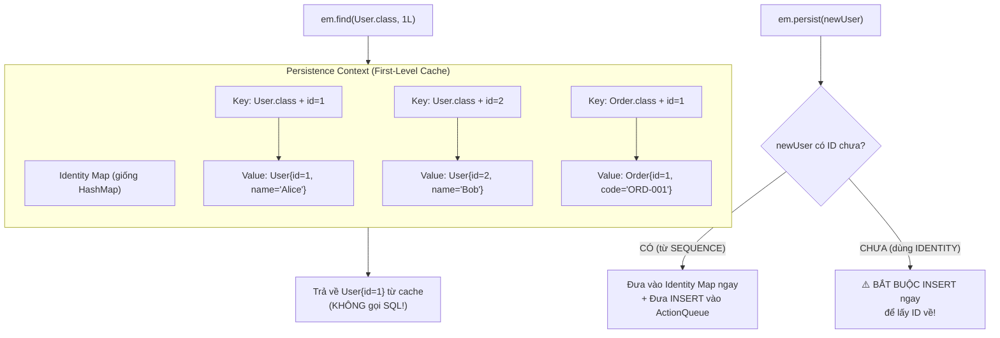

**JPA cần ID để:**
1. **Xác định danh tính duy nhất** — giống key trong `HashMap<EntityKey, Entity>`.
2. **Tránh duplicate** — `em.find(User.class, 1L)` gọi 10 lần chỉ trả về đúng 1 object.
3. **Dirty Checking** — So sánh trạng thái hiện tại với snapshot ban đầu dựa trên ID.
4. **Phân biệt `persist()` vs `merge()`** — Entity mới (ID = null) → `INSERT`; Entity cũ (ID ≠ null) → `SELECT` + `UPDATE`.

### 2.2 Thời điểm sinh ID quyết định mọi thứ

Đây là điểm mấu chốt: **Khi nào ID được sinh** ảnh hưởng trực tiếp đến khả năng Batching:

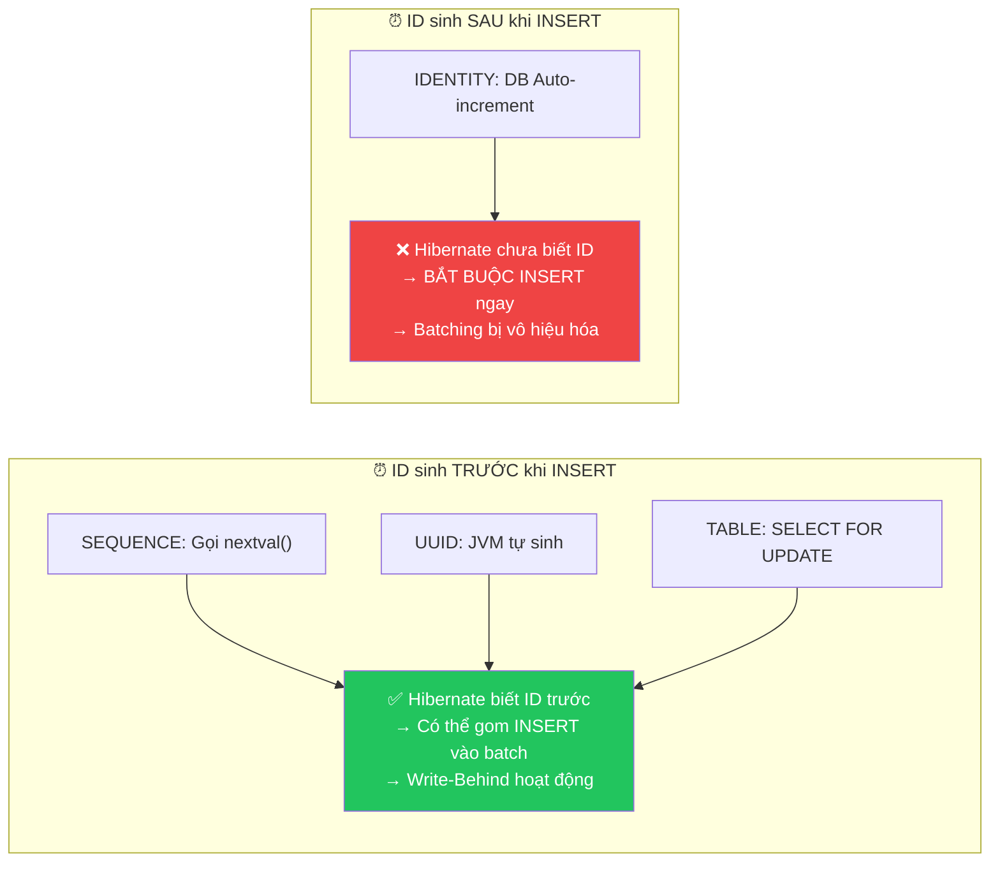

---

## 3. Bốn chiến lược `@GeneratedValue` của JPA

```
┌─────────────────────────────────────────────────────────────────────────────┐
│                         @GeneratedValue Strategies                          │
├──────────────────┬──────────────────┬──────────────────┬────────────────────┤
│    IDENTITY      │     SEQUENCE     │      TABLE       │      UUID v7       │
│ (DB Auto-inc)    │ (DB Sequence)    │ (Bảng phụ giả    │ (Hibernate 7.x     │
│                  │                  │  lập Sequence)   │  extension)        │
│ ⚡ Đơn giản       │ 🚀 Hiệu năng cao │ 🐌 Chậm nhất      │ 🌐 Phân tán         │
└──────────────────┴──────────────────┴──────────────────┴────────────────────┘
```

---

### 3.1 `GenerationType.IDENTITY` — Auto Increment

#### 3.1.1 Cơ chế hoạt động

Dựa vào cột `AUTO_INCREMENT` (MySQL) hoặc `GENERATED ALWAYS AS IDENTITY` (PostgreSQL 10+). CSDL tự sinh ID **sau khi** câu lệnh `INSERT` được thực thi thành công.

```java
@Id
@GeneratedValue(strategy = GenerationType.IDENTITY)
private Long id;
```

**SQL DDL sinh ra:**
```sql
-- MySQL 8.x:
CREATE TABLE products (
    id BIGINT NOT NULL AUTO_INCREMENT,
    name VARCHAR(255),
    PRIMARY KEY (id)
);

-- PostgreSQL 17:
CREATE TABLE products (
    id BIGINT GENERATED BY DEFAULT AS IDENTITY,
    name VARCHAR(255) NOT NULL,
    PRIMARY KEY (id)
);
```

#### 3.1.2 Ưu điểm
- **Đơn giản nhất** — không cần cấu hình thêm bất cứ thứ gì.
- **Tự động tăng** — DB hoàn toàn quản lý, không bao giờ bị trùng.
- **Hỗ trợ mọi CSDL phổ biến** — MySQL, PostgreSQL, SQL Server, H2.

#### 3.1.3 Nhược điểm chí mạng — Phá vỡ Write-Behind & JDBC Batching

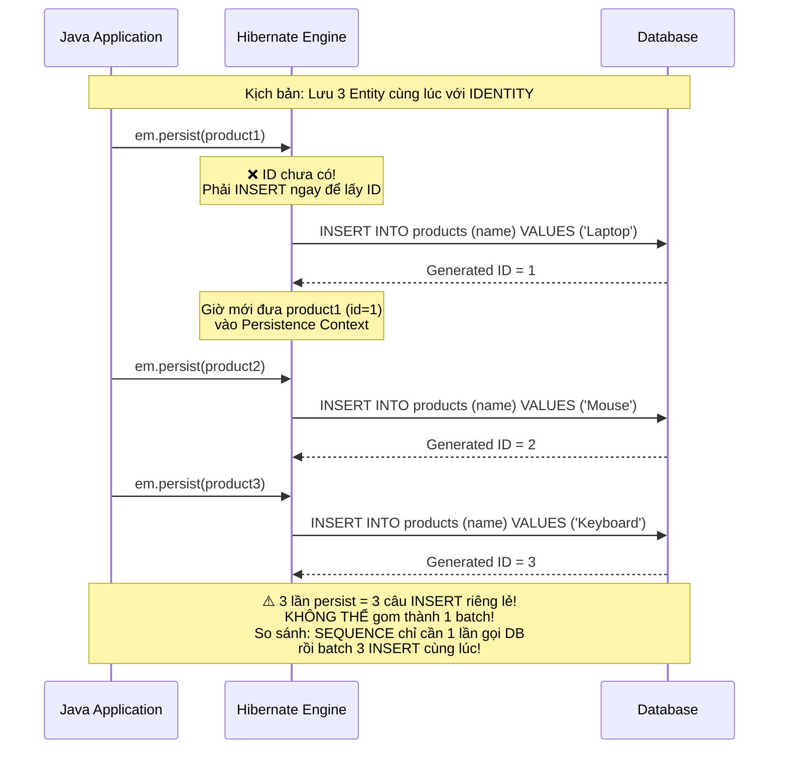

**Tại sao IDENTITY phá vỡ Batching?**

1. **JPA bắt buộc phải có ID** để nạp Entity vào Persistence Context (Identity Map pattern).
2. `IDENTITY` chỉ sinh ID **sau khi** `INSERT` thực thi thành công.
3. → Hibernate **bị ép buộc gửi ngay lập tức lệnh INSERT** xuống DB mỗi khi gọi `persist()`.
4. → Hoàn toàn phá vỡ cơ chế **Write-Behind** (ActionQueue không thể tích lũy INSERT).
5. → **Vô hiệu hóa 100% JDBC Batching** (`hibernate.jdbc.batch_size` bị bỏ qua hoàn toàn).

> [!WARNING]
> **Benchmark thực tế:** Insert 10.000 bản ghi:
> - `IDENTITY`: ~8-12 giây (10.000 câu INSERT riêng lẻ, mỗi câu 1 round-trip tới DB).
> - `SEQUENCE` (allocationSize=50): ~0.5-1 giây (200 lần gọi nextval + JDBC Batch INSERT).
>
> → **Chênh lệch 10-20 lần** chỉ vì chiến lược sinh ID!

#### 3.1.4 Khi nào vẫn chấp nhận dùng IDENTITY?
- Dự án nhỏ, CRUD đơn giản, ít insert hàng loạt.
- MySQL < 8.0 (không hỗ trợ `SEQUENCE`).
- Prototype / POC / Pet project.
- Khi team chưa quen với `SEQUENCE` và ưu tiên tốc độ phát triển.

---

### 3.2 `GenerationType.SEQUENCE` ⭐ — Chuẩn Enterprise Khuyên dùng

#### 3.2.1 Cơ chế hoạt động

Dựa vào đối tượng `SEQUENCE` độc lập trong CSDL (PostgreSQL, Oracle, SQL Server, H2). Sequence là **bộ đếm nguyên tử (Atomic Counter)** ở cấp CSDL, tách biệt hoàn toàn khỏi bất kỳ bảng nào.

```java
@Id
@GeneratedValue(strategy = GenerationType.SEQUENCE, generator = "order_seq_gen")
@SequenceGenerator(
    name = "order_seq_gen",          // Tên logic trong JPA (tham chiếu nội bộ)
    sequenceName = "orders_id_seq",  // Tên SEQUENCE thực tế trong CSDL
    initialValue = 1,                // Giá trị bắt đầu
    allocationSize = 50              // ⭐ Số lượng ID lấy trước mỗi lần gọi DB
)
private Long id;
```

**SQL DDL:**
```sql
-- PostgreSQL:
CREATE SEQUENCE orders_id_seq START WITH 1 INCREMENT BY 50;
-- ↑ INCREMENT BY phải BẰNG allocationSize!
```

#### 3.2.2 Thuật toán Pooled-Lo Optimizer — Trái tim của SEQUENCE

Đây là cơ chế **giảm số lần gọi DB xuống tối thiểu** khi sinh ID:

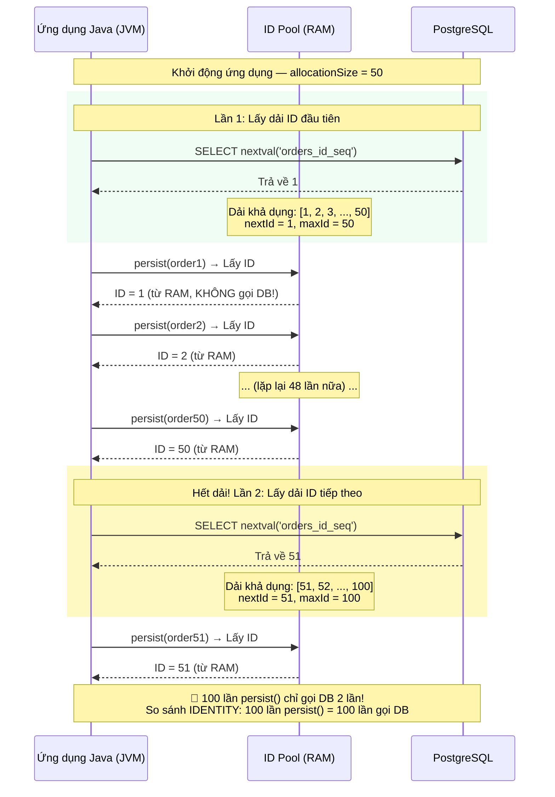

**Giải thích thuật toán Pooled-Lo:**

1. Hibernate gọi `SELECT nextval('orders_id_seq')` → DB trả về giá trị `lo_value`.
2. Hibernate tính toán dải ID: `[lo_value, lo_value + allocationSize - 1]`.
3. Trong dải này, mỗi lần `persist()` → Hibernate lấy ID tiếp theo **từ RAM** mà **KHÔNG cần gọi DB**.
4. Khi hết dải → Gọi `nextval()` lần nữa để lấy dải mới.

> [!TIP]
> **Giá trị `allocationSize` nên đặt bao nhiêu?**
>
> | Mức sử dụng | `allocationSize` | Lý do |
> | :--- | :---: | :--- |
> | Dự án thông thường | `50` (Mặc định JPA) | Đủ tốt cho hầu hết trường hợp. |
> | Hệ thống ghi cao (E-commerce, IoT) | `100` — `200` | Giảm tần suất gọi DB xuống. |
> | Batch Processing / ETL | `500` — `1000` | Import hàng triệu bản ghi cần throughput tối đa. |
> | Hệ thống ít ghi (CMS, Blog) | `20` — `30` | Giảm "khoảng trống" ID khi restart. |
>
> **⚠️ Lưu ý:** Nếu ứng dụng restart giữa chừng, các ID trong dải đã lấy mà chưa dùng sẽ bị "mất" (tạo khoảng trống trong ID). Đây là hành vi **hoàn toàn bình thường** và **không phải lỗi** — ID không bắt buộc phải liên tục!

#### 3.2.3 Cạm bẫy: `allocationSize` không khớp `INCREMENT BY`

Một trong những lỗi phổ biến nhất khi dùng `SEQUENCE`:

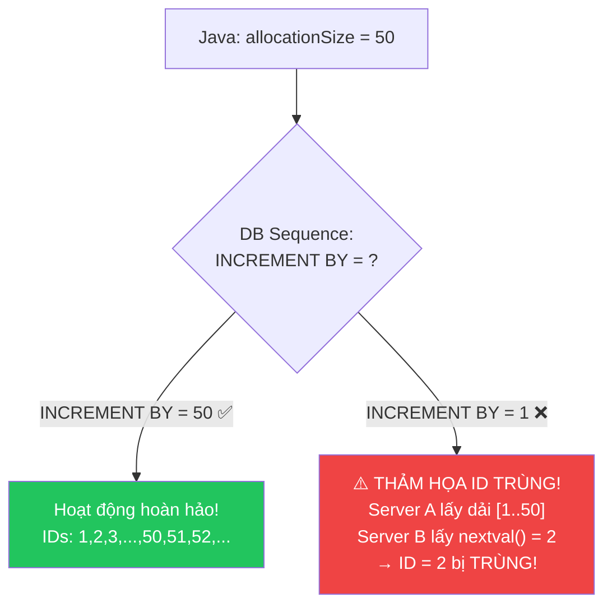

> [!CAUTION]
> **Quy tắc bắt buộc:** `allocationSize` trong Java **PHẢI BẰNG** `INCREMENT BY` của SEQUENCE trong CSDL!
>
> ```sql
> -- ✅ ĐÚNG: allocationSize = 50 → INCREMENT BY = 50
> CREATE SEQUENCE orders_id_seq START WITH 1 INCREMENT BY 50;
>
> -- ❌ SAI: allocationSize = 50 nhưng INCREMENT BY = 1
> CREATE SEQUENCE orders_id_seq START WITH 1 INCREMENT BY 1;
> -- → Sẽ gây trùng ID khi chạy nhiều instance!
> ```
>
> Nếu bạn dùng `ddl-auto = create` hoặc `update`, Hibernate sẽ tự tạo Sequence với `INCREMENT BY` đúng. Nhưng nếu DBA tạo Sequence thủ công mà quên khớp giá trị → **thảm họa trùng ID** trên production!

#### 3.2.4 SEQUENCE với MySQL

MySQL truyền thống không có đối tượng `SEQUENCE`. Tuy nhiên:

- **MySQL 8.0+:** Vẫn không hỗ trợ `CREATE SEQUENCE` chuẩn SQL.
- **Hibernate workaround:** Khi dùng `GenerationType.SEQUENCE` trên MySQL, Hibernate **tự động fallback** sang chiến lược `TABLE` — tạo bảng phụ `hibernate_sequences` để giả lập Sequence.
- **Spring Boot 4.1.0 + Hibernate 7:** Hibernate sử dụng `SequenceStyleGenerator` — nếu phát hiện MySQL (không hỗ trợ SEQUENCE thật), nó tự động dùng bảng thay thế.

```yaml
# application.yml — Cấu hình cho MySQL với SEQUENCE fallback
spring:
  jpa:
    properties:
      hibernate:
        id:
          db_structure_naming_strategy: standard  # Hibernate 7 naming strategy
```

> [!NOTE]
> Nếu dùng MySQL, cân nhắc dùng `IDENTITY` (đơn giản hơn) hoặc chuyển sang UUID v7 (tối ưu cho Microservices). Giả lập SEQUENCE bằng bảng phụ trên MySQL **không mang lại lợi ích hiệu năng** vì bảng phụ vẫn bị Lock contention giống `GenerationType.TABLE`.

---

### 3.3 `GenerationType.TABLE` — Giả lập Sequence bằng bảng phụ

#### 3.3.1 Cơ chế hoạt động

JPA tạo một bảng phụ chuyên lưu trữ giá trị ID hiện tại cho từng Entity. Mỗi lần sinh ID:
1. `SELECT next_val FROM id_sequences WHERE sequence_name = 'product_id' FOR UPDATE` (Row Lock!).
2. `UPDATE id_sequences SET next_val = next_val + allocationSize WHERE sequence_name = 'product_id'`.
3. Trả về giá trị cũ cho ứng dụng.

```java
@Id
@GeneratedValue(strategy = GenerationType.TABLE, generator = "id_gen")
@TableGenerator(
    name = "id_gen",
    table = "id_sequences",          // Bảng phụ lưu các bộ đếm
    pkColumnName = "sequence_name",  // Cột phân biệt Entity nào
    pkColumnValue = "product_id",    // Giá trị cho Entity này
    valueColumnName = "next_val",    // Cột chứa giá trị ID hiện tại
    allocationSize = 50              // Tương tự SEQUENCE
)
private Long id;
```

**Bảng phụ trong CSDL:**
```sql
CREATE TABLE id_sequences (
    sequence_name VARCHAR(255) NOT NULL PRIMARY KEY,
    next_val BIGINT NOT NULL
);

-- Dữ liệu:
-- | sequence_name | next_val |
-- |---------------|----------|
-- | product_id    | 1        |
-- | order_id      | 1        |
-- | user_id       | 1        |
```

#### 3.3.2 Vấn đề hiệu năng nghiêm trọng

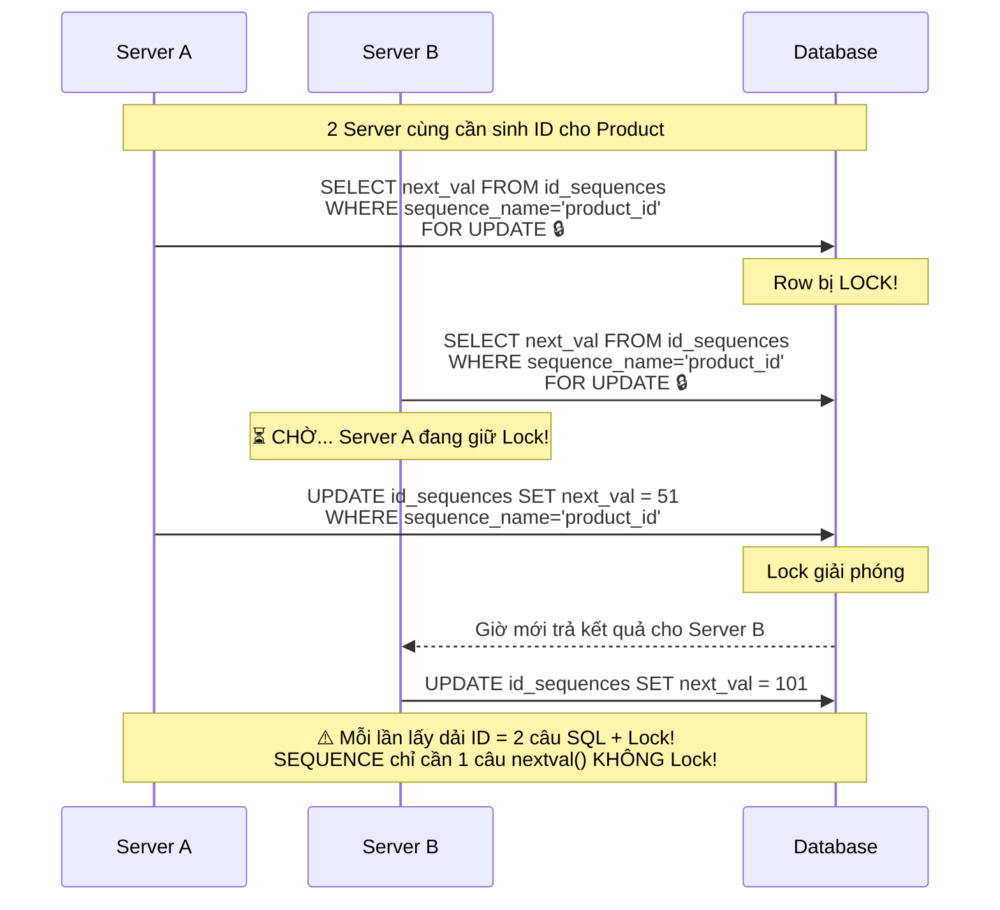

> [!CAUTION]
> **Không khuyến nghị sử dụng `TABLE`** trừ khi CSDL không hỗ trợ `SEQUENCE` **và** bạn cần allocationSize. Lý do:
> - `SELECT FOR UPDATE` → **Row-level Lock** trên bảng phụ.
> - Trong hệ thống concurrent cao, tất cả request **xếp hàng chờ Lock** → **Bottleneck nghiêm trọng**.
> - Hiệu năng kém hơn `SEQUENCE` thật từ **5 đến 10 lần**.
> - MySQL 8.0+ dù không có `CREATE SEQUENCE`, nhưng `IDENTITY` + batching thủ công vẫn tốt hơn `TABLE`.

---

### 3.4 `GenerationType.AUTO` — JPA tự chọn chiến lược

```java
@Id
@GeneratedValue(strategy = GenerationType.AUTO)  // Hoặc chỉ @GeneratedValue
private Long id;
```

JPA Provider (Hibernate) sẽ tự chọn chiến lược dựa trên Dialect của CSDL:

| CSDL | Hibernate 7 chọn | Ghi chú |
| :--- | :--- | :--- |
| PostgreSQL | `SEQUENCE` | PostgreSQL hỗ trợ SEQUENCE native. |
| Oracle | `SEQUENCE` | Oracle hỗ trợ SEQUENCE native. |
| MySQL | `TABLE` (giả lập) | MySQL không có SEQUENCE → fallback bảng phụ. |
| H2 (Test) | `SEQUENCE` | H2 hỗ trợ SEQUENCE. |
| SQL Server | `SEQUENCE` | SQL Server 2012+ hỗ trợ SEQUENCE. |

> [!WARNING]
> **Không khuyến nghị dùng `AUTO`** vì bạn mất kiểm soát:
> - Trên MySQL, `AUTO` chọn `TABLE` (chậm) thay vì `IDENTITY` (nhanh hơn cho MySQL).
> - Khi đổi DB (dev dùng H2, prod dùng MySQL), chiến lược có thể thay đổi → hành vi khác nhau.
> - **Best practice:** Luôn khai báo rõ ràng chiến lược bạn muốn.

---

### 3.5 UUID v7 (Time-Ordered Epoch UUID) — Chuẩn hiện đại cho Microservices

#### 3.5.1 Tại sao cần UUID cho Khóa chính?

Trong kiến trúc phân tán (Microservices), dùng khóa chính tự tăng (`Long`) có 3 nhược điểm nghiêm trọng:

| Vấn đề | Chi tiết | Ví dụ |
| :--- | :--- | :--- |
| **Enumeration Attack** | Kẻ gian đoán ID bằng cách tăng/giảm giá trị. | `/api/orders/101` → thử `/api/orders/102` → Lộ dữ liệu! |
| **Khó Sharding** | Khi chia dữ liệu ra nhiều DB server, cần phối hợp giữa các node để tránh trùng ID. | Server A sinh ID=100, Server B cũng sinh ID=100 → Xung đột! |
| **Lộ thông tin kinh doanh** | Đối thủ biết bạn có bao nhiêu khách hàng, đơn hàng. | `order_id = 50000` → Đối thủ biết bạn đã có 50.000 đơn! |

#### 3.5.2 UUID v4 vs UUID v7 — Bài học đau đớn về B-Tree Index

**UUID v4 (Random)** giải quyết được 3 vấn đề trên, nhưng tạo ra **vấn đề mới nghiêm trọng hơn**:

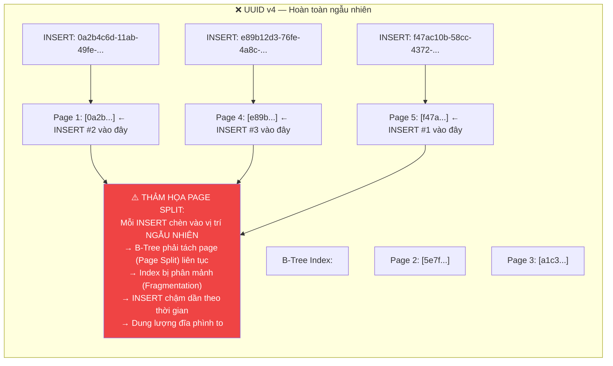

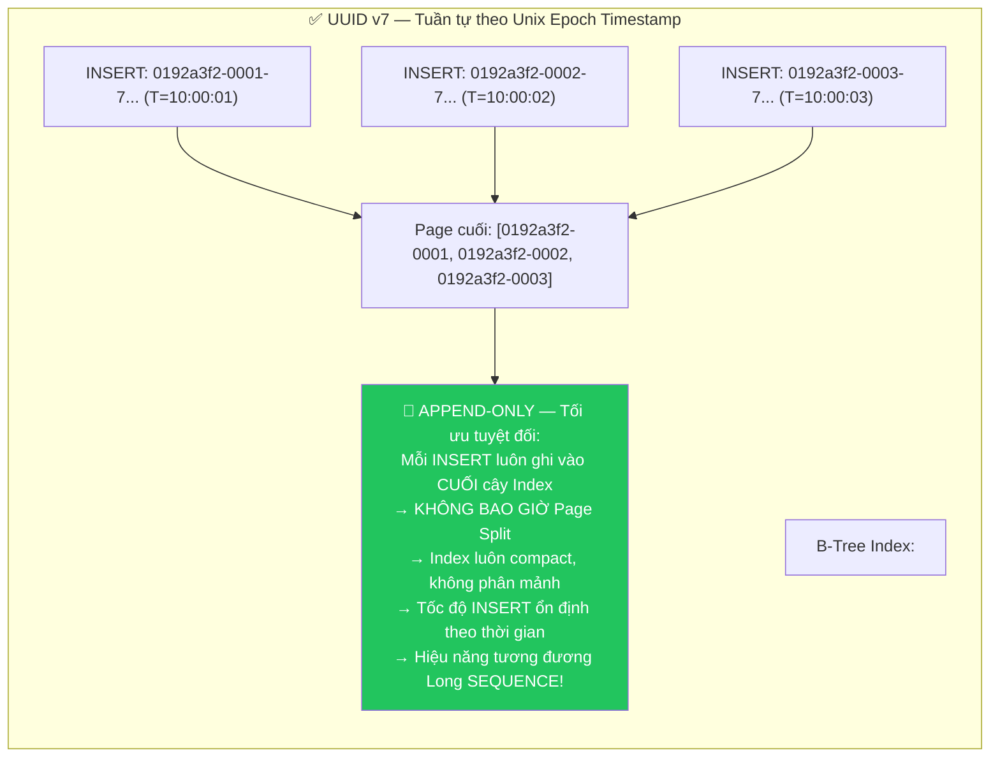

#### 3.5.3 Cấu trúc bên trong UUID v7 (RFC 9562)

```
UUID v7: 0192a3f2-7e8b-7c9d-b5a1-4f8e2d6c1a3b
         ├────────────┤ ├──┤ ├──┤ ├──────────────┤
         48-bit Unix    4-bit 2-bit  62-bit
         timestamp (ms) ver   var   random/counter

Ý nghĩa:
├── 48-bit timestamp: Số milliseconds từ Unix Epoch (01/01/1970)
│   → Đảm bảo sắp xếp tuần tự theo thời gian
│   → Có thể hoạt động tới năm 10.889 AD
│
├── 4-bit version: Luôn = 0111 (version 7)
│
├── 2-bit variant: Luôn = 10 (RFC 4122 variant)
│
└── 62-bit random: Entropy ngẫu nhiên
    → Đảm bảo duy nhất ngay cả khi 2 UUID sinh cùng millisecond
    → Xác suất trùng: 1/2^62 ≈ 1/4.6 * 10^18 (gần như bằng 0)
```

#### 3.5.4 Cấu hình UUID v7 trong Hibernate 7 / Spring Boot 4.1.0

Hibernate 7.x cung cấp annotation `@UuidGenerator` tích hợp sẵn:

```java
import org.hibernate.annotations.UuidGenerator;
import java.util.UUID;

@Entity
@Table(name = "invoices")
@Getter @Setter
@NoArgsConstructor(access = AccessLevel.PROTECTED)
public class Invoice {

    @Id
    @GeneratedValue  // Kết hợp với @UuidGenerator
    @UuidGenerator(style = UuidGenerator.Style.TIME) // ⭐ UUID v7 time-ordered
    @Column(columnDefinition = "uuid", updatable = false, nullable = false)
    private UUID id;

    @Column(nullable = false, unique = true, length = 20)
    private String invoiceNumber;

    @Column(nullable = false, precision = 19, scale = 4)
    private BigDecimal totalAmount;

    @Column(nullable = false, length = 3)
    private String currency;

    public Invoice(String invoiceNumber, BigDecimal totalAmount, String currency) {
        this.invoiceNumber = invoiceNumber;
        this.totalAmount = totalAmount;
        this.currency = currency;
    }
}
```

**Bảng so sánh 3 `Style` của `@UuidGenerator`:**

| Style | Loại UUID | Cơ chế sinh | Index Performance | Dùng khi |
| :--- | :---: | :--- | :---: | :--- |
| `Style.RANDOM` | UUID v4 | `SecureRandom` hoàn toàn ngẫu nhiên. | ❌ B-Tree Fragmentation | Hầu như **không nên** dùng cho PK. |
| `Style.TIME` ⭐ | UUID v7 | 48-bit Unix timestamp (ms) + 62-bit random. | ✅ Append-only, tối ưu | **Khuyến nghị cho PK Microservices**. |
| `Style.AUTO` | Tùy JVM | Hibernate tự chọn tốt nhất cho môi trường hiện tại. | Tùy | Khi không cần kiểm soát chi tiết. |

#### 3.5.5 Lưu trữ UUID trong CSDL — Tối ưu dung lượng

| CSDL | Kiểu cột | Dung lượng | Ghi chú |
| :--- | :--- | :---: | :--- |
| PostgreSQL | `UUID` (native type) ⭐ | 16 bytes | Hỗ trợ native, index tối ưu nhất. |
| MySQL 8+ | `BINARY(16)` | 16 bytes | MySQL không có kiểu `UUID` native. |
| MySQL (dễ đọc) | `CHAR(36)` | 36 bytes | Dễ debug nhưng tốn gấp đôi dung lượng + index chậm hơn. |

```java
// PostgreSQL — Dùng kiểu uuid native:
@Column(columnDefinition = "uuid", updatable = false, nullable = false)
private UUID id;

// MySQL — Dùng BINARY(16) để tiết kiệm:
@Column(columnDefinition = "BINARY(16)", updatable = false, nullable = false)
private UUID id;
```

> [!TIP]
> **PostgreSQL** là sự lựa chọn tốt nhất khi dùng UUID vì có kiểu `UUID` native — lưu trữ dưới dạng 16 bytes, index B-Tree tối ưu sẵn, và hỗ trợ các operator so sánh UUID trực tiếp.

#### 3.5.6 `Persistable<ID>` — Giải quyết cạm bẫy `save()` với UUID tự gán

Khi Entity dùng UUID, bạn có thể gán ID trước khi persist (ví dụ: sinh UUID ở constructor). Nhưng điều này tạo ra **cạm bẫy hiệu năng nghiêm trọng:**

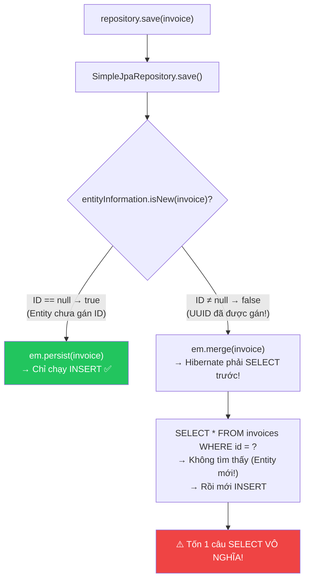

**Giải pháp: Implement `Persistable<UUID>`**

```java
import org.springframework.data.domain.Persistable;

@Entity
@Table(name = "invoices")
@Getter @Setter
@NoArgsConstructor(access = AccessLevel.PROTECTED)
public class Invoice implements Persistable<UUID> {

    @Id
    @GeneratedValue
    @UuidGenerator(style = UuidGenerator.Style.TIME)
    @Column(columnDefinition = "uuid", updatable = false, nullable = false)
    private UUID id;

    // ... các fields khác ...

    @Transient  // Không lưu vào DB
    private boolean isNew = true;

    @Override
    public boolean isNew() {
        return isNew;  // ← Luôn trả về true khi Entity mới tạo
    }

    @PostPersist  // Callback sau khi INSERT thành công
    @PostLoad     // Callback sau khi SELECT từ DB
    void markNotNew() {
        this.isNew = false;  // ← Sau khi persist/load thì không còn "mới" nữa
    }
}
```

> [!IMPORTANT]
> Với cách này, `SimpleJpaRepository.save()` sẽ **luôn gọi `persist()`** (INSERT) cho Entity mới tạo, thay vì gọi `merge()` (SELECT + INSERT) → **Loại bỏ 100% câu SELECT thừa!**

---

## 4. Composite Primary Key (Khóa chính tổ hợp)

Ngoài các chiến lược sinh khóa đơn (Single-column PK), JPA còn hỗ trợ **Composite Primary Key** — khóa chính gồm nhiều cột:

### 4.1 `@IdClass` — Cách truyền thống

```java
// Bước 1: Tạo class chứa các thuộc tính khóa
// Class này PHẢI: implements Serializable, có equals() & hashCode(), có no-arg constructor
public class EnrollmentId implements Serializable {
    private Long studentId;
    private Long courseId;

    // Constructors, equals(), hashCode()
    @Override
    public boolean equals(Object o) {
        if (this == o) return true;
        if (!(o instanceof EnrollmentId that)) return false;
        return Objects.equals(studentId, that.studentId) &&
               Objects.equals(courseId, that.courseId);
    }

    @Override
    public int hashCode() {
        return Objects.hash(studentId, courseId);
    }
}

// Bước 2: Sử dụng @IdClass trên Entity
@Entity
@Table(name = "enrollments")
@IdClass(EnrollmentId.class)
public class Enrollment {

    @Id
    @Column(name = "student_id")
    private Long studentId;

    @Id
    @Column(name = "course_id")
    private Long courseId;

    private Instant enrolledAt;
    private BigDecimal grade;
}
```

### 4.2 `@EmbeddedId` — Cách hiện đại hơn (Khuyến nghị)

```java
// Bước 1: Tạo Embeddable ID
@Embeddable
@Getter @Setter
@NoArgsConstructor
@AllArgsConstructor
@EqualsAndHashCode  // Lombok tự sinh equals() & hashCode()
public class EnrollmentId implements Serializable {

    @Column(name = "student_id")
    private Long studentId;

    @Column(name = "course_id")
    private Long courseId;
}

// Bước 2: Sử dụng @EmbeddedId trên Entity
@Entity
@Table(name = "enrollments")
@Getter @Setter
@NoArgsConstructor
public class Enrollment {

    @EmbeddedId
    private EnrollmentId id;

    @ManyToOne(fetch = FetchType.LAZY)
    @MapsId("studentId")  // Map studentId trong EmbeddedId → FK student
    @JoinColumn(name = "student_id")
    private Student student;

    @ManyToOne(fetch = FetchType.LAZY)
    @MapsId("courseId")   // Map courseId trong EmbeddedId → FK course
    @JoinColumn(name = "course_id")
    private Course course;

    @Column(nullable = false, updatable = false)
    private Instant enrolledAt = Instant.now();

    @Column(precision = 5, scale = 2)
    private BigDecimal grade;

    public Enrollment(Student student, Course course) {
        this.id = new EnrollmentId(student.getId(), course.getId());
        this.student = student;
        this.course = course;
    }
}
```

**So sánh `@IdClass` vs `@EmbeddedId`:**

| Tiêu chí | `@IdClass` | `@EmbeddedId` ⭐ |
| :--- | :--- | :--- |
| Cách truy cập ID | `enrollment.getStudentId()` | `enrollment.getId().getStudentId()` |
| Có thể dùng `@MapsId`? | ❌ Không | ✅ Có (kết hợp FK + PK) |
| JPQL truy vấn | `WHERE e.studentId = :sid` | `WHERE e.id.studentId = :sid` |
| Tính OOP | Thấp (ID fields nằm rải rác) | Cao (ID gom vào 1 class) |
| Khuyến nghị | Legacy code | ⭐ Dự án mới |

> [!NOTE]
> Composite PK thường dùng cho bảng trung gian khi tách `@ManyToMany` thành Entity. Nếu không có yêu cầu đặc biệt, hãy ưu tiên **Surrogate Key** (ID tự sinh) vì đơn giản hơn và linh hoạt hơn.

---

## 5. `equals()` và `hashCode()` cho Entity — Quyết định tàn khốc nhất

Đây là chủ đề **gây tranh cãi gay gắt nhất** trong cộng đồng JPA/Hibernate. Thiết kế sai sẽ dẫn đến bug ẩn cực kỳ khó phát hiện.

### 5.1 Tại sao không dùng `@Id` cho `equals()` / `hashCode()`?

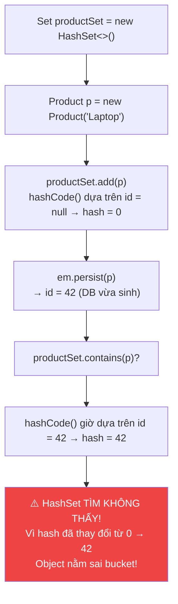

**Vấn đề:** `@Id` chỉ có giá trị **sau khi persist**. Nếu dùng `@Id` cho `hashCode()`:
- Trước persist: `id = null` → `hashCode() = 0`.
- Sau persist: `id = 42` → `hashCode() = 42`.
- → `HashSet` không tìm thấy object vì nó nằm ở bucket cũ (bucket 0), nhưng tìm ở bucket mới (bucket 42)!

### 5.2 Giải pháp chuẩn: Dùng `@NaturalId` (Business Key)

```java
@Entity
@Table(name = "products")
@Getter @Setter
@NoArgsConstructor(access = AccessLevel.PROTECTED)
public class Product {

    @Id
    @GeneratedValue(strategy = GenerationType.SEQUENCE, generator = "product_seq")
    @SequenceGenerator(name = "product_seq", sequenceName = "products_seq", allocationSize = 50)
    private Long id;

    @NaturalId  // ← Khóa tự nhiên bất biến (Hibernate annotation)
    @Column(nullable = false, unique = true, updatable = false, length = 64)
    private String sku;  // VD: "LAPTOP-DELL-XPS-15"

    @Column(nullable = false)
    private String name;

    // ⭐ EQUALS & HASHCODE dựa trên SKU (bất biến, không bao giờ null)
    @Override
    public boolean equals(Object o) {
        if (this == o) return true;
        if (!(o instanceof Product product)) return false;
        return Objects.equals(sku, product.sku);
    }

    @Override
    public int hashCode() {
        return Objects.hash(sku);
        // sku được gán trong constructor → KHÔNG BAO GIỜ thay đổi
        // → hashCode() luôn ổn định → HashSet/HashMap hoạt động đúng
    }

    public Product(String sku, String name) {
        this.sku = Objects.requireNonNull(sku);
        this.name = name;
    }
}
```

### 5.3 Khi Entity KHÔNG có Natural Key — Giải pháp tay trái

Nếu Entity không có thuộc tính business key tự nhiên (ví dụ: `AuditLog`), bạn có 2 lựa chọn:

**Lựa chọn 1: Dùng UUID tự sinh trong constructor**
```java
@Entity
public class AuditLog {
    @Id @GeneratedValue
    private Long id;

    @Column(nullable = false, unique = true, updatable = false)
    private UUID businessKey = UUID.randomUUID(); // Sinh ngay khi new

    @Override
    public boolean equals(Object o) {
        if (this == o) return true;
        if (!(o instanceof AuditLog log)) return false;
        return Objects.equals(businessKey, log.businessKey);
    }

    @Override
    public int hashCode() {
        return Objects.hash(businessKey);
    }
}
```

**Lựa chọn 2: Fixed `hashCode()` + `equals()` dùng `@Id` (Vlad Mihalcea pattern)**
```java
@Override
public boolean equals(Object o) {
    if (this == o) return true;
    if (!(o instanceof AuditLog log)) return false;
    return id != null && Objects.equals(id, log.id);
    //     ↑ Chỉ so sánh khi CẢ HAI đều đã có id (đã persist)
}

@Override
public int hashCode() {
    return getClass().hashCode();
    // ↑ LUÔN trả về cùng 1 giá trị cho mọi instance
    // → hashCode() KHÔNG BAO GIỜ thay đổi
    // → HashSet hoạt động đúng (nhưng hiệu năng kém nếu Set lớn)
}
```

> [!TIP]
> **Quy tắc chọn chiến lược equals/hashCode:**
>
> | Entity có... | Dùng cho equals/hashCode | Ví dụ |
> | :--- | :--- | :--- |
> | Natural Key bất biến | ⭐ `@NaturalId` (tốt nhất) | `Product.sku`, `User.email`, `Invoice.invoiceNumber` |
> | UUID tự sinh | UUID field | `AuditLog.businessKey = UUID.randomUUID()` |
> | Không có gì đặc biệt | Fixed hashCode + ID check | Các Entity phụ trợ, bảng mapping |

---

## 6. `@MappedSuperclass` — Tái sử dụng ID Strategy cho nhiều Entity

Khi toàn bộ Entity trong dự án đều dùng cùng một chiến lược ID, bạn không cần copy-paste `@Id` + `@GeneratedValue` ở mỗi Entity:

```java
// ═══════════════════════════════════════════════
// Base Entity cho toàn bộ dự án — SEQUENCE + Audit fields
// ═══════════════════════════════════════════════
@MappedSuperclass
@Getter @Setter
@NoArgsConstructor(access = AccessLevel.PROTECTED)
public abstract class BaseEntity {

    @Id
    @GeneratedValue(strategy = GenerationType.SEQUENCE, generator = "shared_seq")
    @SequenceGenerator(name = "shared_seq", sequenceName = "shared_seq", allocationSize = 50)
    private Long id;

    @Column(name = "created_at", nullable = false, updatable = false)
    private Instant createdAt;

    @Column(name = "updated_at")
    private Instant updatedAt;

    @PrePersist
    protected void onPrePersist() {
        this.createdAt = Instant.now();
    }

    @PreUpdate
    protected void onPreUpdate() {
        this.updatedAt = Instant.now();
    }
}
```

```java
// Mọi Entity chỉ cần extends BaseEntity — DRY tối đa!
@Entity
@Table(name = "products")
public class Product extends BaseEntity {
    // Tự động có: id, createdAt, updatedAt, PrePersist, PreUpdate
    @Column(nullable = false)
    private String name;

    @Column(nullable = false, precision = 19, scale = 4)
    private BigDecimal price;
}

@Entity
@Table(name = "orders")
public class Order extends BaseEntity {
    // Tự động có: id, createdAt, updatedAt
    @Column(nullable = false, unique = true)
    private String orderCode;
}
```

> [!NOTE]
> `@MappedSuperclass` **KHÔNG tạo bảng riêng** trong CSDL. Các thuộc tính của nó được "copy" xuống bảng của từng Entity con. Đây là khác biệt lớn so với `@Inheritance` (tạo bảng riêng hoặc chia sẻ bảng).

---

## 7. Bảng so sánh toàn diện — Ma trận quyết định cuối cùng

| Tiêu chí | `IDENTITY` | `SEQUENCE` ⭐ | `TABLE` | UUID v7 |
| :--- | :---: | :---: | :---: | :---: |
| **JDBC Batching** | ❌ Không thể | ✅ Hoàn hảo | ✅ Hỗ trợ | ✅ Hoàn hảo |
| **Write-Behind** | ❌ Bị phá vỡ | ✅ Giữ nguyên | ✅ Giữ nguyên | ✅ Giữ nguyên |
| **Hiệu năng sinh ID** | Nhanh (DB) | ⭐ Rất nhanh (allocationSize) | 🐌 Chậm (Lock) | Nhanh (JVM) |
| **Lock contention** | Không | Không (Atomic counter) | ⚠️ Nghiêm trọng | Không |
| **Phù hợp Microservices** | ❌ Khó Sharding | ❌ Cần phối hợp | ❌ Bottleneck | ⭐ Hoàn hảo |
| **Che giấu thông tin** | ❌ Lộ thứ tự | ❌ Lộ thứ tự | ❌ Lộ thứ tự | ✅ Bảo mật |
| **B-Tree Index** | ✅ Append-only | ✅ Append-only | ✅ Append-only | ✅ Append-only |
| **Dung lượng cột** | 8 bytes | 8 bytes | 8 bytes | 16 bytes |
| **Đọc bởi con người** | ✅ Dễ (1, 2, 3...) | ✅ Dễ | ✅ Dễ | ❌ Khó đọc |
| **CSDL hỗ trợ** | Tất cả | PG, Oracle, SS | Tất cả | Tất cả (JVM sinh) |
| **Khuyến nghị** | Dự án nhỏ, MySQL | ⭐ Enterprise | Tránh nếu có thể | Microservices, API public |

### Sơ đồ quyết định: Chọn chiến lược nào?

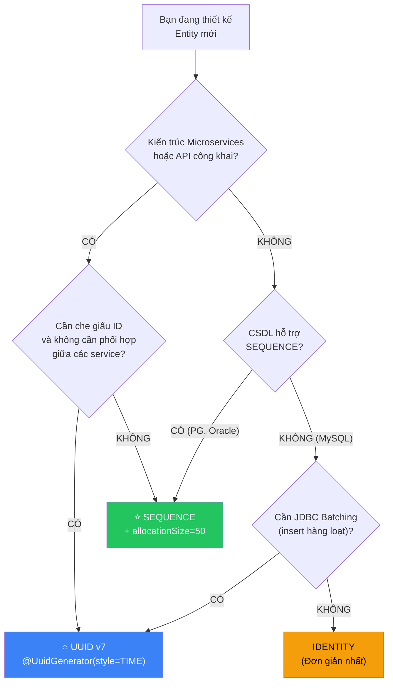

---

## 🔥 Ứng dụng thực tế (Thực tế dùng để làm gì? Giải quyết vấn đề gì?)

### Ví dụ thực tế 1: Tối ưu import hàng loạt sản phẩm (Batch Processing)

**Yêu cầu:** Hệ thống E-commerce cần import 100.000 sản phẩm từ file CSV mỗi đêm.

**Trước (IDENTITY) — 15 phút:**
```java
// IDENTITY: 100.000 INSERT riêng lẻ → 100.000 round-trip tới DB
@Id @GeneratedValue(strategy = GenerationType.IDENTITY)
private Long id;
// Kết quả: ~15 phút cho 100.000 records
```

**Sau (SEQUENCE + Batching) — 30 giây:**
```java
// SEQUENCE: 2.000 lần gọi nextval() + 2.000 JDBC Batch (mỗi batch 50 INSERT)
@Id
@GeneratedValue(strategy = GenerationType.SEQUENCE, generator = "product_seq")
@SequenceGenerator(name = "product_seq", sequenceName = "products_seq", allocationSize = 50)
private Long id;
```
```yaml
spring:
  jpa:
    properties:
      hibernate:
        jdbc:
          batch_size: 50          # Gom 50 INSERT thành 1 batch
        order_inserts: true       # Sắp xếp INSERT theo bảng
        order_updates: true       # Sắp xếp UPDATE theo bảng
```
```
Kết quả: ~30 giây cho 100.000 records → Nhanh hơn 30 lần!
```

### Ví dụ thực tế 2: API thanh toán Microservices — UUID v7

**Yêu cầu:** `payment-service` và `order-service` chạy độc lập trên 2 server khác nhau. Cả hai đều cần sinh ID cho `Transaction` mà **không cần phối hợp**.

```java
@Entity
@Table(name = "transactions")
public class Transaction implements Persistable<UUID> {

    @Id @GeneratedValue
    @UuidGenerator(style = UuidGenerator.Style.TIME)
    @Column(columnDefinition = "uuid")
    private UUID id;

    // API: GET /api/transactions/0192a4f5-7e8b-7c9d-b5a1-4f8e2d6c1a3b
    // ✅ Server A và Server B sinh ID độc lập → KHÔNG BAO GIỜ trùng
    // ✅ Đối thủ không thể đoán ID giao dịch khác
    // ✅ B-Tree Index append-only → Hiệu năng ổn định

    @Transient private boolean isNew = true;
    @Override public boolean isNew() { return isNew; }
    @PostPersist @PostLoad void markNotNew() { isNew = false; }
}
```

### Ví dụ thực tế 3: Bảng trung gian N-N với Composite Key

**Yêu cầu:** Hệ thống quản lý học viên — một sinh viên đăng ký nhiều khóa học, cần tracking ngày đăng ký và điểm số.

```java
// Composite Key = (student_id, course_id) → Đảm bảo 1 sinh viên chỉ đăng ký 1 lần
@EmbeddedId
private EnrollmentId id;

// Ưu điểm: Không cần cột id BIGINT riêng → Tiết kiệm 8 bytes/dòng
// Trên bảng 10 triệu dòng: Tiết kiệm ~76 MB chỉ riêng dung lượng cột + index!
```

---

## 8. Tổng hợp các chủ đề (Bản đồ tra cứu)

### 🟢 Ưu tiên phải biết trước (Bắt buộc)
1. **Vai trò của `@Id` trong Persistence Context:** ID là chìa khóa để JPA quản lý Entity trong Identity Map — không có ID, không có Entity.
2. **Phân biệt `IDENTITY` vs `SEQUENCE`:** `IDENTITY` phá vỡ JDBC Batching, `SEQUENCE` giữ nguyên — đây là kiến thức bắt buộc để trả lời phỏng vấn.
3. **`allocationSize` trong `@SequenceGenerator`:** Hiểu thuật toán Pooled-Lo Optimizer — tại sao `allocationSize = 50` giảm 98% số lần gọi DB.
4. **`allocationSize` phải khớp `INCREMENT BY`:** Không khớp → trùng ID trên production!

### 🟡 Nhóm trung cấp
1. **UUID v7 với `@UuidGenerator(style = TIME)`:** Chuẩn hiện đại cho Microservices — duy nhất toàn cầu, B-Tree append-only, bảo mật.
2. **Cạm bẫy `save()` với UUID tự gán:** `SimpleJpaRepository.save()` gọi `merge()` thay vì `persist()` khi ID ≠ null → giải pháp `Persistable<UUID>`.
3. **`GenerationType.TABLE` vs `SEQUENCE`:** Tại sao `TABLE` gây Lock contention và khi nào (không nên) dùng.
4. **`@MappedSuperclass` cho ID strategy:** Tái sử dụng chiến lược ID + audit fields cho toàn bộ Entity trong dự án.

### 🔴 Nhóm nâng cao
1. **Cấu trúc bên trong UUID v7 (RFC 9562):** 48-bit timestamp + 62-bit random → hiểu tại sao B-Tree Index không bị phân mảnh.
2. **Composite Primary Key (`@EmbeddedId` vs `@IdClass`):** Khi nào dùng khóa tổ hợp, kết hợp với `@MapsId` cho bảng trung gian.
3. **`equals()` / `hashCode()` chuẩn Senior:** Tại sao không dùng `@Id`, giải pháp `@NaturalId`, fixed hashCode (Vlad Mihalcea pattern).
4. **Chiến lược lưu UUID trong CSDL:** `UUID` native (PostgreSQL) vs `BINARY(16)` (MySQL) vs `CHAR(36)` — trade-off dung lượng vs khả năng đọc.
5. **Hibernate `SequenceStyleGenerator` trên MySQL:** Cách Hibernate giả lập SEQUENCE khi CSDL không hỗ trợ native.

---

## 📚 Tài liệu tham khảo chính thống

| Tài liệu | Link liên kết |
|---|---|
| Jakarta Persistence 3.2 — Section 2.4: Primary Keys and Entity Identity | [jakarta.ee/specifications/persistence/3.2](https://jakarta.ee/specifications/persistence/3.2/) |
| Hibernate ORM 7.0 User Guide — Identifiers & Generators | [docs.jboss.org/hibernate/orm/7.0 — Identifiers](https://docs.jboss.org/hibernate/orm/7.0/userguide/html_single/Hibernate_User_Guide.html#identifiers) |
| RFC 9562 — Universally Unique IDentifiers (UUIDs) — UUID v7 | [rfc-editor.org/rfc/rfc9562](https://www.rfc-editor.org/rfc/rfc9562) |
| Vlad Mihalcea — Why you should use UUID v7 as database primary key | [vladmihalcea.com/uuid-database-primary-key](https://vladmihalcea.com/uuid-database-primary-key/) |
| Vlad Mihalcea — How to implement equals and hashCode for JPA Entities | [vladmihalcea.com/equals-and-hashcode](https://vladmihalcea.com/how-to-implement-equals-and-hashcode-using-the-jpa-entity-identifier/) |
| Vlad Mihalcea — Why IDENTITY disables JDBC Batching | [vladmihalcea.com/jpa-entity-identifier-sequence](https://vladmihalcea.com/jpa-entity-identifier-sequence/) |
| Thorben Janssen — Primary Key Mappings with JPA and Hibernate | [thorben-janssen.com/primary-key-mappings-jpa-hibernate](https://thorben-janssen.com/primary-key-mappings-jpa-hibernate/) |
| Baeldung — JPA GenerationType Strategies | [baeldung.com/jpa-strategies-when-to-use](https://www.baeldung.com/jpa-strategies-when-to-use) |

---

> **Tài liệu tiếp theo:** [Relationship Mappings (@OneToOne, @OneToMany, @ManyToOne, @ManyToMany).md](file:///d:/WebSpace/Java-Backend/05-Database/Spring-Data/Spring-Data-JPA/Entity%20Mapping%20%26%20Relationships/Relationship%20Mappings%20%28@OneToOne,%20@OneToMany,%20@ManyToOne,%20@ManyToMany%29.md) — Đi sâu vào nghệ thuật ánh xạ quan hệ bảng, khái niệm Owning Side, Helper Methods và cạm bẫy Lazy Loading trong @OneToOne.
