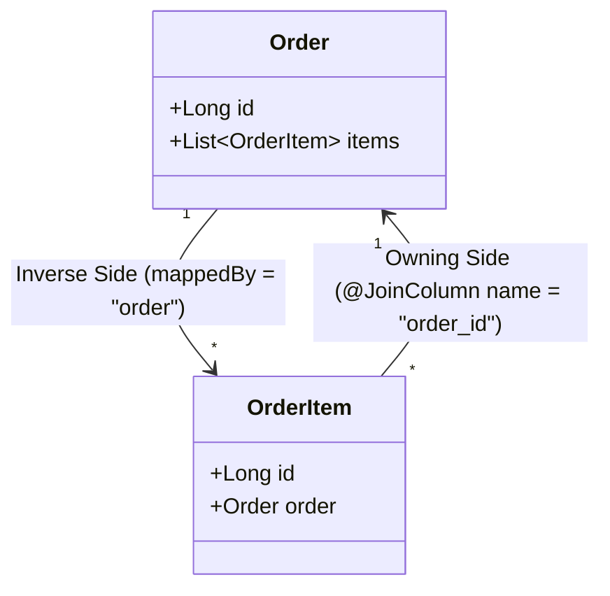
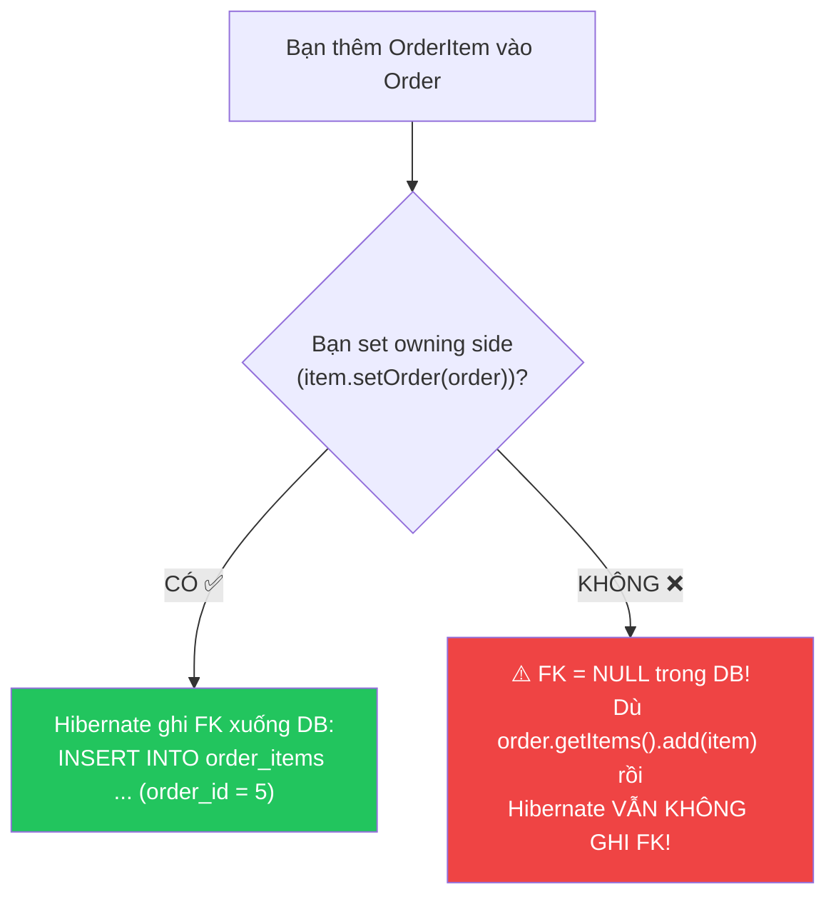
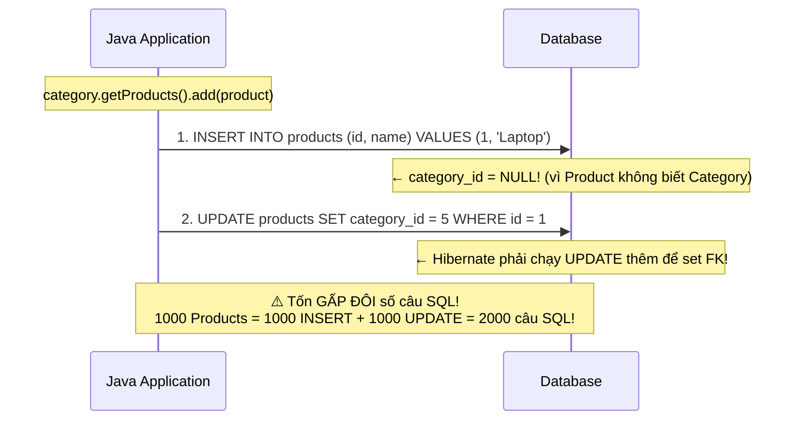
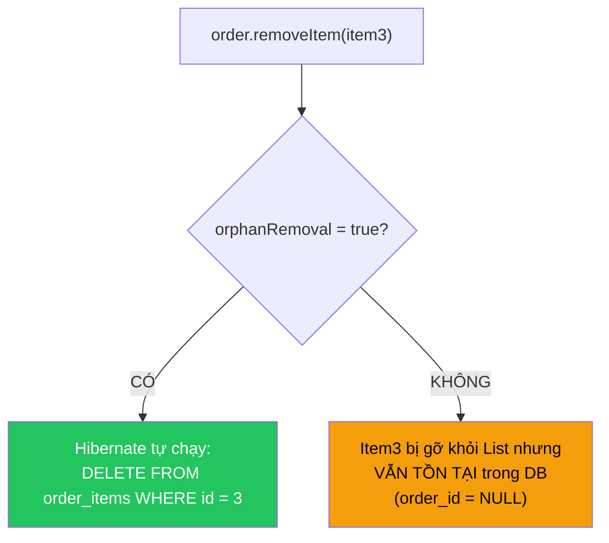
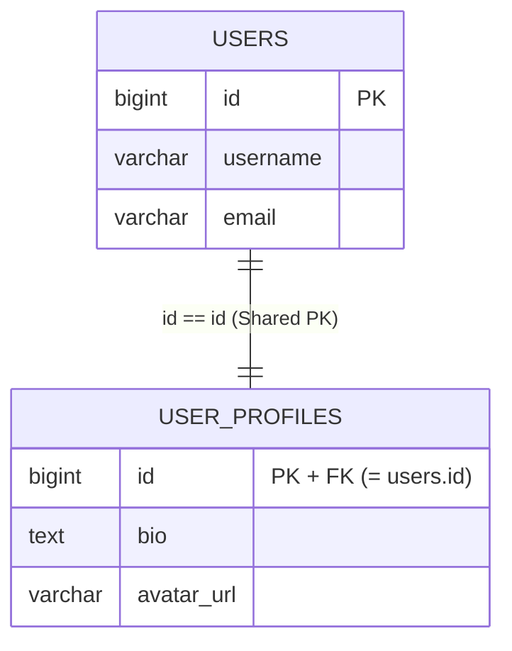
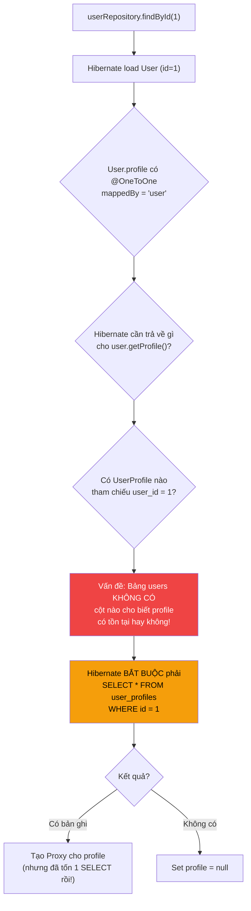
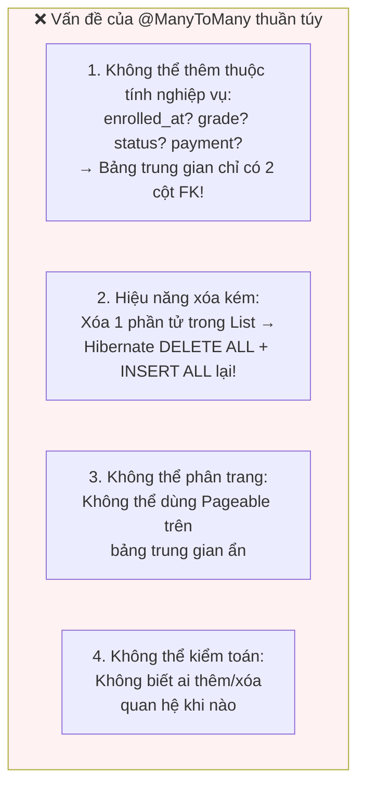
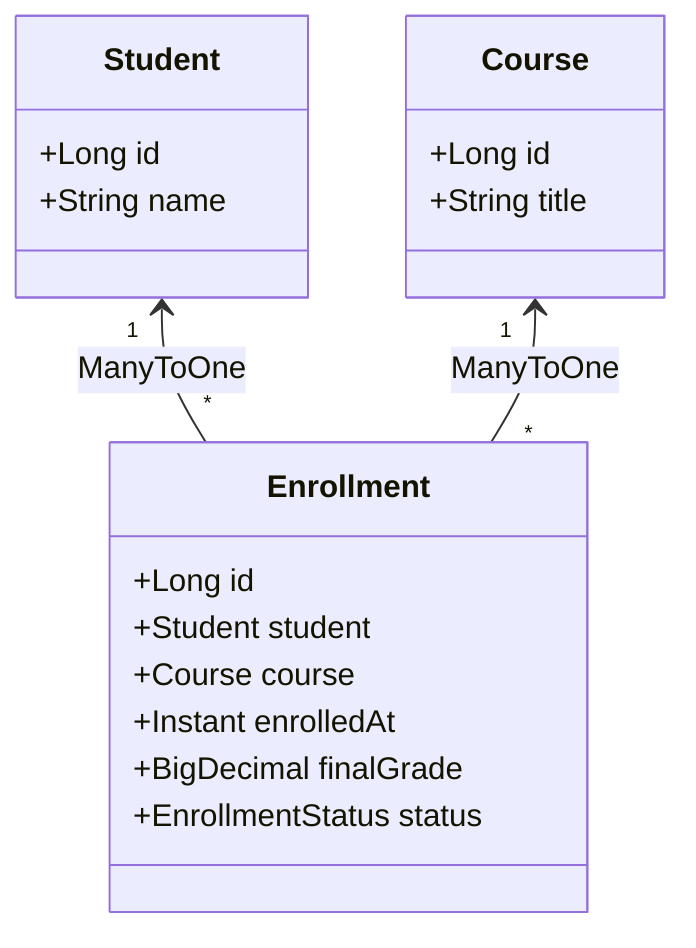
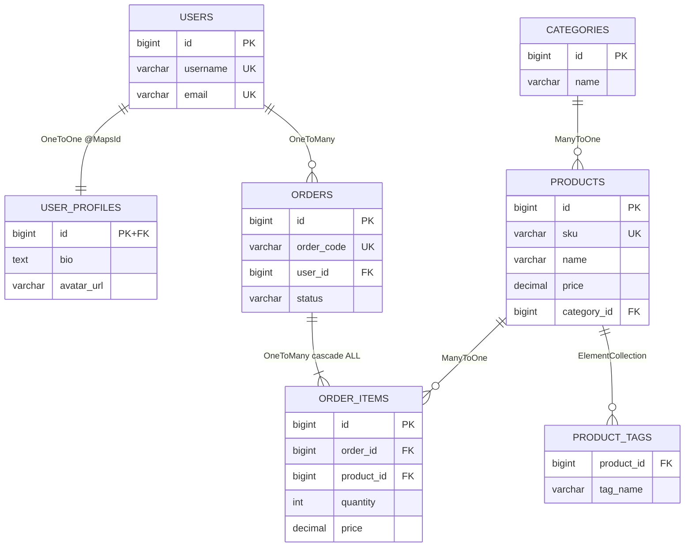

# 🔗 Quan hệ bảng trong JPA: @OneToOne, @OneToMany, @ManyToOne & @ManyToMany

> **Nguồn chính thống:** [Jakarta Persistence 3.2 Specification — Chapter 2.10: Entity Relationships](https://jakarta.ee/specifications/persistence/3.2/) | [Hibernate ORM 7.x User Guide — Associations](https://docs.jboss.org/hibernate/orm/7.0/userguide/html_single/Hibernate_User_Guide.html#associations) | [Spring Data JPA Reference](https://docs.spring.io/spring-data/jpa/reference/index.html)
>
> **Thuộc roadmap:** `5. Database → Spring Data → Spring Data JPA → Entity Mapping & Relationships → Relationship Mappings`

---

## 1. Định nghĩa chính thức từ Jakarta Persistence 3.2 Specification

> *"Relationships among entities may be **one-to-one**, **one-to-many**, **many-to-one**, or **many-to-many**. Relationships are **polymorphic**."*
>
> — **Jakarta Persistence 3.2 — Section 2.10: Entity Relationships**

> *"Every relationship has two sides: the **owning side** and the **inverse (non-owning) side**. The owning side of a relationship determines the updates to the relationship in the database."*
>
> — **Jakarta Persistence 3.2 — Section 2.10.2: Bidirectional Relationships**

### Dịch & giải thích đơn giản:

Trong CSDL quan hệ, các bảng liên kết với nhau qua **Khóa ngoại (Foreign Key)**. Nhưng trong Java, các object liên kết qua **reference** (biến tham chiếu). JPA cần một bộ quy tắc để ánh xạ giữa 2 thế giới này:

> **Thế giới Database:** Quan hệ là **cột FK** nằm ở **một bảng duy nhất** → Chỉ có 1 chiều.
>
> **Thế giới Java:** Quan hệ có thể đi **2 chiều** (`order.getItems()` + `item.getOrder()`) → JPA phải xác định **bên nào có quyền ghi FK xuống DB**.

> [!IMPORTANT]
> Hiểu rõ **Owning Side vs Inverse Side** là chìa khóa để tránh hàng loạt bug ngầm: từ INSERT/UPDATE thừa, Foreign Key bị NULL, đến các collection không được đồng bộ giữa Java và Database.

---

## 2. Khái niệm Cốt lõi: Owning Side vs Inverse Side (`mappedBy`)

Đây là khái niệm **quan trọng nhất** trong toàn bộ chương Relationship Mappings. Nếu bạn chỉ có 5 phút để học, hãy học phần này.

### 2.1 Quy tắc vàng



| Khái niệm | Vị trí khai báo | Đặc điểm nhận dạng | Trách nhiệm đối với CSDL |
| :--- | :--- | :--- | :--- |
| **Owning Side** ⭐ | Bên **nhiều** (`@ManyToOne`) hoặc bên giữ FK. | Có annotation **`@JoinColumn`**. | **CHỈ CÓ bên này mới có quyền cập nhật giá trị cột FK** xuống CSDL! |
| **Inverse Side** | Bên **một** (`@OneToMany`). | Có thuộc tính **`mappedBy = "tên_field_bên_owning"`**. | **Chỉ đọc** — Mọi thay đổi trên collection bên này bị Hibernate **hoàn toàn lờ đi** nếu bên Owning Side không được set! |

### 2.2 Minh họa bằng sơ đồ quyết định



> [!CAUTION]
> Đây là lỗi phổ biến nhất của lập trình viên mới học JPA: Chỉ gọi `order.getItems().add(item)` mà quên gọi `item.setOrder(order)`. Kết quả: FK trong database là `NULL` → Dữ liệu mồ côi, quan hệ bị đứt!

---

## 3. Quan hệ `@ManyToOne` & `@OneToMany` — Quan hệ Vua trong JPA

Đây là mối quan hệ **phổ biến nhất** trong mọi hệ thống backend:
- Một `Category` có nhiều `Product`
- Một `Order` có nhiều `OrderItem`
- Một `User` có nhiều `Post`
- Một `Department` có nhiều `Employee`

### 3.1 FetchType mặc định — Cạm bẫy đầu tiên

| Annotation | FetchType mặc định | Bạn cần đổi thành |
| :--- | :---: | :---: |
| `@ManyToOne` | ⚠️ `EAGER` | ⭐ **`LAZY`** (Bắt buộc!) |
| `@OneToMany` | ✅ `LAZY` | Giữ nguyên `LAZY` |

> [!WARNING]
> `@ManyToOne` mặc định là `EAGER` — nghĩa là **mỗi khi load một OrderItem, Hibernate tự động JOIN kéo luôn toàn bộ Order**. Nếu bạn load 1000 OrderItem → Hibernate chạy **1000 câu SELECT riêng lẻ** tới bảng `orders` (N+1 Problem)!
>
> **Quy tắc bắt buộc:** Luôn đặt `@ManyToOne(fetch = FetchType.LAZY)`.

---

### 3.2 Cạm bẫy `@OneToMany` một chiều (Unidirectional) ❌

Nhiều lập trình viên chỉ khai báo `@OneToMany` ở phía Cha mà **không khai báo `@ManyToOne` ở phía Con:**

```java
// ❌ CẠM BẪY HIỆU NĂNG — @OneToMany Unidirectional:
@Entity
public class Category {
    @Id @GeneratedValue
    private Long id;

    @OneToMany                       // Không có mappedBy
    @JoinColumn(name = "category_id") // Ngay cả khi có @JoinColumn
    private List<Product> products = new ArrayList<>();
}

@Entity
public class Product {
    @Id @GeneratedValue
    private Long id;
    private String name;
    // ← Không có @ManyToOne Category!
}
```

**Hậu quả kinh hoàng — SQL thực tế Hibernate chạy:**



---

### 3.3 Chuẩn mực: Quan hệ hai chiều (Bidirectional) & Defensive Helper Methods ✅

**Quy tắc bất biến:** Luôn triển khai quan hệ 2 chiều và **bắt buộc viết các hàm Helper Method** để đồng bộ cả 2 chiều trong bộ nhớ RAM:

```java
// ═══════════════════════════════════════════════════════════
// PHÍA CON (Owning Side): Giữ Khóa ngoại thực tế
// ═══════════════════════════════════════════════════════════
@Entity
@Table(name = "order_items")
@Getter @Setter
@NoArgsConstructor(access = AccessLevel.PROTECTED)
public class OrderItem {

    @Id
    @GeneratedValue(strategy = GenerationType.SEQUENCE, generator = "item_seq")
    @SequenceGenerator(name = "item_seq", sequenceName = "order_items_seq", allocationSize = 50)
    private Long id;

    @ManyToOne(fetch = FetchType.LAZY, optional = false) // ← Bắt buộc LAZY!
    @JoinColumn(name = "order_id", nullable = false)      // ← Cột FK trong CSDL
    private Order order;

    @Column(nullable = false)
    private String productName;

    @Column(nullable = false, precision = 19, scale = 4)
    private BigDecimal price;

    @Column(nullable = false)
    private int quantity;

    public OrderItem(String productName, BigDecimal price, int quantity) {
        this.productName = productName;
        this.price = price;
        this.quantity = quantity;
    }
}
```

```java
// ═══════════════════════════════════════════════════════════
// PHÍA CHA (Inverse Side): Ánh xạ qua mappedBy
// ═══════════════════════════════════════════════════════════
@Entity
@Table(name = "orders")
@Getter @Setter
@NoArgsConstructor(access = AccessLevel.PROTECTED)
public class Order {

    @Id
    @GeneratedValue(strategy = GenerationType.SEQUENCE, generator = "order_seq")
    @SequenceGenerator(name = "order_seq", sequenceName = "orders_seq", allocationSize = 50)
    private Long id;

    @Column(nullable = false, unique = true)
    private String orderCode;

    // mappedBy = "order" → trỏ đến field "order" trong class OrderItem
    @OneToMany(mappedBy = "order", cascade = CascadeType.ALL, orphanRemoval = true)
    private List<OrderItem> items = new ArrayList<>();

    // ═════════════════════════════════════════════════════
    // ⭐ HELPER METHODS: Đảm bảo tính toàn vẹn 2 chiều
    //    Luôn gọi hàm này thay vì thao tác trực tiếp lên List!
    // ═════════════════════════════════════════════════════
    public void addItem(OrderItem item) {
        items.add(item);
        item.setOrder(this);  // ← SET OWNING SIDE! Hibernate mới ghi FK xuống DB.
    }

    public void removeItem(OrderItem item) {
        items.remove(item);
        item.setOrder(null);  // ← Gỡ quan hệ owning side
    }

    public Order(String orderCode) {
        this.orderCode = orderCode;
    }
}
```

**Cách sử dụng đúng trong Service layer:**

```java
@Service
public class OrderService {

    @Transactional
    public Order createOrder(String orderCode, List<OrderItemRequest> itemRequests) {
        Order order = new Order(orderCode);

        for (OrderItemRequest req : itemRequests) {
            OrderItem item = new OrderItem(req.productName(), req.price(), req.quantity());
            order.addItem(item); // ← Gọi helper method! KHÔNG gọi order.getItems().add()!
        }

        return orderRepository.save(order);
        // cascade = CascadeType.ALL → save(order) tự động INSERT tất cả OrderItems
    }
}
```

**SQL Hibernate sinh ra (hoàn hảo — chỉ INSERT, không có UPDATE thừa):**
```sql
INSERT INTO orders (id, order_code) VALUES (1, 'ORD-001');
INSERT INTO order_items (id, order_id, product_name, price, quantity) VALUES (1, 1, 'Laptop', 25000000, 1);
INSERT INTO order_items (id, order_id, product_name, price, quantity) VALUES (2, 1, 'Mouse', 500000, 2);
-- ✅ Không có UPDATE thừa! FK order_id được set đúng ngay từ đầu!
```

---

### 3.4 `cascade` & `orphanRemoval` — Lan truyền thao tác

| Thuộc tính | Ý nghĩa | Khi nào dùng |
| :--- | :--- | :--- |
| `cascade = CascadeType.ALL` | Khi `persist/merge/remove` Entity cha → tự động thực hiện trên tất cả Entity con. | Khi Entity con **thuộc về** Entity cha (Order → OrderItem). |
| `orphanRemoval = true` | Khi Entity con bị **gỡ khỏi collection** của cha (ví dụ: `order.getItems().remove(item)`) → tự động `DELETE` khỏi DB. | Khi Entity con **không có ý nghĩa** nếu thiếu Entity cha. |
| `cascade = CascadeType.PERSIST` | Chỉ lan truyền thao tác `persist` (INSERT). | Khi cần tiết kiệm hơn `ALL` — Entity con có thể tồn tại độc lập. |



---

## 4. Quan hệ `@OneToOne`

Quan hệ 1 - 1 xảy ra khi mỗi bản ghi ở bảng A liên kết **duy nhất** với một bản ghi ở bảng B (Ví dụ: `User` ↔ `UserProfile`, `Order` ↔ `Invoice`).

JPA có 2 cách thiết kế:

### 4.1 Cách 1: Sử dụng Khóa ngoại thông thường (`@JoinColumn`)

Tạo thêm một cột FK riêng biệt (ví dụ: `profile_id` trong bảng `users`). Cách này đơn giản nhưng tốn thêm dung lượng và 1 chỉ mục Index cho FK.

```java
@Entity
public class User {
    @Id @GeneratedValue
    private Long id;

    @OneToOne(fetch = FetchType.LAZY, cascade = CascadeType.ALL)
    @JoinColumn(name = "profile_id", unique = true) // FK thông thường
    private UserProfile profile;
}
```

---

### 4.2 Cách 2: Chia sẻ chung Khóa chính với `@MapsId` ⭐ (Chuẩn Enterprise Khuyên dùng)

Bảng `user_profiles` **không sinh ID riêng** mà lấy **chính ID của bảng `users`** làm vừa là Primary Key vừa là Foreign Key!



```java
// ═══════════════════════════════════════════════
// Entity Cha: User
// ═══════════════════════════════════════════════
@Entity
@Table(name = "users")
@Getter @Setter
@NoArgsConstructor(access = AccessLevel.PROTECTED)
public class User {

    @Id
    @GeneratedValue(strategy = GenerationType.SEQUENCE, generator = "user_seq")
    @SequenceGenerator(name = "user_seq", sequenceName = "users_seq", allocationSize = 50)
    private Long id;

    @Column(nullable = false, unique = true)
    private String username;

    @OneToOne(mappedBy = "user", cascade = CascadeType.ALL, fetch = FetchType.LAZY)
    private UserProfile profile;

    // ⭐ Helper Method
    public void setProfile(UserProfile profile) {
        this.profile = profile;
        if (profile != null) {
            profile.setUser(this);
        }
    }

    public User(String username) {
        this.username = username;
    }
}
```

```java
// ═══════════════════════════════════════════════
// Entity Con: UserProfile (Owning Side — Giữ FK/Shared PK)
// ═══════════════════════════════════════════════
@Entity
@Table(name = "user_profiles")
@Getter @Setter
@NoArgsConstructor(access = AccessLevel.PROTECTED)
public class UserProfile {

    @Id  // Không có @GeneratedValue! ID lấy từ User
    private Long id;

    @OneToOne(fetch = FetchType.LAZY)
    @MapsId  // ⭐ Sao chép ID của User vào làm ID của chính mình
    @JoinColumn(name = "id")
    private User user;

    @Column(length = 500)
    private String bio;

    @Column(name = "avatar_url")
    private String avatarUrl;

    public UserProfile(String bio, String avatarUrl) {
        this.bio = bio;
        this.avatarUrl = avatarUrl;
    }
}
```

**Ưu điểm của `@MapsId`:**
- Tiết kiệm 1 cột FK + 1 Index → Giảm dung lượng lưu trữ.
- JOIN giữa 2 bảng trên **cùng PK** → Nhanh hơn JOIN trên FK riêng biệt.
- Đảm bảo tính toàn vẹn: Mỗi `UserProfile` chắc chắn ứng với đúng 1 `User`.

---

### 4.3 Cạm bẫy Senior: Khi nào `@OneToOne` LAZY biến thành EAGER?

> [!WARNING]
> ### Vấn đề cốt lõi: `@OneToOne(mappedBy = "...")` ở phía Inverse Side KHÔNG THỂ Lazy Load!
>
> **Kịch bản:** Bạn đặt `@OneToOne(fetch = FetchType.LAZY, mappedBy = "user")` ở class `User`.
>
> **Kỳ vọng:** Khi load `User`, profile chưa được load (Lazy).
>
> **Thực tế:** Hibernate **BẮT BUỘC PHẢI CHẠY SQL SELECT NGAY LẬP TỨC** → Profile bị load EAGER!



**Lý do kỹ thuật:**
- Java yêu cầu `user.getProfile()` phải trả về `null` nếu không có profile, hoặc Proxy nếu có.
- Nhưng ở bảng `users`, **không có cột nào** cho biết profile tồn tại hay không.
- → Hibernate buộc phải query bảng `user_profiles` để kiểm tra sự tồn tại → **Biến LAZY thành EAGER!**

**Quy tắc:**
- Chỉ có bên **Owning Side** (bên có `@JoinColumn` hoặc `@MapsId`) mới thực sự Lazy load trong `@OneToOne`.
- Nếu bạn thường xuyên load `User` mà **không cần** `Profile` → cân nhắc sử dụng `@ManyToOne` + unique constraint thay vì `@OneToOne` mappedBy.

---

## 5. Quan hệ `@ManyToMany` (Tại sao là Anti-Pattern trên Production?)

Trong sách giáo khoa, quan hệ nhiều-nhiều thường được viết đơn giản như sau:

```java
// ❌ CÁCH VIẾT SÁCH GIÁO KHOA — ANTI-PATTERN TRÊN PRODUCTION:
@Entity
public class Student {
    @Id @GeneratedValue
    private Long id;

    @ManyToMany
    @JoinTable(
        name = "enrollments",
        joinColumns = @JoinColumn(name = "student_id"),
        inverseJoinColumns = @JoinColumn(name = "course_id")
    )
    private Set<Course> courses = new HashSet<>();
}

@Entity
public class Course {
    @Id @GeneratedValue
    private Long id;

    @ManyToMany(mappedBy = "courses")
    private Set<Student> students = new HashSet<>();
}
```

### 5.1 Tại sao `@ManyToMany` thuần túy bị cấm trong các dự án thực tế?



**Vấn đề #1 — Không thể thêm cột nghiệp vụ:** Trong thực tế, "một sinh viên đăng ký một khóa học" luôn đi kèm thông tin: `enrolled_at` (ngày đăng ký), `grade` (điểm), `status` (đang học/đã đỗ), `payment_status`. Với `@ManyToMany` thuần túy, bảng trung gian **chỉ có 2 cột FK** → Không có cách nào thêm các cột này!

**Vấn đề #2 — Hiệu năng xóa:** Khi xóa 1 quan hệ trong `@ManyToMany` dùng `List`, Hibernate có thể **DELETE toàn bộ dòng** liên quan rồi **INSERT lại** — giống cạm bẫy `@ElementCollection`.

---

### 5.2 Giải pháp Senior: Tách thành Entity Trung gian độc lập ✅

Chuyển hóa quan hệ N - N thành **hai quan hệ 1 - N** thông qua Entity trung gian `Enrollment`:



```java
// ═══════════════════════════════════════════════
// Entity Trung gian: Enrollment (Giữ 2 FK + các cột nghiệp vụ)
// ═══════════════════════════════════════════════
@Entity
@Table(
    name = "enrollments",
    uniqueConstraints = @UniqueConstraint(
        name = "uk_enrollment_student_course",
        columnNames = {"student_id", "course_id"} // Đảm bảo 1 sinh viên chỉ đăng ký 1 lần
    )
)
@Getter @Setter
@NoArgsConstructor(access = AccessLevel.PROTECTED)
public class Enrollment {

    @Id
    @GeneratedValue(strategy = GenerationType.SEQUENCE, generator = "enrollment_seq")
    @SequenceGenerator(name = "enrollment_seq", sequenceName = "enrollments_seq", allocationSize = 50)
    private Long id;

    @ManyToOne(fetch = FetchType.LAZY, optional = false)
    @JoinColumn(name = "student_id", nullable = false)
    private Student student;

    @ManyToOne(fetch = FetchType.LAZY, optional = false)
    @JoinColumn(name = "course_id", nullable = false)
    private Course course;

    // ⭐ Các cột nghiệp vụ KHÔNG THỂ CÓ với @ManyToMany thuần túy:
    @Column(nullable = false, updatable = false)
    private Instant enrolledAt = Instant.now();

    @Column(precision = 5, scale = 2)
    private BigDecimal finalGrade;

    @Enumerated(EnumType.STRING)
    @Column(nullable = false, length = 20)
    private EnrollmentStatus status = EnrollmentStatus.ENROLLED;

    @Column(name = "paid_amount", precision = 19, scale = 4)
    private BigDecimal paidAmount;

    // Constructor nghiệp vụ
    public Enrollment(Student student, Course course) {
        this.student = student;
        this.course = course;
    }
}
```

```java
// ═══════════════════════════════════════════════
// Student: Không còn @ManyToMany, thay bằng @OneToMany → Enrollment
// ═══════════════════════════════════════════════
@Entity
@Table(name = "students")
@Getter @Setter
@NoArgsConstructor(access = AccessLevel.PROTECTED)
public class Student {

    @Id
    @GeneratedValue(strategy = GenerationType.SEQUENCE, generator = "student_seq")
    @SequenceGenerator(name = "student_seq", sequenceName = "students_seq", allocationSize = 50)
    private Long id;

    @Column(nullable = false)
    private String name;

    @OneToMany(mappedBy = "student", cascade = CascadeType.ALL, orphanRemoval = true)
    private List<Enrollment> enrollments = new ArrayList<>();

    // ⭐ Helper Method
    public Enrollment enrollInCourse(Course course) {
        Enrollment enrollment = new Enrollment(this, course);
        enrollments.add(enrollment);
        return enrollment;
    }

    public Student(String name) {
        this.name = name;
    }
}
```

```java
// ═══════════════════════════════════════════════
// Course: Tương tự
// ═══════════════════════════════════════════════
@Entity
@Table(name = "courses")
@Getter @Setter
@NoArgsConstructor(access = AccessLevel.PROTECTED)
public class Course {

    @Id
    @GeneratedValue(strategy = GenerationType.SEQUENCE, generator = "course_seq")
    @SequenceGenerator(name = "course_seq", sequenceName = "courses_seq", allocationSize = 50)
    private Long id;

    @Column(nullable = false)
    private String title;

    @OneToMany(mappedBy = "course")
    private List<Enrollment> enrollments = new ArrayList<>();

    public Course(String title) {
        this.title = title;
    }
}
```

**Sử dụng trong Service:**

```java
@Service
public class EnrollmentService {

    @Transactional
    public Enrollment enroll(Long studentId, Long courseId) {
        Student student = studentRepository.findById(studentId)
            .orElseThrow(() -> new EntityNotFoundException("Student not found"));
        Course course = courseRepository.findById(courseId)
            .orElseThrow(() -> new EntityNotFoundException("Course not found"));

        Enrollment enrollment = student.enrollInCourse(course);
        enrollment.setPaidAmount(course.getTuitionFee());

        return studentRepository.save(student)
            .getEnrollments().getLast(); // cascade persist tự INSERT enrollment
    }
}
```

---

## 6. Bảng so sánh tổng hợp 4 loại quan hệ

| Mối quan hệ | Khuyến nghị sử dụng | FetchType mặc định | FetchType bắt buộc đặt lại | Vị trí Owning Side | SQL sinh ra |
| :--- | :---: | :---: | :---: | :--- | :--- |
| **`@ManyToOne`** | ⭐⭐⭐ **Dùng nhiều nhất** | `EAGER` ⚠️ | **`LAZY`** (Bắt buộc!) | Luôn nằm ở bảng Con (chứa FK). | `JOIN` hoặc `SELECT` riêng |
| **`@OneToMany`** | ⭐⭐⭐ **Dùng cùng @ManyToOne** | `LAZY` ✅ | `LAZY` | Phía nghịch đảo (`mappedBy`). | `SELECT ... WHERE fk = ?` |
| **`@OneToOne`** | ⭐ **Cân nhắc kỹ** | `EAGER` ⚠️ | **`LAZY`** (Chỉ hoạt động ở Owning Side) | Phía có `@JoinColumn` hoặc `@MapsId`. | Shared PK hoặc FK |
| **`@ManyToMany`** | ❌ **Anti-pattern** | `LAZY` ✅ | Nên thay bằng Entity trung gian | Bảng trung gian `@JoinTable`. | 3 bảng, nhiều SQL phức tạp |

---

## 7. Mẫu thiết kế quan hệ hoàn chỉnh — Hệ thống E-commerce

Dưới đây là ER Diagram minh họa cách áp dụng toàn bộ kiến thức vào một hệ thống thực tế:



---

## 🔥 Ứng dụng thực tế (Thực tế dùng để làm gì? Giải quyết vấn đề gì?)

### Ví dụ thực tế 1: Ngăn chặn INSERT/UPDATE thừa trong hệ thống Order

**Vấn đề:** Team dev phát hiện hệ thống xử lý đơn hàng chạy chậm bất thường. Sau khi bật `spring.jpa.show-sql=true`, phát hiện mỗi lần tạo đơn hàng 10 sản phẩm → Hibernate chạy **20 câu SQL** (10 INSERT + 10 UPDATE) thay vì **10 INSERT**.

**Nguyên nhân:** `@OneToMany` unidirectional → Hibernate INSERT với FK = NULL rồi UPDATE lại.

**Giải pháp:** Chuyển sang bidirectional `@ManyToOne` + `@OneToMany(mappedBy = ...)` + Helper Methods → Giảm **50% số lượng SQL** (chỉ 10 INSERT, không có UPDATE thừa).

### Ví dụ thực tế 2: Mở rộng nghiệp vụ nhờ Entity Trung gian

**Vấn đề:** Hệ thống quản lý học viên ban đầu dùng `@ManyToMany` giữa `Student` và `Course`. Sau 6 tháng, PM yêu cầu thêm tính năng:
- Theo dõi ngày đăng ký
- Chấm điểm từng môn
- Trạng thái thanh toán

**Giải pháp:** Tách `@ManyToMany` thành Entity `Enrollment` trung gian → Thêm các cột `enrolled_at`, `grade`, `payment_status` **mà không cần thay đổi cấu trúc bảng `students` và `courses`**.

### Ví dụ thực tế 3: Tiết kiệm bộ nhớ và chỉ mục với Shared Primary Key

**Vấn đề:** Bảng `user_profiles` có 5 triệu bản ghi. Với FK thông thường, cần duy trì thêm 1 Index cho cột `user_id` → Tốn thêm ~200MB dung lượng đĩa chỉ riêng cho Index.

**Giải pháp:** Dùng `@MapsId` để `user_profiles.id = users.id` → Loại bỏ hoàn toàn cột FK riêng + Index FK → JOIN trên cùng PK nhanh hơn JOIN trên FK.

---

## 8. Tổng hợp các chủ đề (Bản đồ tra cứu)

### 🟢 Ưu tiên phải biết trước (Bắt buộc)
1. **Owning Side vs Inverse Side:** Phân biệt `@JoinColumn` (ghi FK) và `mappedBy` (chỉ đọc) — quyết định bên nào điều khiển FK trong CSDL.
2. **Bidirectional `@ManyToOne` + `@OneToMany`:** Cấu hình chuẩn cho 90% quan hệ trong mọi dự án.
3. **`FetchType.LAZY` bắt buộc cho `@ManyToOne`:** Mặc định là `EAGER` → phải đổi ngay để tránh N+1 Problem.
4. **Helper Methods:** Luôn viết `addChild()` / `removeChild()` để đồng bộ quan hệ 2 chiều trong bộ nhớ RAM.

### 🟡 Nhóm trung cấp
1. **Cạm bẫy `@OneToMany` Unidirectional:** Hiểu tại sao nó sinh ra bảng trung gian hoặc INSERT + UPDATE thừa.
2. **`@MapsId` trong `@OneToOne`:** Kỹ thuật Shared Primary Key tiết kiệm dung lượng Index.
3. **`@ManyToMany` là Anti-pattern:** Tại sao phải tách thành Entity trung gian và cách triển khai.
4. **`cascade` & `orphanRemoval`:** Phân biệt lan truyền thao tác CRUD và dọn dẹp bản ghi mồ côi.

### 🔴 Nhóm nâng cao
1. **`@OneToOne(mappedBy)` Inverse Side không thể Lazy:** Bản chất kỹ thuật ByteBuddy Proxy — Hibernate phải kiểm tra sự tồn tại bản ghi nên biến LAZY thành EAGER.
2. **Unbounded Collections:** Khi Entity cha có **hàng triệu** bản ghi con → **KHÔNG NÊN** map `@OneToMany` mà chỉ nên query từ Repository. Ví dụ: 1 `Customer` có 1.000.000 `Order` → tuyệt đối không nên có `customer.getOrders()`.
3. **`@JoinTable` tùy chỉnh:** Kiểm soát tên bảng trung gian, tên cột FK, và thêm Index cho bảng trung gian khi cần.
4. **Bidirectional `@ManyToMany` với Entity trung gian + Composite Key:** Sử dụng `@EmbeddedId` thay vì `@Id @GeneratedValue` cho Entity trung gian khi cần tối ưu dung lượng.

---

## 📚 Tài liệu tham khảo chính thống

| Tài liệu | Link liên kết |
|---|---|
| Jakarta Persistence 3.2 — Chapter 2.10: Entity Relationships | [jakarta.ee/specifications/persistence/3.2](https://jakarta.ee/specifications/persistence/3.2/) |
| Hibernate ORM 7.0 User Guide — Associations | [docs.jboss.org/hibernate/orm/7.0 — Associations](https://docs.jboss.org/hibernate/orm/7.0/userguide/html_single/Hibernate_User_Guide.html#associations) |
| Vlad Mihalcea — The best way to map a @OneToMany | [vladmihalcea.com/the-best-way-to-map-a-onetomany](https://vladmihalcea.com/the-best-way-to-map-a-onetomany-relationship-with-jpa-and-hibernate/) |
| Vlad Mihalcea — The best way to map a @OneToOne | [vladmihalcea.com/the-best-way-to-map-a-onetoone](https://vladmihalcea.com/the-best-way-to-map-a-onetoone-relationship-with-jpa-and-hibernate/) |
| Vlad Mihalcea — The best way to map a @ManyToMany with extra columns | [vladmihalcea.com/many-to-many-extra-columns](https://vladmihalcea.com/the-best-way-to-map-a-many-to-many-association-with-extra-columns-when-using-jpa-and-hibernate/) |
| Thorben Janssen — Best Practices for Many-to-Many Associations | [thorben-janssen.com/best-practices-many-to-many](https://thorben-janssen.com/best-practices-many-to-many-associations-with-hibernate-and-jpa/) |

---

> **Tài liệu tiếp theo:** Cascade Types & orphanRemoval — Phân biệt sự khác nhau giữa xóa lan truyền và dọn dẹp bản ghi mồ côi, cùng các nguyên tắc khi nào nên dùng `CascadeType.ALL` vs `CascadeType.PERSIST` vs `CascadeType.MERGE`.
