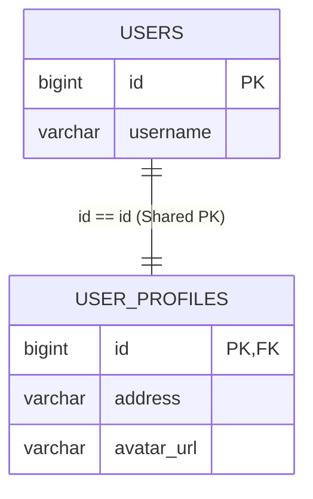
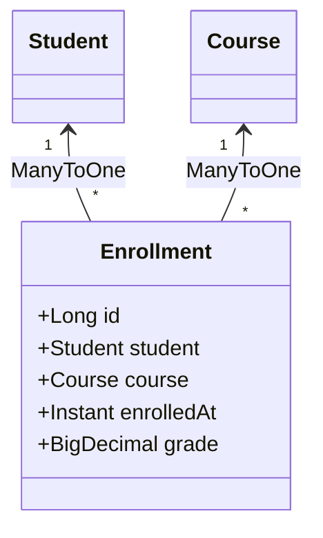

# 🔗 Quan hệ bảng trong JPA: @OneToOne, @OneToMany, @ManyToOne & @ManyToMany

> **Nguồn chính thống:** [Jakarta Persistence 3.2 Specification](https://jakarta.ee/specifications/persistence/3.2/) | [Hibernate ORM 7.x User Guide — Associations](https://hibernate.org/orm/documentation/) | [Spring Data JPA Reference](https://docs.spring.io/spring-data/jpa/reference/index.html)
>
> **Thuộc roadmap:** `5. Database → Spring Data → Spring Data JPA → Entity Mapping & Relationships → Relationship Mappings (@OneToOne, @OneToMany, @ManyToOne, @ManyToMany)`

---

## 1. Khái niệm Cốt lõi: Owning Side vs Inverse Side (`mappedBy`)

Khác với CSDL quan hệ (nơi quan hệ chỉ là một cột Khóa ngoại - Foreign Key nằm ở một bảng), trong thế giới Hướng đối tượng của Java, một quan hệ có thể được điều hướng theo cả hai chiều (Bidirectional).

Để giải quyết sự bất đối xứng này, JPA đưa ra quy tắc **Owning Side** và **Inverse Side**:

```mermaid
classDiagram
    class Order {
        +Long id
        +List~OrderItem~ items
    }
    class OrderItem {
        +Long id
        +Order order
    }

    Order "1" --> "*" OrderItem : Inverse Side (mappedBy = "order")
    OrderItem "*" --> "1" Order : Owning Side (@JoinColumn: order_id)
```

| Khái niệm | Vị trí khai báo | Đặc điểm nhận dạng | Trách nhiệm đối với CSDL |
| :--- | :--- | :--- | :--- |
| **Owning Side (Bên sở hữu)** ⭐ | Thường ở bên nhiều (`@ManyToOne`) hoặc bên giữ Khóa ngoại. | Có annotation **`@JoinColumn`**. | **Chỉ có bên này mới có quyền cập nhật giá trị cột Khóa ngoại (Foreign Key)** xuống CSDL! |
| **Inverse Side (Bên nghịch đảo)** | Thường ở bên một (`@OneToMany`). | Có thuộc tính **`mappedBy = "tên_field_bên_owning"`**. | Chỉ mang tính chất đọc (Read-only mapping) để phục vụ duyệt đối tượng trong Java. **Mọi thay đổi trên collection của bên này hoàn toàn bị Hibernate lờ đi** nếu bên Owning Side không được set! |

---

## 2. Quan hệ `@ManyToOne` & `@OneToMany` (Quan hệ Vua trong JPA)

Đây là mối quan hệ phổ biến nhất trong mọi hệ thống backend (Ví dụ: Một `Category` có nhiều `Product`, một `Order` có nhiều `OrderItem`).

### 2.1 Cạm bẫy `@OneToMany` một chiều (Unidirectional) ❌
Nhiều lập trình viên chỉ khai báo `@OneToMany` ở phía Cha mà không khai báo `@ManyToOne` ở phía Con:

```java
// ❌ CẠM BẪY HIỆU NĂNG:
@Entity
public class Category {
    @Id @GeneratedValue
    private Long id;

    @OneToMany // Không có mappedBy, không có @ManyToOne ở Product
    @JoinColumn(name = "category_id") // Ngay cả khi có dòng này
    private List<Product> products = new ArrayList<>();
}
```

> **Hậu quả kinh hoàng của Hibernate:**
> Khi bạn thêm một `Product` vào `category.getProducts().add(product)`:
> 1. Hibernate chạy lệnh `INSERT INTO products ...` (với `category_id = NULL`).
> 2. Sau đó, Hibernate chạy thêm một lệnh `UPDATE products SET category_id = ? WHERE id = ?`!
> 3. Tốn gấp đôi số lượng câu lệnh SQL và làm phân mảnh index!

---

### 2.2 Chuẩn mực: Quan hệ hai chiều (Bidirectional) & Defensive Helper Methods ✅

Quy tắc bất biến: Luôn triển khai quan hệ 2 chiều và **bắt buộc viết các hàm Helper Method** để đồng bộ cả 2 chiều trong bộ nhớ RAM:

```java
// Phía Con (Owning Side): Giữ Khóa ngoại thực tế
@Entity
@Table(name = "order_items")
@Getter @Setter
@NoArgsConstructor
public class OrderItem {
    @Id
    @GeneratedValue(strategy = GenerationType.IDENTITY)
    private Long id;

    @ManyToOne(fetch = FetchType.LAZY, optional = false)
    @JoinColumn(name = "order_id", nullable = false) // Khóa ngoại trong CSDL
    private Order order;

    private String productName;
    private BigDecimal price;
    private int quantity;
}
```

```java
// Phía Cha (Inverse Side): Ánh xạ qua mappedBy
@Entity
@Table(name = "orders")
@Getter @Setter
@NoArgsConstructor
public class Order {
    @Id
    @GeneratedValue(strategy = GenerationType.IDENTITY)
    private Long id;

    private String orderCode;

    // mappedBy trỏ chính xác đến tên thuộc tính 'order' bên OrderItem
    @OneToMany(mappedBy = "order", cascade = CascadeType.ALL, orphanRemoval = true)
    private List<OrderItem> items = new ArrayList<>();

    // ⭐ HELPER METHODS: Đảm bảo tính toàn vẹn 2 chiều trong bộ nhớ RAM
    public void addOrderItem(OrderItem item) {
        items.add(item);
        item.setOrder(this); // Thiết lập Owning Side để Hibernate lưu FK xuống DB!
    }

    public void removeOrderItem(OrderItem item) {
        items.remove(item);
        item.setOrder(null);
    }
}
```

---

## 3. Quan hệ `@OneToOne`

Quan hệ 1 - 1 xảy ra khi mỗi bản ghi ở bảng A liên kết duy nhất với một bản ghi ở bảng B (Ví dụ: `User` và `UserProfile`).

JPA có 2 cách thiết kế:

### Cách 1: Sử dụng Khóa ngoại thông thường (`@JoinColumn`)
Tạo thêm một cột `profile_id` độc lập ở bảng `users`. Cách này tốn thêm dung lượng và tốn 1 chỉ mục Index cho khóa ngoại.

---

### Cách 2: Chia sẻ chung Khóa chính với `@MapsId` ⭐ (Chuẩn Enterprise Khuyên dùng)
Bảng `user_profiles` không sinh ID riêng mà lấy **chính ID của bảng `users` làm vừa là Primary Key vừa là Foreign Key**!



```java
@Entity
@Table(name = "user_profiles")
@Getter @Setter
@NoArgsConstructor
public class UserProfile {

    @Id
    private Long id; // Không có @GeneratedValue! ID này lấy từ User

    @OneToOne(fetch = FetchType.LAZY)
    @MapsId // Sao chép ID của User vào làm ID của chính mình
    @JoinColumn(name = "id")
    private User user;

    private String bio;
    private String avatarUrl;
}
```

> [!WARNING]
> ### Cạm bẫy Senior của `@OneToOne`: Khi nào LAZY biến thành EAGER?
> Nếu bạn đặt `@OneToOne(fetch = FetchType.LAZY, mappedBy = "profile")` ở phía **Inverse Side (Class User)**:
> - Hibernate **BẮT BUỘC PHẢI CHẠY SQL SELECT NGAY LẬP TỨC** (Biến thành EAGER)!
> - **Lý do:** Java yêu cầu biến `user.getProfile()` phải trả về `null` nếu không có profile, hoặc trả về một Proxy nếu có. Nhưng ở bảng `users`, không có cột nào cho biết profile có tồn tại hay không. Do đó, Hibernate bắt buộc phải gửi câu lệnh SELECT sang bảng `user_profiles` để kiểm tra sự tồn tại!
> - **Quy tắc:** Chỉ có bên **Owning Side** mới có thể thực sự Lazy load trong `@OneToOne`.

---

## 4. Quan hệ `@ManyToMany` (Tại sao là Anti-Pattern trên Production?)

Trong sách giáo khoa, quan hệ nhiều-nhiều thường được viết đơn giản như sau:

```java
// ❌ CÁCH VIẾT SÁCH GIÁO KHOA - ANTI-PATTERN TRÊN PRODUCTION:
@Entity
public class Student {
    @ManyToMany
    @JoinTable(
        name = "enrollments",
        joinColumns = @JoinColumn(name = "student_id"),
        inverseJoinColumns = @JoinColumn(name = "course_id")
    )
    private Set<Course> courses = new HashSet<>();
}
```

### Tại sao `@ManyToMany` thuần túy bị cấm trong các dự án thực tế?
1. **Không thể thêm thuộc tính nghiệp vụ:** Trong thực tế, việc một sinh viên đăng ký một khóa học luôn đi kèm các thông tin quan trọng: `enrolled_at` (ngày đăng ký), `grade` (điểm số), `status` (đang học/đã đỗ), `payment_status`. Với `@ManyToMany` thuần túy, bạn **hoàn toàn không có cách nào thêm các cột này vào bảng trung gian**!
2. **Hiệu năng xóa kém:** Khi xóa một phần tử trong danh sách `@ManyToMany` dùng `List`, Hibernate có thể xóa sạch toàn bộ các dòng của sinh viên đó trong bảng trung gian rồi insert lại!

---

### Giải pháp Senior: Tách `@ManyToMany` thành Entity Trung gian độc lập

Ta chuyển hóa quan hệ N - N thành **hai quan hệ 1 - N** thông qua Entity trung gian `Enrollment`:



```java
@Entity
@Table(name = "enrollments")
@Getter @Setter
@NoArgsConstructor
public class Enrollment {

    @Id
    @GeneratedValue(strategy = GenerationType.SEQUENCE, generator = "enrollment_seq")
    private Long id;

    @ManyToOne(fetch = FetchType.LAZY, optional = false)
    @JoinColumn(name = "student_id", nullable = false)
    private Student student;

    @ManyToOne(fetch = FetchType.LAZY, optional = false)
    @JoinColumn(name = "course_id", nullable = false)
    private Course course;

    @Column(nullable = false, updatable = false)
    private Instant enrolledAt = Instant.now();

    private BigDecimal finalGrade;

    public Enrollment(Student student, Course course) {
        this.student = student;
        this.course = course;
    }
}
```

---

## 5. Bảng so sánh tổng hợp 4 loại quan hệ

| Mối quan hệ | Khuyến nghị sử dụng | FetchType mặc định | FetchType bắt buộc đặt lại | Vị trí Owning Side |
| :--- | :---: | :---: | :---: | :--- |
| **`@ManyToOne`** | ⭐⭐⭐ **Dùng nhiều nhất** | `EAGER` ⚠️ | **`LAZY`** (Bắt buộc!) | Luôn nằm ở bảng Con (chứa Foreign Key). |
| **`@OneToMany`** | ⭐⭐⭐ **Dùng cùng @ManyToOne** | `LAZY` ✅ | `LAZY` | Phía nghịch đảo (`mappedBy`). |
| **`@OneToOne`** | ⭐ **Cân nhắc kỹ** | `EAGER` ⚠️ | **`LAZY`** (Chỉ hoạt động ở Owning Side) | Phía có `@JoinColumn` hoặc `@MapsId`. |
| **`@ManyToMany`** | ❌ **Anti-pattern** | `LAZY` ✅ | Nên thay bằng Entity trung gian | Bảng trung gian `@JoinTable`. |

---

## 🔥 Ứng dụng thực tế (Thực tế dùng để làm gì? Giải quyết vấn đề gì?)

1. **Ngăn chặn triệt để hiện tượng INSERT/UPDATE thừa:** Việc hiểu rõ Owning Side và viết các hàm helper method giúp hệ thống chỉ chạy đúng 1 câu lệnh SQL INSERT cho mỗi bản ghi con, giảm 50% số lượng truy vấn tới cơ sở dữ liệu.
2. **Khả năng mở rộng nghiệp vụ trong tương lai:** Thay thế `@ManyToMany` bằng Entity trung gian ngay từ đầu giúp dự án dễ dàng bổ sung các trường dữ liệu như thời gian tạo, người phê duyệt, lịch sử thanh toán mà không cần phải đập đi xây lại cấu trúc bảng.
3. **Tiết kiệm bộ nhớ và chỉ mục với Shared Primary Key:** Kỹ thuật `@MapsId` trong quan hệ 1-1 giúp các bảng thông tin mở rộng (như `UserProfile`, `OrderInvoice`) dùng chung ID với bảng chính, loại bỏ nhu cầu duy trì chỉ mục FK riêng biệt.

---

## 6. Tổng hợp các chủ đề (Bản đồ tra cứu)

### 🟢 Ưu tiên phải biết trước (Bắt buộc)
- Phân biệt Owning Side (`@JoinColumn`) và Inverse Side (`mappedBy`).
- Cấu hình chuẩn cho quan hệ 2 chiều `@OneToMany` & `@ManyToOne`.
- Bắt buộc phải chuyển `FetchType` của `@ManyToOne` từ mặc định `EAGER` sang `LAZY`.
- Viết các hàm Helper Method (`addChild`, `removeChild`) để đồng bộ hai chiều.

### 🟡 Nhóm trung cấp
- Tại sao `@OneToMany` một chiều (Unidirectional) lại sinh ra bảng trung gian và câu UPDATE thừa.
- Kỹ thuật chia sẻ khóa chính `@MapsId` trong quan hệ `@OneToOne`.
- Lý do tại sao `@ManyToMany` thuần túy là Anti-pattern và cách tách thành Entity trung gian.
- Nguy cơ xóa toàn bộ danh sách khi thao tác trên `@ManyToMany` dạng `List`.

### 🔴 Nhóm nâng cao
- Bản chất tại sao `@OneToOne(mappedBy = "...")` ở phía Inverse Side không thể Lazy load (Vấn đề Bytecode Proxy và kiểm tra giá trị `null`).
- Tối ưu hóa quan hệ bảng khi xử lý High-volume dữ liệu: Tránh map các Collection khổng lồ (Unbounded Collections - ví dụ: 1 Customer có 1.000.000 đơn hàng thì KHÔNG NÊN map `@OneToMany` trong Customer, mà chỉ query từ `OrderRepository`).

---

## 📚 Tài liệu tham khảo chính thống

| Tài liệu | Link liên kết |
|---|---|
| Jakarta Persistence 3.2 — Chapter 2.10: Entity Relationships | [jakarta.ee/specifications/persistence/3.2](https://jakarta.ee/specifications/persistence/3.2/) |
| Vlad Mihalcea — The best way to map a @OneToMany relationship with JPA and Hibernate | [vladmihalcea.com/the-best-way-to-map-a-onetomany-relationship-with-jpa-and-hibernate/](https://vladmihalcea.com/the-best-way-to-map-a-onetomany-relationship-with-jpa-and-hibernate/) |
| Vlad Mihalcea — The best way to map a @OneToOne relationship with JPA and Hibernate | [vladmihalcea.com/the-best-way-to-map-a-onetoone-relationship-with-jpa-and-hibernate/](https://vladmihalcea.com/the-best-way-to-map-a-onetoone-relationship-with-jpa-and-hibernate/) |
| Vlad Mihalcea — The best way to map a many-to-many association with extra columns | [vladmihalcea.com/the-best-way-to-map-a-many-to-many-association-with-extra-columns-when-using-jpa-and-hibernate/](https://vladmihalcea.com/the-best-way-to-map-a-many-to-many-association-with-extra-columns-when-using-jpa-and-hibernate/) |

---

> **Tài liệu tiếp theo:** [Cascade Types & orphanRemoval.md](file:///d:/WebSpace/Java-Backend/05-Database/Spring-Data/Spring-Data-JPA/Cascade%20Types%20%26%20orphanRemoval.md) — Phân biệt sự khác nhau giữa xóa lan truyền và dọn dẹp bản ghi mồ côi.
